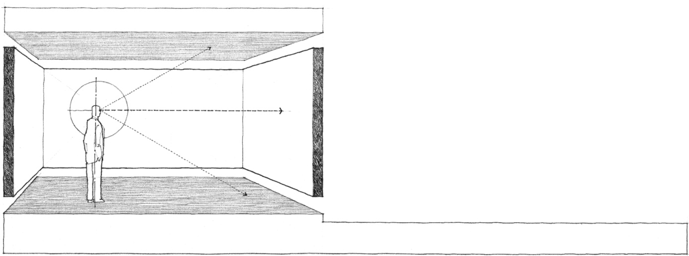
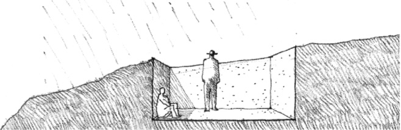
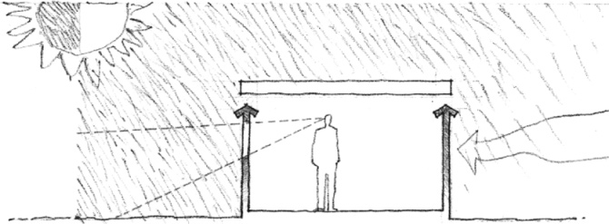
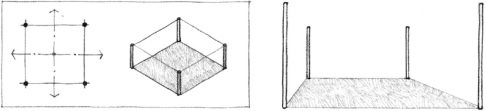
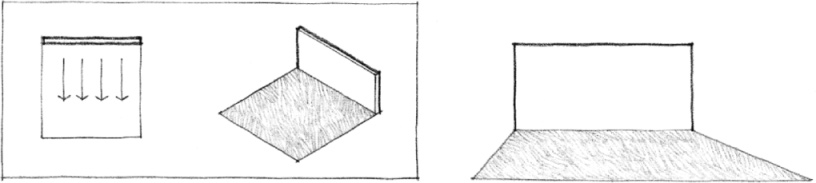
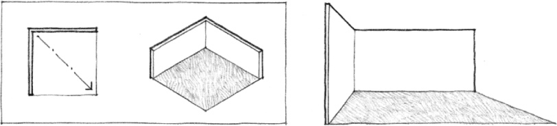
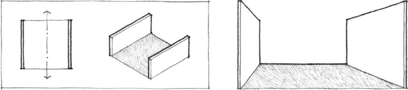
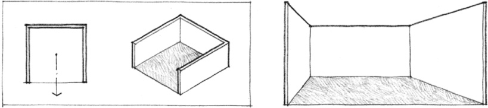
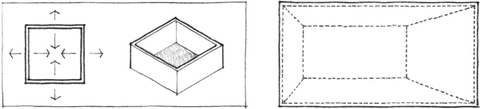

> [BREADCRUMB_CTX: 《Architecture》 > Vertical Elements Defining Space]

## VERTICAL ELEMENTS DEFINING SPACE

In the previous section of this chapter, horizontal planes defined fields of space in which the vertical boundaries were implied rather than explicitly described. The following section discusses the critical role vertical elements of form play in firmly establishing the visual limits of a spatial field.

Vertical forms have a greater presence in our visual field than horizontal planes and are therefore more instrumental in defining a discrete volume of space and providing a sense of enclosure and privacy for those within it. In addition, they serve to separate one space from another and establish a common boundary between the interior and exterior environments.

Vertical elements of form also play important roles in the construction of architectural forms and spaces. They serve as structural supports for floor and roof planes. They provide shelter and protection from the climatic elements and aid in controlling the flow of air, heat, and sound into and through the interior spaces of a building.

### Vertical Linear Elements

Vertical linear elements define the perpendicular edges of a volume of space.

### Single Vertical Plane

A single vertical plane articulates the space on which it fronts.

### L-shaped Plane

An L-shaped configuration of vertical planes generates a field of space from its corner outward along a diagonal axis.

### Parallel Planes

Two parallel vertical planes define a volume of space between them that is oriented axially toward both open ends of the configuration.

### U-shaped Plane

A U-shaped configuration of vertical planes defines a volume of space that is oriented primarily toward the open end of the configuration.

### Four Planes: Closure

Four vertical planes establish the boundaries of an introverted space and influence the field of space around the enclosure.

