> [BREADCRUMB_CTX: 《Architecture》 > Vertical Linear Elements]

## VERTICAL LINEAR ELEMENTS

A vertical linear element, such as a column, obelisk, or tower, establishes a point on the ground plane and makes it visible in space. Standing upright and alone, a slender linear element is nondirectional except for the path that would lead us to its position in space. Any number of horizontal axes can be made to pass through it.

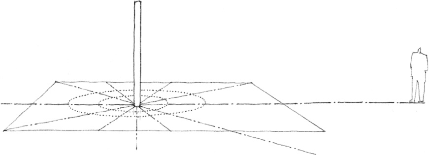

When located within a defined volume of space, a column will generate a spatial field about itself and interact with the spatial enclosure. A column attached to a wall buttresses the plane and articulates its surface. At the corner of a space, a column punctuates the meeting of two wall planes. Standing free within a space, a column defines zones of space within the enclosure.

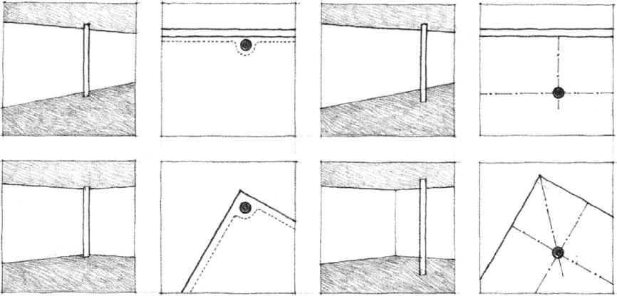

When centered in a space, a column will assert itself as the center of the field and define equivalent zones of space between itself and the surrounding wall planes. When offset, the column will define hierarchical zones of space differentiated by size, form, and location.

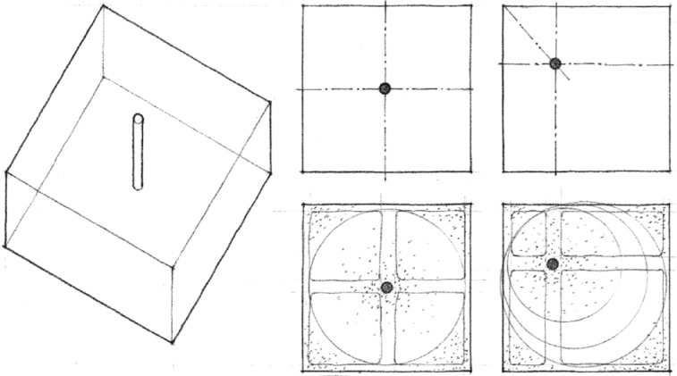

No volume of space can be established without the definition of its edges and corners. Linear elements serve this purpose in marking the limits of spaces that require visual and spatial continuity with their surroundings.

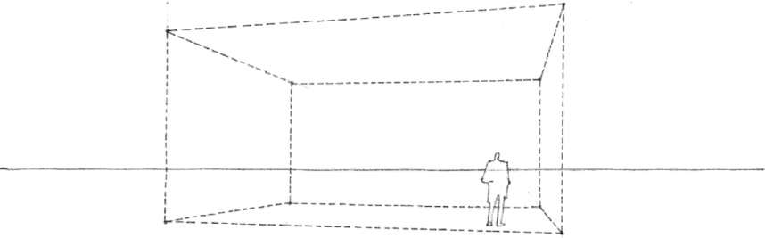

Two columns establish a transparent spatial membrane by the visual tension between their shafts. Three or more columns can be arranged to define the corners of a volume of space. This space does not require a larger spatial context for its definition, but relates freely to it.

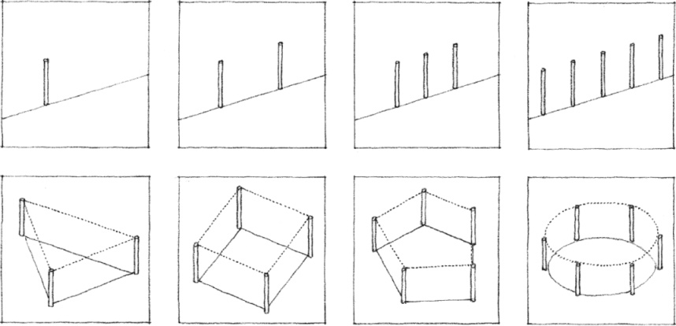

The edges of the volume of space can be visually reinforced by articulating its base plane and establishing its upper limits with beams spanning between the columns or with an overhead plane. A repetitive series of column elements along its perimeter would further strengthen the definition of the volume.

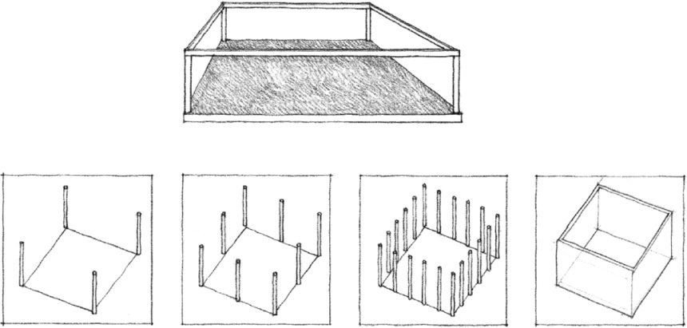
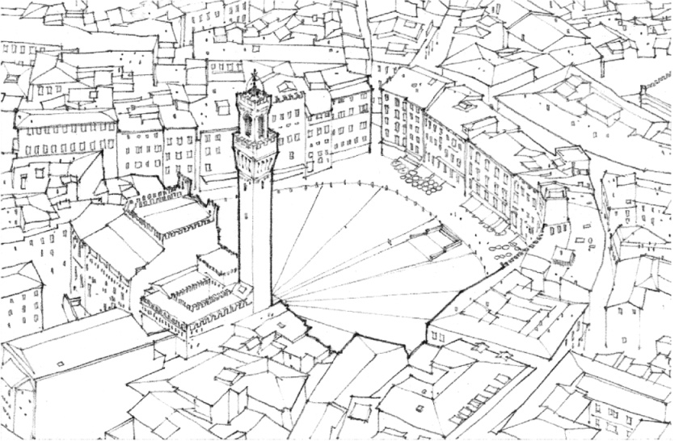

**Piazza del Campo**, Siena, Italy

Vertical linear elements can terminate an axis, mark the center of an urban space, or provide a focus for an urban space along its edge.

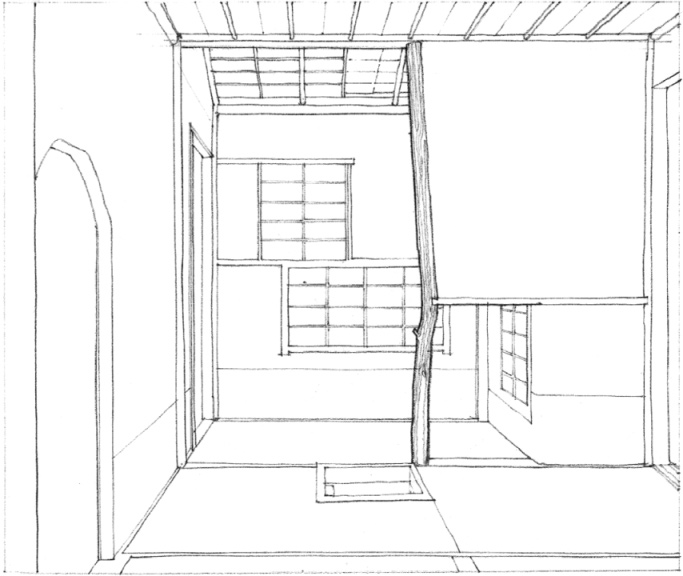

**Shokin-Tei Pavilion, Katsura Imperial Villa**, Kyoto, Japan, 17th century. In the example above, the tokobashira, often a tree trunk in natural form, is a symbolic element that marks one edge of the tokonoma in a Japanese tearoom.

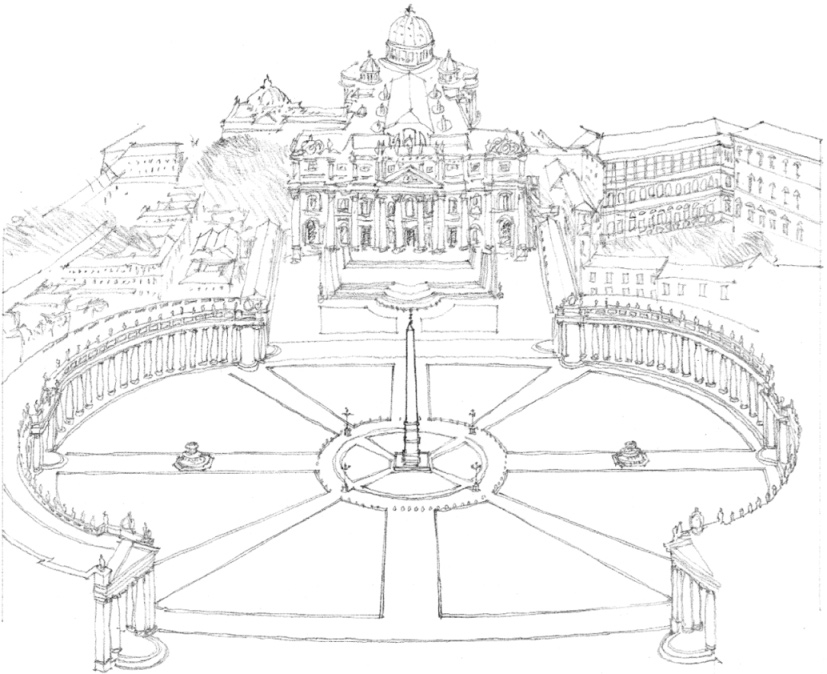

**Piazza of St. Peter**, Rome, 1655–1667, Giovanni Bernini

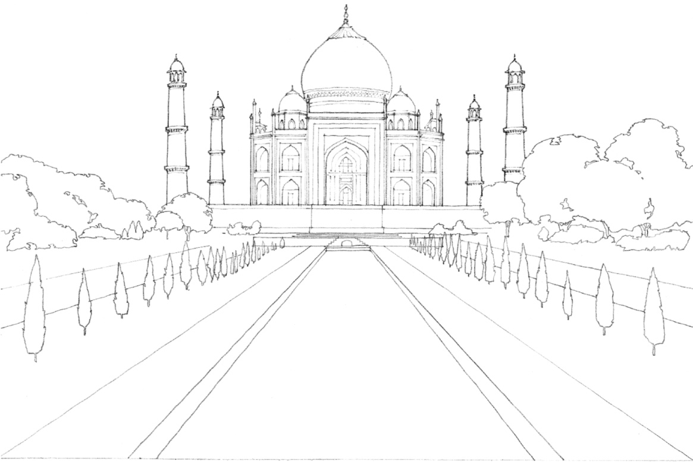

**Taj Mahal, Tomb of Muntaz Mahal**, wife of Shah Jahan, Agra, India, 1630–1653

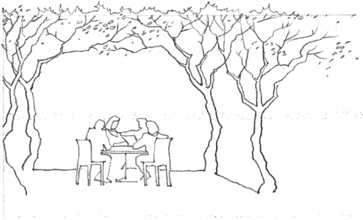

A bosket or grove of trees defining a shady place in a garden or park

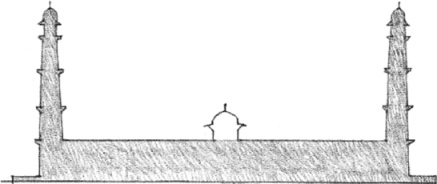

**Tomb of Jahangir**, near Lahore

In these examples, various forms of minarets mark the corners of a platform and establish a field of space—a three-dimensional framework—for the Mogul mausoleum structures.

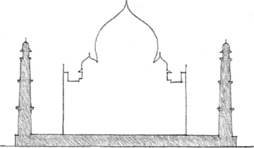

**Tomb of Muntaz Mahal**, Agra

From an analysis of Islamic Indian Architecture by Andras Volwahsen

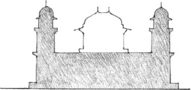

**Tomb of I’timad-ud-daula**, Agra

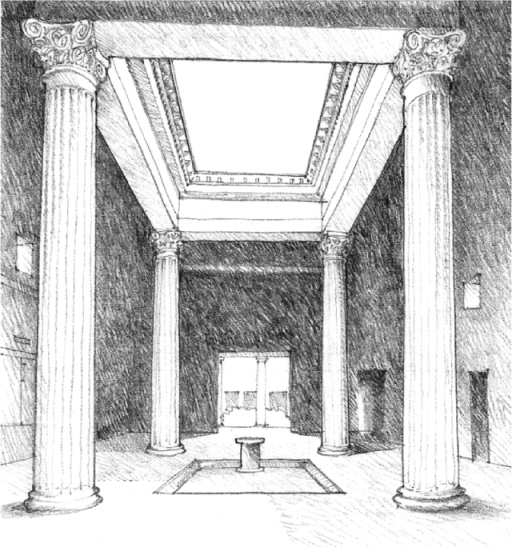

Tetrastyle atrium, **House of the Silver Wedding**, Pompeii, 2nd century B.C.

Four columns can establish the corners of a discrete volume of space within a larger room or setting. Supporting a canopy, the columns form an aedicule, a diminutive pavilion that serves as a shrine or the symbolic center of a space.

Traditional Roman houses typically were organized about an atrium open to the sky and surrounded by a roof structure supported at the corners by four columns. Vitruvius termed this a tetrastyle atrium.

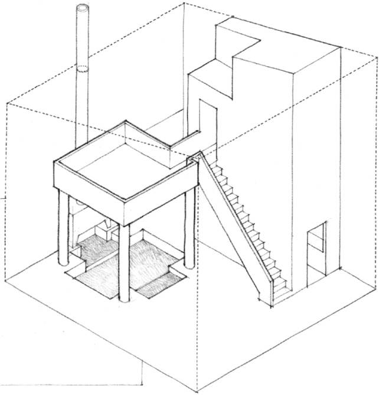
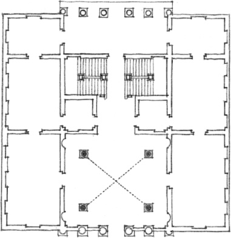

**Palazzo Antonini**, Udine, Italy, 1556, Andrea Palladio

During the Renaissance, Andrea Palladio incorporated the tetrastyle theme in the vestibules and halls of a number of villas and palazzi. The four columns not only supported the vaulted ceiling and the floor above but also adjusted the dimensions of the rooms to Palladian proportions.

In the Sea Ranch condominium units, four posts along with a sunken floor and an overhead plane define an intimate aedicular space within a larger room.

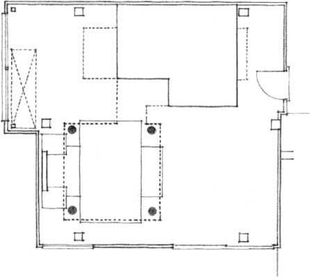

**Condominium Unit No. 5, Sea Ranch**, California, 1966, MLTW

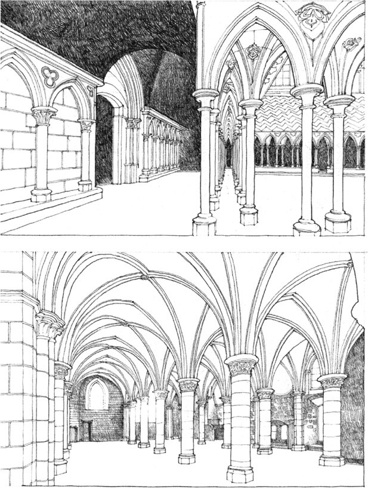

**Cloister and Salle des Chevaliers, Mont St. Michel**, France, 1203–1228

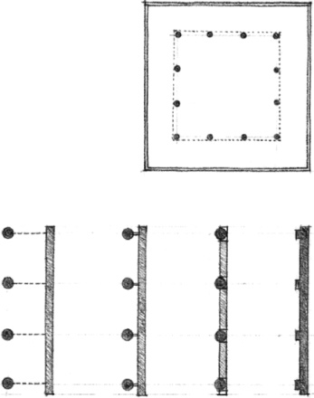

A regularly spaced series of columns or similar vertical elements form a colonnade. This archetypal element in the vocabulary of architectural design effectively defines an edge of a spatial volume while permitting visual and spatial continuity to exist between the space and its surroundings. A row of columns can also engage a wall and become a pilastrade that supports the wall, articulates its surface, and tempers the scale, rhythm, and proportioning of its bays.

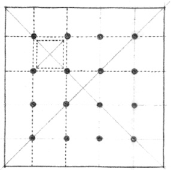

A grid of columns within a large room or hall not only serves to support the floor or roof plane above. The orderly rows of columns also punctuate the spatial volume, mark off modular zones within the spatial field, and establish a measurable rhythm and scale that make the spatial dimensions comprehensible.

In 1926, Le Corbusier stated what he believed to be the “Five Points of the New Architecture.” His observations were to a great extent the result of the development of reinforced concrete construction that began in the late nineteenth century. This type of construction, in particular the use of concrete columns to support floor and roof slabs, afforded new possibilities for the definition and enclosure of spaces within a building.

Concrete slabs could cantilever beyond their column supports and enable the “free facade” of the building to be “light membranes” of “screen walls and windows.” Within the building, a “free plan” was possible since the enclosure and layout of spaces were not determined or restricted by the pattern of heavy load-bearing walls. Interior spaces could be defined with non-load-bearing partitions, and their layout could respond freely to programmatic requirements.

---

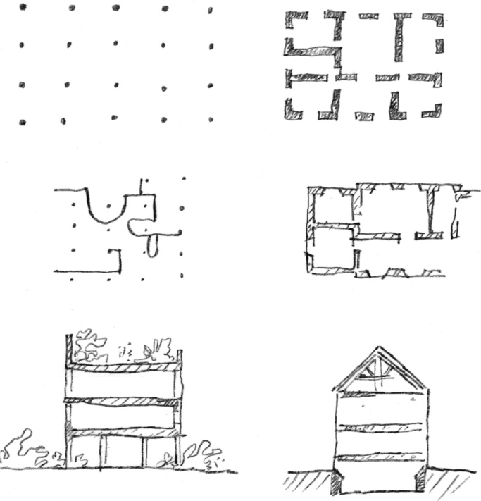

Sketches for *The Five Points of the New Architecture*, 1926, Le Corbusier

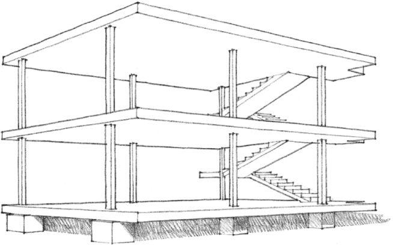

**Dom-ino House Project**, 1914, Le Corbusier

---

On the facing page, two contrasting examples of the use of a column grid are illustrated:

1. A column grid establishes a fixed, neutral field of space in which interior spaces are freely formed and distributed.
2. A grid of columns or posts corresponds closely to the layout of the interior spaces; there is a close fit between structure and space.

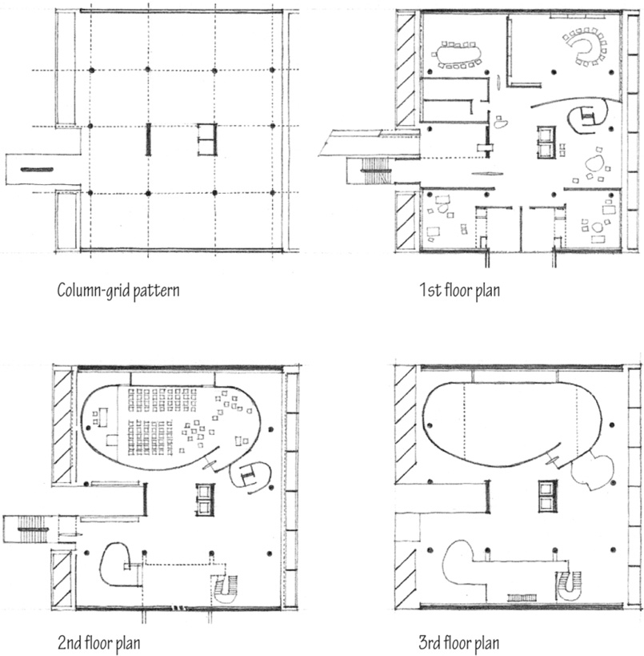

**1. Millowners’ Association Building**, Ahmedabad, India, 1954, Le Corbusier

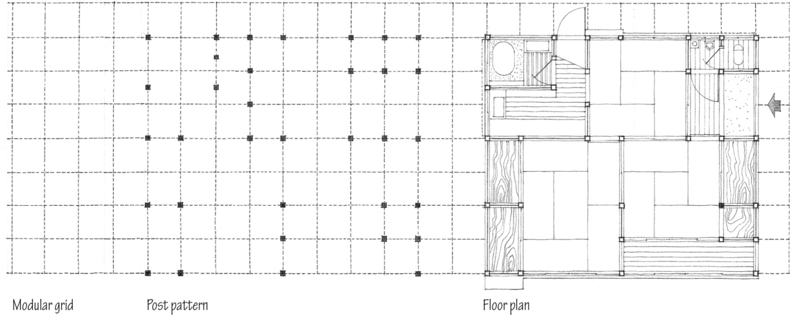

**2. Traditional Japanese Residence**