> [BREADCRUMB_CTX: 《Architecture》 > Single Vertical Plane]

## SINGLE VERTICAL PLANE

A single vertical plane, standing alone in space, has visual qualities uniquely different from those of a freestanding column. A round column has no preferred direction except for its vertical axis. A square column has two equivalent sets of faces and therefore two identical axes. A rectangular column also has two axes, but they differ in their effect. As the rectangular column becomes more like a wall, it can appear to be merely a fragment of an infinitely larger or longer plane, slicing through and dividing a volume of space.

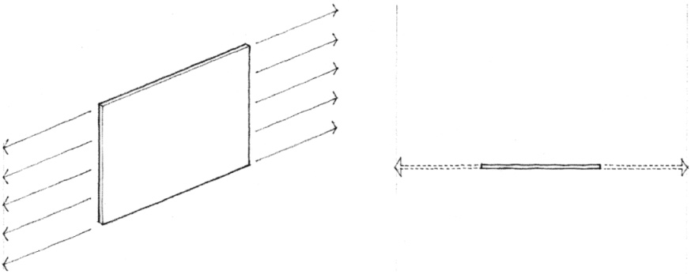

A vertical plane has frontal qualities. Its two surfaces or faces front on and establish the edges of two separate and distinct spatial fields.

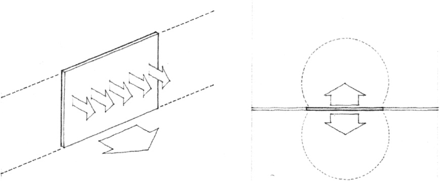

These two faces of a plane can be equivalent and front similar spaces. Or they can be differentiated in form, color, or texture, in order to respond to or articulate different spatial conditions. A vertical plane can therefore have either two fronts or a front and a back.

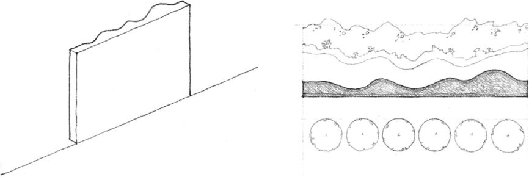

The field of space on which a single vertical plane fronts is not well-defined. The plane by itself can establish only a single edge of the field. To define a three-dimensional volume of space, the plane must interact with other elements of form.

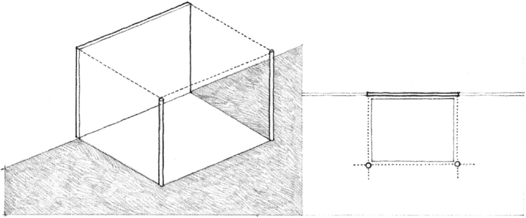

The height of a vertical plane relative to our body height and eye level is the critical factor that affects the ability of the plane to visually describe space. When 2-feet high, a plane defines the edge of a spatial field but provides little or no sense of enclosure. When waist-high, it begins to provide a sense of enclosure while allowing for visual continuity with the adjoining space. When it approaches our eye level in height, it begins to separate one space from another. Above our height, a plane interrupts the visual and spatial continuity between two fields and provides a strong sense of enclosure.

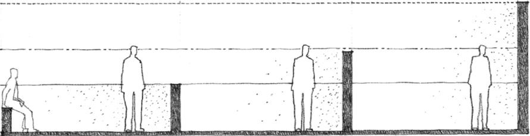

The surface color, texture, and pattern of a plane affect our perception of its visual weight, scale, and proportion.

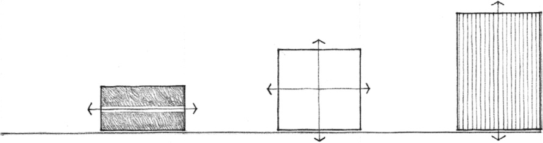

When related to a defined volume of space, a vertical plane can be the primary face of the space and give it a specific orientation. It can front the space and define a plane of entry into it. It can be a freestanding element within a space and divide the volume into two separate but related areas.

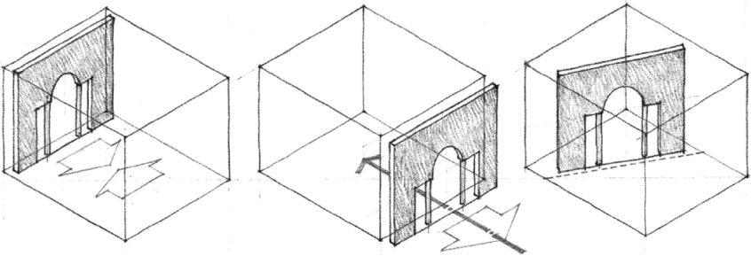
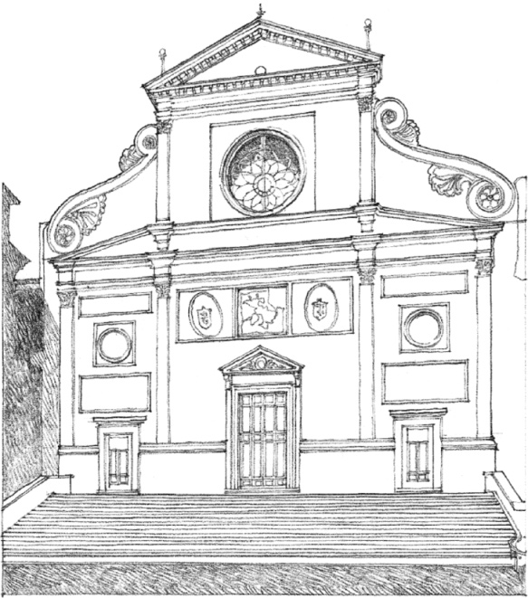

**St. Agostino**, Rome, 1479–1483, Giacomo da Pietrasanta

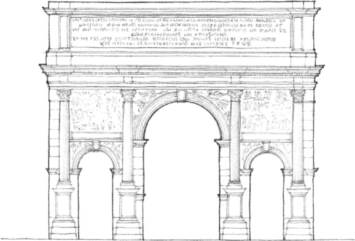

**Arch of Septimius Severus**, Rome, A.D. 203

A single vertical plane can define the principal facade of a building fronting a public space, establish a gateway through which one passes, as well as articulate spatial zones within a larger volume.

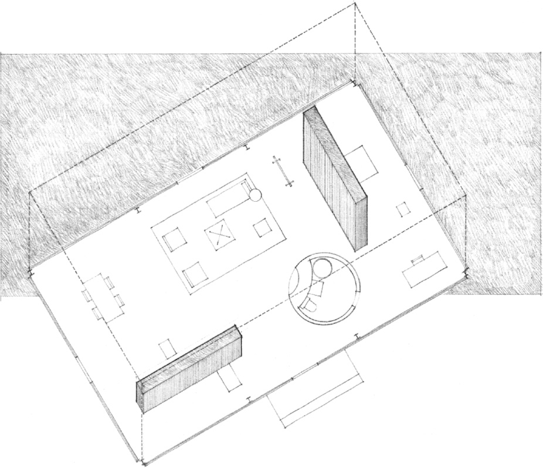

**Glass House**, New Canaan, Connecticut, 1949, Philip Johnson

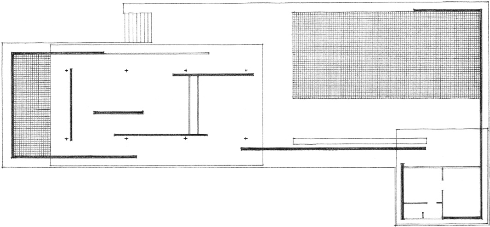

**German Pavilion (Barcelona Pavilion)** at the International Exposition of 1929, Barcelona, Mies van der Rohe

A composition of vertical planes cuts the continuous field of the architectural volume, creating an open plan of spaces that merge with one another. The partitions never form closed, geometrically static areas.

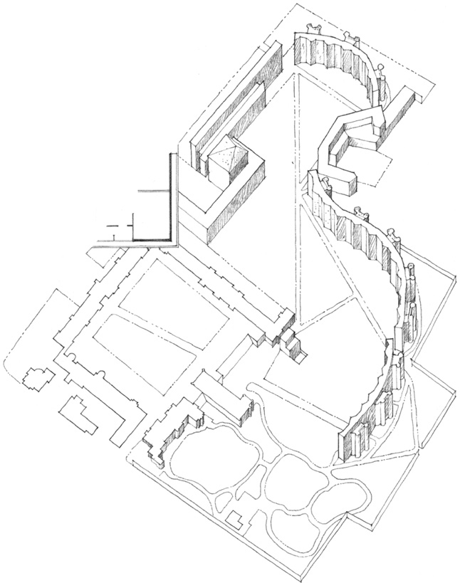

“A Garden-Wall Building”  
**Student Apartments, Selwyn College** (Project), Cambridge, England, 1959, James Stirling and James Gowan