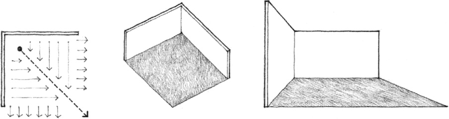
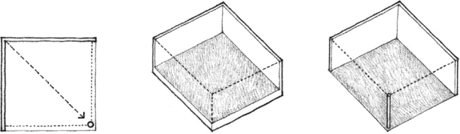
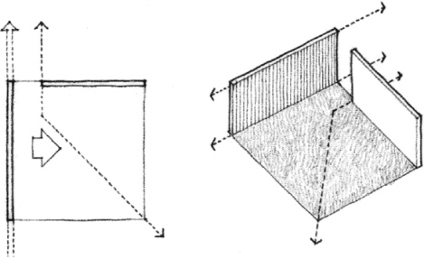
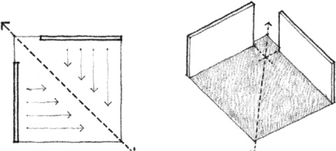

> [BREADCRUMB_CTX: 《Architecture》 > L-Shaped Configuration of Planes]

## L-SHAPED CONFIGURATION OF PLANES

An L-shaped configuration of vertical planes defines a field of space along a diagonal from its corner outward. While this field is strongly defined and enclosed at the corner of the configuration, it dissipates rapidly as it moves away from the corner. The introverted field at the interior corner becomes extroverted along its outer edges.

While two edges of the field are clearly defined by the two planes of the configuration, its other edges remain ambiguous unless further articulated by additional vertical elements, manipulations of the base plane, or an overhead plane.

If a void is introduced to one side of the corner of the configuration, the definition of the field will be weakened. The two planes will be isolated from each other and one will appear to slide by and visually dominate the other.

If neither plane extends to the corner, the field will become more dynamic and organize itself along the diagonal of the configuration.

