> [BREADCRUMB_CTX: 《Architecture》 > L-Shaped Planes]

## L-SHAPED PLANES

A building form can have an L-shaped configuration and be subject to the following readings. One of the arms of the configuration can be a linear form that incorporates the corner within its boundaries while the other arm is seen as an appendage to it. Or the corner can be articulated as an independent element that joins two linear forms together.

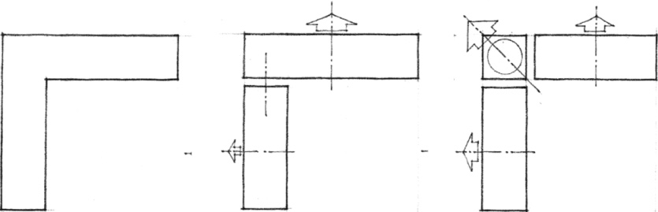

A building can have an L-shaped configuration to establish a corner of its site, enclose a field of outdoor space to which its interior spaces relate, or shelter a portion of outdoor space from undesirable conditions around it.

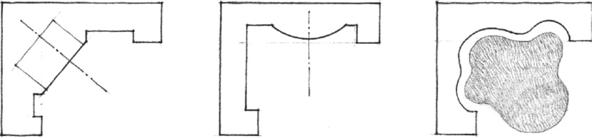

L-shaped configurations of planes are stable and self-supporting and can stand alone in space. Because they are open-ended, they are flexible space-defining elements. They can be used in combination with one another or with other elements of form to define a rich variety of spaces.

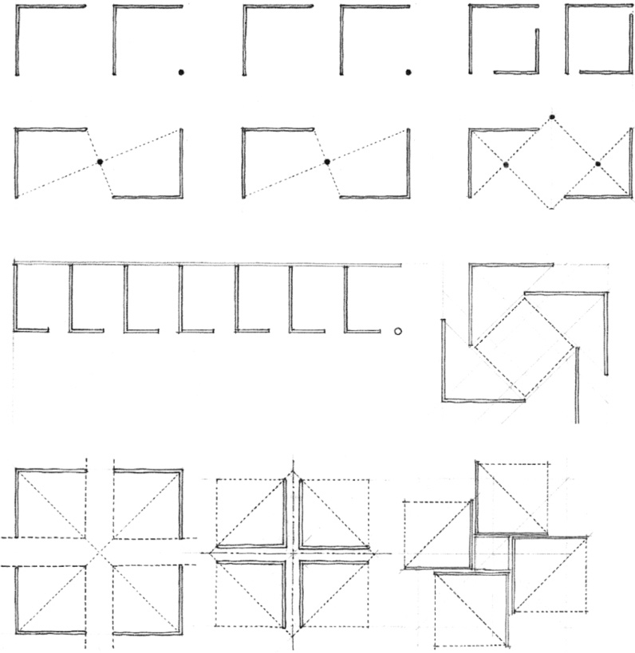
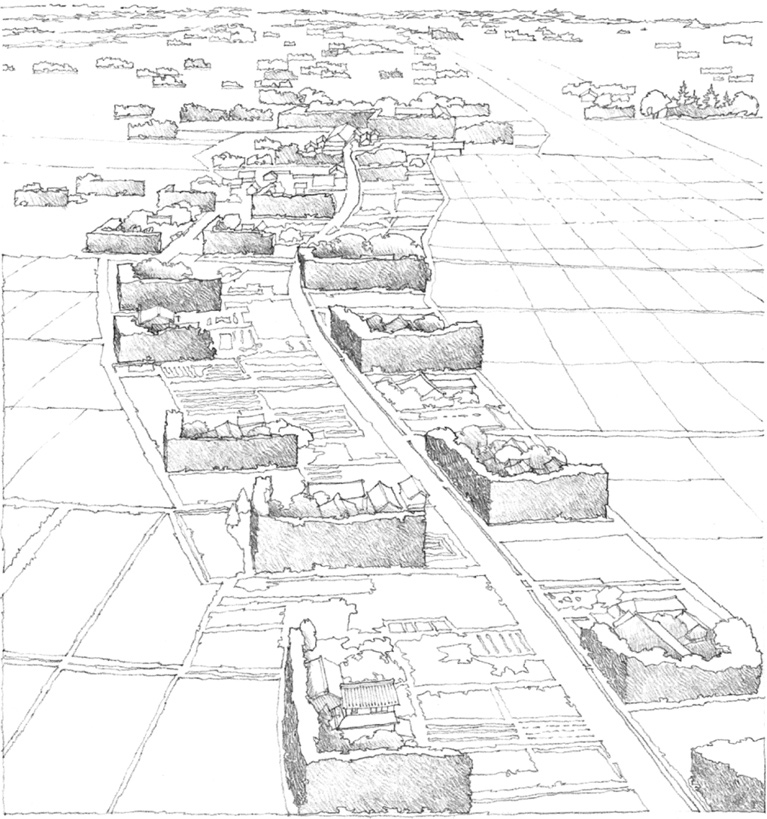

Vegetation forming L-shaped windscreens, Shimane Prefecture, Japan

The sheltering aspect of an L-shaped configuration is expressed well in this example where Japanese farmers coaxed pine trees to grow into tall, thick, L-shaped hedges to shield their houses and land from winter winds and snowstorms.

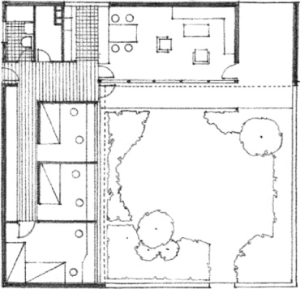

Basic Housing Unit

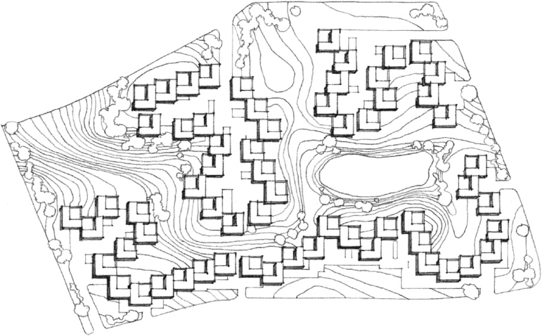

Site Plan  
**Kingo Housing Estate** near Elsinore, Denmark 1958–1963, Jørn Utzon

A common theme found in examples of residential architecture is an L-shaped configuration of rooms enclosing an outdoor living space. Typically, one wing contains the communal living spaces while the other contains private, individual spaces. The service and utility spaces usually occupy a corner position or are strung along the backside of one of the wings.

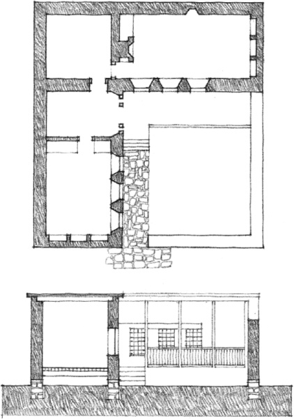

Traditional House in Konya, Turkey

The advantage of this type of layout is its provision of a private courtyard, sheltered by the building form and to which interior spaces can be directly related. In the Kingo Housing estate, a fairly high density is achieved with this type of unit, each with its own private outdoor space.

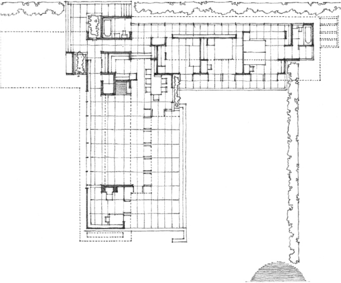

**Rosenbaum House**, Florence, Alabama, 1939, Frank Lloyd Wright

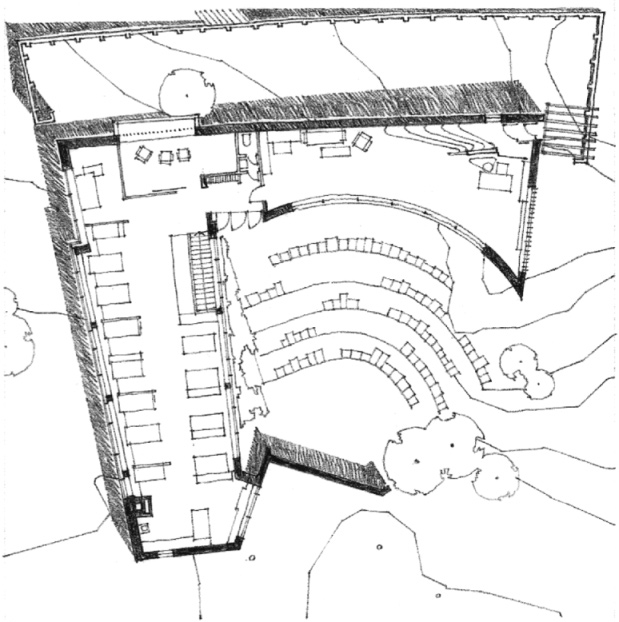

**Architect’s Studio**, Helsinki, 1955–1956, Alvar Aalto

Similar to the residential examples on the preceding page, these buildings use their L-shaped forms as sheltering or enclosing elements. The outdoor space enclosed by the architect’s studio in Helsinki is used as an amphitheater for lectures and social occasions. It is not a passive space whose form is determined by the building that encloses it. Rather, it asserts its positive form on the shape of its enclosure. The History Faculty Building at Cambridge uses a seven-story, L-shaped block to functionally and symbolically enclose a large, roof-lit library, which is the most important space in the building.

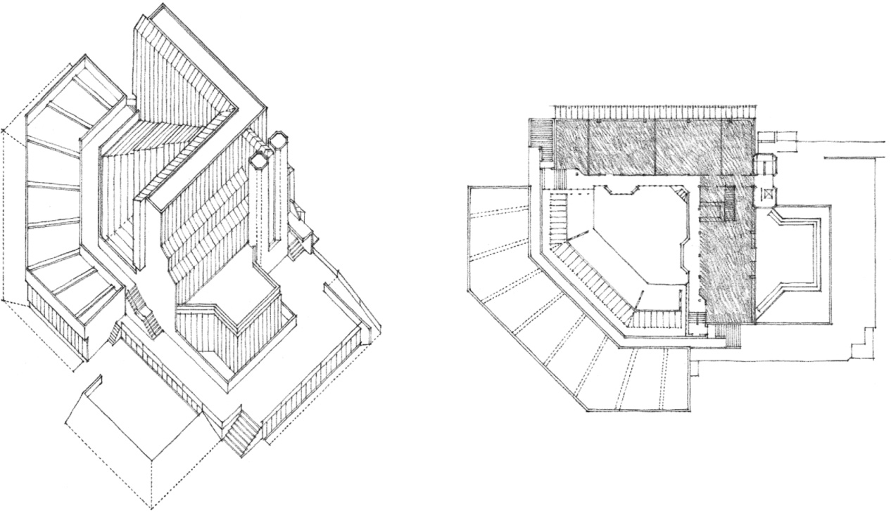

**History Faculty Building, Cambridge University**, England, 1964–1967, James Stirling

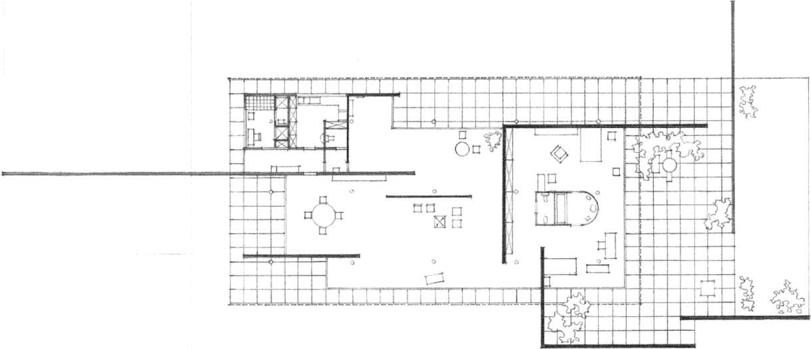

**Berlin Building Exposition House**, 1931, Mies van der Rohe

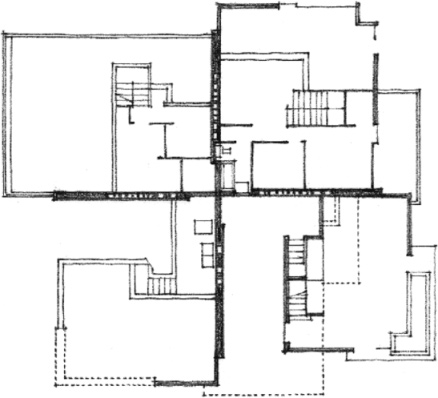

Four-family housing units, **Suntop Homes**, Ardmore, Pennsylvania, 1939, Frank Lloyd Wright

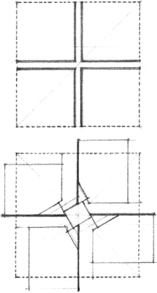

Diagram, **St. Mark’s Tower**, New York City, 1929, Frank Lloyd Wright

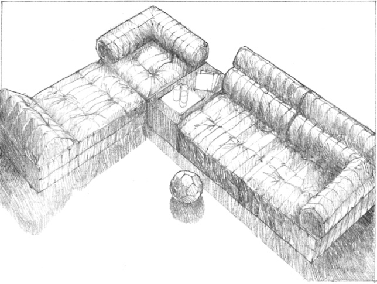

In these examples, L-shaped walls separate the units of a quadruplex housing organization and define zones within a building as well as spaces within a room.