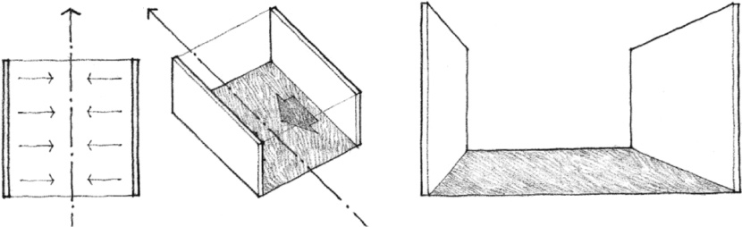
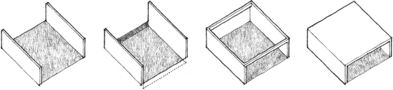
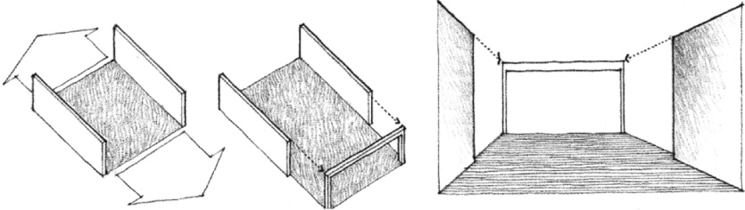
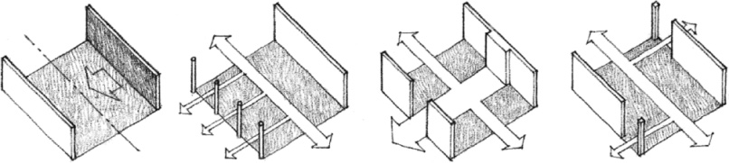

> [BREADCRUMB_CTX: 《Architecture》 > Parallel Vertical Planes]

## PARALLEL VERTICAL PLANES

A pair of parallel vertical planes defines a field of space between them. The open ends of the field, established by the vertical edges of the planes, give the space a strong directional quality. Its primary orientation is along the axis about which the planes are symmetrical. Since the parallel planes do not meet to form corners and fully enclose the field, the space is extroverted in nature.

The definition of the spatial field along the open ends of the configuration can be visually reinforced by manipulating the base plane or adding overhead elements to the composition.

The spatial field can be expanded by extending the base plane beyond the open ends of the configuration. This expanded field can, in turn, be terminated by a vertical plane whose width and height is equal to that of the field.

If one of the parallel planes is differentiated from the other by a change in form, color, or texture, a secondary axis, perpendicular to the flow of the space, will be established within the field. Openings in one or both of the planes can also introduce secondary axes to the field and modulate the directional quality of the space.

