> [BREADCRUMB_CTX: 《Architecture》 > Parallel Planes]

## PARALLEL PLANES

Various elements in architecture can be seen as parallel planes that define a field of space:

* a pair of parallel interior walls within a building
* a street space formed by the facades of two facing buildings
* a colonnaded arbor or pergola
* a promenade or allée bordered by rows of trees or hedges
* a natural topographical form in the landscape

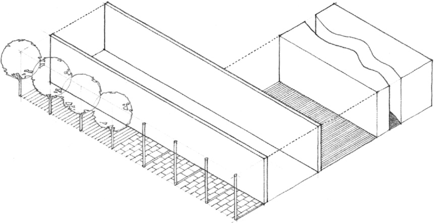

The image of parallel vertical planes is often associated with the bearing-wall structural system, wherein a floor or roof structure spans the spaces between two or more parallel load-bearing walls.

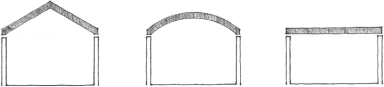

Sets of parallel vertical planes can be transformed into a wide variety of configurations. Their spatial fields can be related to one another either through the open ends of their configurations or through openings in the planes themselves.

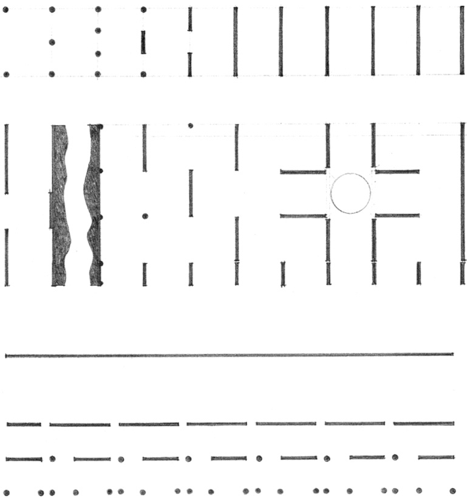
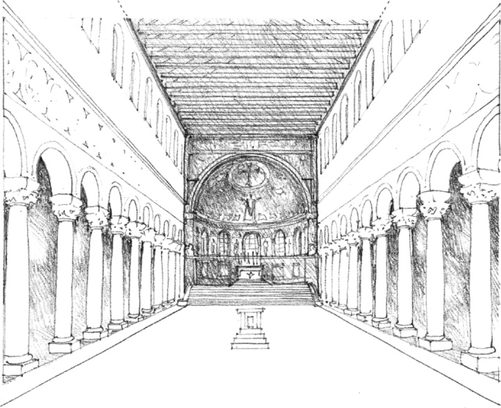

Nave of the basilican church, **St. Apollinare in Classe**, Ravenna, Italy, 534–539

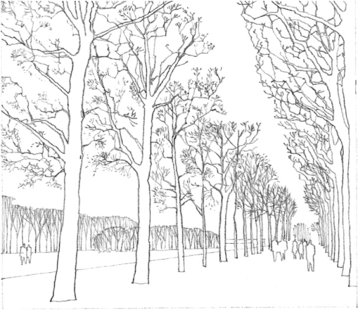

**Champ de Mars**, Paris

The directional quality and flow of the space defined by parallel planes are naturally manifested in spaces used for circulation and movement, such as the streets and boulevards of towns and cities. These linear spaces can be defined by the facades of the buildings fronting them, as well as by the more permeable planes established by colonnades, arcades, or rows of trees.

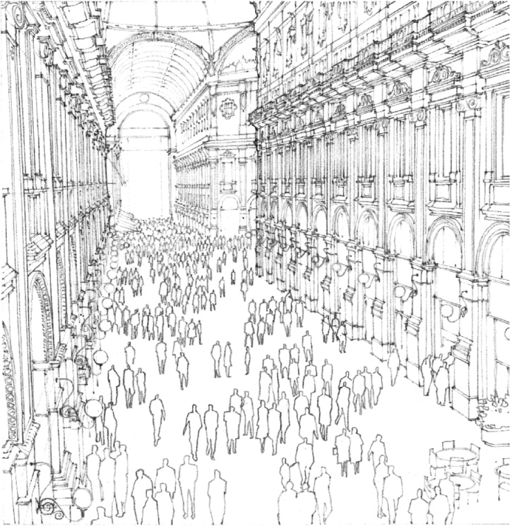

**Galleria Vittorio Emanuelle II**, Milan, Italy, 1865–1877, Giuseppe Mengoni

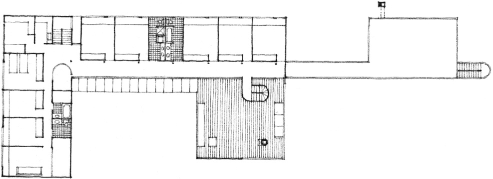

Upper level  
**House in Old Westbury**, New York, 1969–1971, Richard Meier

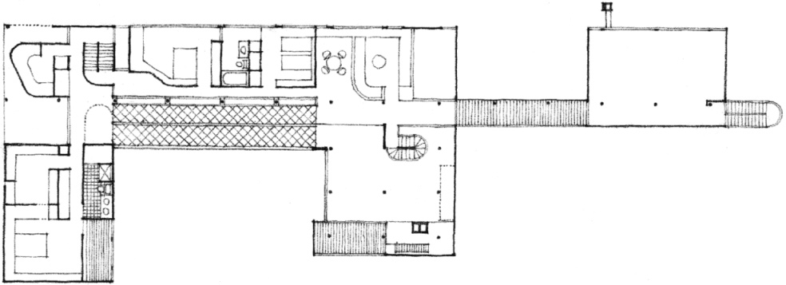

Middle level

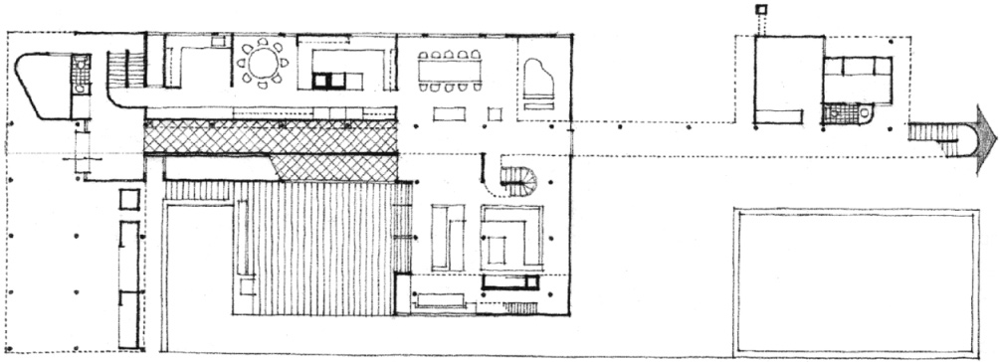

Ground level

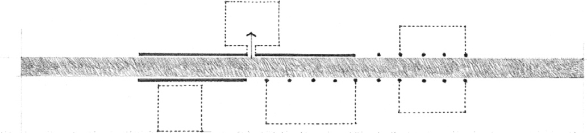

The flow of the space defined by parallel planes corresponds naturally to the paths of movement within a building, along its corridors, halls, and galleries.

The parallel planes that define a circulation space can be solid and opaque to provide privacy for the spaces along the circulation path. The planes can also be established by a row of columns so that the circulation path, open on one or both of its sides, becomes part of the spaces through which it passes.

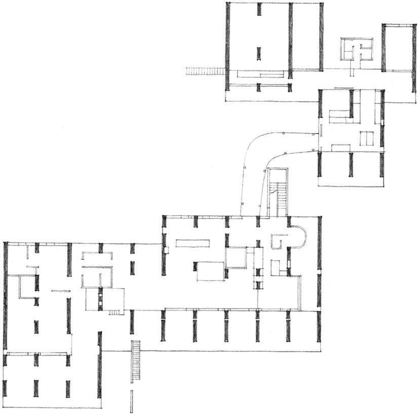

**Sarabhai House**, Ahmedabad, India, 1955, Le Corbusier

The parallel vertical planes of a bearing-wall structural system can be the generating force behind the form and organization of a building. Their repetitive pattern can be modified by varying their length or by introducing voids within the planes to accommodate the dimensional requirements of larger spaces. These voids can also define circulation paths and establish visual relationships perpendicular to the wall planes.

The slots of space defined by parallel wall planes can also be modulated by altering the spacing and configuration of the planes.

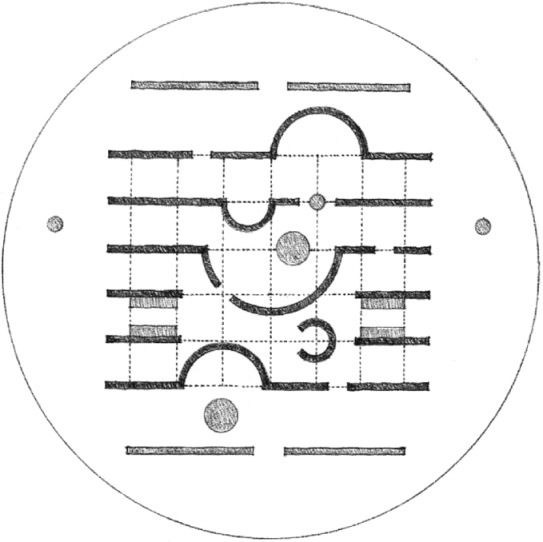

**Arnheim Pavilion**, The Netherlands, 1966, Aldo van Eyck

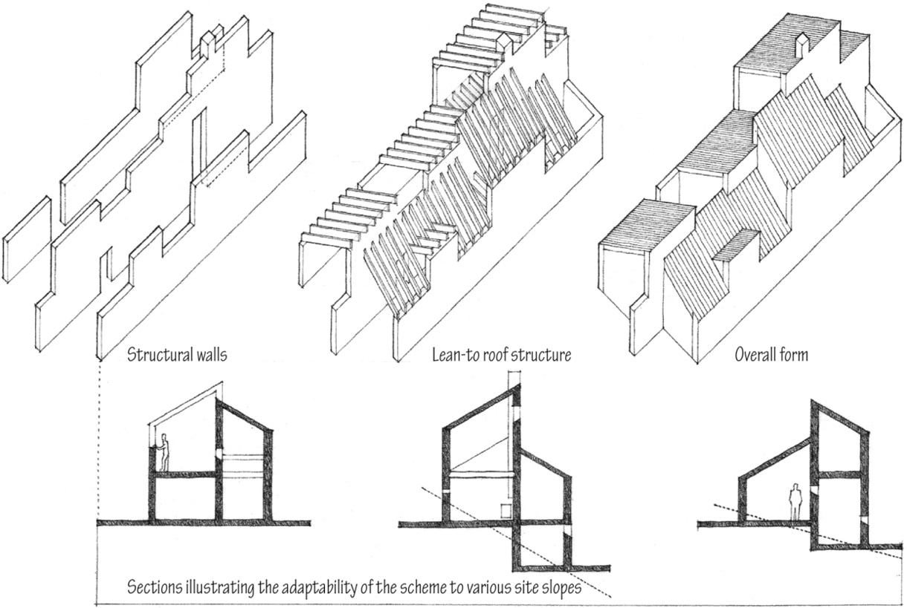

**Village Project**, 1955, James Stirling (Team X)

Parallel bearing walls are often used in multifamily housing developments. They not only provide structural support for the floors and roofs of each housing unit, but also serve to isolate the units from one another, curb the passage of sound, and check the spread of fire. The pattern of parallel bearing walls is particularly appropriate for rowhousing and townhouse schemes where each unit is provided with two orientations.

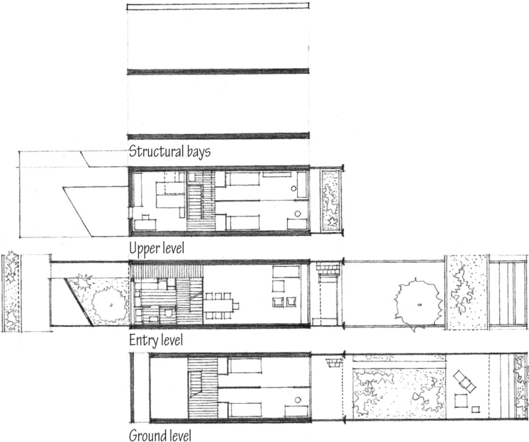

**Siedlung Halen**, near Bern, Switzerland, 1961, Atelier 5