> [BREADCRUMB_CTX: 《Architecture》 > U-Shaped Planes]

## U-SHAPED PLANES

A U-shaped configuration of vertical planes defines a field of space that has an inward focus as well as an outward orientation. At the closed end of the configuration, the field is well defined. Toward the open end of the configuration, the field becomes extroverted in nature.

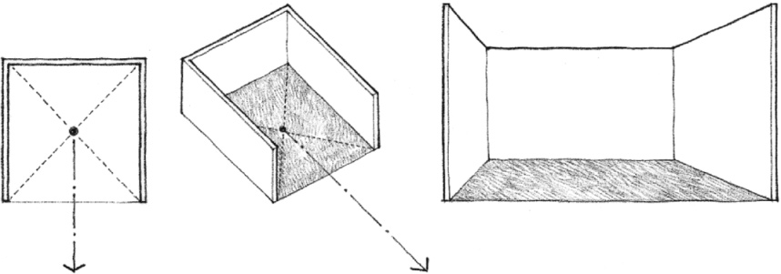

The open end is the primary aspect of the configuration by virtue of its uniqueness relative to the other three planes. It allows the field to have visual and spatial continuity with the adjoining space. The extension of the spatial field into the adjoining space can be visually reinforced by continuing the base plane beyond the open end of the configuration.

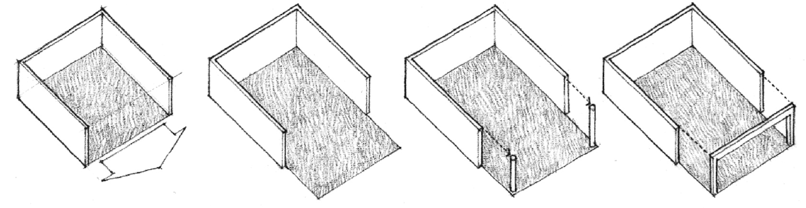

If the plane of the opening is further defined with columns or overhead elements, the definition of the original field will be reinforced and continuity with the adjoining space will be interrupted.

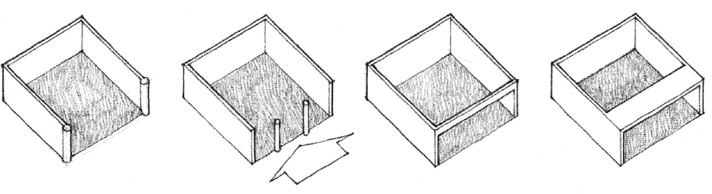

If the configuration of planes is rectangular and oblong in form, the open end can be along its narrow or wide side. In either case, the open end will remain the primary face of the spatial field, and the plane opposite the open end will be the principal element among the three planes of the configuration.

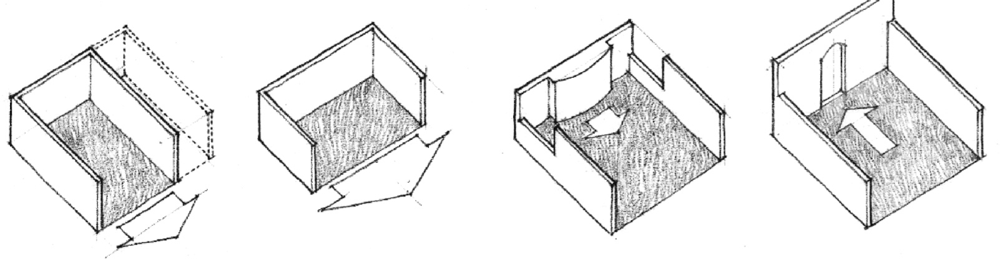

If openings are introduced at the corners of the configuration, secondary zones will be created within a multidirectional and dynamic field.

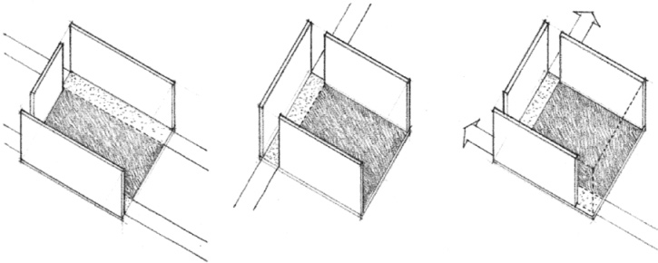

If the field is entered through the open end of the configuration, the rear plane, or a form placed in front of it, will terminate our view of the space. If the field is entered through an opening in one of the planes, the view of what lies beyond the open end will draw our attention and terminate the sequence.

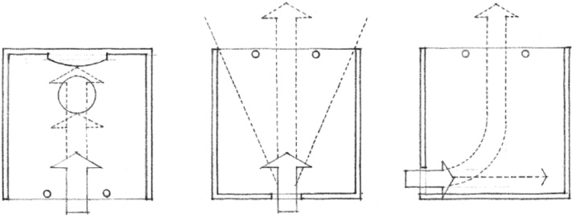

If the end of a long, narrow field is open, the space will encourage movement and induce a progression or sequence of events. If the field is square, or nearly square, the space will be static and have the character of a place to be in, rather than a space to move through. If the side of a long, narrow field is open, the space will be susceptible to a subdivision into a number of zones.

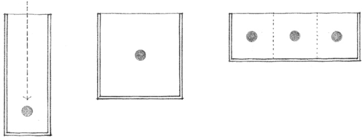

U-shaped configurations of building forms and organizations have the inherent ability to capture and define outdoor space. Their composition can be seen to consist essentially of linear forms. The corners of the configuration can be articulated as independent elements or can be incorporated into the body of the linear forms.

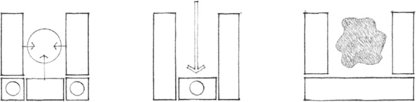
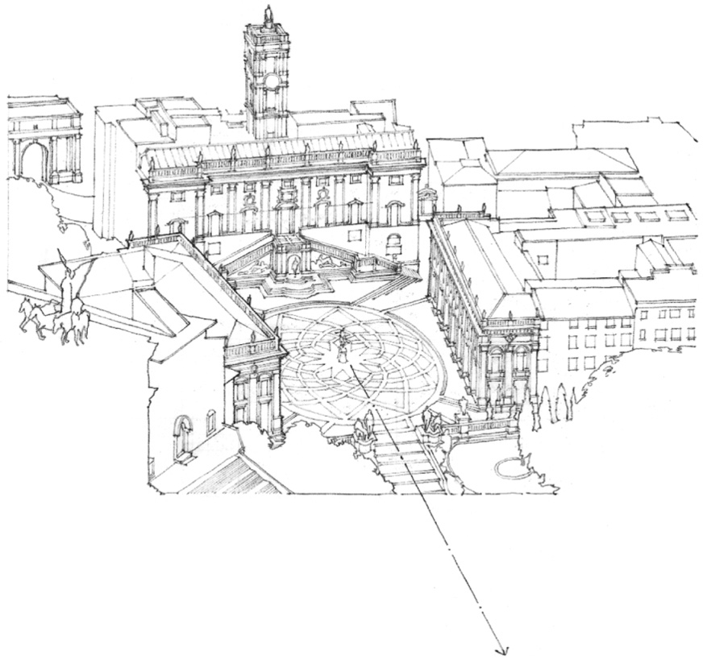

**Piazza del Campidoglio**, Rome, c. 1544, Michelangelo

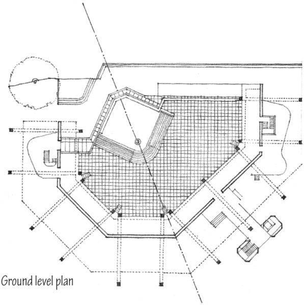

**Florey Building, Queen’s College**, Oxford, 1966–1971, James Stirling

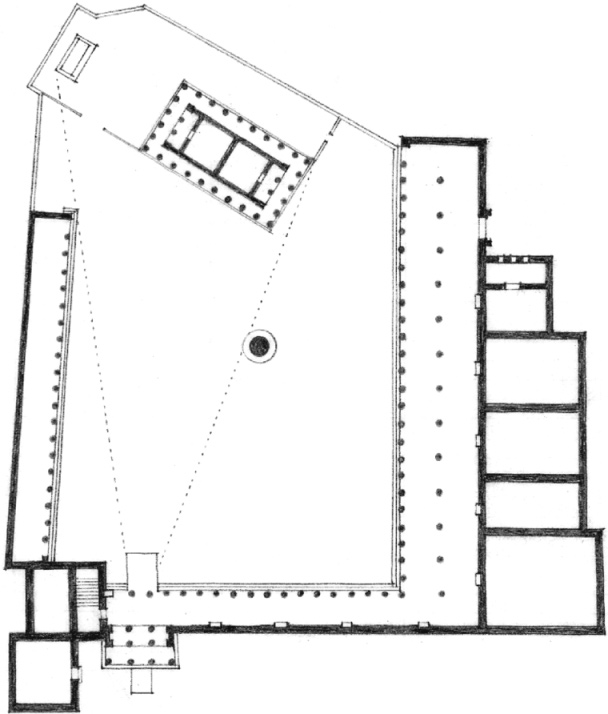

**Sacred Precinct of Athena**,Pergamon, Asia Minor, 4th century B.C.

U-shaped configurations of building forms can serve to define an urban space and terminate an axial condition. They can also focus on an important or significant element within their fields. When an element is placed along the open end of its field, it gives the field a point of focus as well as a greater sense of closure.

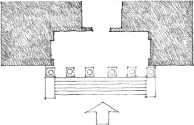

A U-shaped organization can define a forecourt for the approach to a building as well as form an entrance recessed within the building volume.

A U-shaped building form can also serve as a container and can organize within its field a cluster of forms and spaces.

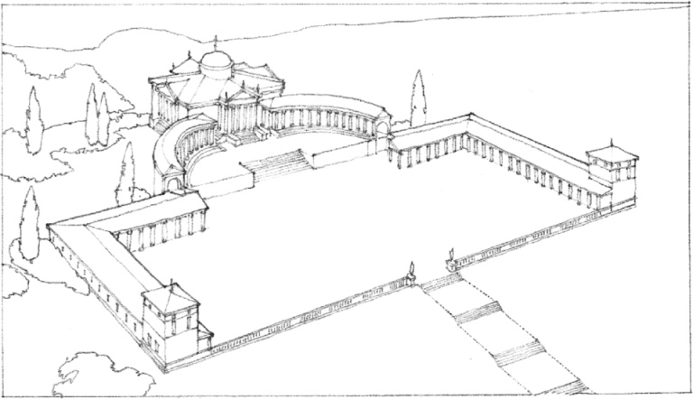

**Villa Trissino at Meledo**, From *The Four Books on Architecture*, Andrea Palladio

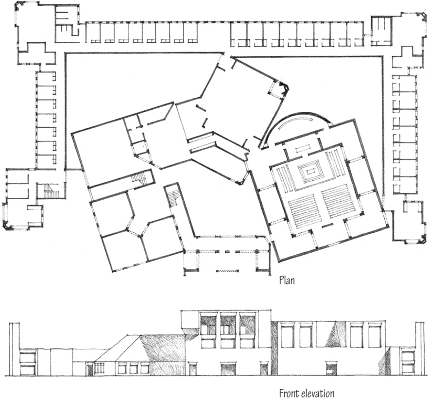

**Convent for the Dominican Sisters** (project), Media, Pennsylvania, 1965–1968, Louis Kahn. The cells form an enclave for a village of community rooms.

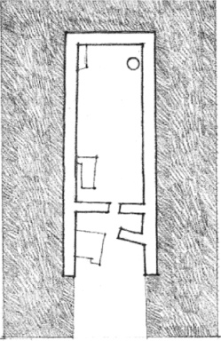

**Early Megaron Space**  
Principal room or hall of an early Anatolian or Aegean house

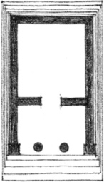

**Temple of Nemesis**, Rhamnus

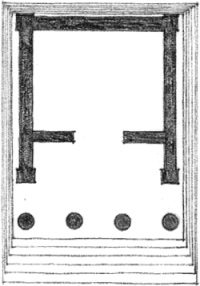

**Temple “B,”** Selinus

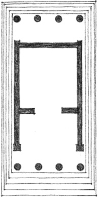

**Temple on the Ilissus**, Athens  
**Plans of Greek Temples**  
5th–4th centuries B.C.

U-shaped enclosures of interior space have a specific orientation toward their open ends. These U-shaped enclosures can group themselves around a central space to form an introverted organization.

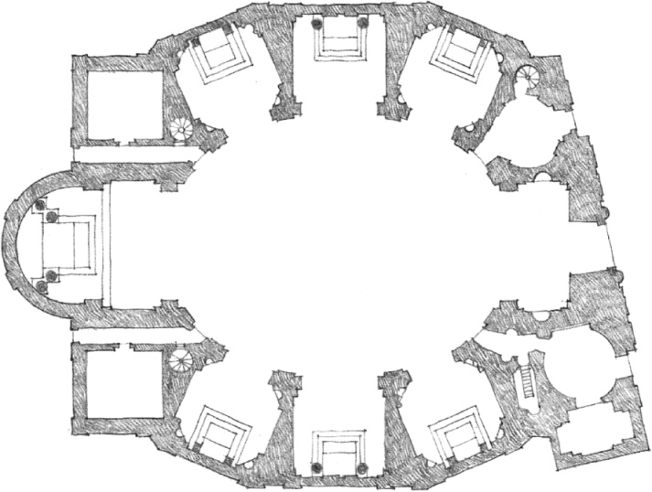

**Sketch of an Oval Church by Borromini**, Genesis of San Carlo Alle Quattro Fontane

The Hotel for Students at Otaniemi, Finland, by Alvar Aalto, demonstrates the use of U-shaped enclosures to define the basic unit of space in double-loaded schemes for dormitories, apartments, and hotels. These units are extroverted. They turn their back on the corridor and orient themselves to the exterior environment.

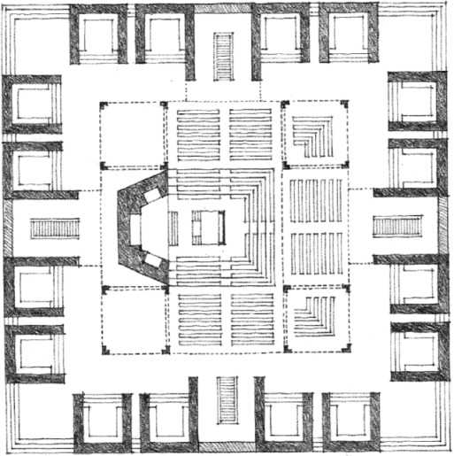

**Hurva Synagogue** (project), Jerusalem, 1968, Louis Kahn

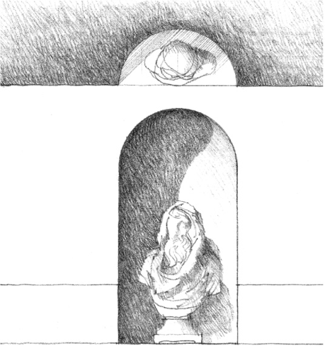

A Niche in a Wall

U-shaped enclosures of space can range in scale from a niche in the wall of a room, to a hotel or dormitory room, and on to an arcaded outdoor space that organizes an entire complex of buildings.

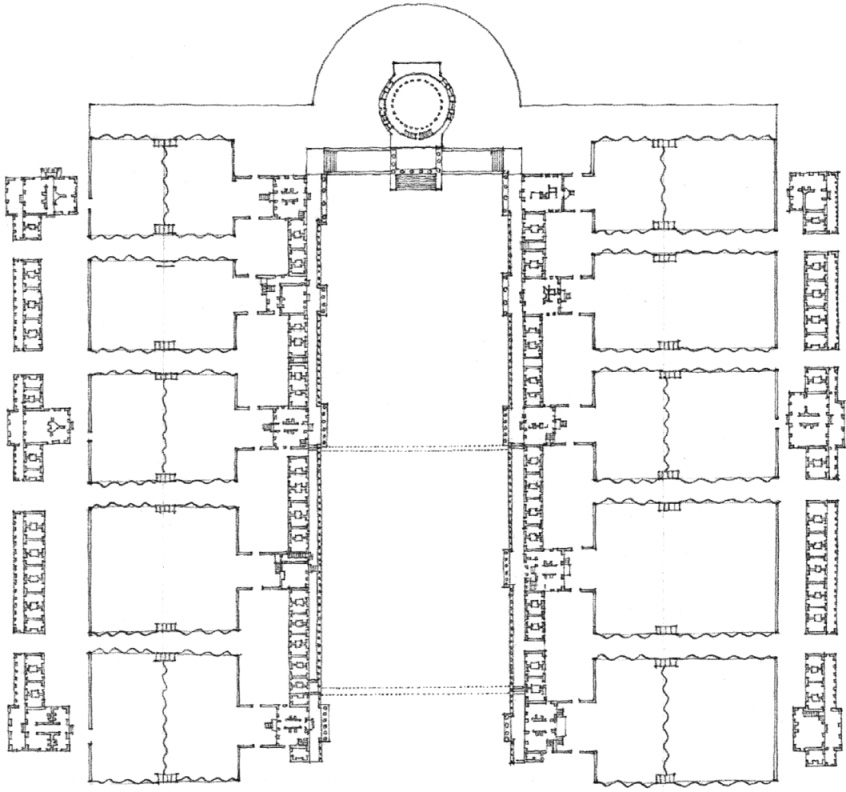

**University of Virginia**, Charlottesville, Virginia, 1817–1826, Thomas Jefferson with Thornton and Latrobe

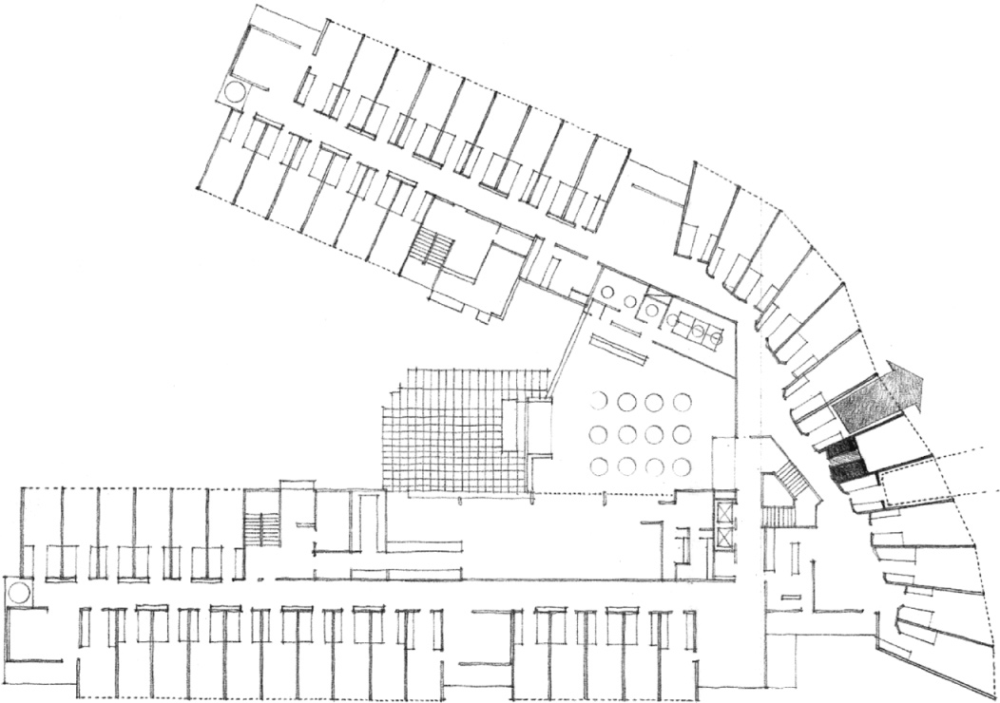

**Hotel for Students at Otaniemi**, Finland, 1962–1966, Alvar Aalto