> [BREADCRUMB_CTX: 《Architecture》 > Four Planes: Closure]

## FOUR PLANES: CLOSURE

Four vertical planes encompassing a field of space is probably the most typical, and certainly the strongest, type of spatial definition in architecture. Since the field is completely enclosed, its space is naturally introverted. To achieve visual dominance within a space or become its primary face, one of the enclosing planes can be differentiated from the others by its size, form, surface articulation, or by the nature of the openings within it.

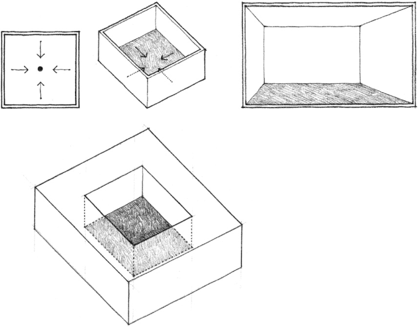

Well-defined, enclosed fields of space can be found in architecture at various scales, from a large urban square, to a courtyard or atrium space, to a single hall or room within a building complex. The examples on this and the following pages illustrate enclosed spatial fields in both urban and building-scale situations.

Historically, four planes have often been used to define a visual and spatial field for a sacred or significant building that stands as an object within the enclosure. The enclosing planes may be ramparts, walls, or fences that isolate the field and exclude surrounding elements from the precinct.

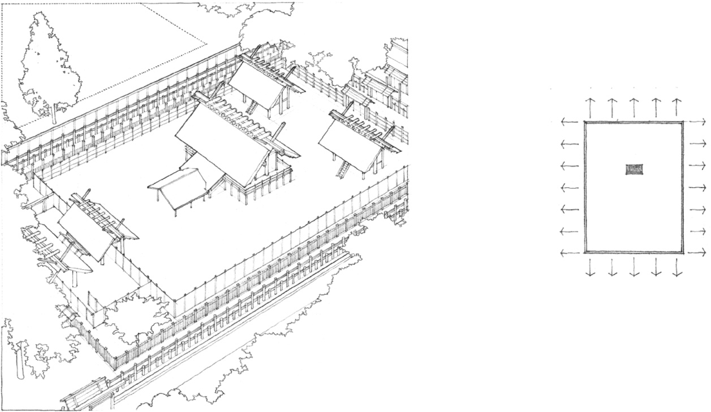

**Sacred Enclosure, Ise Inner Shrine**, Mie Prefecture, Japan, reconstructed every 20 years since A.D. 690.

In an urban context, a defined field of space can organize a series of buildings along its perimeter. The enclosure may consist of arcades or gallery spaces that promote the inclusion of surrounding buildings into their domain and activate the space they define.

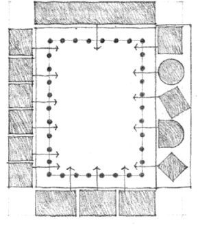
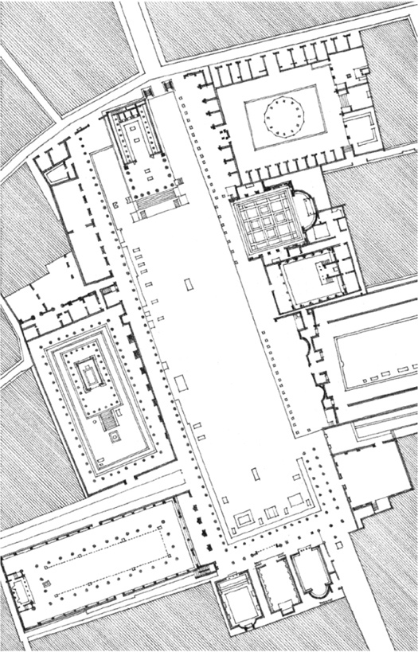

**Forum at Pompeii**, 2nd century B.C.

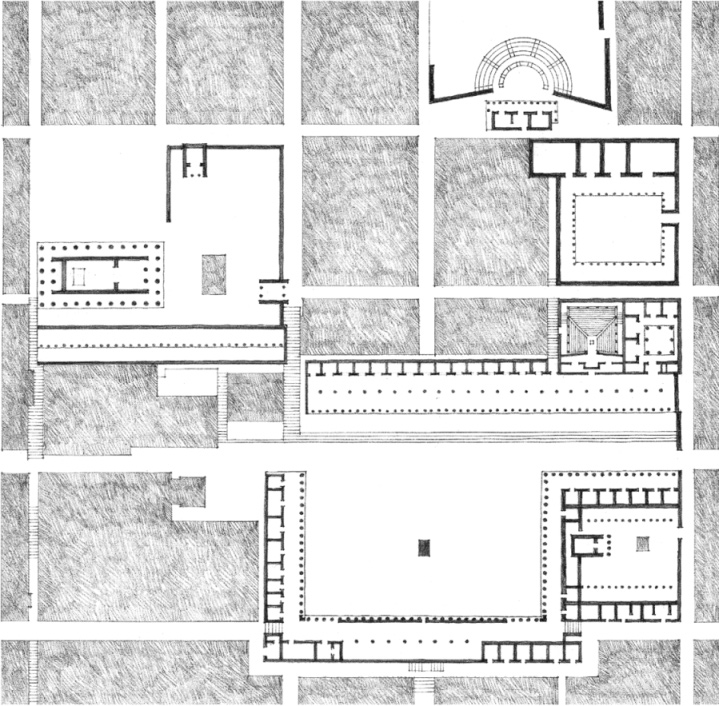

Plan of the **Agora at Priene** and its surroundings, 4th century B.C.

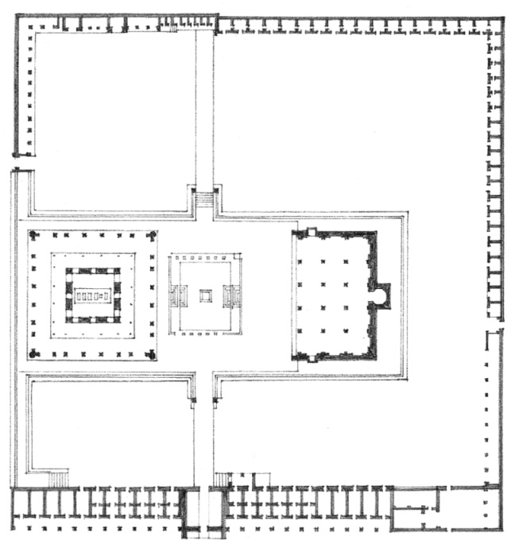

**Ibrahim Rauza**, Tomb of Sultan Ibrahim II, Bijapur, India, 1615, Malik Sandal

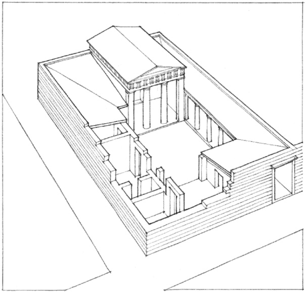

**House No. 33, Priene**, 3rd century B.C.

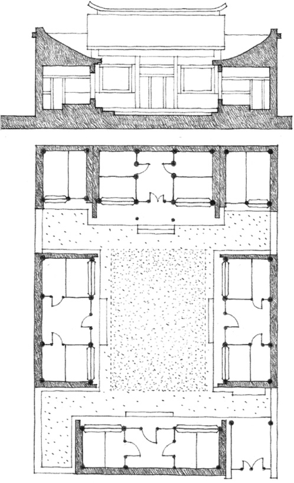

Traditional Chinese Patio House

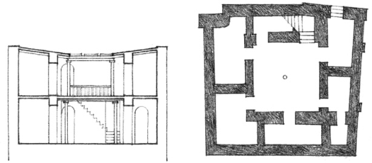

**House, Ur of the Chaldees**, c. 2000 B.C.

The examples on these two pages illustrate the use of enclosed volumes of space as ordering elements about which the spaces of a building can be clustered and organized. These organizing spaces can generally be characterized by their centrality, their clarity of definition, their regularity of form, and their dominating size. They are manifested here in the atrium spaces of houses, the arcaded cortile of an Italian palazzo, the enclosure of a Greek shrine, the courtyard of a Finnish town hall, and the cloister of a monastery.

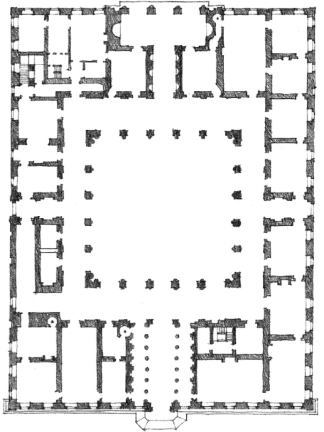

**Palazzo Farnese**, Rome, 1515, Antonio da Sangallo the Younger

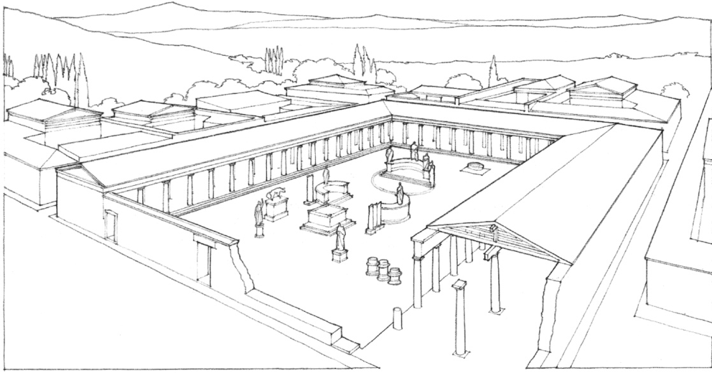

Enclosure of the **Shrine of Apollo Delphinios**, Miletus, c. 2nd century B.C.

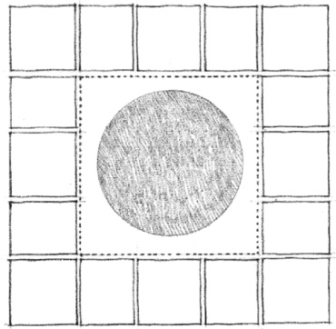
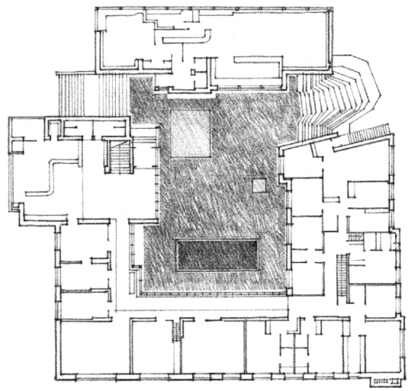

**Town Hall, Säynätsalo**, Finland, 1950–1952, Alvar Aalto

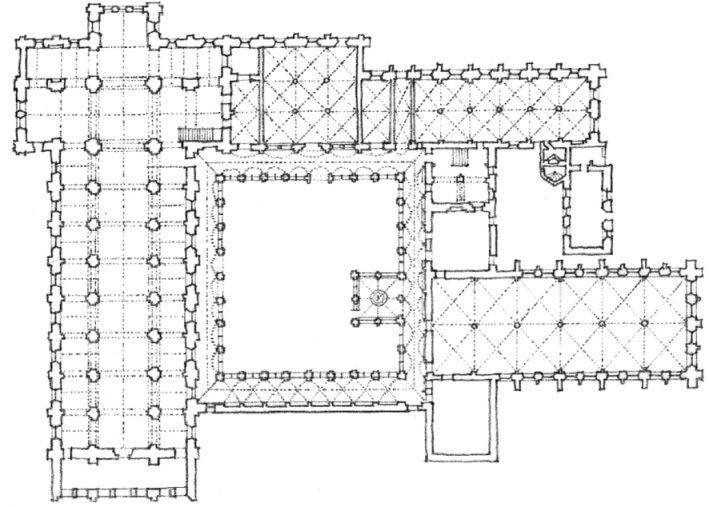

**Fontenay Abbey**, Burgundy, France, c. 1139