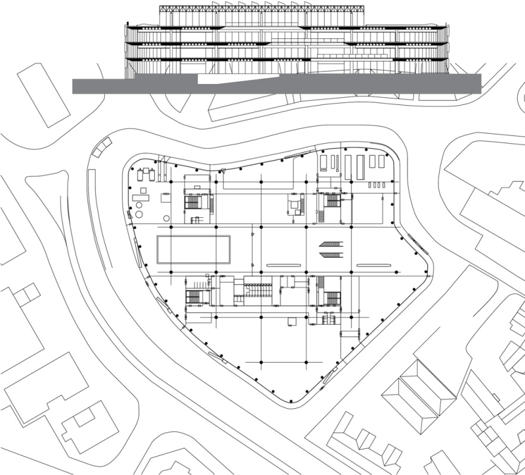
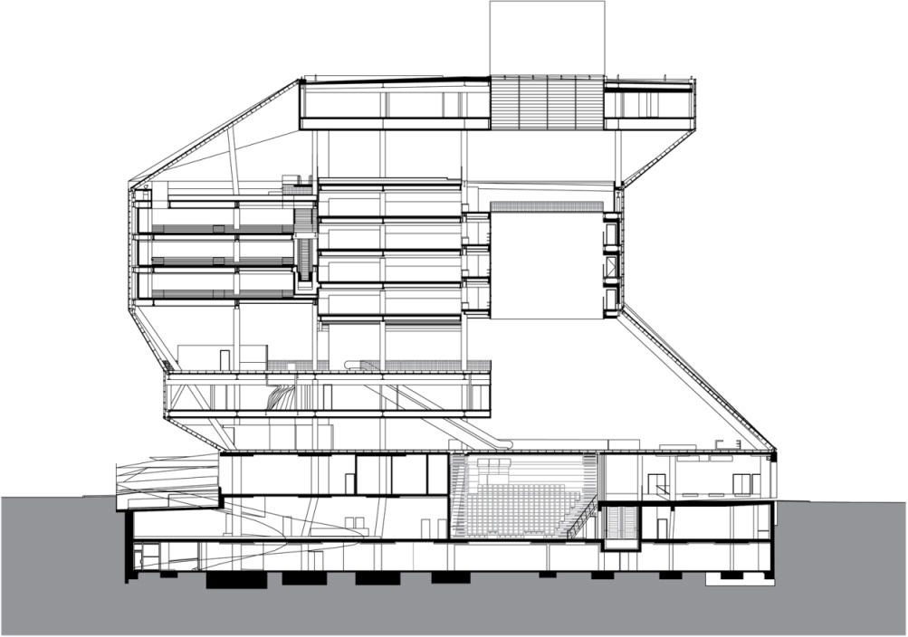
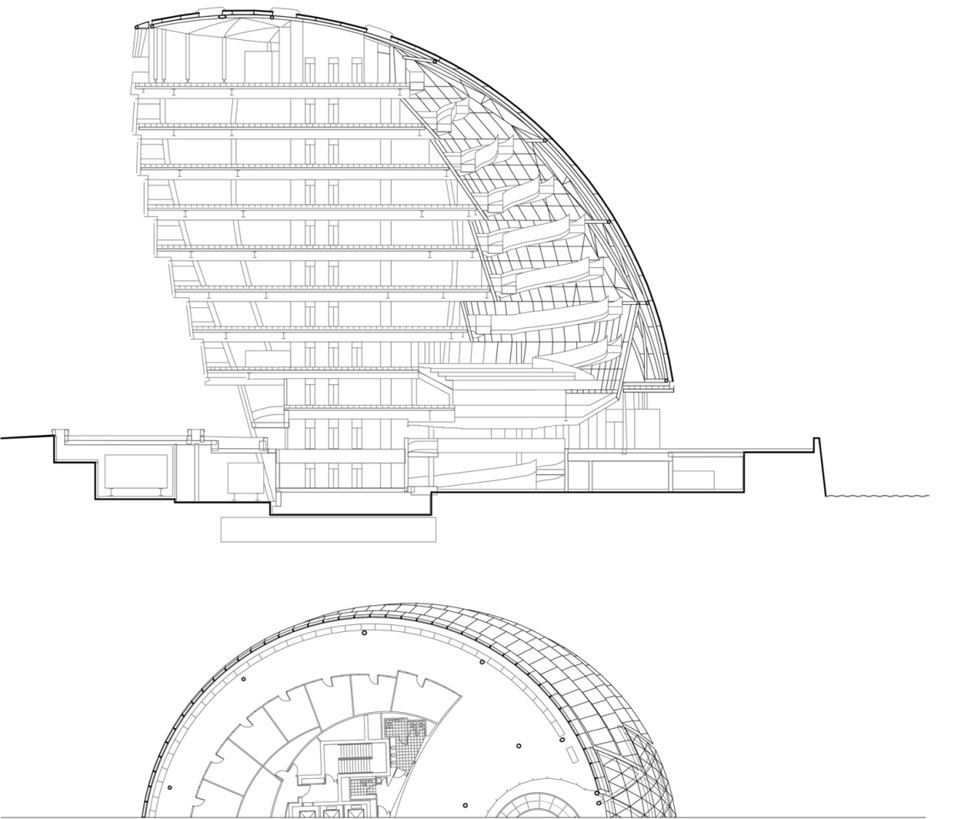
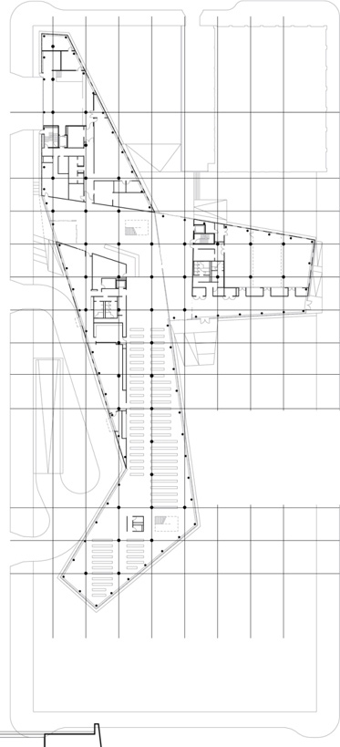
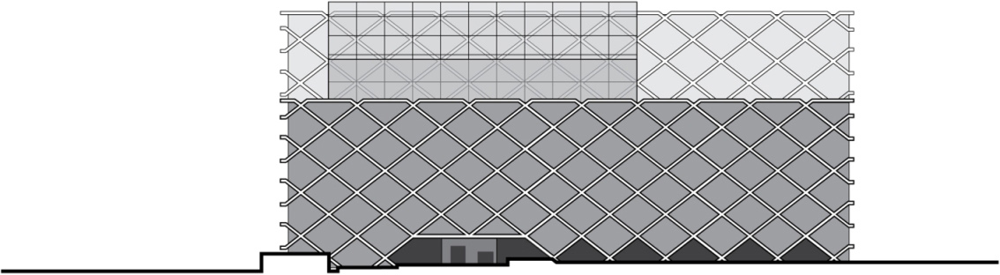
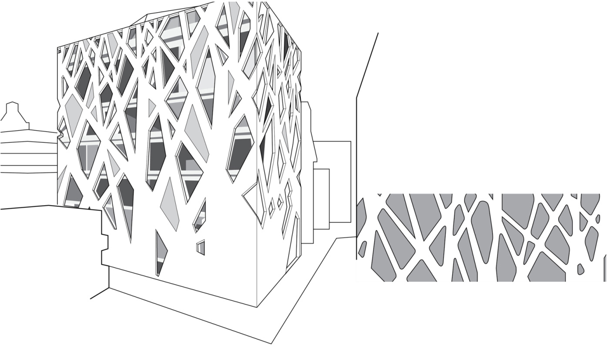
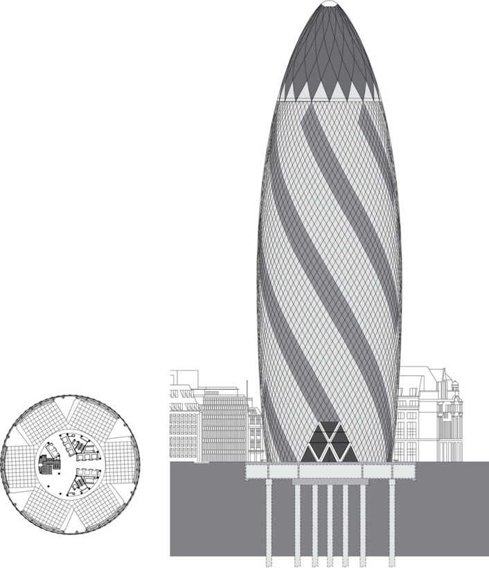

> [BREADCRUMB_CTX: 《Architecture》 > Four Planes: Enclosure]

## FOUR PLANES: ENCLOSURE

**Willis, Faber & Dumas Headquarters**, Ipswich, England, 1971–1975, Foster + Partners

How the overhead or roof plane can dominate the form of a building is illustrated on pages 129–131. In contrast, other buildings can be seen to be dominated by the form of their exterior, enclosing wall planes. Exterior walls determine to a great extent the visual character of a building, whether they have the weight and opacity of load-bearing walls, the lightness and transparency of nonbearing curtain walls supported by a structural framework of columns and beams, or a combination of both.

The transition from bearing-wall constructions to frame structures have given rise to new forms that go beyond the timeless elements of basic statics—the columns, beams, and load-bearing walls of stable constructions that are fixed in time and space. The rational forms of rectilinear geometry and the rule of the vertical have been revised, both statically and optically, by the development of irregular structures that rely on tension and friction rather than pressure. We can see these new forms as they mimic topography, orient themselves toward views, embrace sunlight, and turn away from cold winds and stormy weather.

**Seattle Public Library**, Seattle, Washington, 2004, OMA

The evolution of materials and technology for separating the skin of a building from its structure has also played a major role in the development of building forms.

Structural glass facades integrate structure and cladding to provide maximum transparency in buildings. While their forms may vary, the translucent panels typically span from floor to floor and are supported by structural systems that are exposed and distinct from the building’s primary structure.

Many of the structural systems use trusses or trussed supports, which may slope inward or outward, or follow a curved geometry in plan or section. Some use glass fines set perpendicular to the glass facade to provide lateral support.

Gridshells are form-active structures that derive their strength from their double-curved surface geometry. The system uses a network of in-plane prestressed cables to provide stability and shear resistance to the thin shell grid. Vaulted, domed, and other double-curved configurations can be used in vertical and overhead applications as well as to form complete building enclosures.

**London City Hall**, London, England, 1998–2003, Foster + Partners

**Des Moines Public Library**, Des Moines, Iowa, 2006, David Chipperfield Architects

Diagrid structures refer to networks of intersecting members connected at specially jointed nodes to create a diagonal grid across a building surface. The diagonal members are capable of carrying both gravity and lateral loads through triangulation, which results in a relatively uniform load distribution. This exoskeletal framework allows for the possible reduction in the number of internal supports, saving on space and building materials and providing for greater flexibility in interior layouts. Also, because each diagonal can be viewed as providing a continuous load path to the ground, the number of possible load paths in case of a localized structural failure results in a high degree of redundancy.

**One Shelley Street**, Sydney, Australia, 2009, Fitzpatrick + Partners. This project uses a structural diagrid system positioned on the outside of and very close to the glass facade to create a visually unique exterior.

**TOD’s Omotesando Building**, Tokyo, Japan, 2002–2004, Toyo Ito and Associates. Unlike the geometric regularity of One Shelley Street’s diagrid, the concrete diagrid used in TOD’s Omotesando Building is based on a pattern of overlapping tree silhouettes that mimic the branch structure of nearby elm trees. Similar to the growth pattern of trees, the diagrid members get thinner and more numerous with a higher ratio of openings as you move up higher in the building.

The various forms of diagram structures have been made possible through digital technologies that help us to conceive of and make visible complex three-dimensional constructions and compositions. 3D modeling and CAD software enable us to develop, describe, and fabricate the components to realize these constructions. Many of these creations would be difficult, if not impossible, to do by hand. This is especially true of the calculations necessary to determine the structural requirements for the individual members of a diagrid system.

3D modeling and CAD software have not only the computational capability to calculate the structural requirements for each member but also the means with 3D printers to fabricate the components, many of which are not identical for assembly on site.

Perimeter hoops resist the horizontal forces at each node level where the diagonal columns intersect. As with dome structures, the hoops in the upper region are in compression while those at the middle and lower levels are subject to significant tensile forces. The hoops also serve to transform the diagrid into a very stiff triangulated shell, freeing the interior core from the need to resist lateral wind forces.

**30 St. Mary Axe**, London, UK, 2001–2003, Foster + Partners. Informally known as The Gherkin and previously, the Swiss Re Building, this skyscraper is an iconic symbol in London’s financial district. The shape of the tower was partially influenced by the need to have a smooth flow of wind around the building and minimize its impact on the local wind environment. Across this curved surface the diagrid structure is formed by generating a pattern of intersecting diagonals spiraling in two directions.