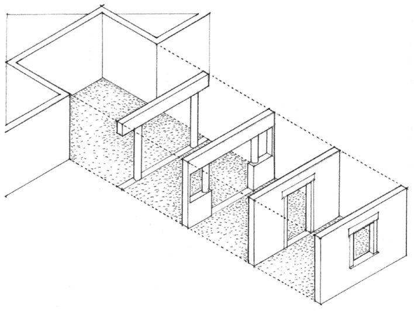
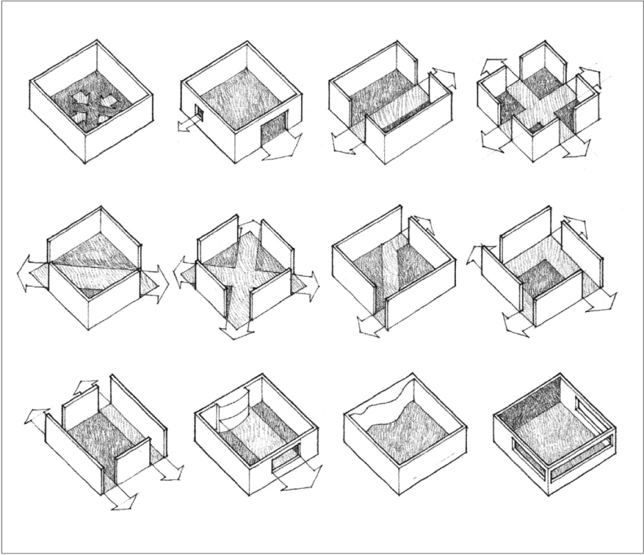
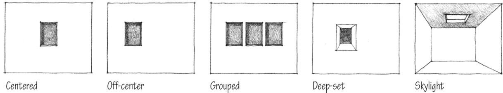
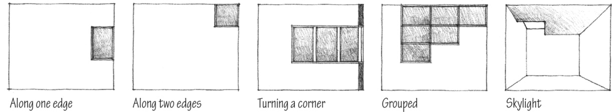
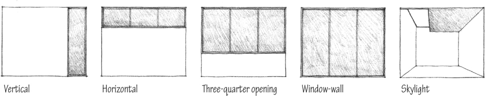

> [BREADCRUMB_CTX: 《Architecture》 > Openings in Space-Defining Elements]

## OPENINGS IN SPACE-DEFINING ELEMENTS

No spatial or visual continuity is possible with adjacent spaces without openings in the enclosing planes of a spatial field. Doors offer entry into a room and influence the patterns of movement and use within it. Windows allow light to penetrate the space and illuminate the surfaces of a room, offer views from the room to the exterior, establish visual relationships between the room and adjacent spaces, and provide for the natural ventilation of the space. While these openings provide continuity with adjacent spaces, they can, depending on their size, number, and location, also begin to weaken the enclosure of the space.

The following section of this chapter focuses on enclosed spaces at the scale of a room, where the nature of the openings within the room’s enclosure is a major factor in determining the quality of its space.

### Within Planes

An opening can be located wholly within a wall or ceiling plane and be surrounded on all sides by the surface of the plane.

### At Corners

An opening can be located along one edge or at a corner of a wall or ceiling plane. In either case, the opening will be at a corner of a space.

### Between Planes

An opening can extend vertically between the floor and ceiling planes or horizontally between two wall planes. It can grow in size to occupy an entire wall of a space.