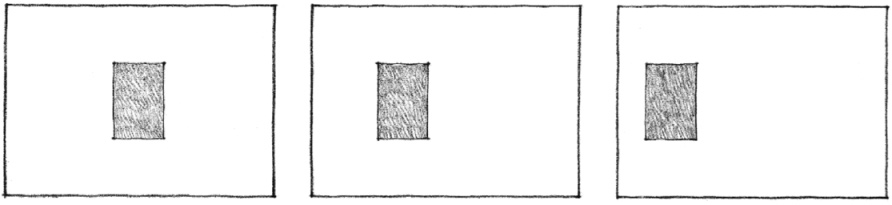
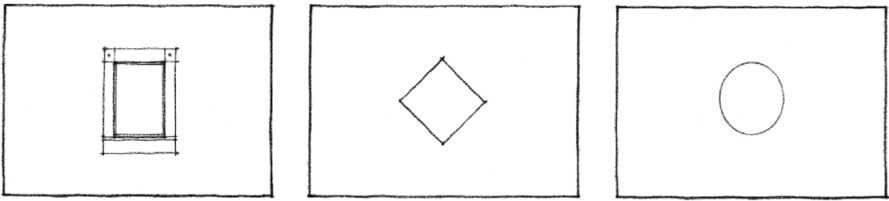
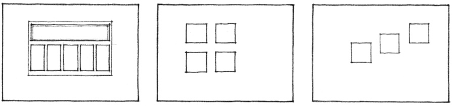
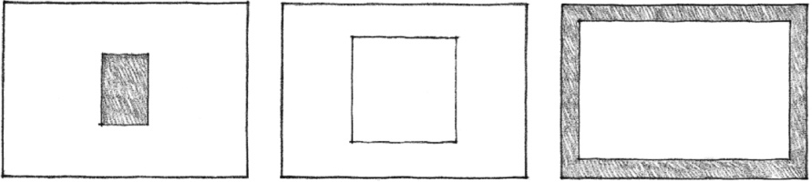
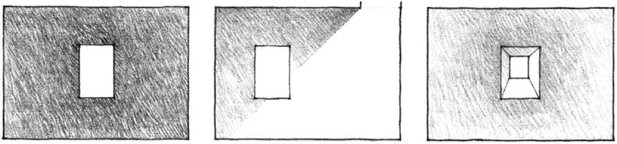
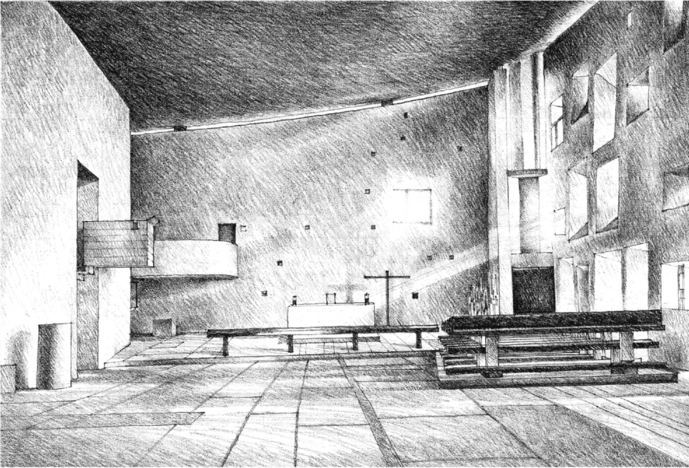
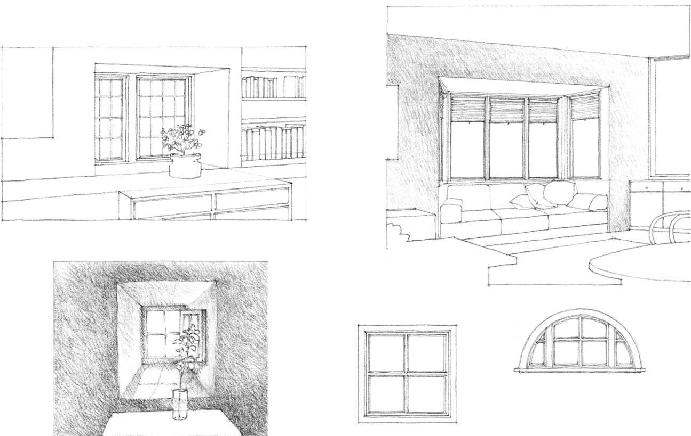

> [BREADCRUMB_CTX: 《Architecture》 > Openings Within Planes]

## OPENINGS WITHIN PLANES

An opening located wholly within a wall or ceiling plane often appears as a bright figure on a contrasting field or background. If centered within the plane, the opening will appear stable and visually organize the surface around it. Moving the opening off-center will create a degree of visual tension between the opening and the edges of the plane toward which it is moved.

The shape of the opening, if similar to the shape of the plane in which it is located, will create a redundant compositional pattern. The shape or orientation of the opening may contrast with the enclosing plane to emphasize its individuality as a figure. The singularity of the opening may be visually reinforced with a heavy frame or articulated trimwork.

Multiple openings may be clustered to form a unified composition within a plane, or be staggered or dispersed to create visual movement along the surface of the plane.

As an opening within a plane increases in size, it will at some point cease to be a figure within an enclosing field and become instead a positive element in itself, a transparent plane bounded by a heavy frame.

Openings within planes naturally appear brighter than their adjacent surfaces. If the contrast in brightness along the edges of the openings becomes excessive, the surfaces can be illuminated by a second light source from within the space, or a deep-set opening can be formed to create illuminated surfaces between the opening and the surrounding plane.

Chapel space, **Notre Dame Du Haut**, Ronchamp, France, 1950–1955, Le Corbusier

