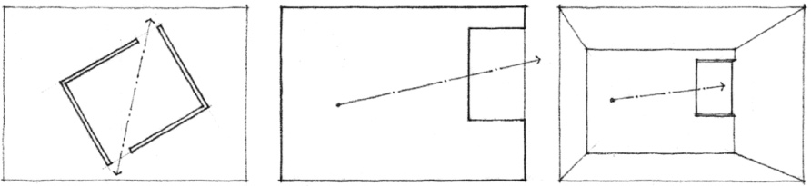
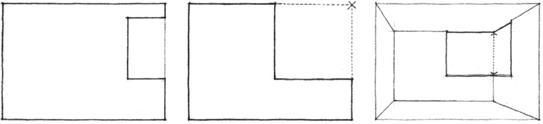
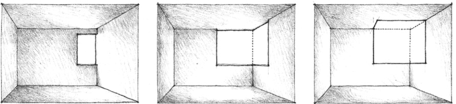
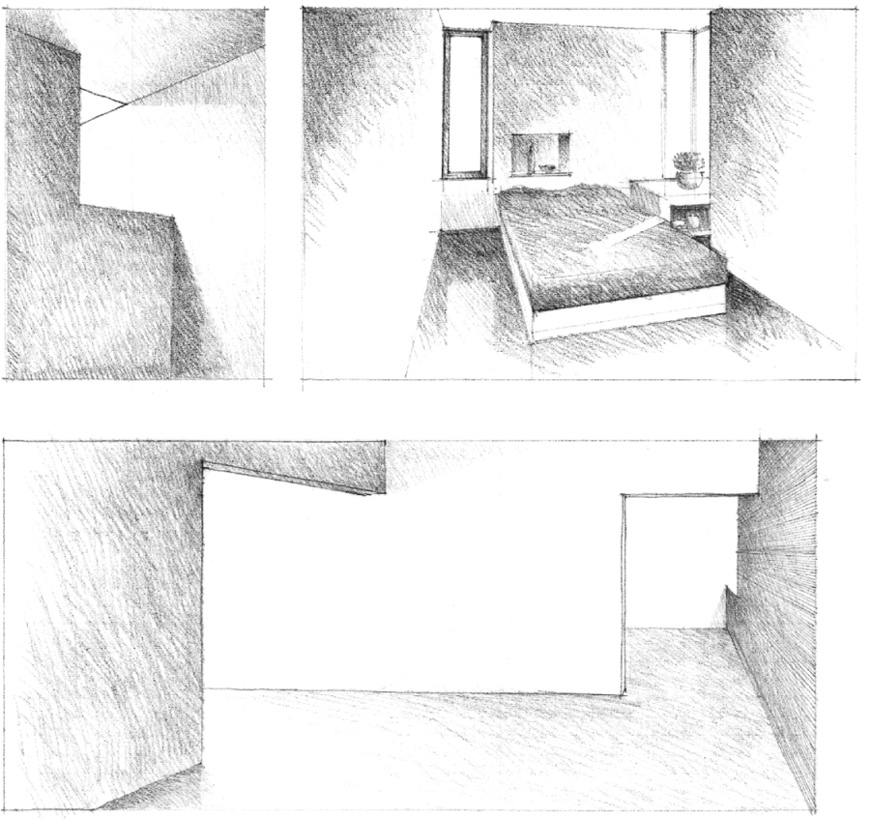
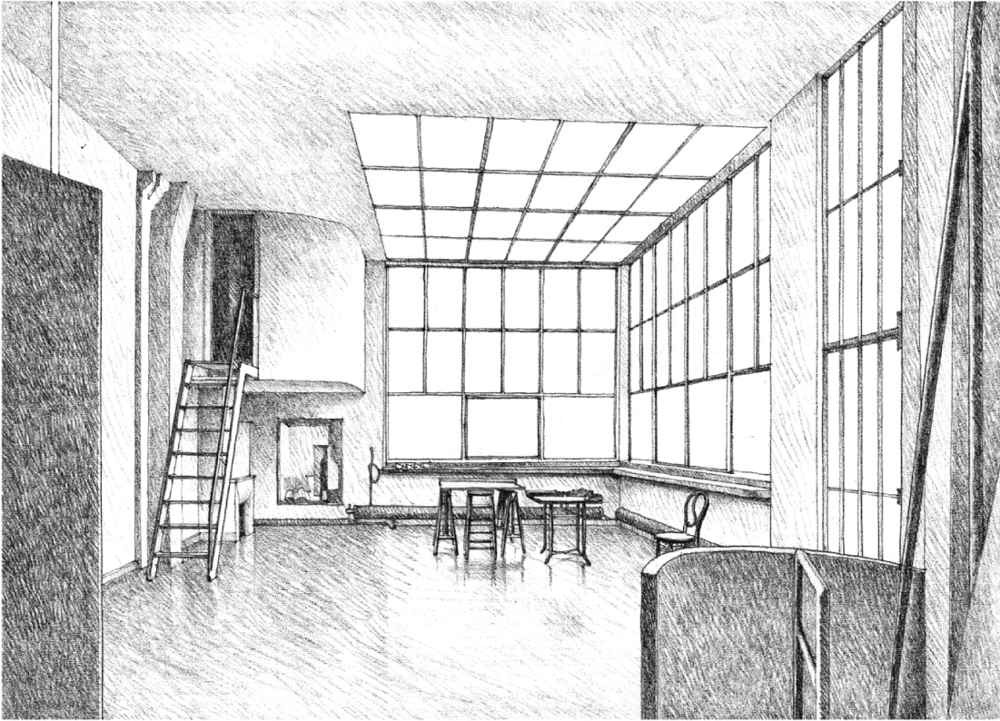
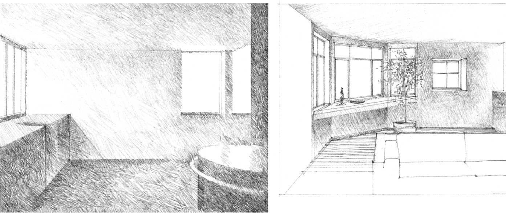

> [BREADCRUMB_CTX: 《Architecture》 > Openings at Corners]

## OPENINGS AT CORNERS

Openings that are located at corners give a space and the planes in which they are located a diagonal orientation. This directional effect may be desirable for compositional reasons, or the corner opening may be established to capture a desirable view or brighten a dark corner of a space.

A corner opening visually erodes the edges of the plane in which it is located and articulates the edge of the plane adjacent and perpendicular to it. The larger the opening, the weaker will be the definition of the corner. If the opening were to turn the corner, the angle of the space would be implied rather than real and the spatial field would extend beyond its enclosing planes.

If openings are introduced between the enclosing planes at all four corners of a space, the individual identity of the planes will be reinforced and diagonal or pinwheel patterns of space, use, and movement will be encouraged.

The light that enters a space through a corner opening washes the surface of the plane adjacent and perpendicular to the opening. This illuminated surface itself becomes a source of light and enhances the brightness of the space. The level of illumination can be enhanced further by turning the corner with the opening or adding a skylight above the opening.

Studio, **Amédée Ozenfant House**, Paris, 1922–1923, Le Corbusier

