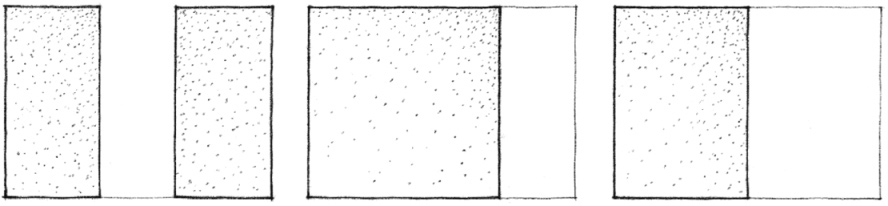
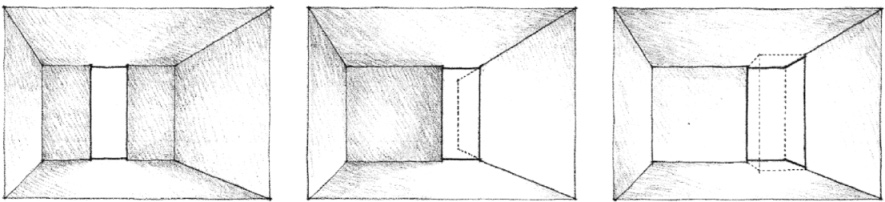
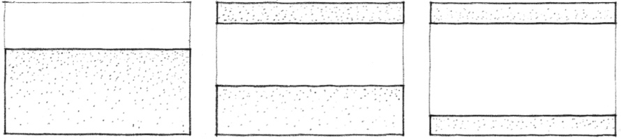
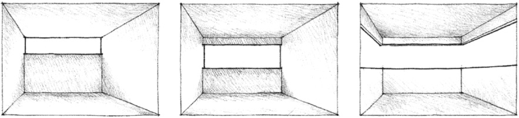
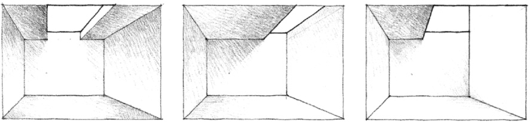
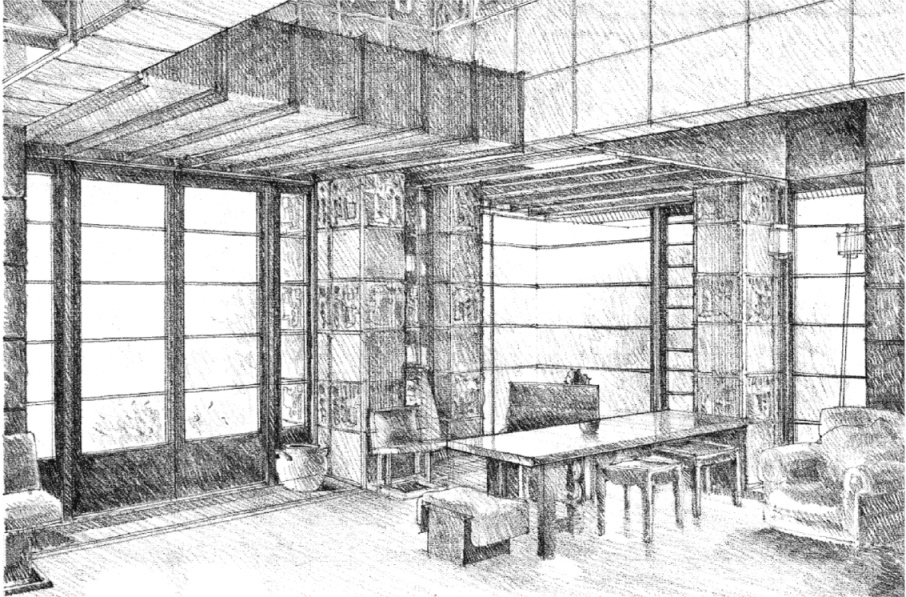
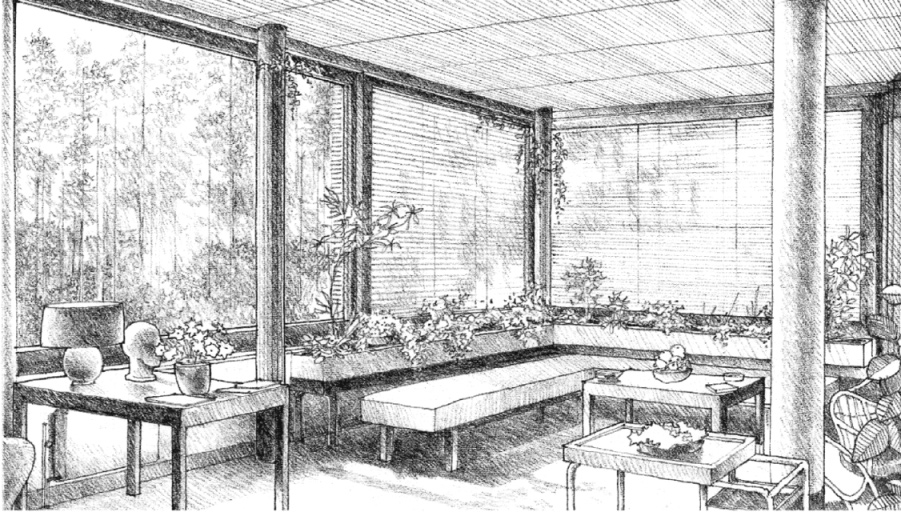
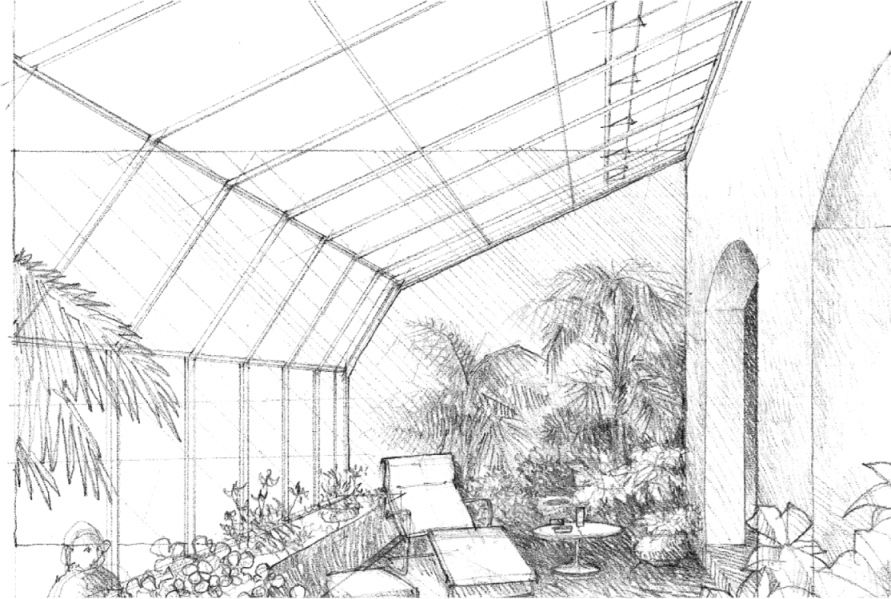

> [BREADCRUMB_CTX: 《Architecture》 > Openings Between Planes]

## OPENINGS BETWEEN PLANES

A vertical opening that extends from the floor to the ceiling plane of a space visually separates and articulates the edges of the adjacent wall planes.

If located at a corner, the vertical opening will erode the definition of the space and allow it to extend beyond the corner to the adjacent space. It will also allow incoming light to wash the surface of the wall plane perpendicular to it and articulate the primacy of that plane in the space. If allowed to turn the corner, the vertical opening will further erode the definition of the space, allow it to interlock with adjacent spaces, and emphasize the individuality of the enclosing planes.

A horizontal opening that extends across a wall plane will separate it into a number of horizontal layers. If the opening is not very deep, it will not erode the integrity of the wall plane. If, however, its depth increases to the point where it is greater than the bands above and below it, then the opening will become a positive element bounded at its top and bottom by heavy frames.

Turning a corner with a horizontal opening reinforces the horizontal layering of a space and broadens the panoramic view from within the space. If the opening continues around the space, it will visually lift the ceiling plane from the wall planes, isolate it, and give it a feeling of lightness.

Locating a linear skylight along the edge where a wall and ceiling plane meet allows incoming light to wash the surface of the wall, illuminate it, and enhance the brightness of the space. The form of the skylight can be manipulated to capture direct sunlight, indirect daylight, or a combination of both.

Living Room, **Samuel Freeman House**, Los Angeles, California, 1924, Frank Lloyd Wright

Window-walls offer more expansive views and permit a greater amount of daylight to penetrate a space than any of the previous examples of openings. If they are oriented to capture direct sunlight, sun-shading devices may be necessary to reduce glare and excessive heat gain within the space.

While a window-wall weakens the vertical boundaries of a space, it creates the potential for visually expanding the space beyond its physical boundaries.

Living Room, **Villa Mairea**, Noormarkku, Finland, 1938–1939, Alvar Aalto

Combining a window-wall with a large skylight overhead creates a sun room or greenhouse space. The boundaries between inside and outside, defined by the linear members of a frame, become obscure and tenuous.

