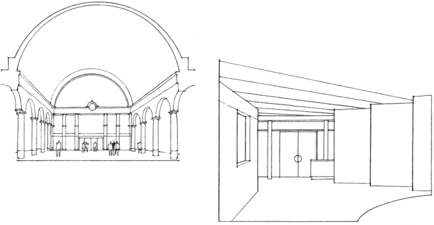
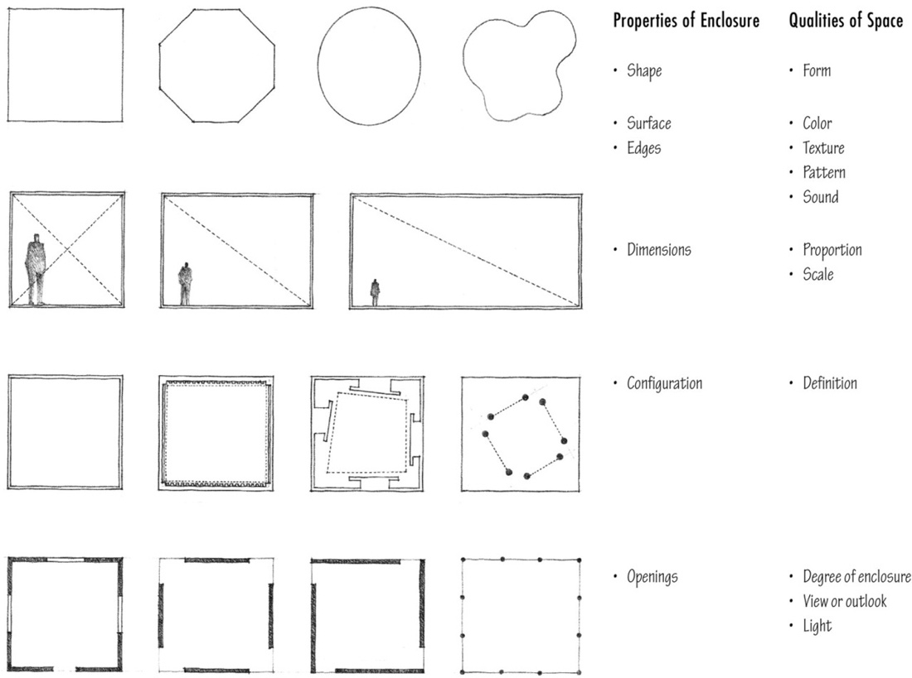
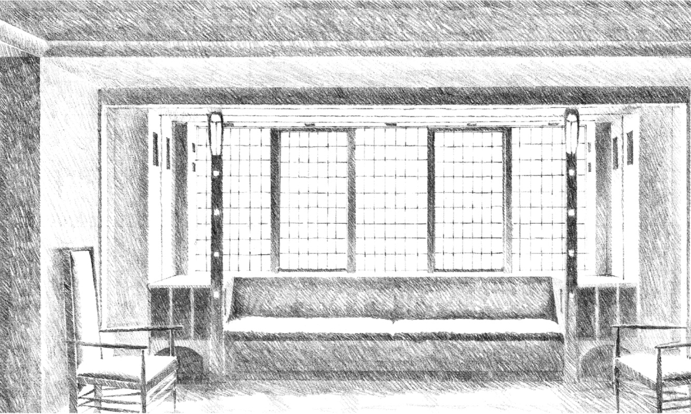
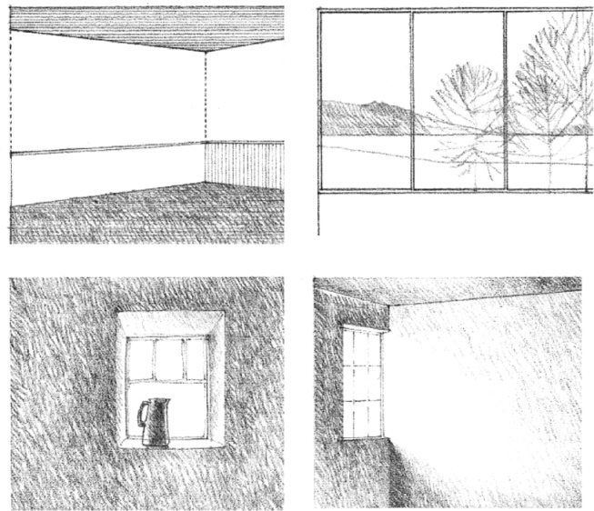

> [BREADCRUMB_CTX: 《Architecture》 > Qualities of Architectural Space]

## QUALITIES OF ARCHITECTURAL SPACE

The basic patterns of linear and planar elements that define discrete volumes of space, and the varieties of openings that serve to connect these spatial volumes to one another and their context are presented on pages 158–159 and 161. The qualities of an architectural space, however, are much richer than what the diagrams are able to portray. The spatial qualities of form, proportion, scale, texture, light, and sound ultimately depend on the properties of the enclosure of a space. Our perception of these qualities is often a response to the combined effects of the properties encountered and is conditioned by culture, prior experiences, and personal interest or inclination.

Bay Window of the Living Room, **Hill House**, Helensburgh, Scotland, 1902–1903, Charles Rennie Mackintosh

Chapter 2 discusses the impact of shape, surface, and edges on our perception of form. Chapter 6 presents the issues of dimensions, proportion, and scale. While the first part of this chapter outlines how basic configurations of linear and planar elements define volumes of space, this concluding section describes how the size, shape, and location of openings or voids within the enclosing forms of a space influence the following qualities of a room:

* **Degree of enclosure** …the form of the space
* **View or outlook** .…….the focus of the space
* **Light**………………the illumination of its surfaces and forms

