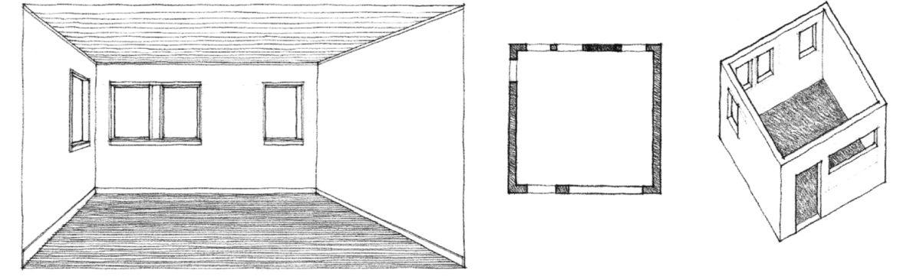
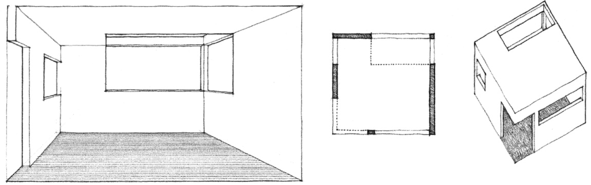
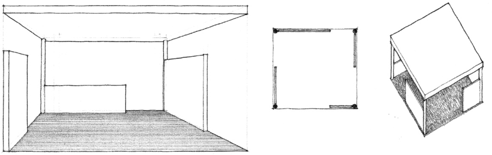
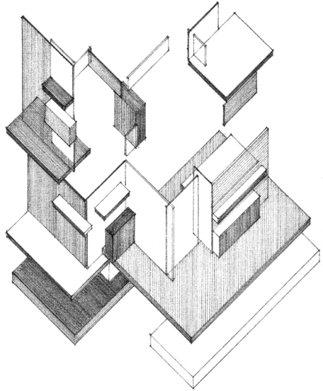
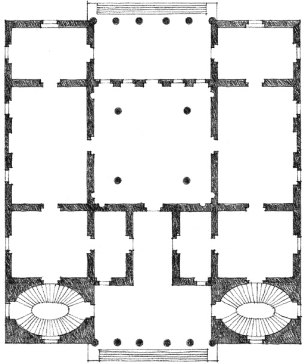
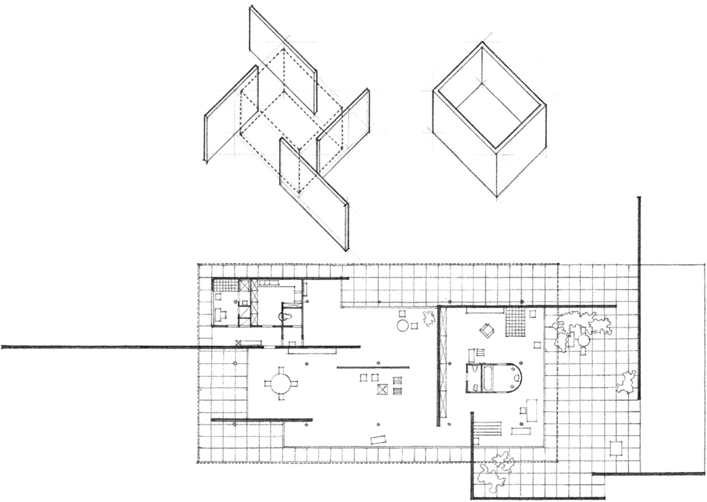

> [BREADCRUMB_CTX: 《Architecture》 > Degree of Enclosure]

## DEGREE OF ENCLOSURE

The degree of enclosure of a space, as determined by the configuration of its defining elements and the pattern of its openings, has a significant impact on our perception of its form and orientation. From within a space, we see only the surface of a wall. It is this thin layer of material that forms the vertical boundary of the space. The actual thickness of a wall plane can be revealed only along the edges of door and window openings.

Openings lying wholly within the enclosing planes of a space do not weaken the edge definition nor the sense of closure of the space. The form of the space remains intact and perceptible.

Openings located along the edges of the enclosing planes of a space visually weaken the corner boundaries of the volume. While these openings erode the overall form of a space, they also promote its visual continuity and interaction with adjacent spaces.

Openings between the enclosing planes of a space visually isolate the planes and articulate their individuality. As these openings increase in number and size, the space loses its sense of enclosure, becomes more diffuse, and begins to merge with adjacent spaces. The visual emphasis is on the enclosing planes rather than the volume of space defined by the planes.

**Color Construction** (Project for a Private House), 1922, Theo van Doesburg and Cornels van Eesteren

**Palazzo Garzadore** (Project), Vincenza, Italy, 1570, Andrea Palladio

**House, Berlin Building Exposition**, 1931, Mies van der Rohe