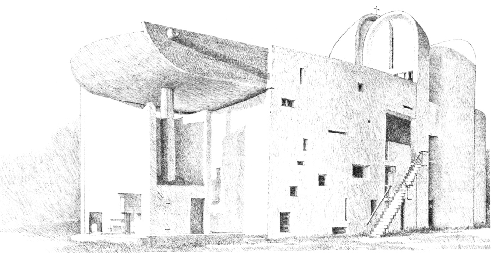
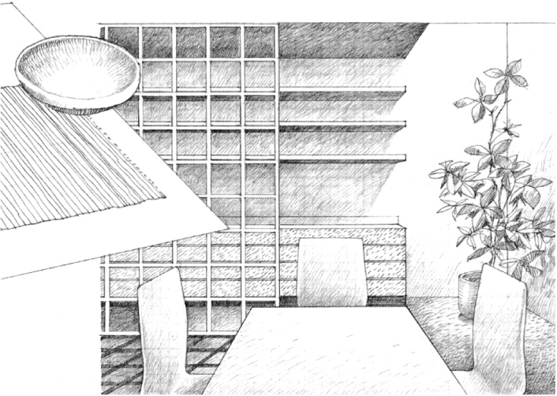
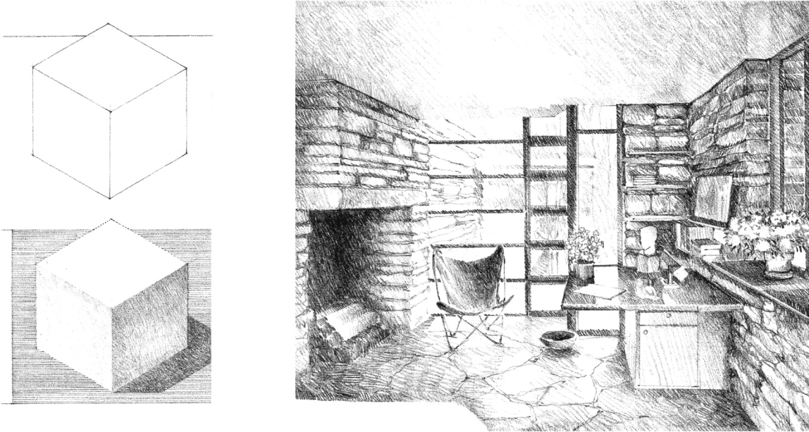
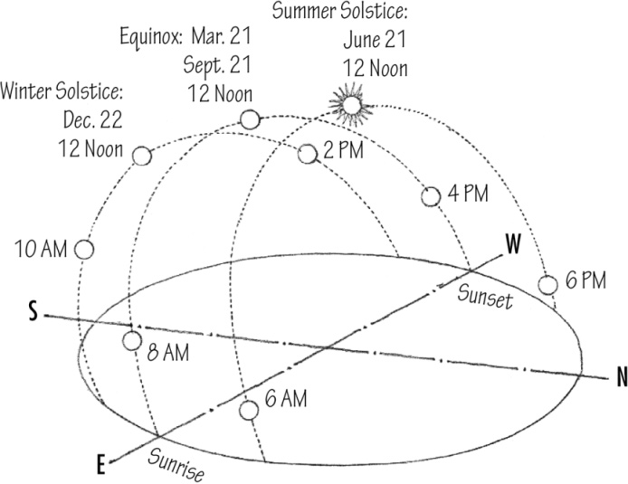
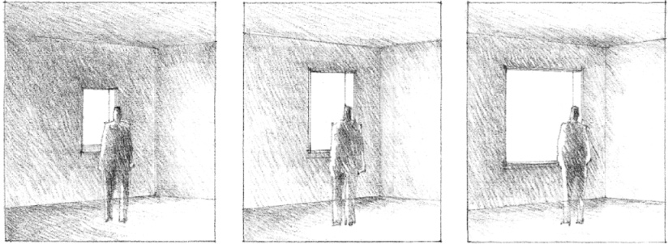
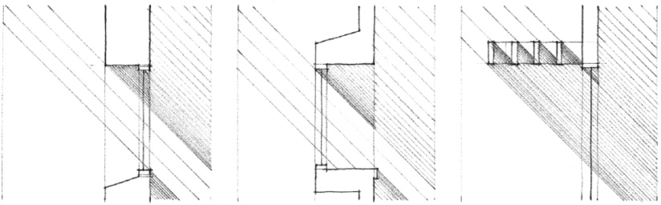
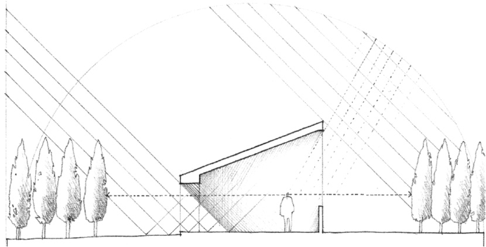
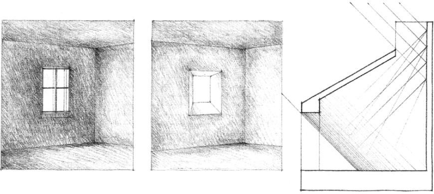
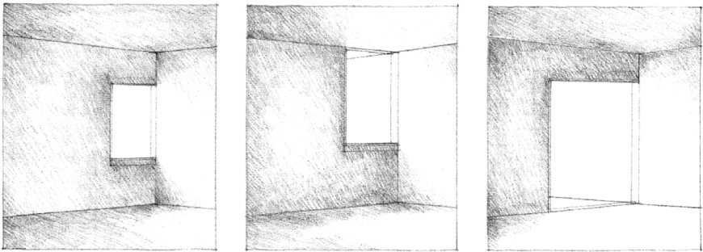
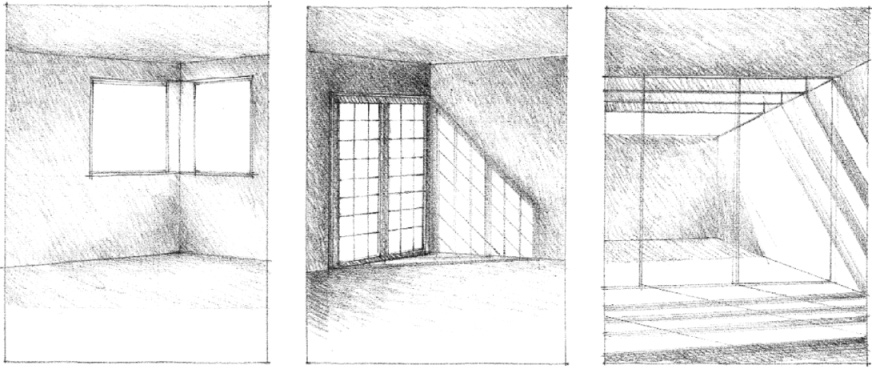

> [BREADCRUMB_CTX: 《Architecture》 > Light]

## LIGHT

“Architecture is the masterly, correct and magnificent play of masses brought together in light. Our eyes are made to see forms in light; light and shade reveal these forms…”

Le Corbusier: *Towards a New Architecture*

**Notre Dame Du Haut**, Ronchamp, France, 1950–1955, Le Corbusier

The sun is the rich source of natural light for the illumination of forms and spaces in architecture. While the sun’s radiation is intense, the quality of its light, manifested in the form of direct sunlight or diffuse daylight, varies with the time of day, from season to season, and from place to place. As the luminous energy of the sun is dispersed by clouds, haze, and precipitation, it transmits the changing colors of the sky and the weather to the forms and surfaces it illuminates.

**Fallingwater (Kaufmann House)**, near Ohiopyle, Pennsylvania, 1936–1937, Frank Lloyd Wright

Penetrating a space through windows in a wall plane, or through skylights in the overhead roof plane, the radiant energy of the sun falls upon the surfaces within the room, enlivens their colors, and reveals their textures. With the shifting patterns of light, shade, and shadows that it creates, the sun animates the space of the room, and articulates the forms within it. By its intensity and dispersion within the room, the luminous energy of the sun can clarify the form of the space or distort it. The color and brilliance of sunlight can create a festive atmosphere within the room or a more diffuse daylight can instill within it a somber mood.

Since the intensity and direction of the light the sun radiates is fairly predictable, its visual impact on the surfaces, forms, and space of a room can be predicated on the size, location, and orientation of windows and skylights within the enclosure.

**Sun-Path Diagram for the Northern Hemisphere**

The size of a window or skylight controls the amount of daylight a room receives. The size of an opening in a wall or roof plane, however, is also regulated by factors other than light, such as the materials and construction of the wall or roof plane; code requirements for ventilation; the desire for views and visual privacy; the appropriate degree of enclosure for the space; and the effect of openings on the exterior form of a building. The location and orientation of a window or skylight, therefore, can be more important than its size in determining the quality of daylight a room receives.

An opening can be oriented to receive direct sunlight during certain portions of the day. Direct sunlight provides a high degree of illumination that is especially intense during midday hours. It creates sharp patterns of light and dark on the surfaces of a room and crisply articulates the forms within the space. Possible detrimental effects of direct sunlight, such as glare and excessive heat gain, can be controlled by shading devices built into the form of the opening or provided by the foliage of nearby trees or adjacent structures.

An opening can also be oriented away from direct sunlight and receive instead the diffuse, ambient light from the sky vault overhead. The sky vault is a beneficial source of daylight since it remains fairly constant, even on cloudy days, and can help to soften the harshness of direct sunlight and balance the light level within a space.

The location of an opening affects the manner in which natural light enters a room and illuminates its forms and surfaces. When located entirely within a wall plane, an opening can appear as a bright spot of light on a darker surface. This condition can induce glare if an excessive degree of contrast exists between the brightness of the opening and the darker surface surrounding it. The uncomfortable or debilitating glare caused by excessive brightness ratios between adjacent surfaces or areas in a room can be ameliorated by allowing daylight to enter the space from at least two directions.

When an opening is located along the edge of a wall or at the corner of a room, the daylight entering through it will wash the surface of the wall adjacent and perpendicular to the plane of the opening. This illuminated surface itself becomes a source of light and enhances the light level within the space.

Additional factors influence the quality of light within a room. The shape and articulation of an opening is reflected in the shadow pattern cast by sunlight on the forms and surfaces of the room. The color and texture of these forms and surfaces, in turn, affect their reflectivity and the ambient light level within the space.

