> [BREADCRUMB_CTX: 《Architecture》 > View]

## VIEW

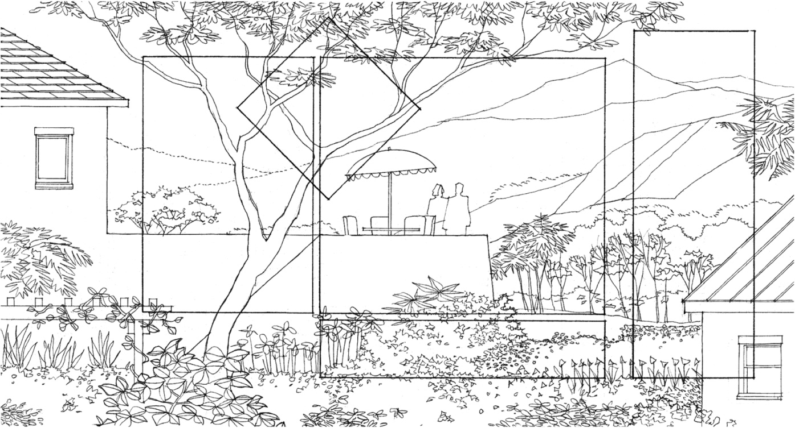

Another quality of space that must be considered in establishing openings in the enclosure of a room is its focus and orientation. While some rooms have an internal focus, such as a fireplace, others have an outward orientation given to them by a view to the outdoors or an adjacent space. Window and skylight openings provide this view and establish a visual relationship between a room and its surroundings. The size and location of these openings determine, of course, the nature of the outlook as well as the degree of visual privacy for an interior space.

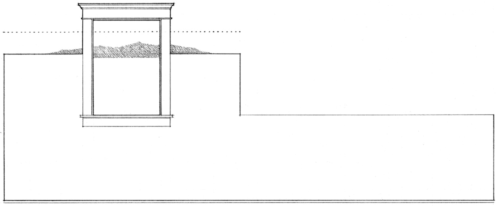

A small opening can reveal a close-up detail or frame a view so that we see it as a painting on a wall.

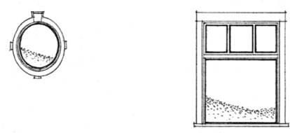

A long, narrow opening, whether vertical or horizontal, can not only separate two planes but also hint at what lies beyond.

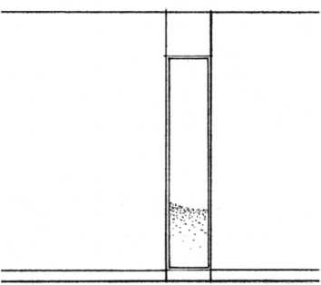

A group of windows can be sequenced to fragment a scene and encourage movement within a space.

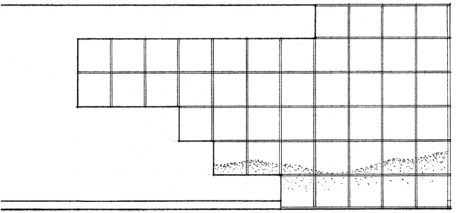

As an opening expands, it opens up a room to a broad vista. The large scene can dominate a space or serve as a backdrop for the activities within it.

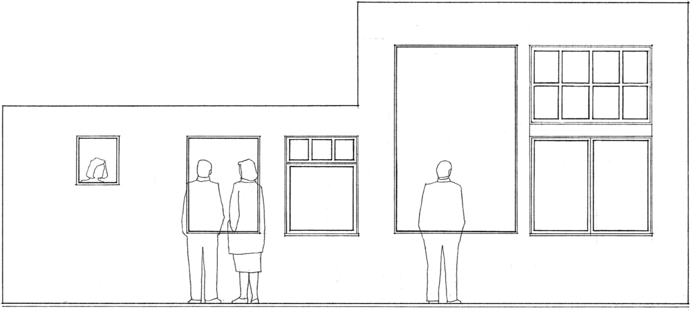
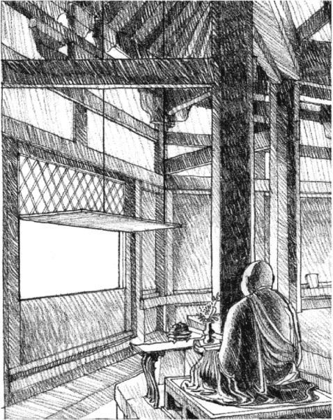

**Outlook: Horyu-Ji Temple**, Nara, Japan, A.D. 607.

A window can be located such that a specific view can be seen from only one position in a room.

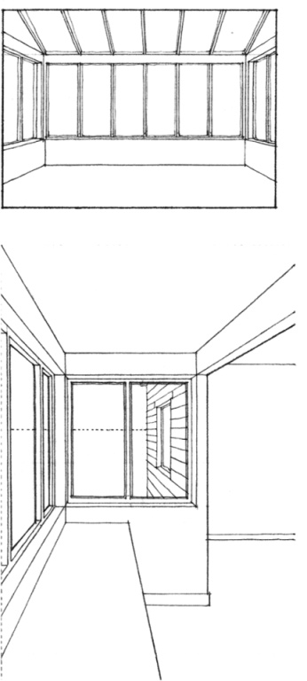

A bay window can project a person into a scene. If large enough, the projected space can become an alcove able to be occupied.

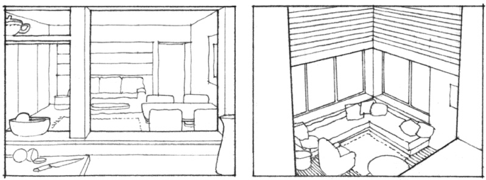

Interior openings offer views from one space to another. An opening can be oriented upward to offer a view of treetops and the sky.

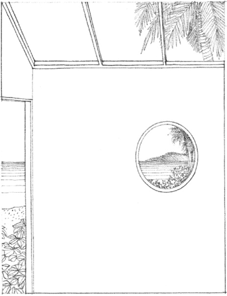
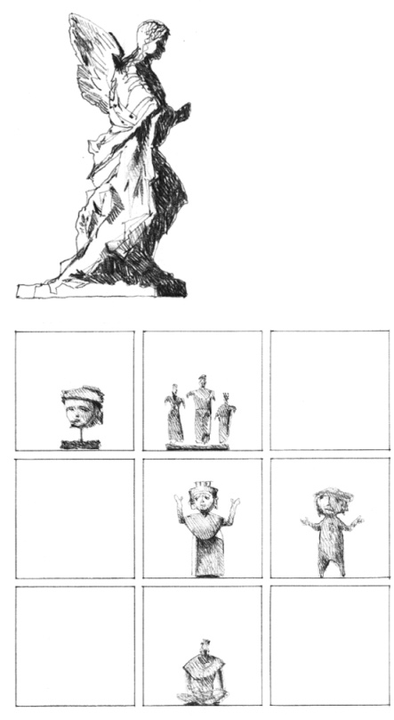

Views should not be limited to the outdoors or adjacent spaces. Interior design elements can also provide subjects for visual attention.

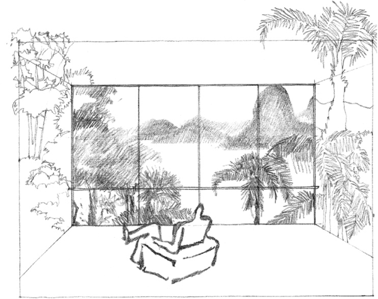

**Vista**, based on a sketch by Le Corbusier for the design of the Ministry of National Education and Public Health in Rio de Janeiro, 1936

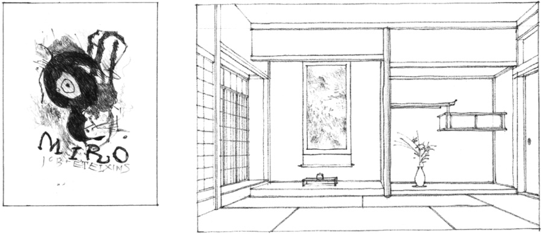

An Internal Focus: **Tokonoma**, the spiritual center of a traditional Japanese house

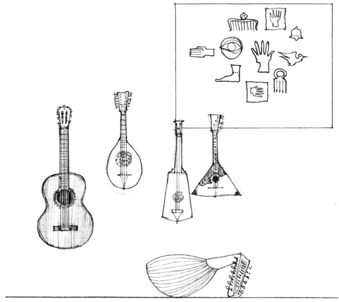
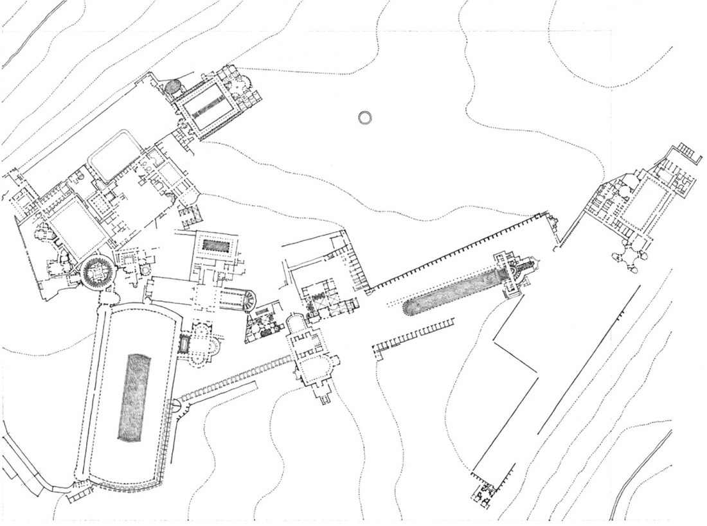

**Hadrian’s Villa**, Tivoli, Italy, A.D. 118–125