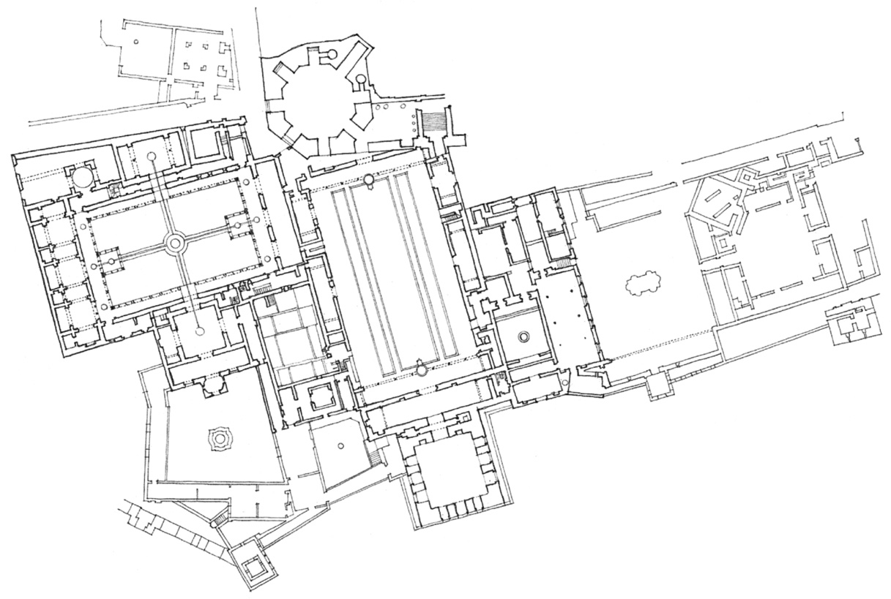

> [BREADCRUMB_CTX: 《Architecture》 > Organization of Form & Space]

## ORGANIZATION OF FORM & SPACE

The last chapter laid out how various configurations of form could be manipulated to define a solitary field or volume of space, and how their patterns of solids and voids affected the visual qualities of the defined space. Few buildings, however, consist of a solitary space. They are normally composed of a number of spaces which are related to one another by function, proximity, or a path of movement. This chapter lays out for study and discussion the basic ways the spaces of a building can be related to one another and organized into coherent patterns of form and space.

**Alhambra**, Palace and Citadel of the Moorish kings, Granada, Spain, 1248–1354