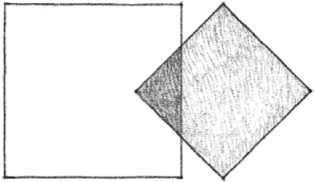
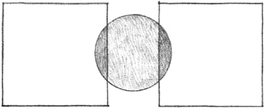

> [BREADCRUMB_CTX: 《Architecture》 > Spatial Relationships]

## SPATIAL RELATIONSHIPS

Two spaces may be related to each other in several fundamental ways.

**Space within a Space**  
A space may be contained within the volume of a larger space.

**Interlocking Spaces**  
The field of a space may overlap the volume of another space.

**Adjacent Spaces**  
Two spaces may abut each other or share a common border.

**Spaces Linked by a Common Space**  
Two spaces may rely on an intermediary space for their relationship.