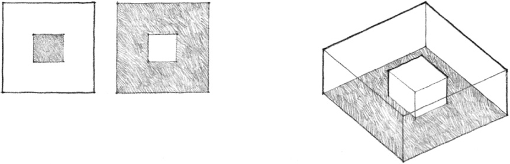
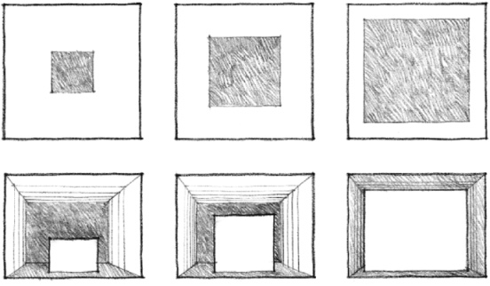
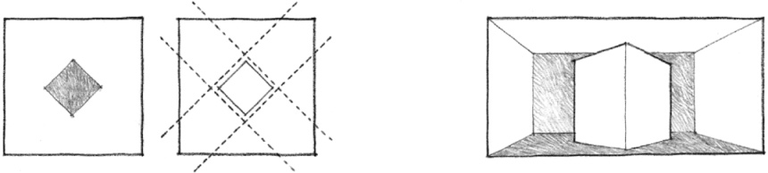
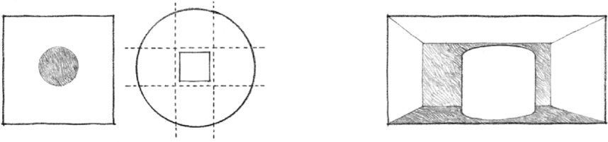
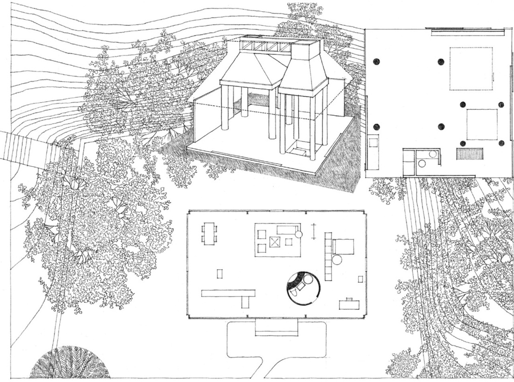

> [BREADCRUMB_CTX: 《Architecture》 > Space Within a Space]

## SPACE WITHIN A SPACE

A large space can envelop and contain a smaller space within its volume. Visual and spatial continuity between the two spaces can be easily accommodated, but the smaller, contained space depends on the larger, enveloping space for its relationship to the exterior environment.

In this type of spatial relationship, the larger, enveloping space serves as a three-dimensional field for the smaller space contained within it. For this concept to be perceived, a clear differentiation in size is necessary between the two spaces. If the contained space were to increase in size, the larger space would begin to lose its impact as an enveloping form. If the contained space continued to grow, the residual space around it would become too compressed to serve as an enveloping space. It would become instead merely a thin layer or skin around the contained space. The original notion would be destroyed.

To endow itself with a higher attention-value, the contained space may share the form of the enveloping shape, but be oriented in a different manner. This would create a secondary grid and a set of dynamic, residual spaces within the larger space.

The contained space may also differ in form from the enveloping space in order to strengthen its image as a freestanding volume. This contrast in form may indicate a functional difference between the two spaces or the symbolic importance of the contained space.

**Moore House**, Orinda, California, 1961, Charles Moore  
**Glass House**, New Canaan, Connecticut, 1949, Philip Johnson