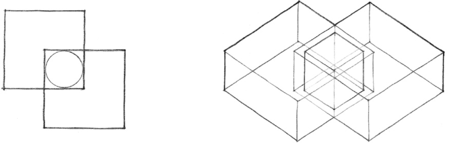
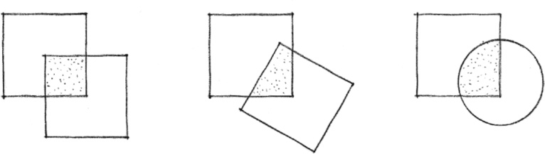
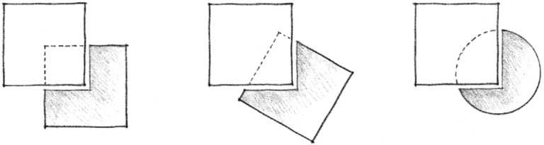
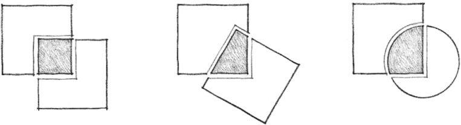
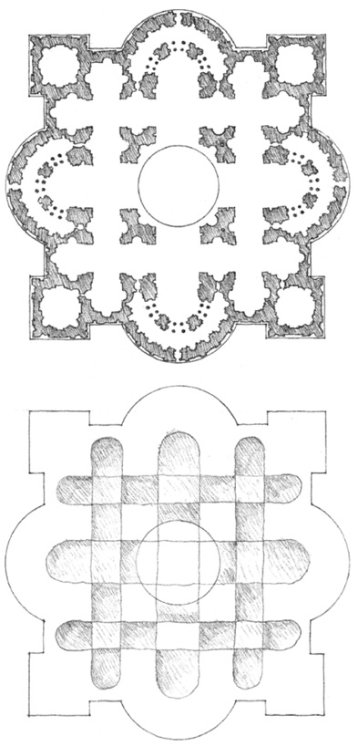
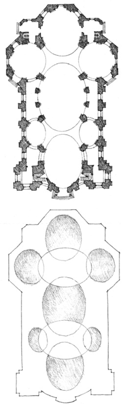
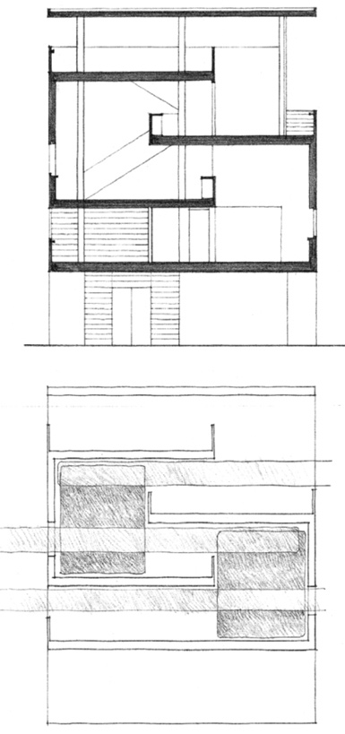
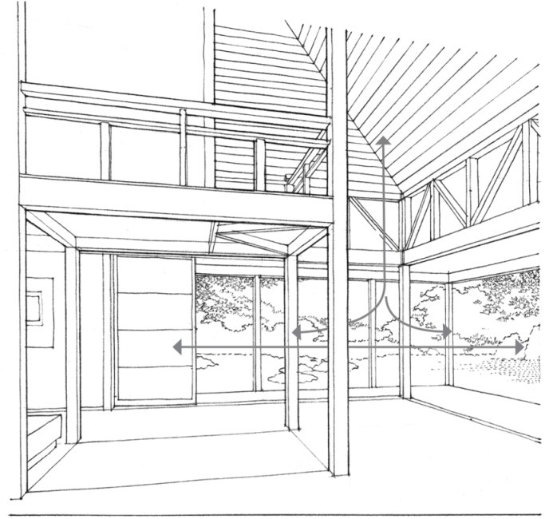

> [BREADCRUMB_CTX: 《Architecture》 > Interlocking Spaces]

## INTERLOCKING SPACES

An interlocking spatial relationship results from the overlapping of two spatial fields and the emergence of a zone of shared space. When two spaces interlock their volumes in this manner, each retains its identity and definition as a space. But the resulting configuration of the two interlocking spaces is subject to a number of interpretations.

The interlocking portion of the two volumes can be shared equally by each space.

The interlocking portion can merge with one of the spaces and become an integral part of its volume.

The interlocking portion can develop its own integrity as a space that serves to link the two original spaces.

**Plan for St. Peter** (Second Version), Rome, 1506–1520, Donato Bramante & Baldassare Peruzzi

**Pilgrimage Church**, Vierzehnheiligen, Germany, 1744–1772, Balthasar Neumann

**Villa at Carthage**, Tunisia, 1928, Le Corbusier

The one-story space flows into the larger volume of which it is a part and to the outdoors.