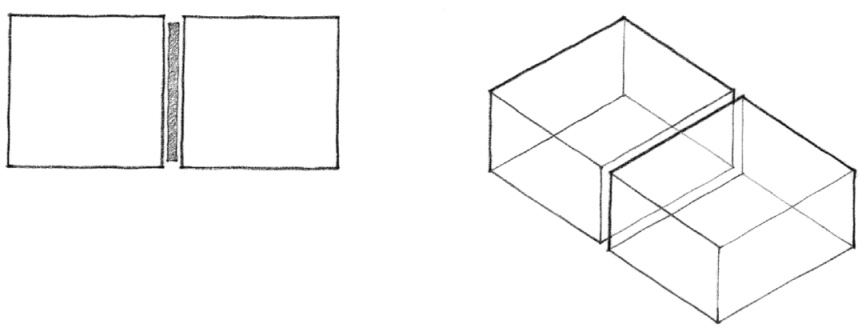
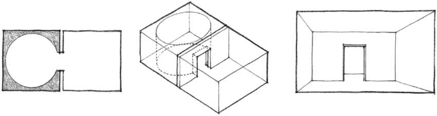
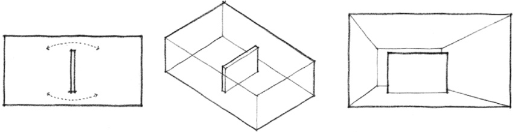
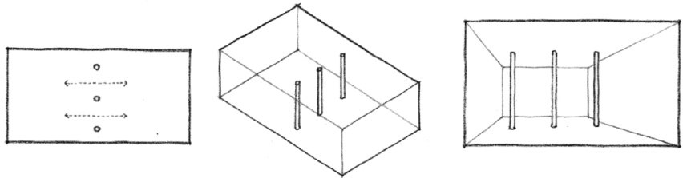
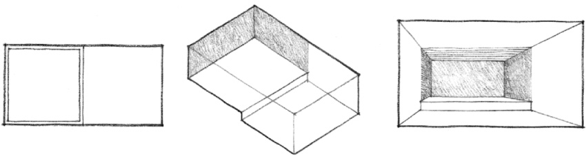
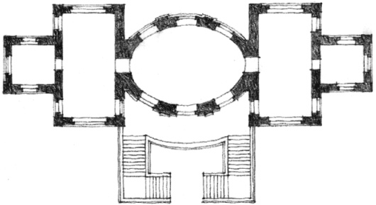
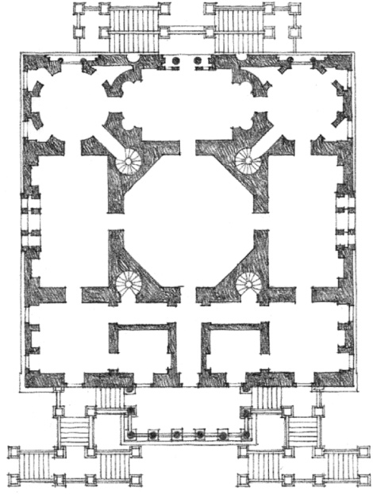
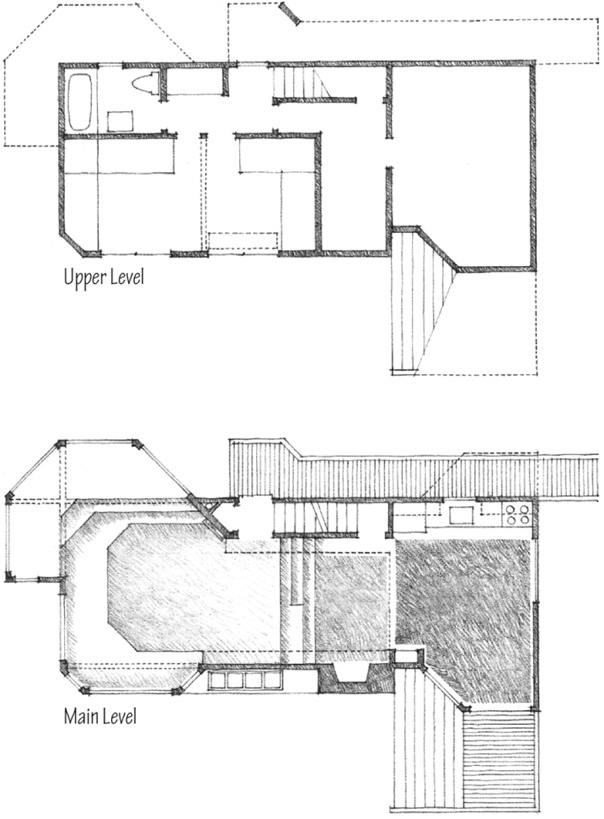
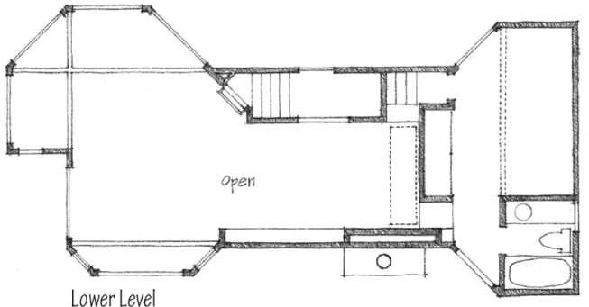

> [BREADCRUMB_CTX: 《Architecture》 > Adjacent Spaces]

## ADJACENT SPACES

Adjacency is the most common type of spatial relationship. It allows each space to be clearly defined and to respond, each in its own way, to specific functional or symbolic requirements. The degree of visual and spatial continuity that occurs between two adjacent spaces depends on the nature of the plane that both separates and binds them together.

The separating plane may:

* limit visual and physical access between two adjacent spaces, reinforce the individuality of each space, and accommodate their differences.

* appear as a freestanding plane in a single volume of space.

* be defined with a row of columns that allows a high degree of visual and spatial continuity between the two spaces.

* be merely implied with a change in level or a contrast in surface material or texture between the two spaces. This and the preceding two cases can also be read as single volumes of space which are divided into two related zones.

**Pavilion Design**, 17th century, Fischer von Erlach

The spaces in these two buildings are individualistic in size, shape, and form. The walls that enclose them adapt their forms to accommodate the differences between adjacent spaces.

**Chiswick House**, London, England, 1729, Lord Burlington & William Kent

Three spaces—the living, fireplace, and dining areas—are defined by changes in floor level, ceiling height, and quality of light and view, rather than by wall planes.

**Lawrence House**, Sea Ranch, California, 1966, Moore-Turnbull/MLTW