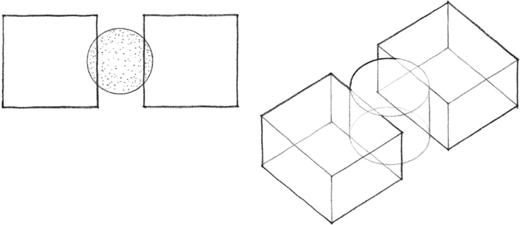
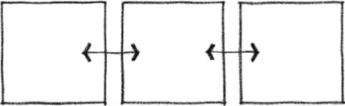
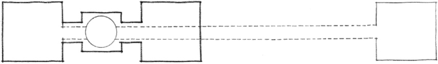
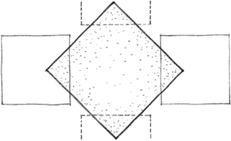
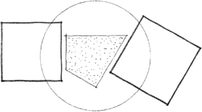
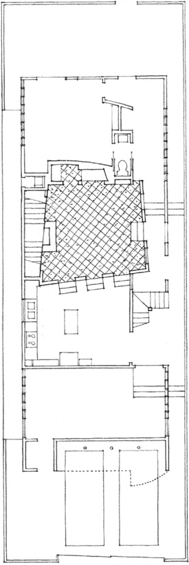
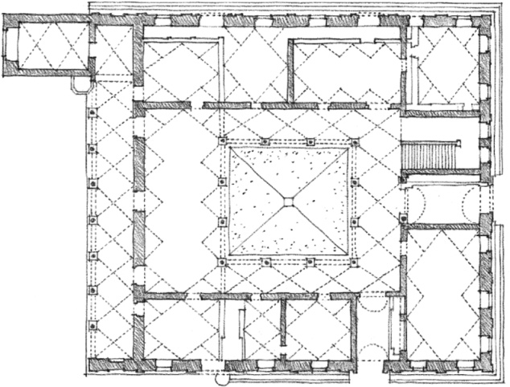
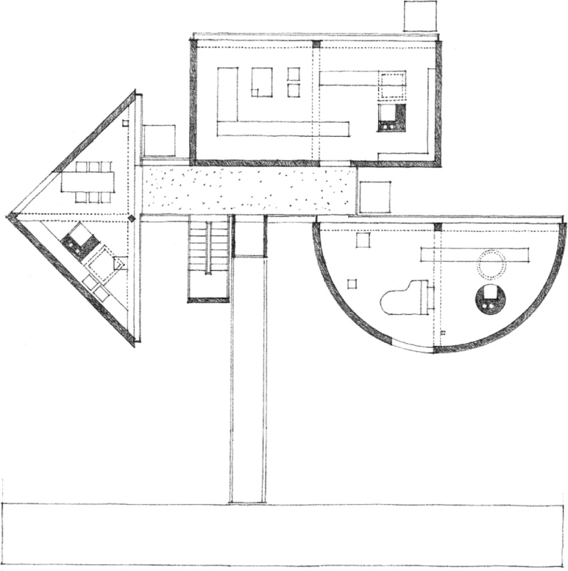

> [BREADCRUMB_CTX: 《Architecture》 > Spaces Linked by a Common Space]

## SPACES LINKED BY A COMMON SPACE

Two spaces that are separated by distance can be linked or related to each other by a third, intermediate, space. The visual and spatial relationship between the two spaces depends on the nature of the third space with which they share a common bond.

The intermediate space can differ in form and orientation from the two spaces to express its linking function.

The two spaces, as well as the intermediate space, can be equivalent in size and shape and form a linear sequence of spaces.

The intermediate space can itself become linear in form to link two spaces that are distant from each other, or join a whole series of spaces that have no direct relationship to one another.

The intermediate space can, if large enough, become the dominant space in the relationship, and be capable of organizing a number of spaces about itself.

The form of the intermediate space can be residual in nature and be determined solely by the forms and orientations of the two spaces being linked.

**Caplin House**, Venice, California, 1979, Frederick Fisher

**Palazzo Piccolomini**, Pienza, Italy, c. 1460, Bernardo Rosselino

**One-Half House** (Project), 1966, John Hejduk