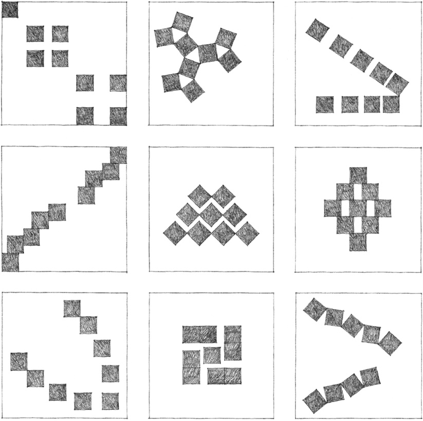
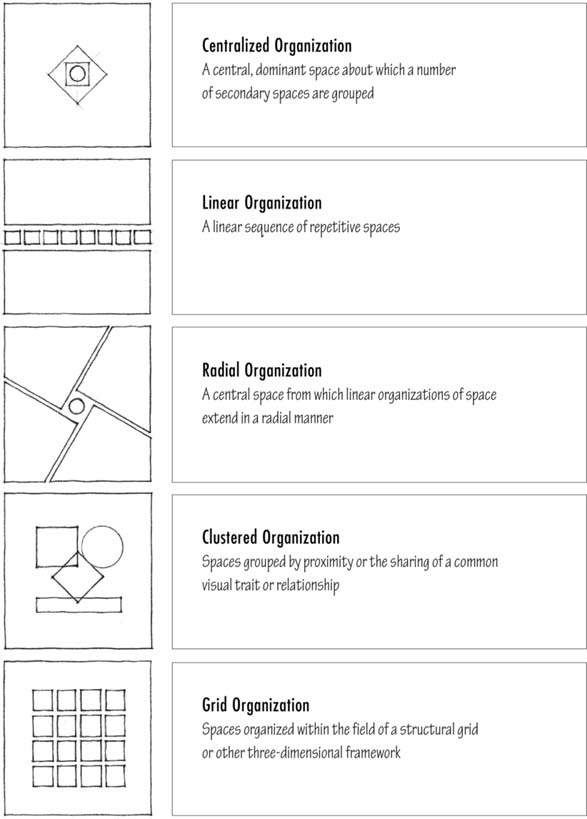

> [BREADCRUMB_CTX: 《Architecture》 > Spatial Organizations]

## SPATIAL ORGANIZATIONS

**Compositions of Nine Squares**: A Bauhaus Study

The following section lays out the basic ways we can arrange and organize the spaces of a building. In a typical building program, there are usually requirements for various kinds of spaces. There may be requirements for spaces that:

* have specific functions or require specific forms
* are flexible in use and can be freely manipulated
* are singular and unique in their function or significance to the building organization
* have similar functions and can be grouped into a functional cluster or repeated in a linear sequence
* require exterior exposure for light, ventilation, outlook, or access to outdoor spaces
* must be segregated for privacy
* must be easily accessible

The manner in which these spaces are arranged can clarify their relative importance and functional or symbolic role in the organization of a building. The decision as to what type of organization to use in a specific situation will depend on:

* demands of the building program, such as functional proximities, dimensional requirements, hierarchical classification of spaces, and requirements for access, light, or view
* exterior conditions of the site that might limit the organization’s form or growth, or that might encourage the organization to address certain features of its site and turn away from others

Each type of spatial organization is introduced by a section that discusses the formal characteristics, spatial relationships, and contextual responses of the category. A range of examples then illustrates the basic points made in the introduction. Each of the examples should be studied in terms of:

* What kinds of spaces are accommodated and where? How are they defined?
* What kinds of relationships are established among the spaces, one to another, and to the exterior environment?
* Where can the organization be entered and what configuration does the path of circulation have?
* What is the exterior form of the organization and how might it respond to its context?

