> [BREADCRUMB_CTX: 《Architecture》 > Linear Organizations]

## LINEAR ORGANIZATIONS

A linear organization consists essentially of a series of spaces. These spaces can either be directly related to one another or be linked through a separate and distinct linear space.

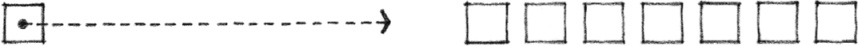

A linear organization usually consists of repetitive spaces which are alike in size, form, and function. It may also consist of a single linear space that organizes along its length a series of spaces that differ in size, form, or function. In both cases, each space along the sequence has an exterior exposure.

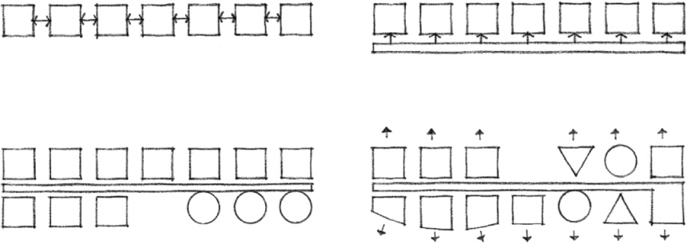

Spaces that are functionally or symbolically important to the organization can occur anywhere along the linear sequence and have their importance articulated by their size and form. Their significance can also be emphasized by their location:

* at the end of the linear sequence
* offset from the linear organization
* at pivotal points of a segmented linear form

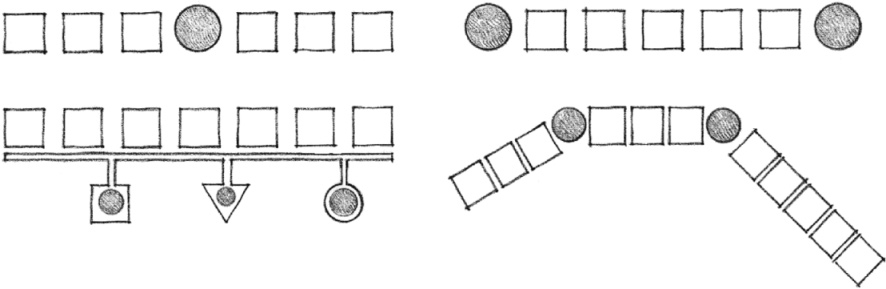
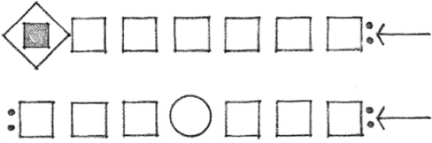

Because of their characteristic length, linear organizations express a direction and signify move-ment, extension, and growth. To limit their growth, linear organizations can be terminated by a dominant space or form, by an elaborate or articulated entrance, or by merging with another building form or the topography of its site.

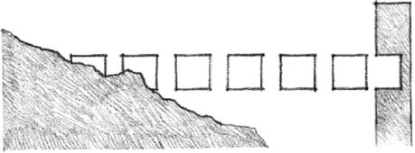

The form of a linear organization is inherently flexible and can respond readily to various conditions of its site. It can adapt to changes in topography, maneuver around a body of water or a stand of trees, or turn to orient spaces to capture sunlight and views. It can be straight, segmented, or curvilinear. It can run horizontally across its site, diagonally up a slope, or stand vertically as a tower.

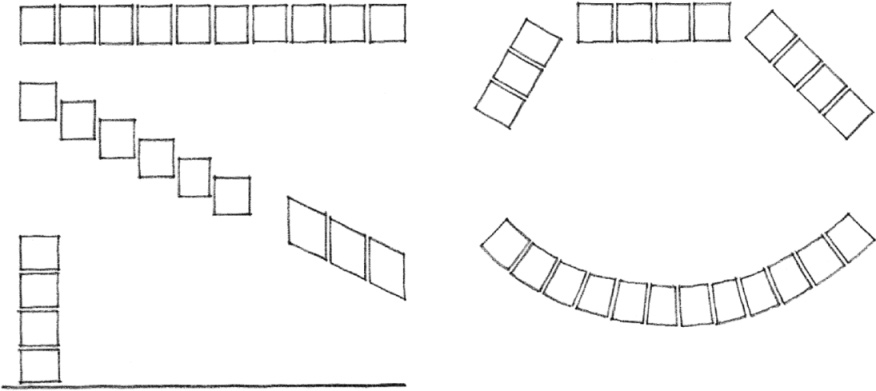

The form of a linear organization can relate to other forms in its context by:

* linking and organizing them along its length
* serving as a wall or barrier to separate them into different fields
* surrounding and enclosing them within a field of space

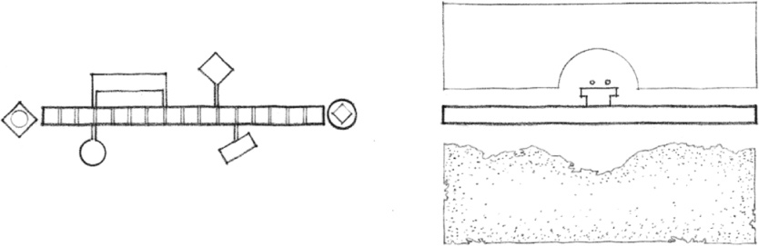

Curved and segmented forms of linear organizations enclose a field of exterior space on their concave sides and orient their spaces toward the center of the field. On their concave sides, these forms appear to front space and exclude it from their fields.

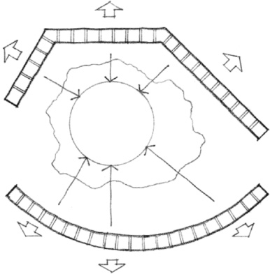
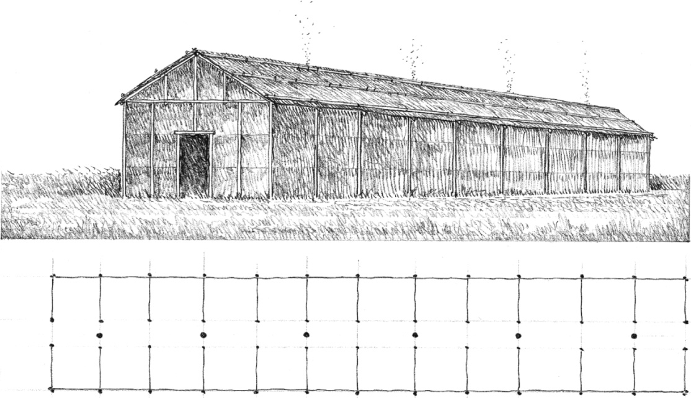

**Longhouse**, a dwelling type of the member tribes of the Iroquois Confederacy in North America, c. 1600.

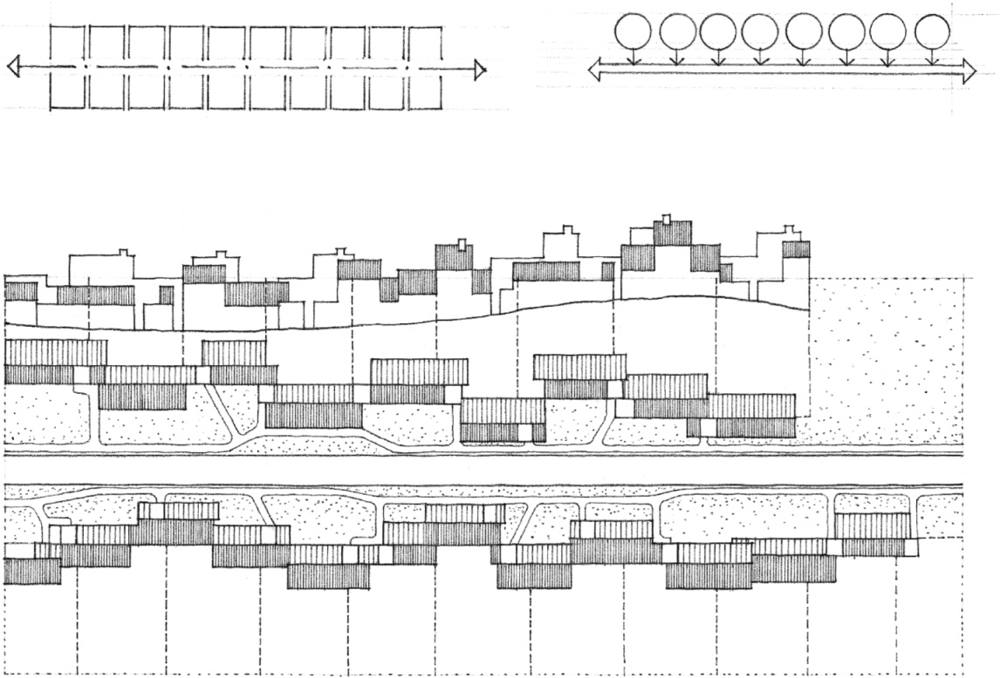

Terraced Housing Fronting a Village Street, **Village Project**, 1955, James Stirling (Team X)

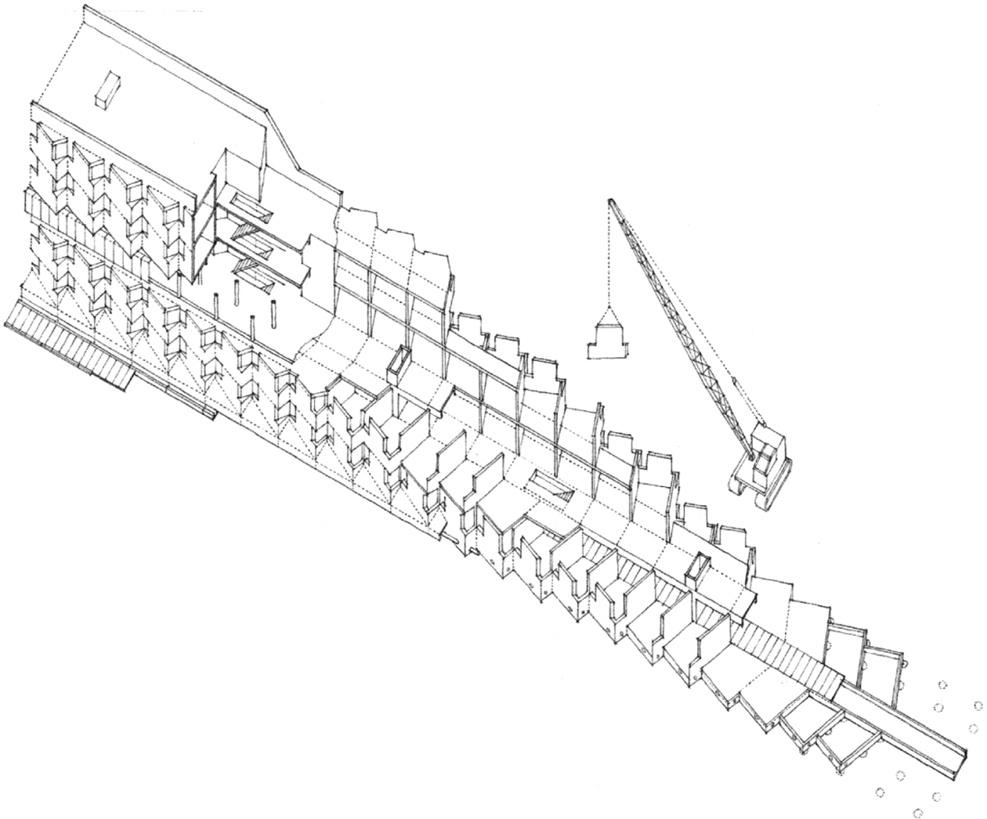

Residential Expansion, **St. Andrews University**, Scotland, 1964–1968, James Stirling

### Linear Sequences of Spaces

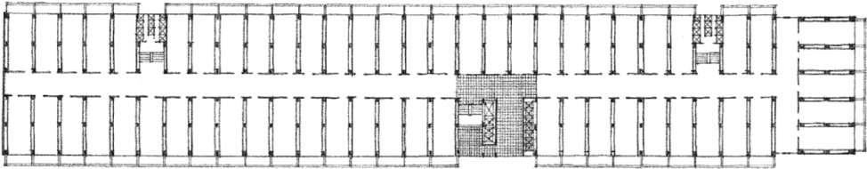

Typical Apartment Floor, **Unité d’Habitation**, Marseilles, 1946–1952, Le Corbusier

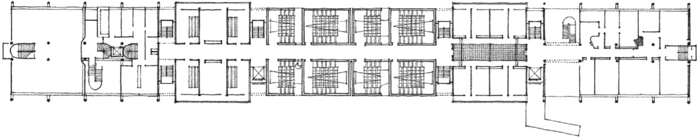

Second Floor Plan, Main Building, **Sheffield University** (Project), England, 1953, James Stirling

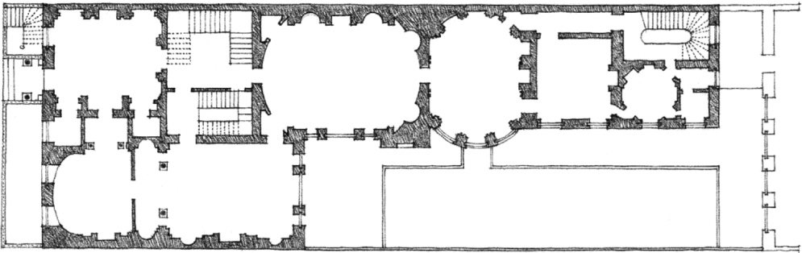

**Lord Derby’s House**, London, 1777 Robert Adam

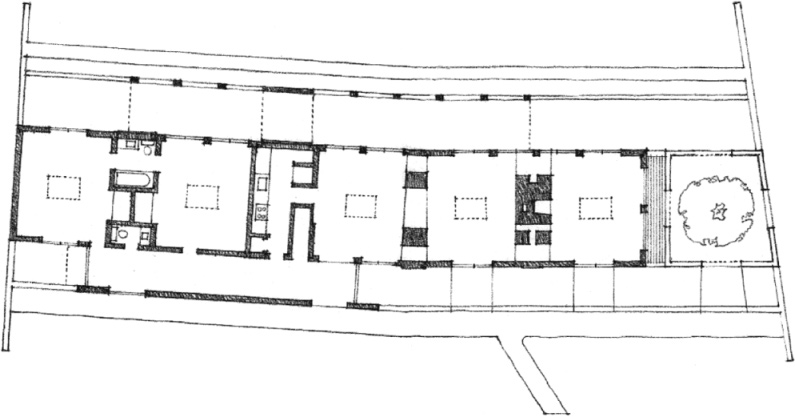

**Pearson House** (Project), 1957, Robert Venturi

### Linear Sequences of Rooms…

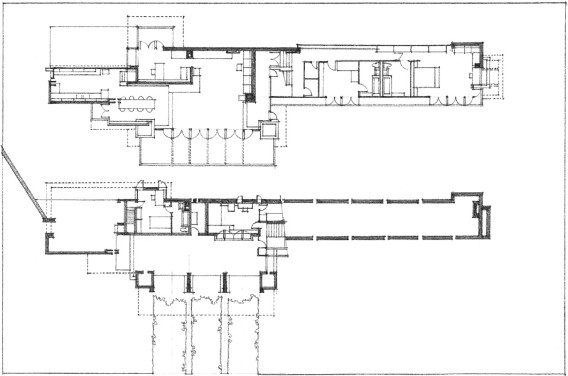

**Lloyd Lewis House**, Libertyville, Illinois, 1940, Frank Lloyd Wright

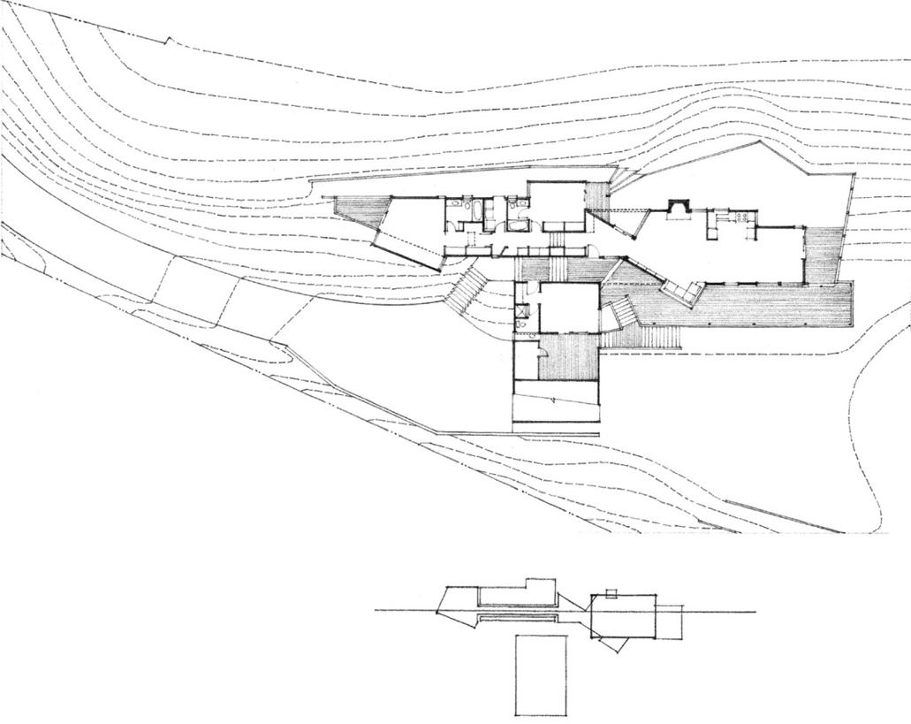

**Romano House**, Kentfield, California, 1970, Esherick Homsey Dodge & Davis

### Adapting to Function and Site

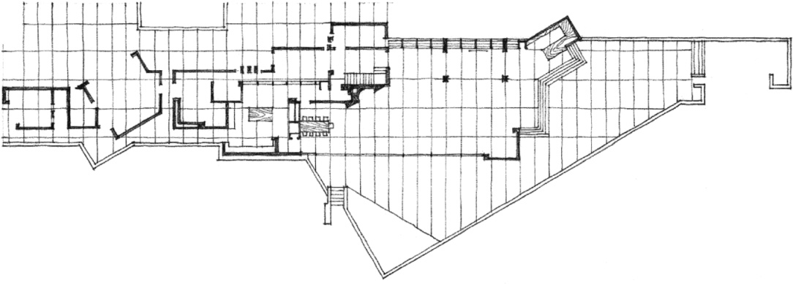

**Marcus House** (Project), Dallas, Texas, 1935, Frank Lloyd Wright

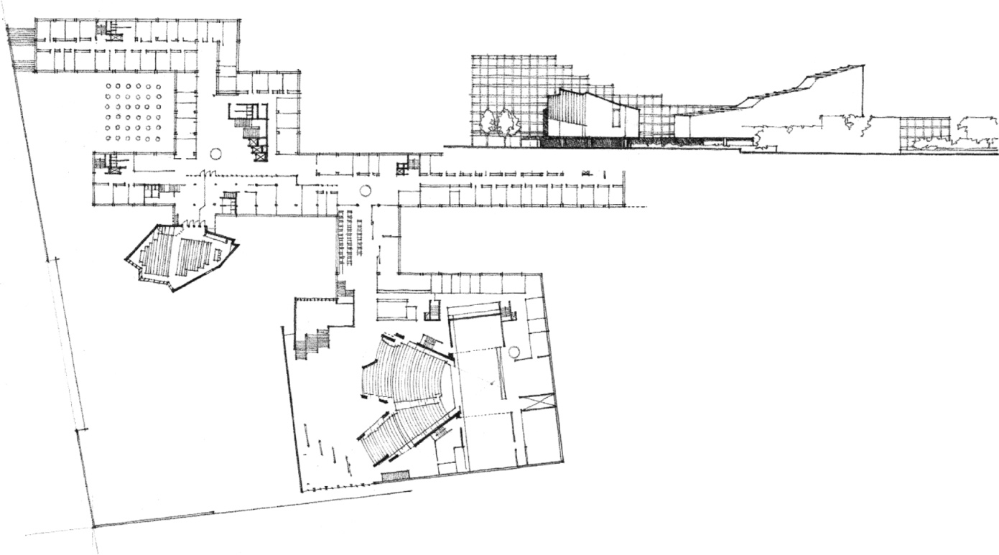

**Town Center for Castrop-Rauxel**, Germany, (Competition Entry), 1965, Alvar Aalto

### Introducing Hierarchy to Linear Sequences…

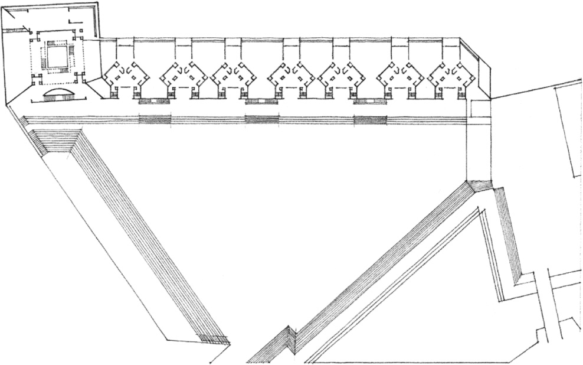

**Interama**, Project for an Inter-American Community, Florida, 1964–1967, Louis Kahn

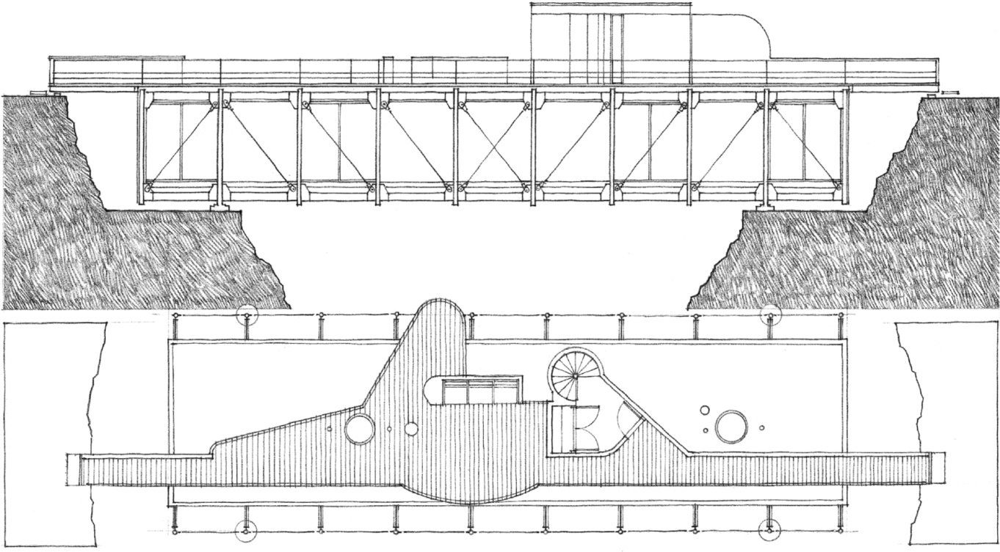

**Bridge House** (Project), Christopher Owen

### and Expressing Movement

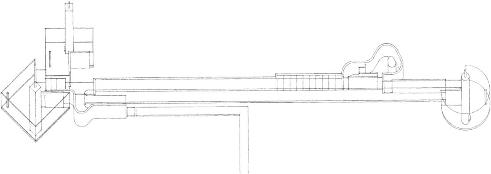

**House 10** (Project), 1966, John Hejduk

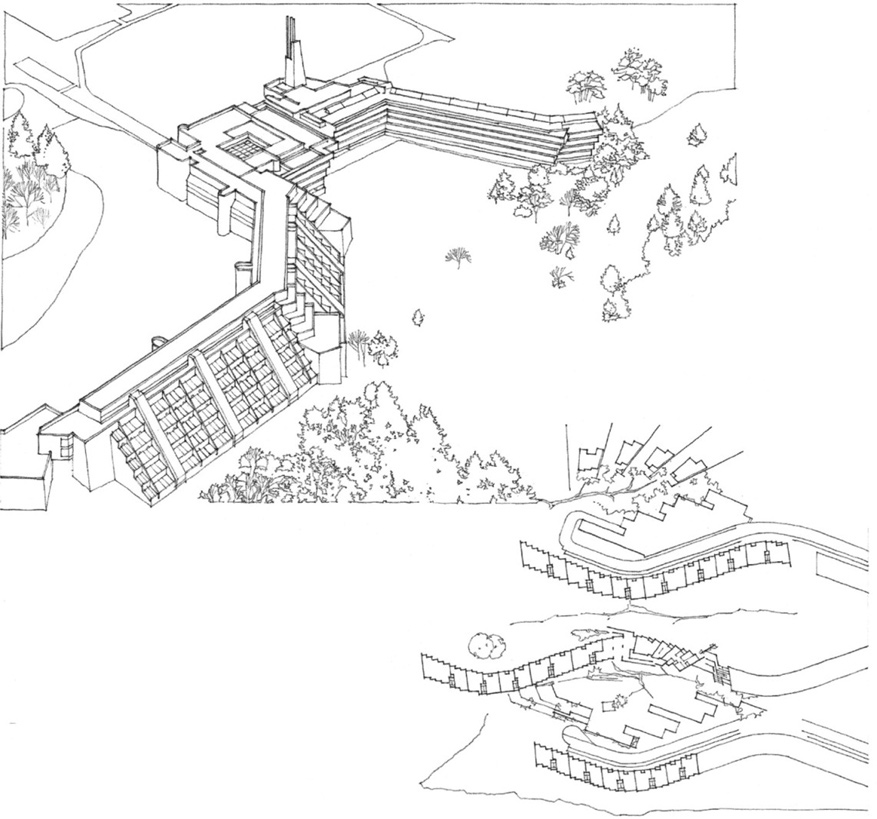

**Scarborough College**, Westhill, Ontario, 1964, John Andrews

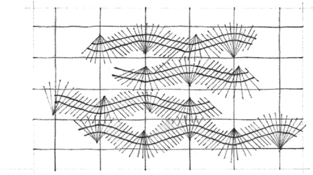

**Housing Development**, Pavia, Italy, 1966, Alvar Aalto

### Linear Organizations Adapting to Site…

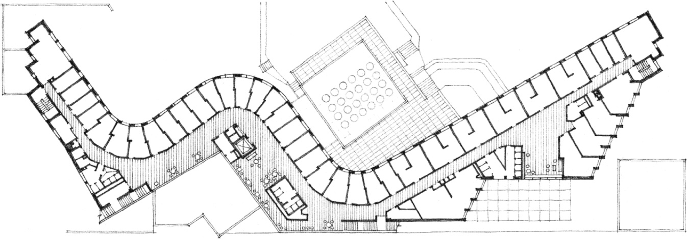

Typical Upper-Floor Plan, **Baker House**, Massachusetts Institute of Technology, Cambridge, Massachusetts, 1948, Alvar Aalto

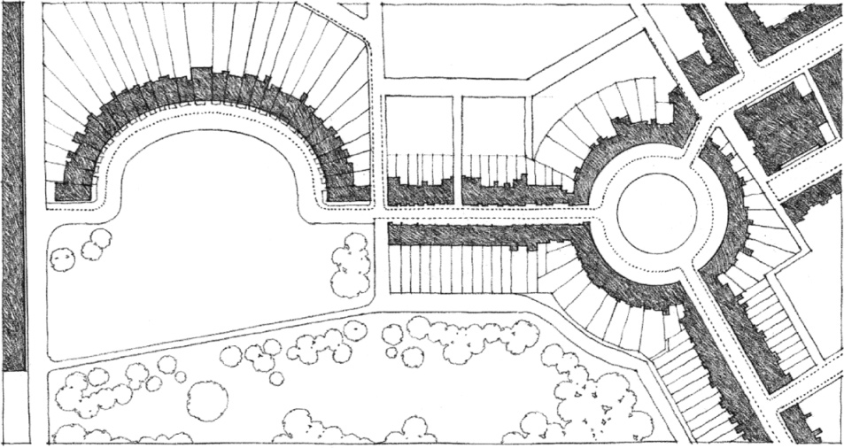

Plan for the **Circus** (1754, John Wood, Sr.) and the **Royal Crescent** (1767–1775, John Wood) at Bath, England

### and Shaping Exterior Space