> [BREADCRUMB_CTX: 《Architecture》 > Radial Organizations]

## RADIAL ORGANIZATIONS

A radial organization of space combines elements of both centralized and linear organizations. It consists of a dominant central space from which a number of linear organizations extend in a radial manner. Whereas a centralized organization is an introverted scheme that focuses inward on its central space, a radial organization is an extroverted plan that reaches out to its context. With its linear arms, it can extend and attach itself to specific elements or features of its site.

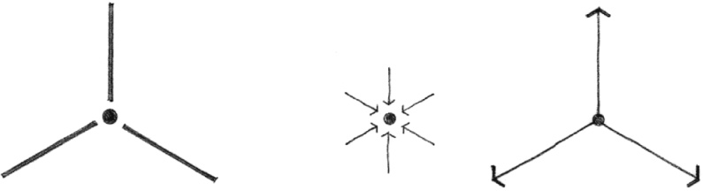

As with centralized organizations, the central space of a radial organization is generally regular in form. The linear arms, for which the central space is the hub, may be similar to one another in form and length and maintain the regularity of the organization’s overall form.

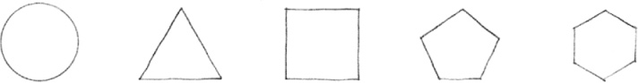

The radiating arms may also differ from one another in order to respond to individual requirements of function and context.

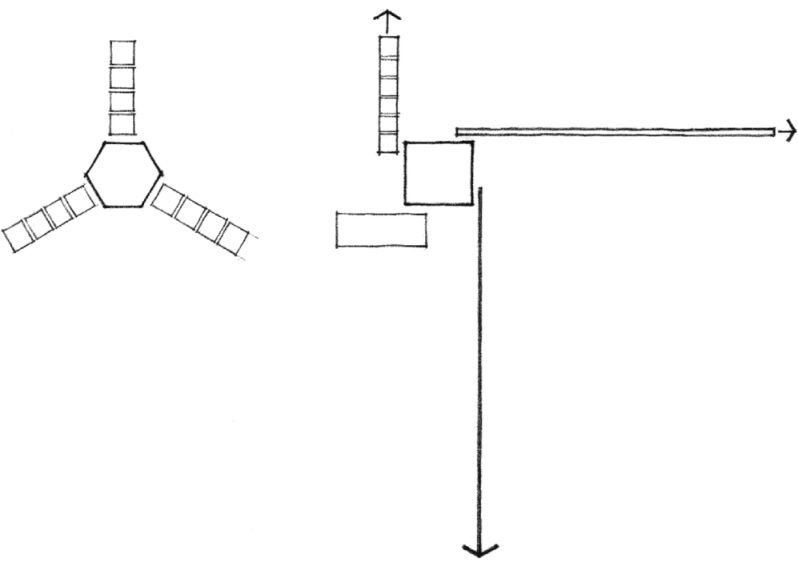

A specific variation of a radial organization is the pinwheel pattern wherein the linear arms of the organization extend from the sides of a square or rectangular central space. This arrangement results in a dynamic pattern that visually suggests a rotational movement about the central space.

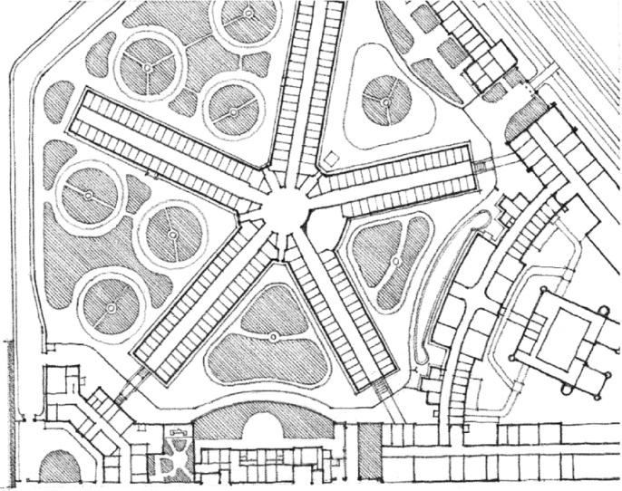

**Moabit Prison**, Berlin, 1869–1879, August Busse and Heinrich Herrmann

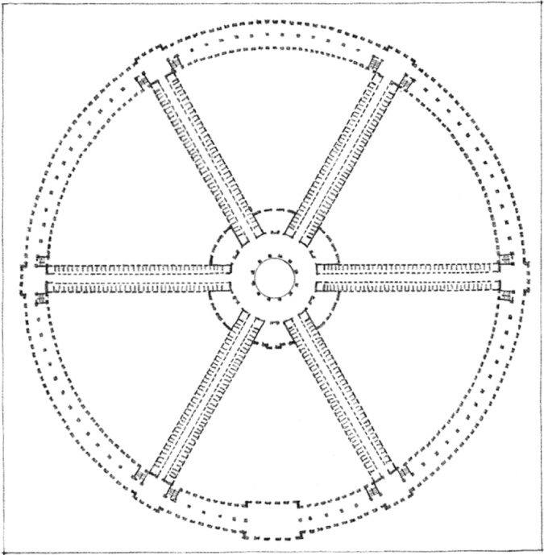

**Hôtel Dieu** (Hospital), 1774, Antoine Petit

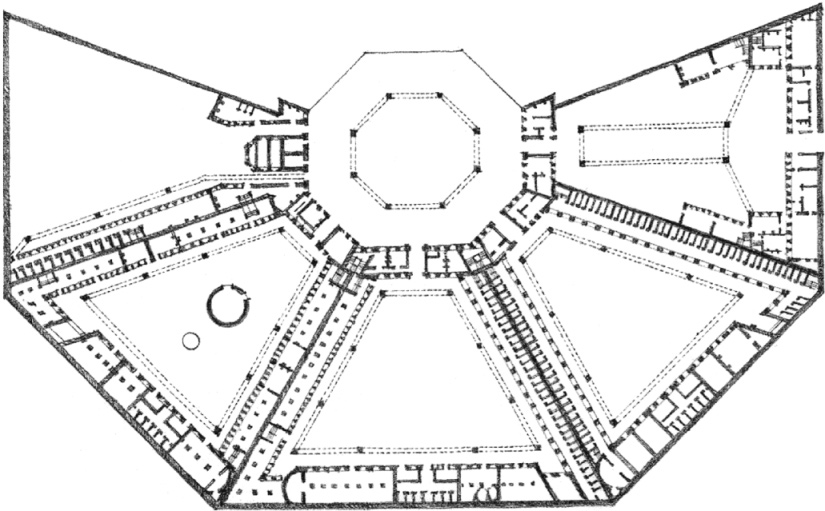

**Maison de Force** (Prison), Ackerghem near Ghent, Belgium, 1772–1775, Malfaison and Kluchman

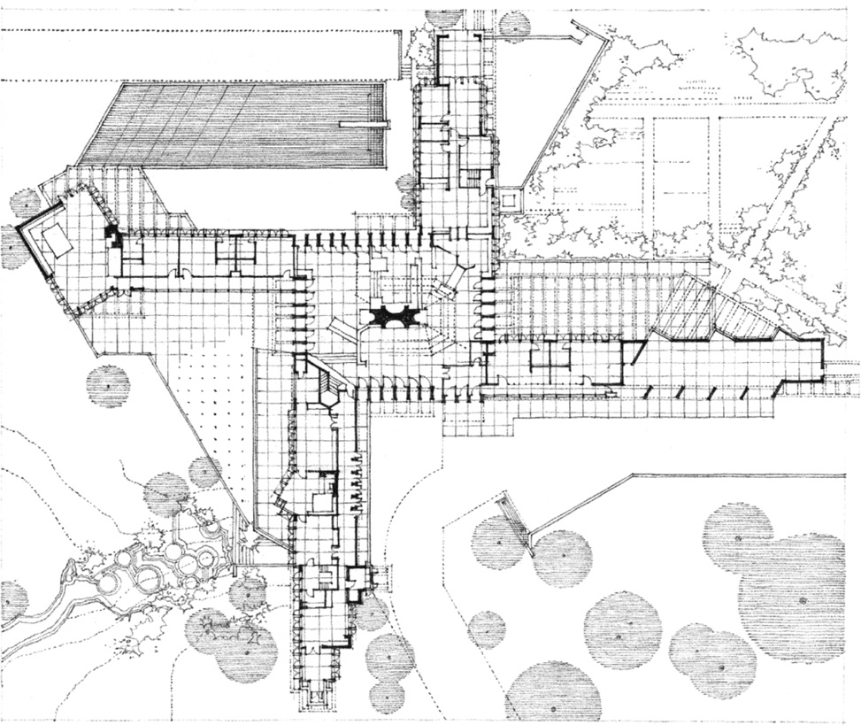

**Herbert F. Johnson House (Wingspread**), Wind Point, Wisconsin, 1937, Frank Lloyd Wright

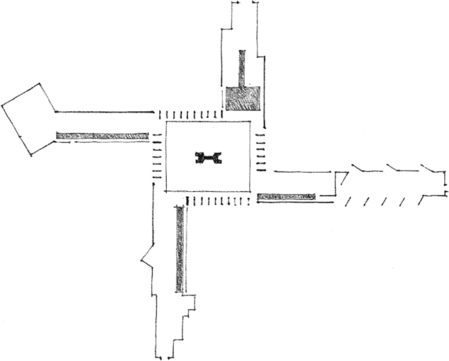
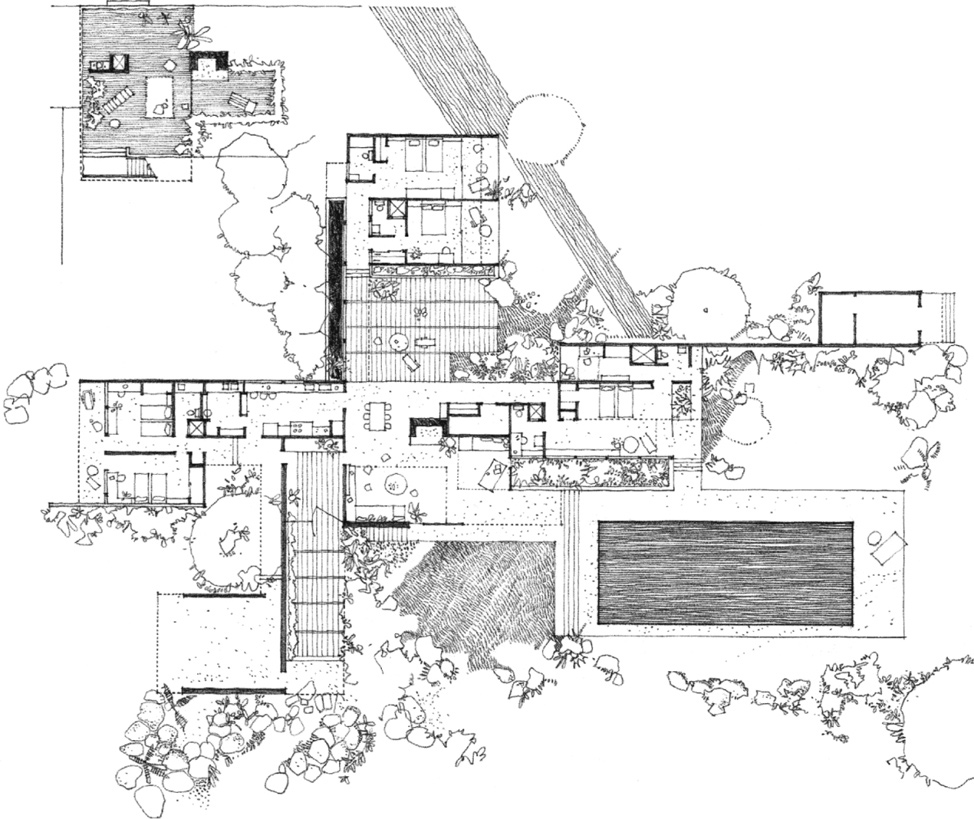

**Kaufmann Desert House**, Palm Springs, California, 1946, Richard Neutra

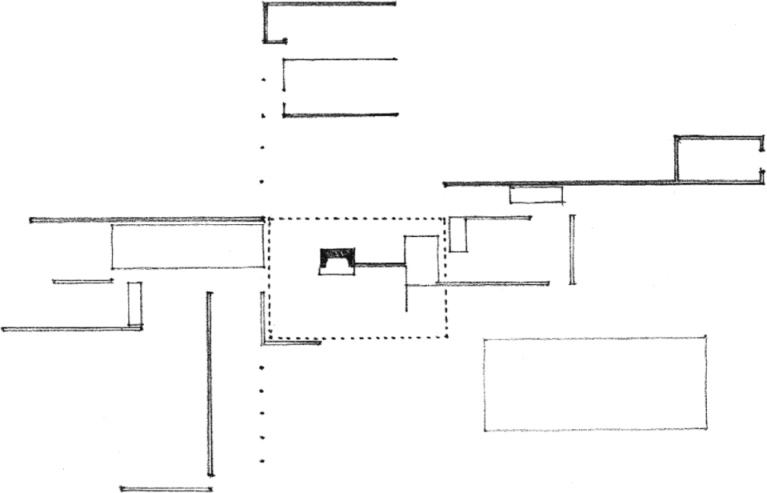
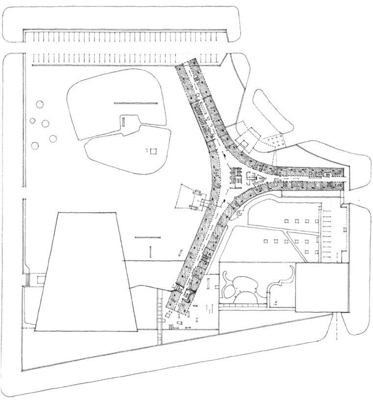

**Secretariat Building**, UNESCO Headquarters, Place de Fontenoy, Paris, 1953–1958, Marcel Breuer

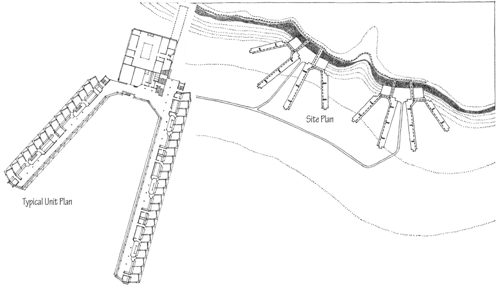

Residential Expansion, **St. Andrews University**, Scotland, 1964–1968, James Stirling

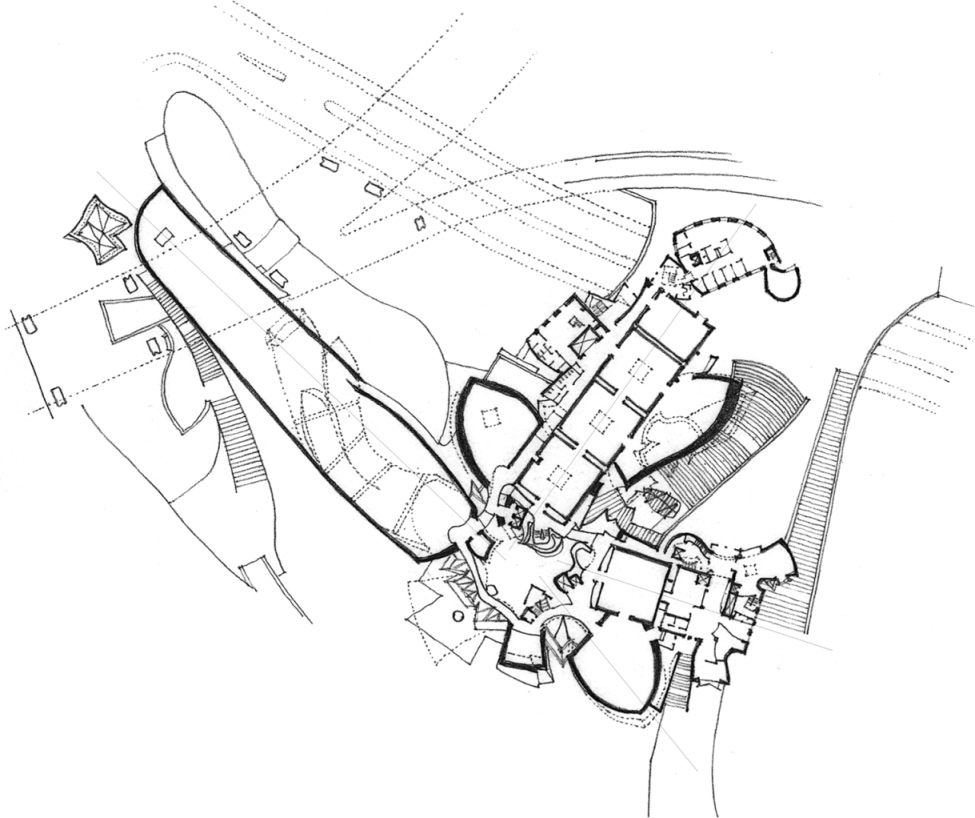

**Guggenheim Museum**, Bilbao, Spain, 1991–1997, Frank Gehry

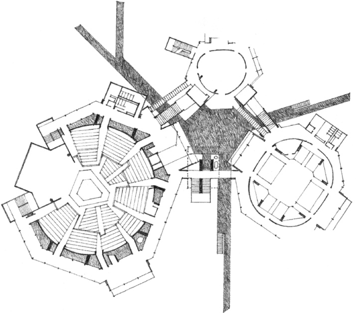

**New Mummers Theater**, Oklahoma City, Oklahoma, 1970, John M. Johansen

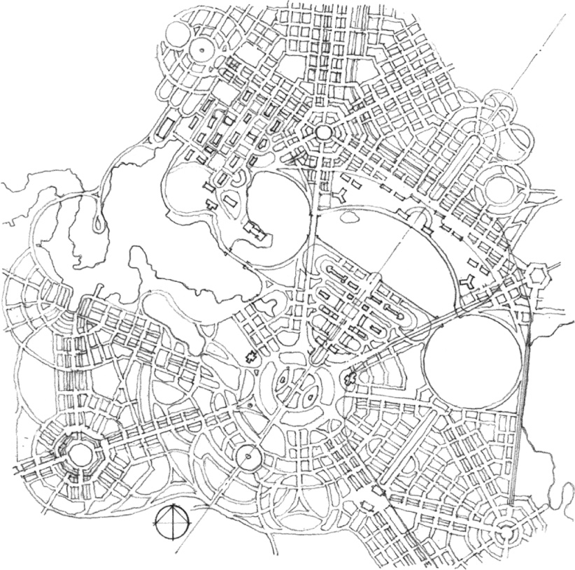

**Plan for Canberra**, Australia, 1911, Walter Burley Griffin