> [BREADCRUMB_CTX: 《Architecture》 > Clustered Organizations]

## CLUSTERED ORGANIZATIONS

A clustered organization relies on physical proximity to relate its spaces to one another. It often consists of repetitive, cellular spaces that have similar functions and share a common visual trait such as shape or orientation. A clustered organization can also accept within its composition spaces that are dissimilar in size, form, and function, but related to one another by proximity or a visual ordering device such as symmetry or an axis. Because its pattern does not originate from a rigid geometrical concept, the form of a clustered organization is flexible and can accept growth and change readily without affecting its character.

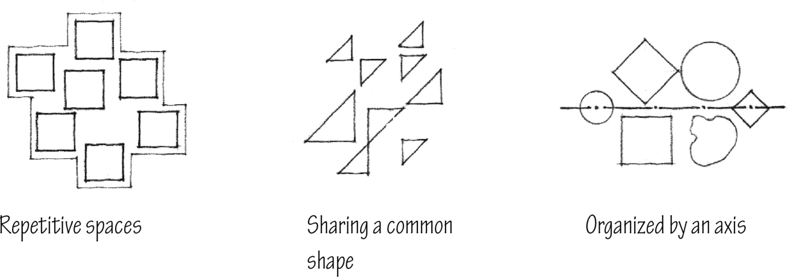

Clustered spaces can be organized about a point of entry into a building or along the path of movement through it. The spaces can also be clustered about a large defined field or volume of space. This pattern is similar to that of a centralized organization, but it lacks the latter’s compactness and geometrical regularity. The spaces of a clustered organization can also be contained within a defined field or volume of space.

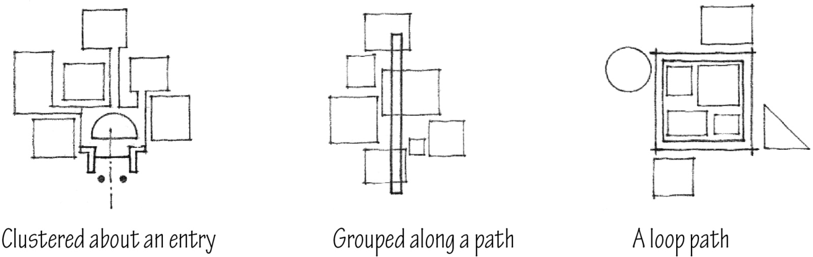

Since there is no inherent place of importance within the pattern of a clustered organization, the significance of a space must be articulated by its size, form, or orientation within the pattern.

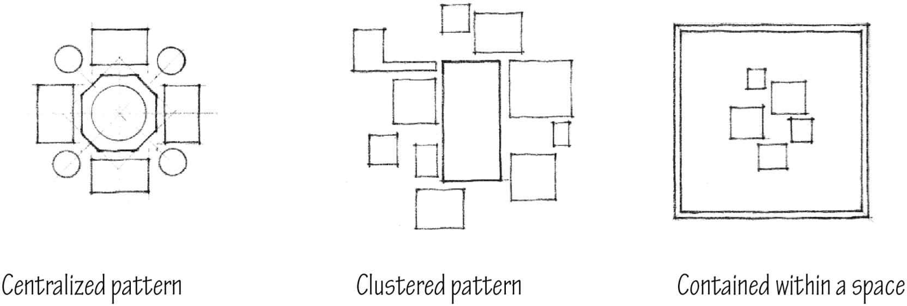

Symmetry or an axial condition can be used to strengthen and unify portions of a clustered organization and help articulate the importance of a space or group of spaces within the organization.

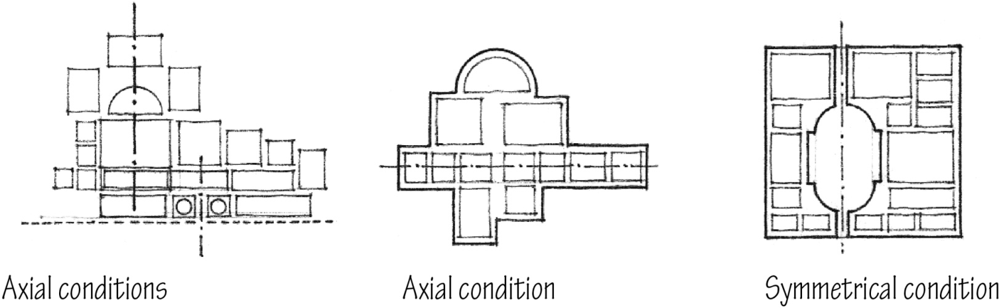
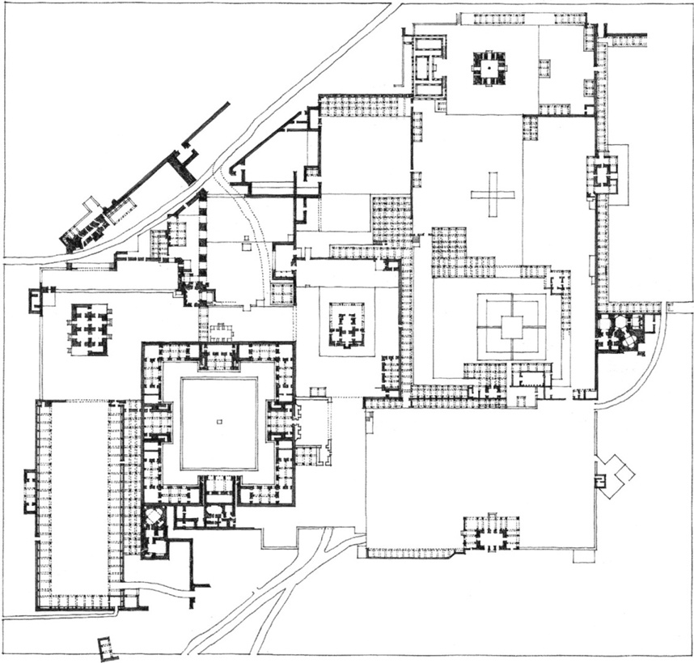

**Fatehpur Sikri**, Palace Complex of Akbar the Great Mogul Emperor of India, 1569–1574

### Spaces Organized by Geometry

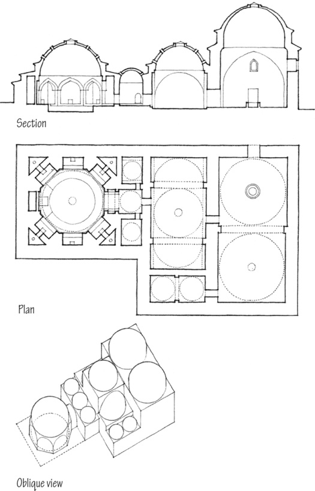

**Yeni-Kaplica** (Thermal Bath), Bursa,Turkey

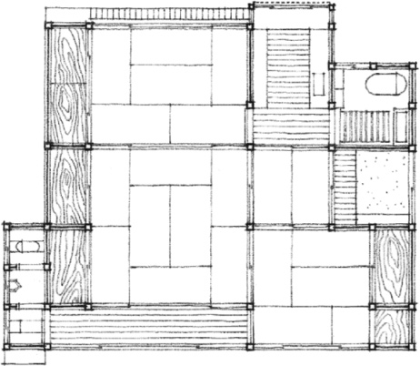

**Traditional Japanese House**

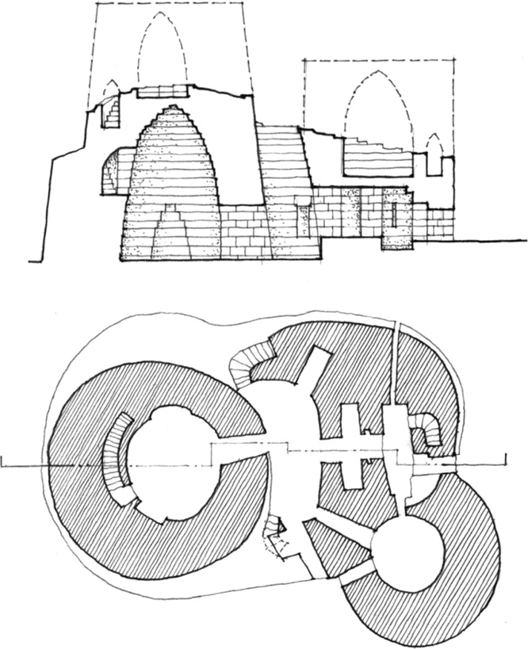

**Nuraghe at Palmavera**, Sardinia, typical of the ancient stone towers of the Nuraghic culture, 18th–16th century B.C.

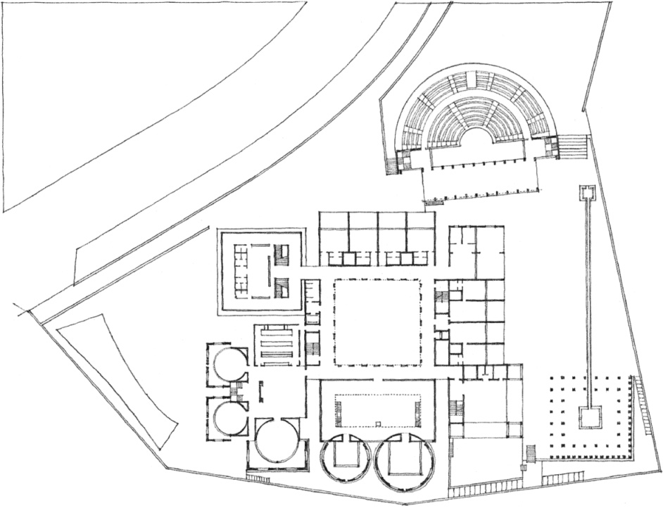

**Meeting House, Salk Institute of Biological Studies** (Project), La Jolla, California, 1959–1965, Louis Kahn

### Spaces Organized Around a Dominant Space

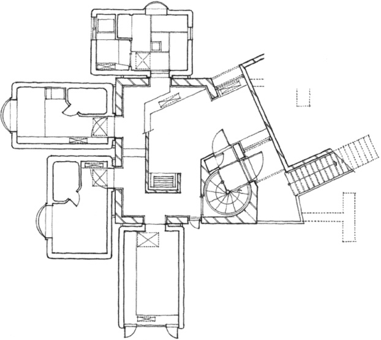

**Karuizawa House**, Country Retreat, 1974, Kisho Kurokawa

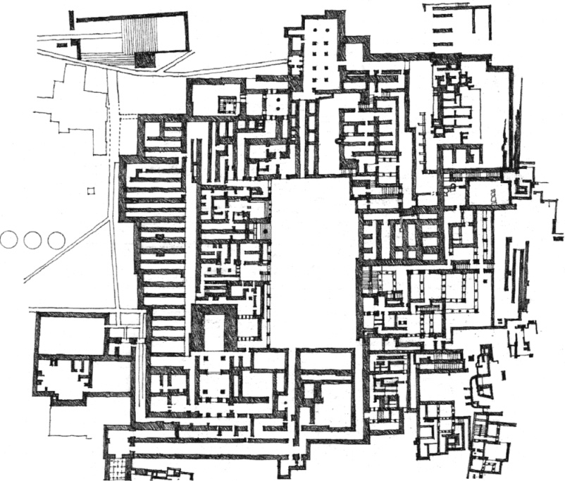

**Palace of King Minos**, Knossos, Crete, c. 1500 B.C.

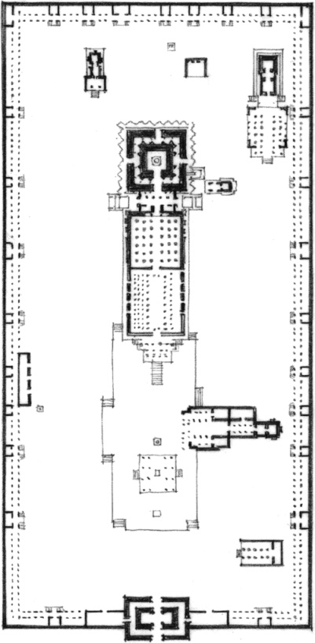

**Rajarajeshwara Temple**, Thanjavur, India, 11th century

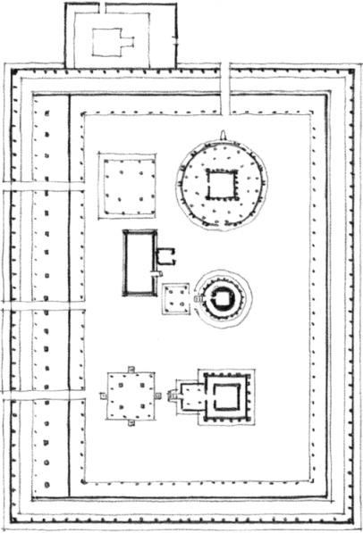

**Vadakkunnathan Temple**, Trichur, India, 11th century

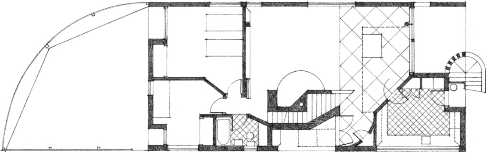

**House for Mrs. Robert Venturi**, Chestnut Hill, Pennsylvania, 1962–1964, Venturi and Short

### Spaces Organized within a Spatial Field

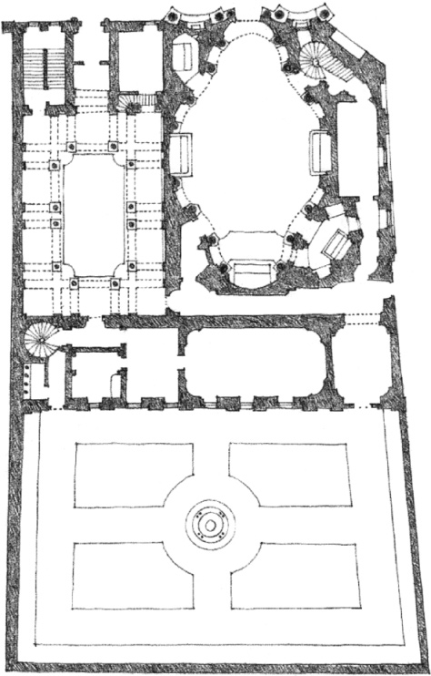

**St. Carlo alle Quattro Fontane**, Rome, 1633–1641, Francesco Borromini

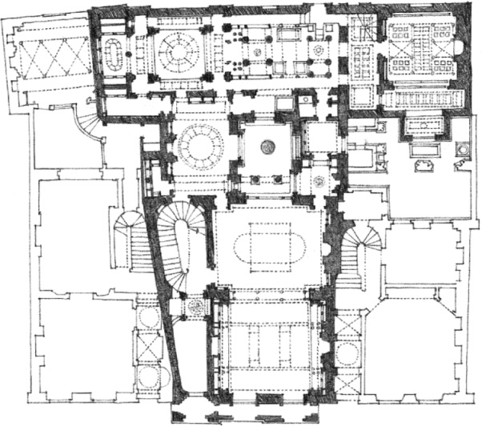

**Soane House**, London, England, 1812–1834, Sir John Soane

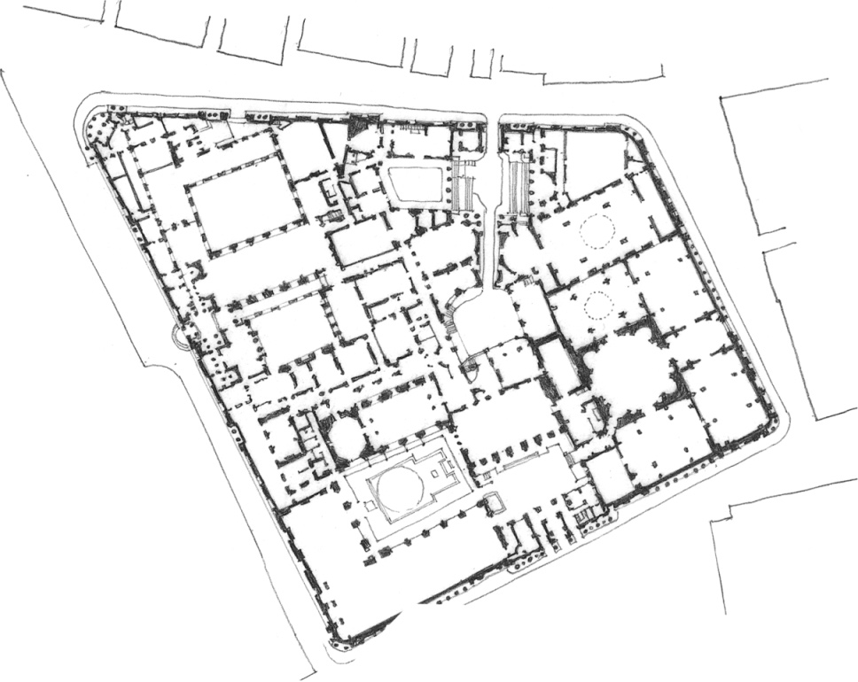

**Bank of England**, London, England, 1788–1833, Sir John Soane

### Spaces Organized by Axial Symmetries

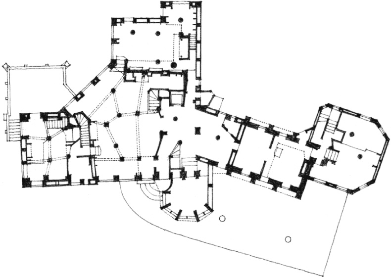

**Mercer’s Castle (Fonthill)**, Doylestown, Pennsylvania, 1908–1910, Henry Mercer

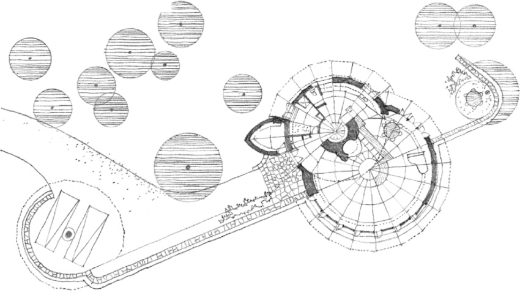

**Friedman House**, Pleasantville, N.Y., 1950, Frank Lloyd Wright

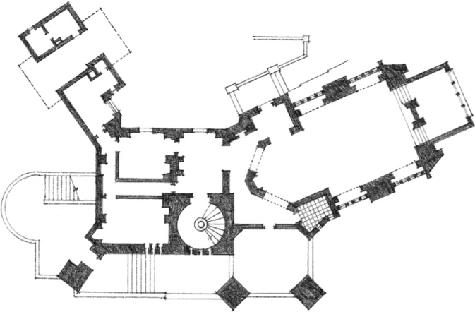

**Wyntoon**, Country Estate for the Hearst Family in Northern California,1903, Bernard Maybeck

### Spaces Organized by Site Conditions

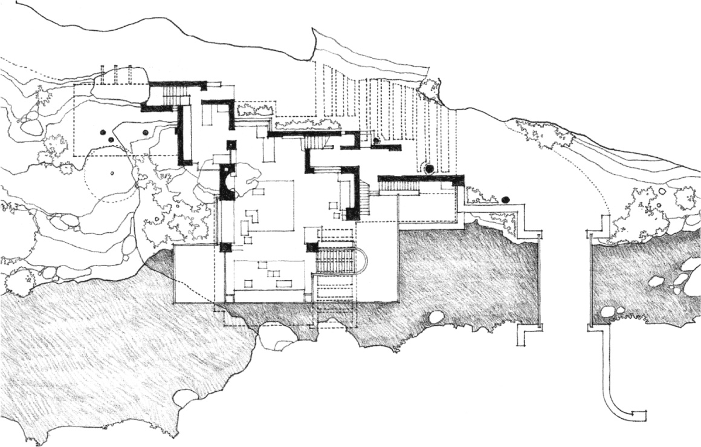

**Fallingwater (Kaufmann House)**, near Ohiopyle, Pennsylvania, 1936–1937, Frank Lloyd Wright

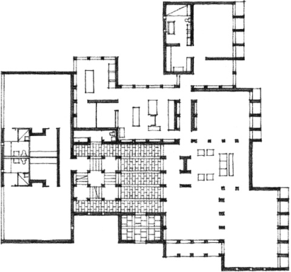

**Morris House** (Project), Mount Kisco, New York, 1958, Louis Kahn

### Spaces Organized by Geometric Pattern

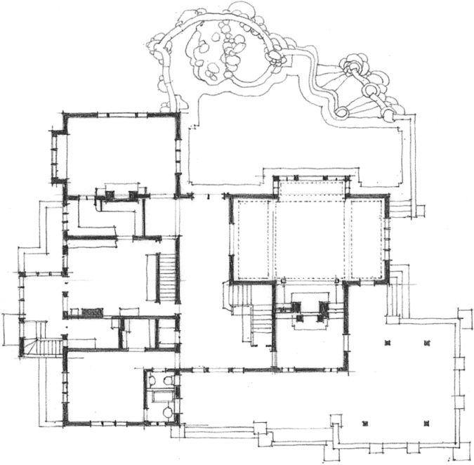

**Gamble House**, Pasadena, California, 1908, Greene & Greene