> [BREADCRUMB_CTX: 《Architecture》 > Grid Organizations]

## GRID ORGANIZATIONS

A grid organization consists of forms and spaces whose positions in space and relationships with one another are regulated by a three-dimensional grid pattern or field.

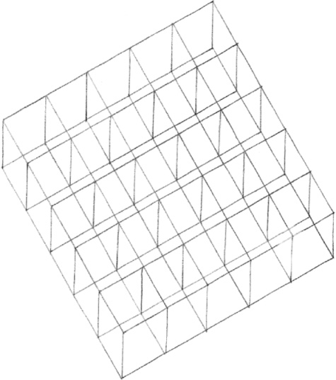

A grid is created by two, usually perpendicular, sets of parallel lines that establish a regular pattern of points at their intersections. Projected into the third dimension, the grid pattern is transformed into a set of repetitive, modular units of space.

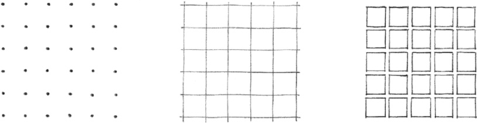

The organizing power of a grid results from the regularity and continuity of its pattern that pervades the elements it organizes. Its pattern establishes a stable set or field of reference points and lines in space with which the spaces of a grid organization, although dissimilar in size, form, or function, can share a common relationship.

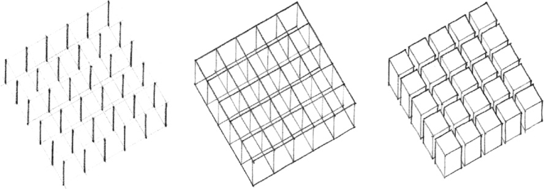

A grid is established in architecture most often by a skeletal structural system of columns and beams. Within the field of this grid, spaces can occur as isolated events or as repetitions of the grid module. Regardless of their disposition within the field, these spaces, if seen as positive forms, will create a second set of negative spaces.

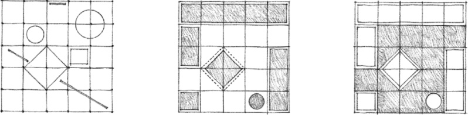

Since a three-dimensional grid consists of repetitive, modular units of space, it can be subtracted from, added to, or layered, and still maintain its identity as a grid with the ability to organize spaces. These formal manipulations can be used to adapt a grid form to its site, to define an entrance or outdoor space, or to allow for its growth and expansion.

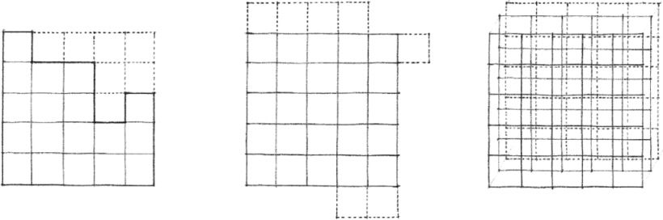

To accommodate the specific dimensional requirements of its spaces or to articulate zones of space for circulation or service, a grid can be made irregular in one or two directions. This dimensional transformation would create a hierarchical set of modules differentiated by size, proportion, and location.

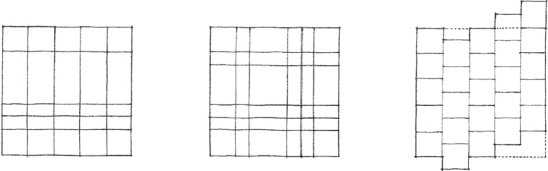

A grid can also undergo other transformations. Portions of the grid can slide to alter the visual and spatial continuity across its field. A grid pattern can be interrupted to define a major space or accommodate a natural feature of its site. A portion of the grid can be dislocated and rotated about a point in the basic pattern. Across its field, a grid can transform its image from a pattern of points to lines, to planes, and finally, to volumes.

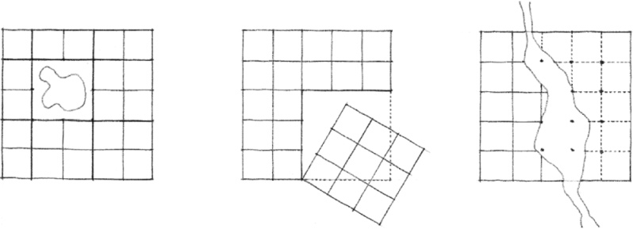
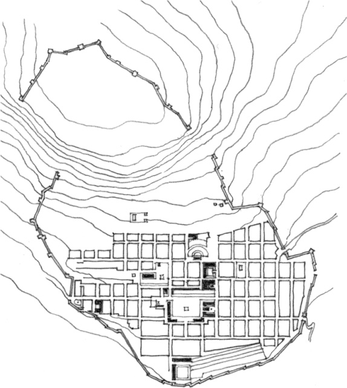

City of **Priene**, Turkey, founded 334 B.C.

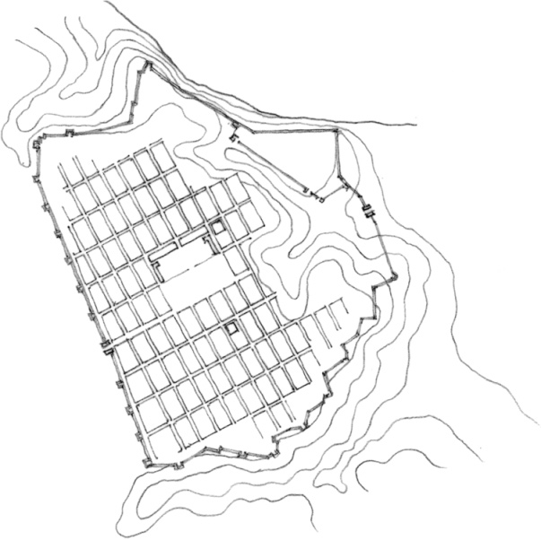

Plan of **Dura-Europos**, near Salhiyé, Syria, 4th century B.C.

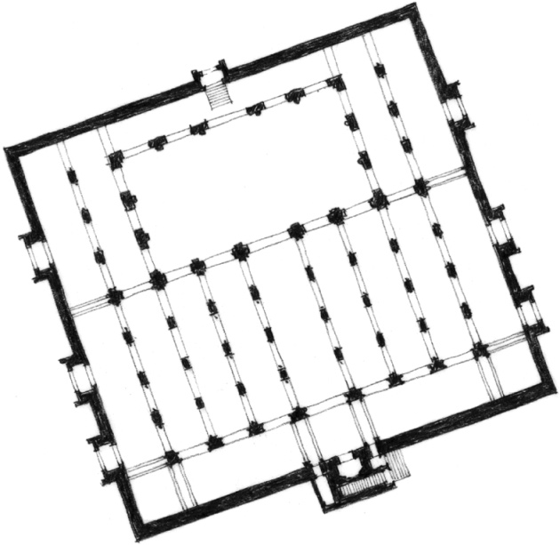

**Mosque of Tinmal**, Morocco, 1153–1154

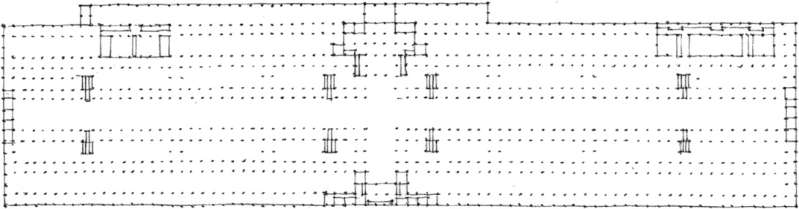

**Crystal Palace**, London, England, Great Exhibition of 1851, Sir Joseph Paxton

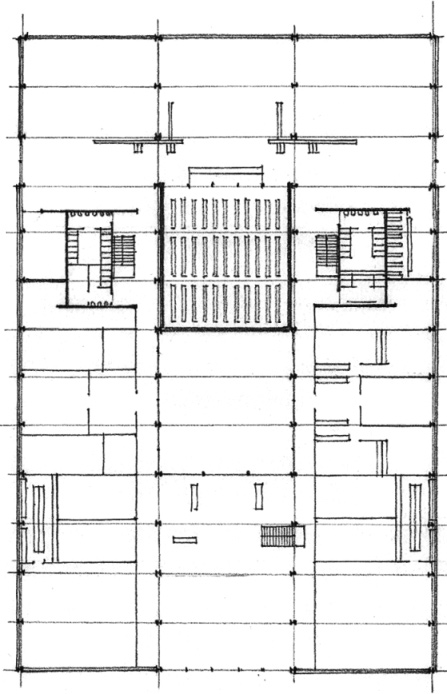

**IIT Library Building** (Project), Chicago, Illinois, 1942–1943, Mies van der Rohe

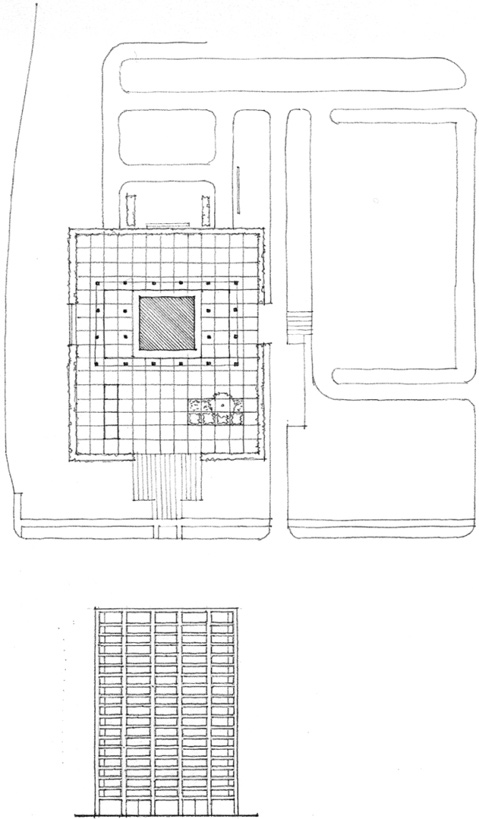

**Business Men’s Assurance Co. of America**, Kansas City, Missouri, 1963, SOM

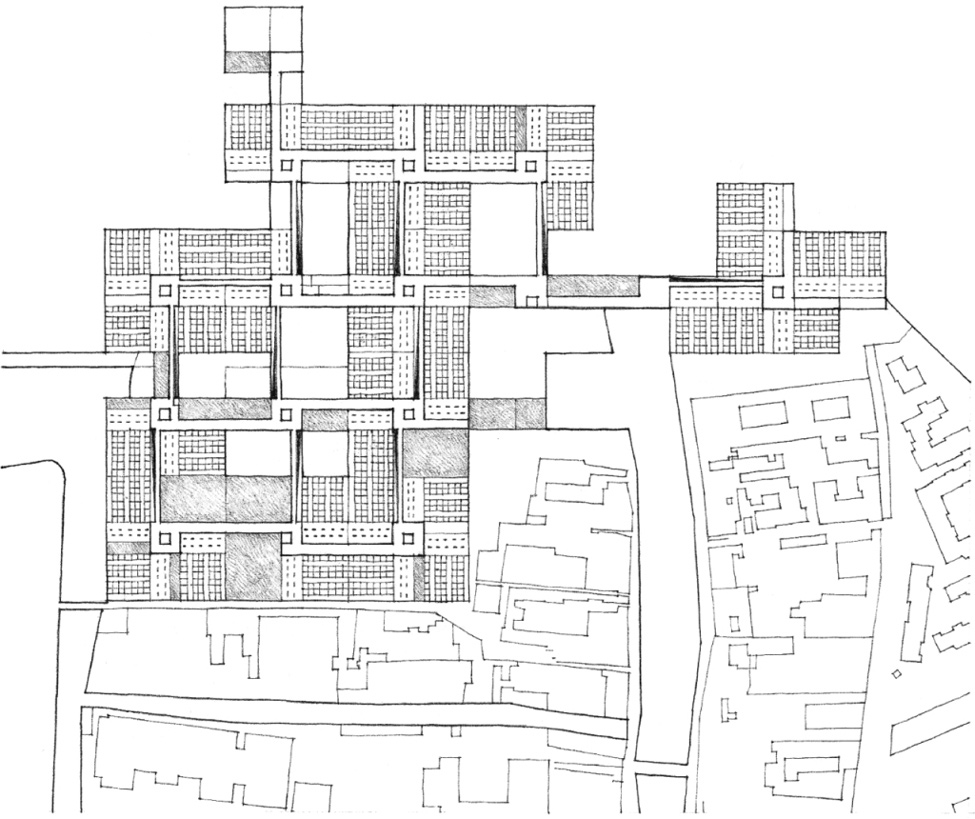

**Hospital Project**, Venice, 1964–1966, Le Corbusier

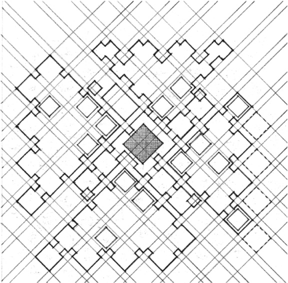

**Centraal Beheer Office Building**, Apeldoorn, The Netherlands, 1972, Herman Hertzberger with Lucas & Niemeyer

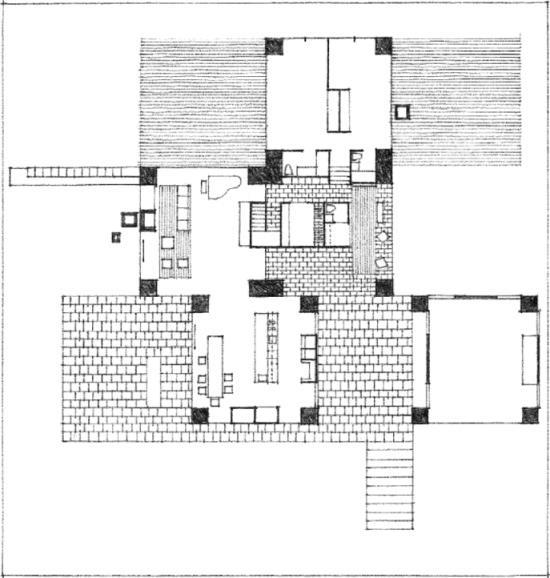

**Adler House** (Project), Philadelphia, Pennsylvania, 1954, Louis Kahn

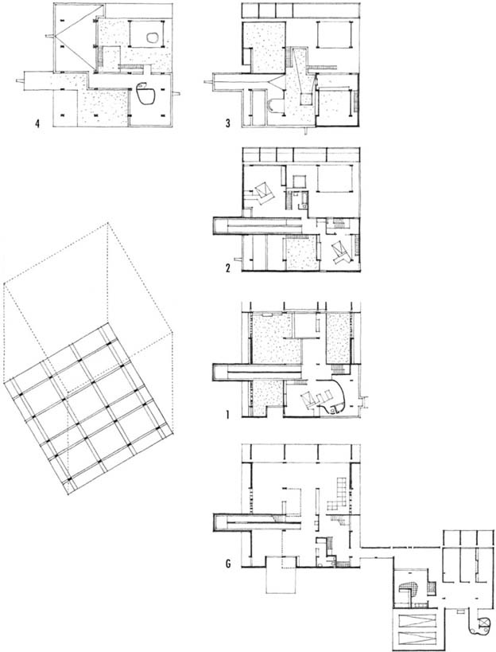

**Shodhan House**, Ahmedabad, India, 1956, Le Corbusier

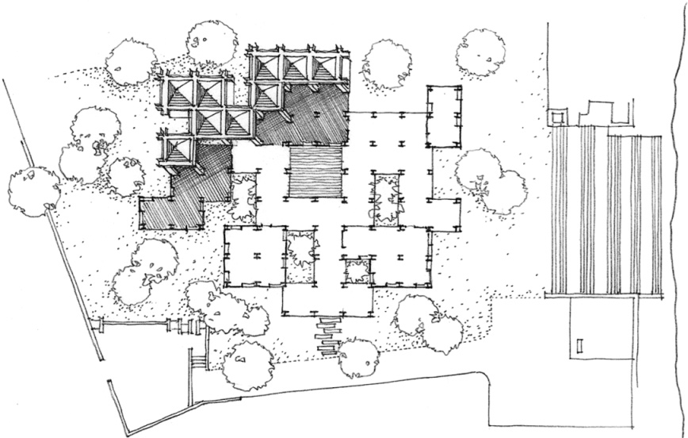

**Gandhi Ashram Museum**, Ahmedabad, India, 1958–1963, Charles Correa

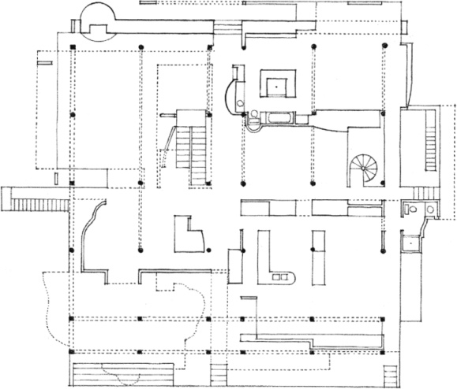

**Snyderman House**, Fort Wayne, Indiana, 1972, Michael Graves

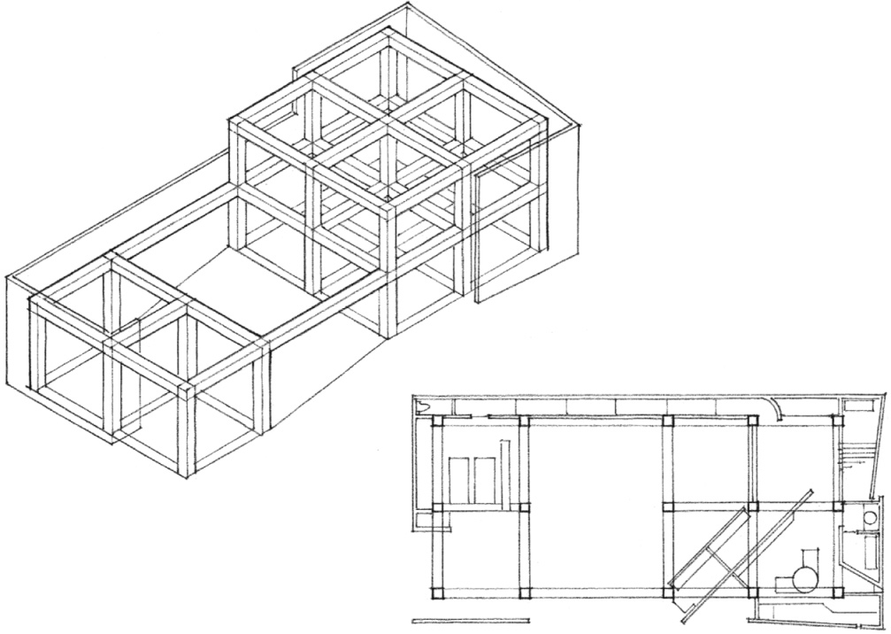

**Manabe Residence**, Tezukayama, Osaka, Japan, 1976–1977, Tadao Ando

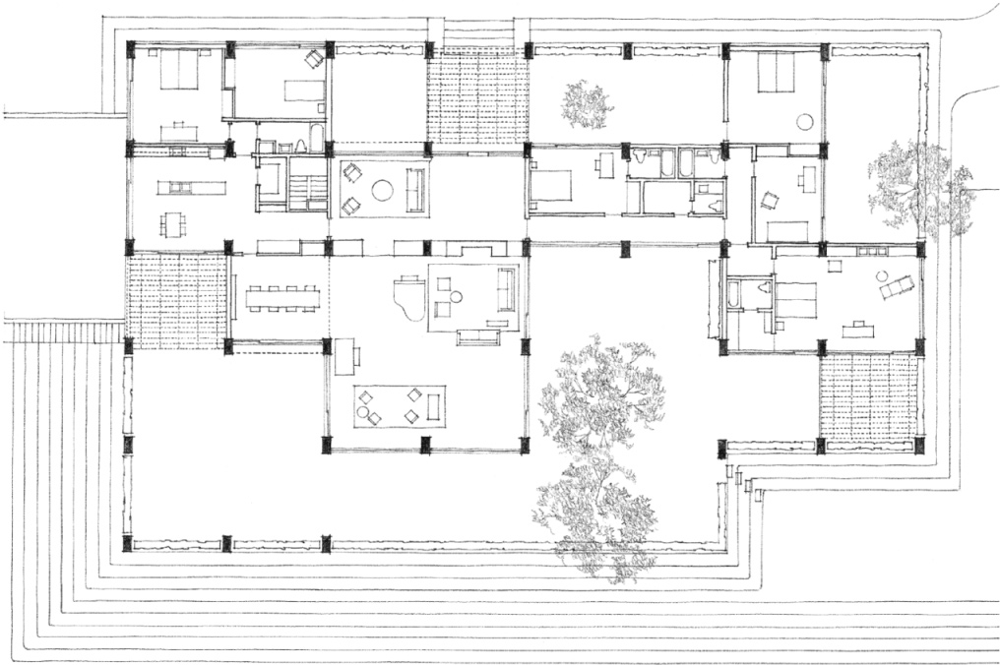

**Eric Boissonas House I**, New Canaan, Connecticut, 1956, Philip Johnson

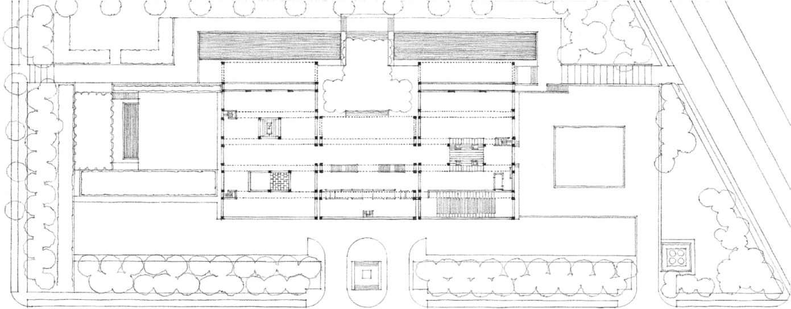

**Kimball Art Museum**, Forth Worth, Texas, 1967–1972, Louis Kahn

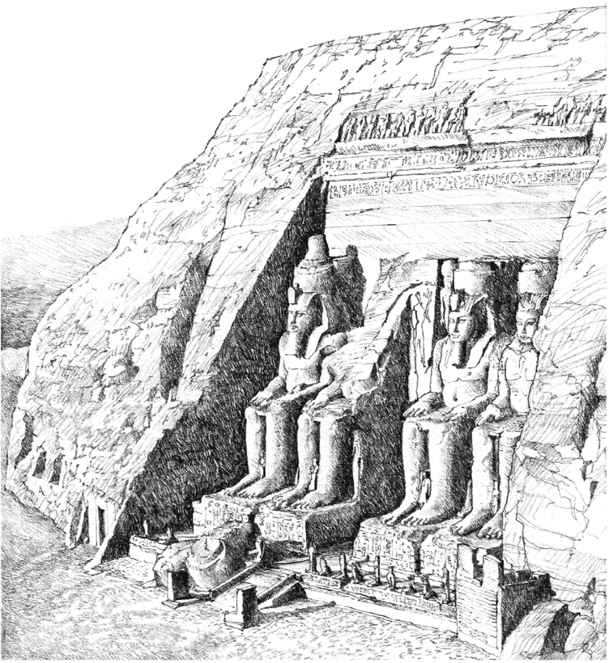
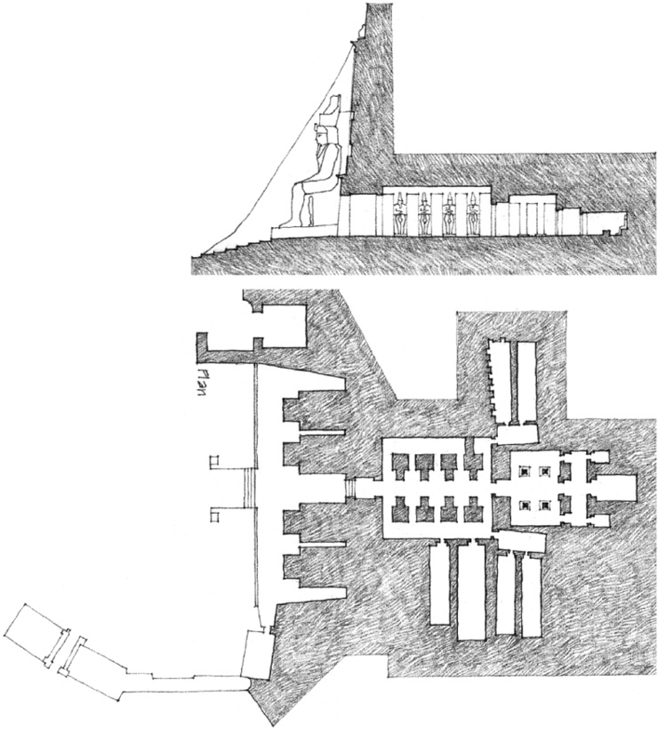

**Abu Simbel**, Great Temple of Rameses II, 1301–1235 B.C.