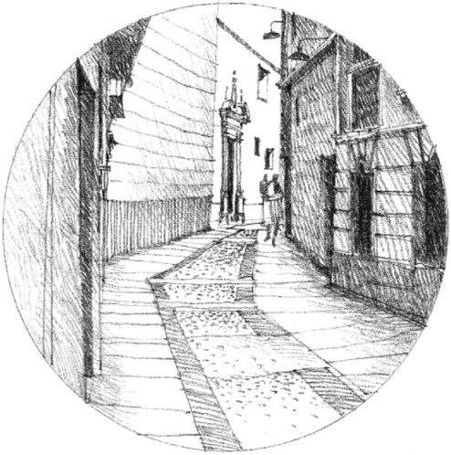
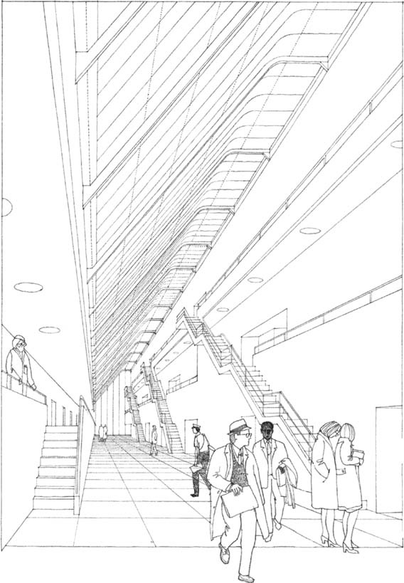

> [BREADCRUMB_CTX: 《Architecture》 > Circulation: Movement Through Space]

## CIRCULATION: MOVEMENT THROUGH SPACE

The path of our movement can be conceived as the perceptual thread that links the spaces of a building, or any series of interior or exterior spaces, together.

Since we move in ***Time***  
               through a ***Sequence***  
                               of ***Spaces***,

we experience a space in relation to where we’ve been and where we anticipate going. This chapter presents the principal components of a building’s circulation system as positive elements that affect our perception of the forms and spaces of the building.

Skylighted Concourse, **Olivetti Headquarters**  
(Project), Milton Keynes, England, 1971,  
James Stirling & Michael Wilford