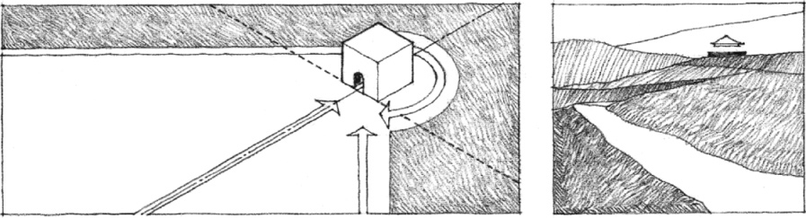
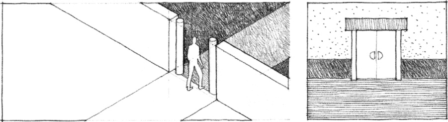
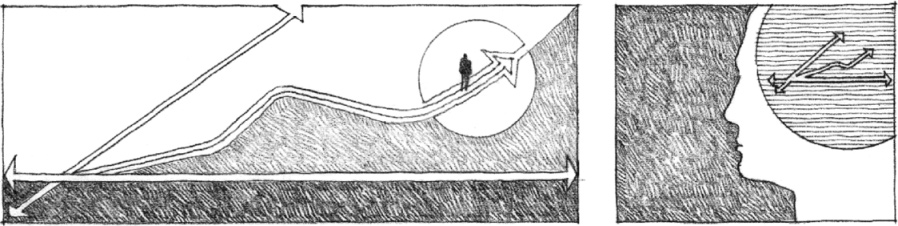
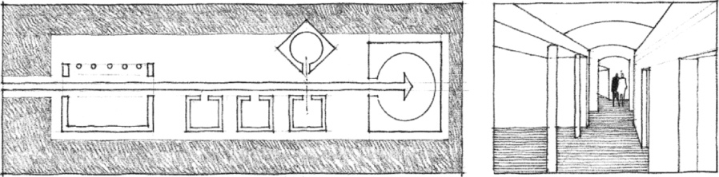
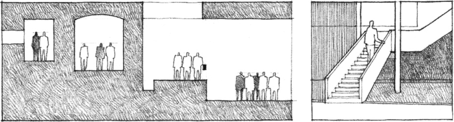

> [BREADCRUMB_CTX: 《Architecture》 > Circulation Elements]

## CIRCULATION ELEMENTS

### Approach

* The Distant View

### Entrance

* From Outside to Inside

### Configuration of the Path

* The Sequence of Spaces

### Path-Space Relationships

* Edges, Nodes, and Terminations of the Path

### Form of the Circulation Space

* Corridors, Halls, Galleries, Stairways, and Rooms

