> [BREADCRUMB_CTX: 《Architecture》 > Approach]

## APPROACH

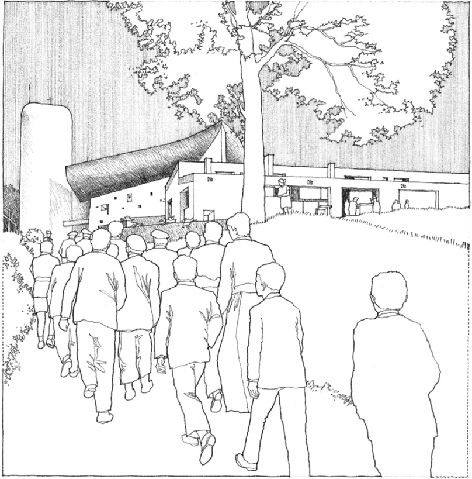

Approach to **Notre Dame Du Haut**, Ronchamp, France, 1950–1955, Le Corbusier

Prior to actually passing into the interior of a building, we approach its entrance along a path. This is the first phase of the circulation system, during which we are prepared to see, experience, and use the spaces within a building.

The approach to a building and its entrance may vary in duration from a few paces through a compressed space to a lengthy and circuitous route. It may be perpendicular to the primary facade of a building or be oblique to it. The nature of the approach may contrast with what is confronted at its termination, or it may be continued on into the building’s interior sequence of spaces, obscuring the distinction between inside and outside.

### Frontal

A frontal approach leads directly to the entrance of a building along a straight, axial path. The visual goal that terminates the approach is clear; it may be the entire front facade of a building or an elaborated entrance within the plane.

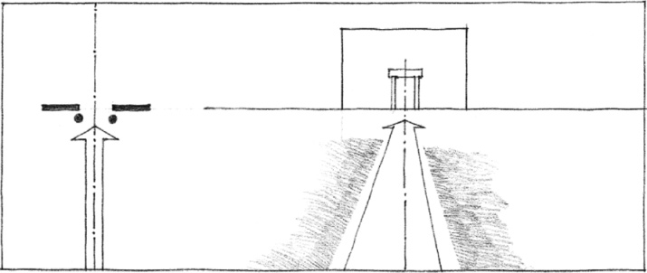

### Oblique

An oblique approach enhances the effect of perspective on the front facade and form of a building. The path can be redirected one or more times to delay and prolong the sequence of the approach. If a building is approached at an extreme angle, its entrance can project beyond its facade to be more clearly visible.

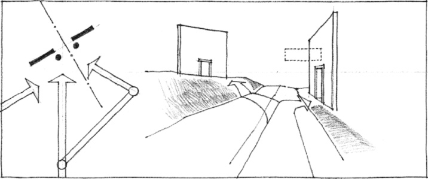

### Spiral

A spiral path prolongs the sequence of the approach and emphasizes the three-dimensional form of a building as we move around its perimeter. The building entrance might be viewed intermittently during the approach to clarify its position or it may be hidden until the point of arrival.

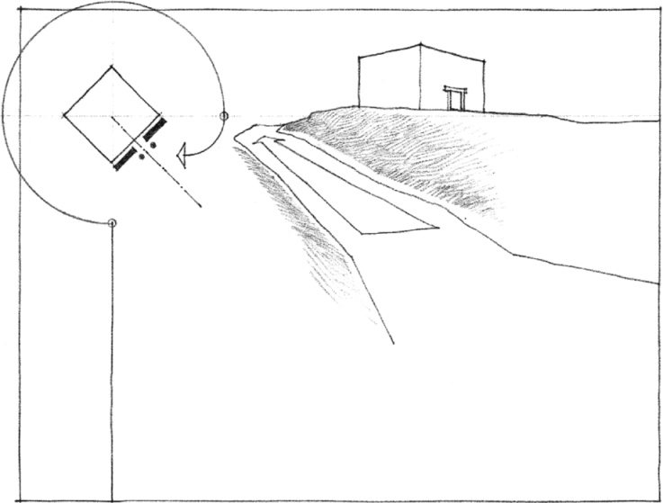
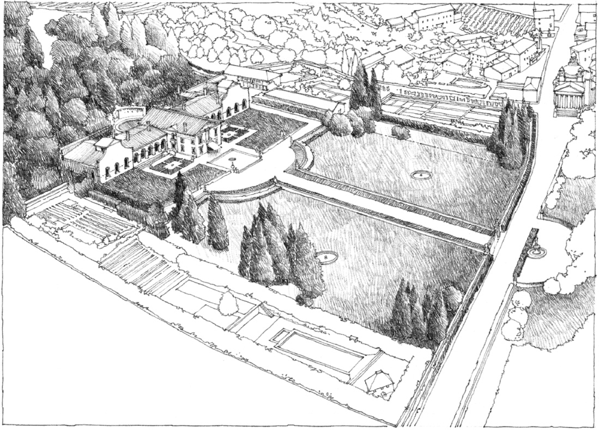

**Villa Barbaro**, Maser, Italy, 1560–1568, Andrea Palladio

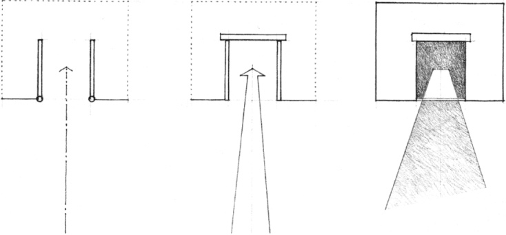

Portals and gateways have traditionally been means of orienting us to the path beyond and welcoming or guarding against our entry.

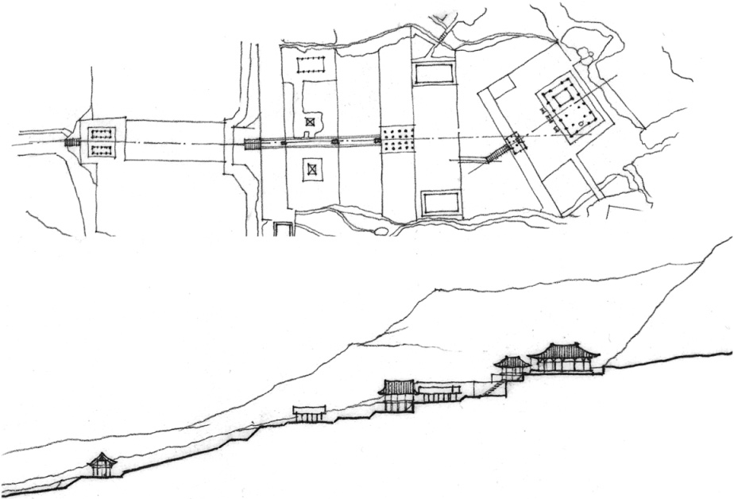

**Buseoksa Temple**, Gyeongsangdo, Korea, A.D. 676–1000

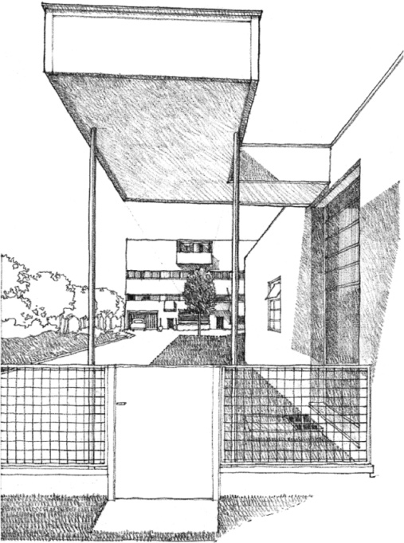

**Villa Garches**, Vaucresson, France, 1926–1927, Le Corbusier

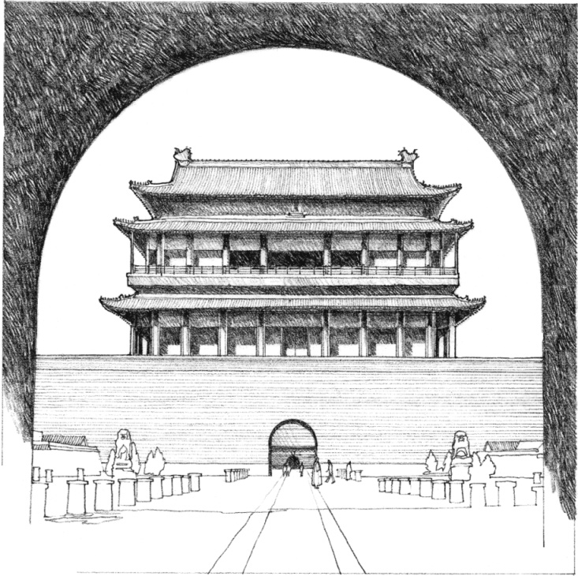

**Qian Men**, Link between the Forbidden City to the north and the Outer City to the south in Beijing, China, 15th century

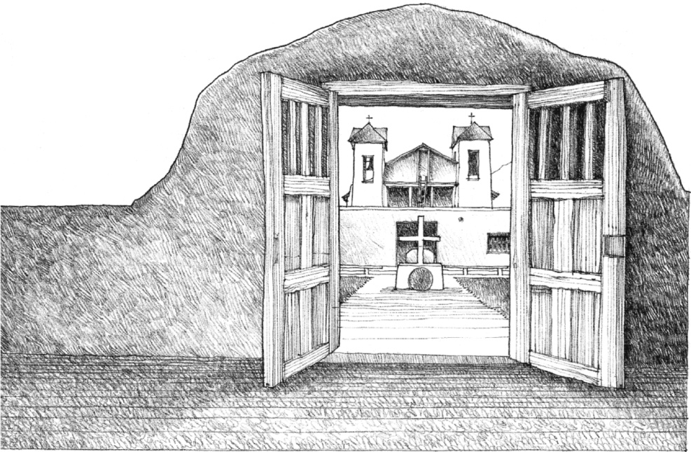

**Catholic Church**, Taos, New Mexico, 17th century

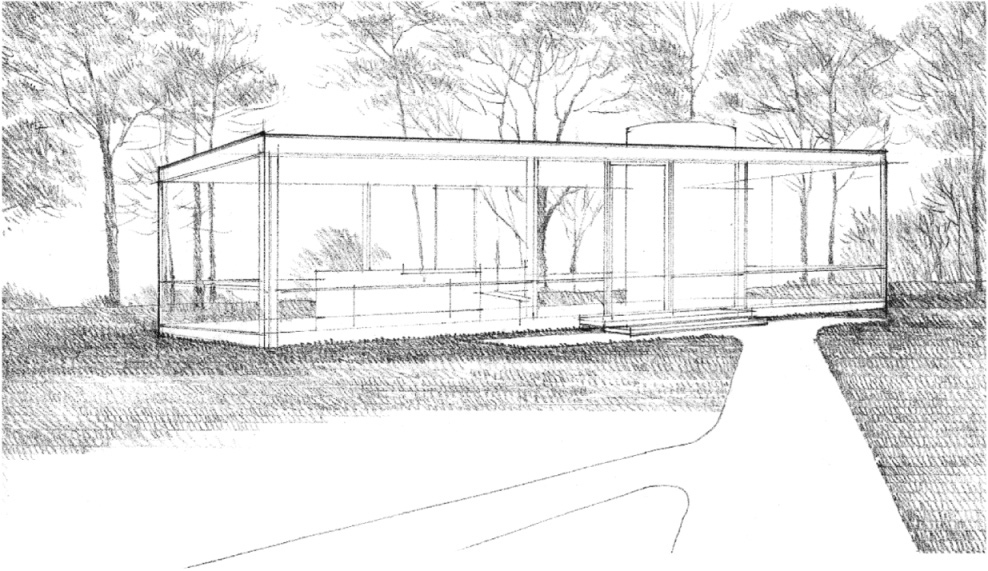

**Glass House**, New Canaan, Connecticut, 1949, Philip Johnson

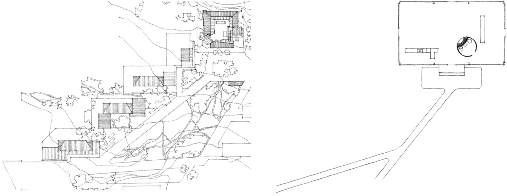

Site Plan, **Town Hall at Säynätsalo**, Finland, 1950–1952, Alvar Aalto

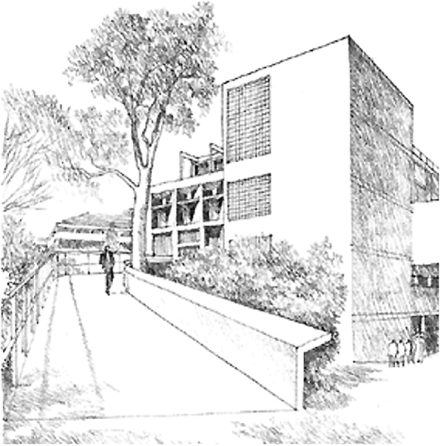

Ramp into and through the **Carpenter Center for the Visual Arts**, Harvard University, Cambridge, Massachusetts, 1961–1964, Le Corbusier

Drawings of church-dominated urban spaces by Camillo Sitte that illustrate the asymmetrical, picturesque approach to the siting of buildings. Only fragments of the churches can be seen from various points in the squares.

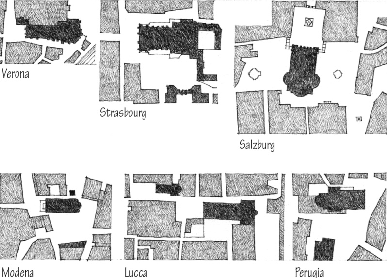
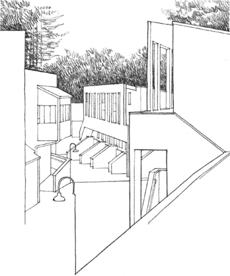

**Kresge College**, Santa Cruz Campus, University of California, 1972–1974, MLTW/Moore and Turnbull

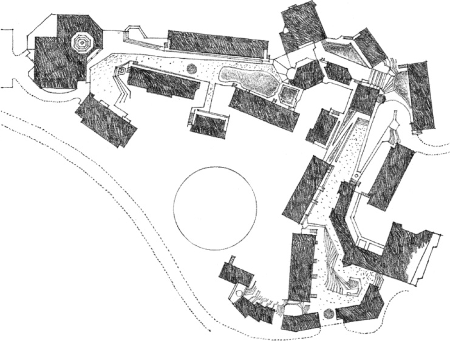
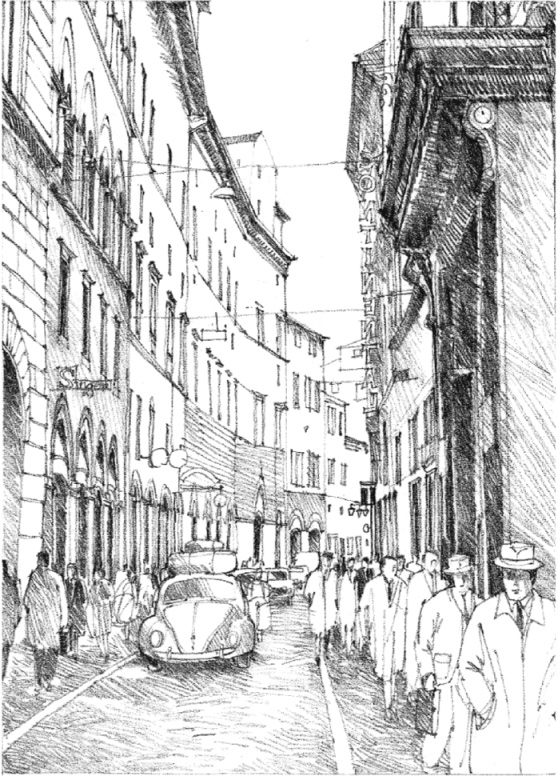

Street in Siena, Italy

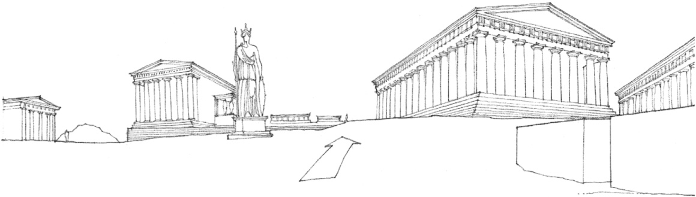

View looking east from the Propylaea

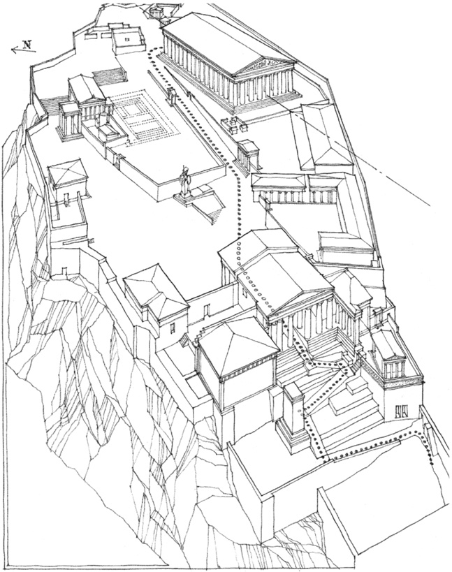

Aerial view of the **Acropolis**, Athens, Greece. Dotted line indicates the path through the Propylaea to the east end of the Parthenon.

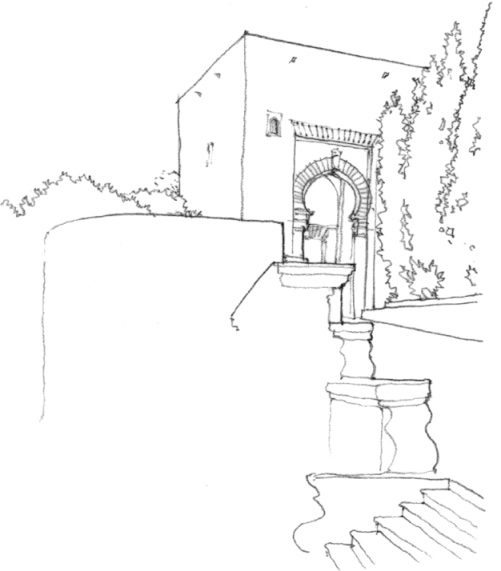

Gate of Justice, **Alhambra**, Granada, Spain, 1338–1390

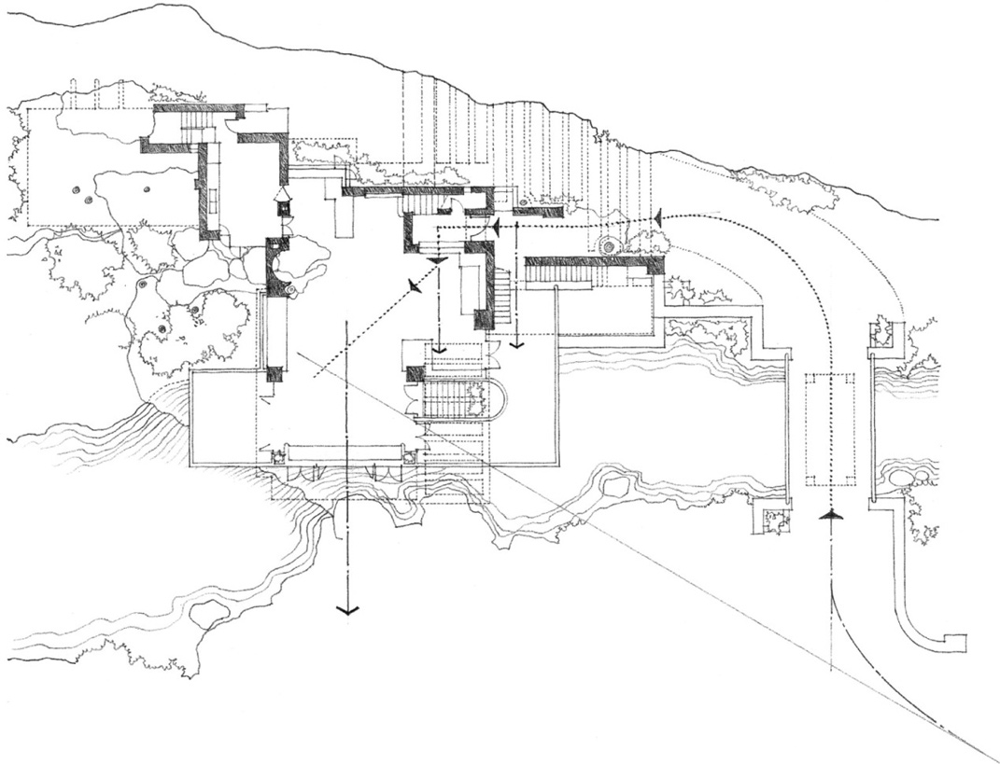

**Fallingwater (Kaufmann House)**, near Ohiopyle, Pennsylvania, 1936–1937, Frank Lloyd Wright

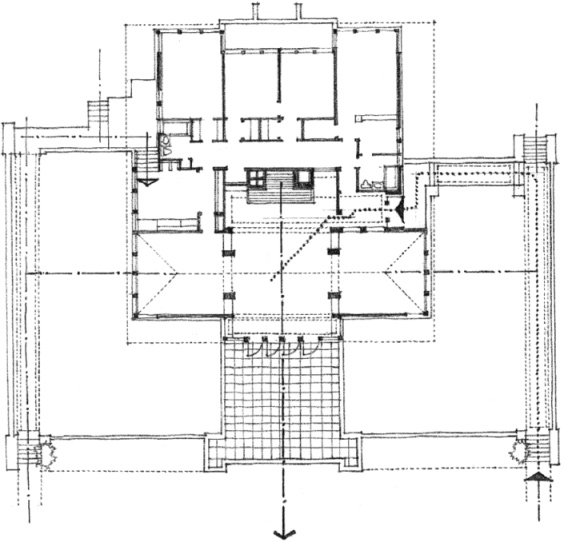

**Edwin Cheney House**, Oak Park, Illinois, 1904, Frank Lloyd Wright

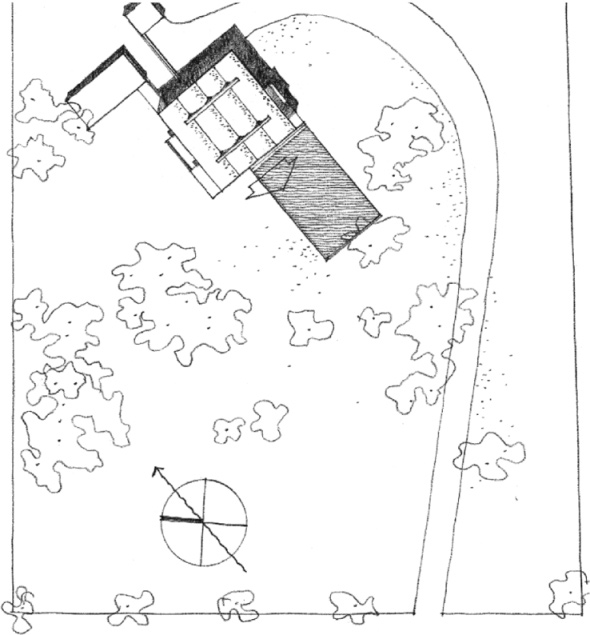

**Villa Hutheesing** (Project), Ahmedabad, India, 1952, Le Corbusier