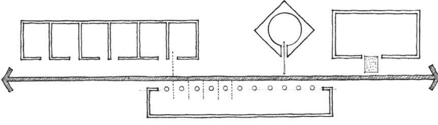
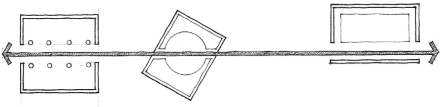
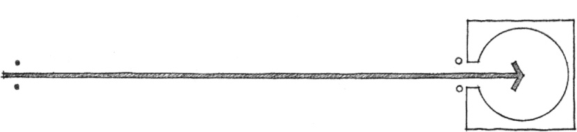
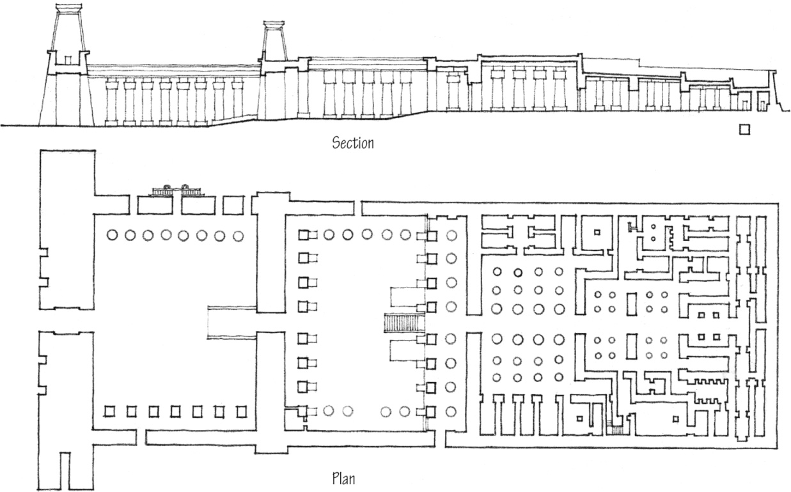
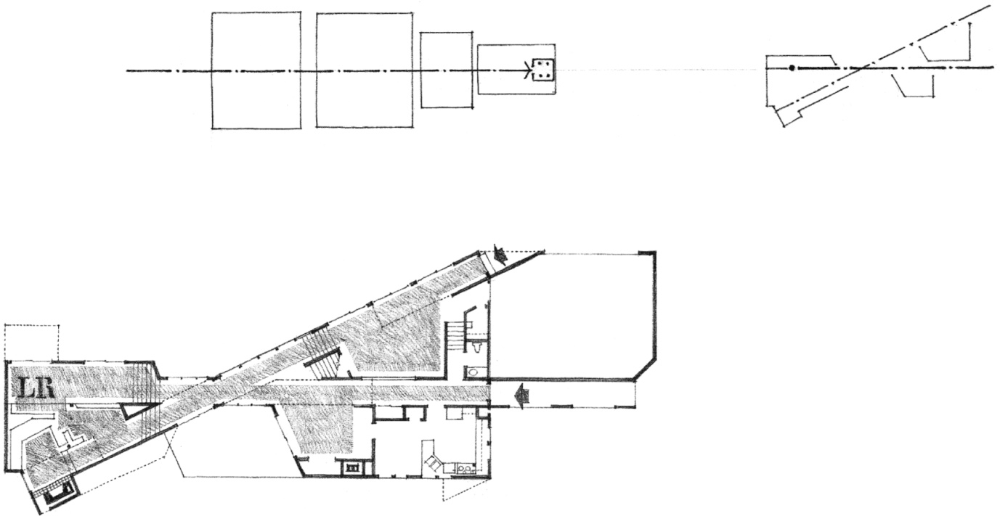
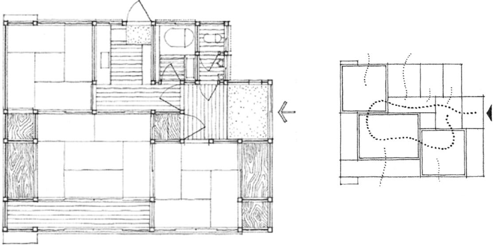
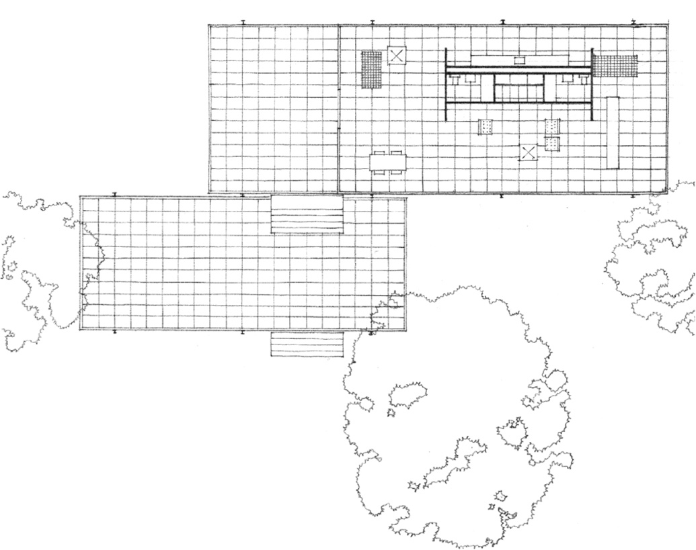
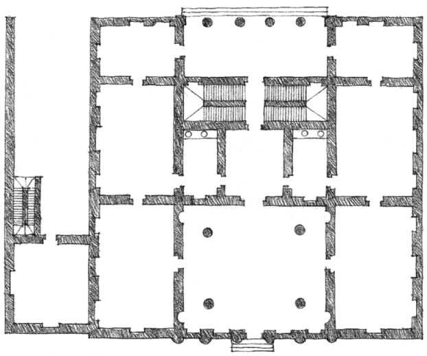
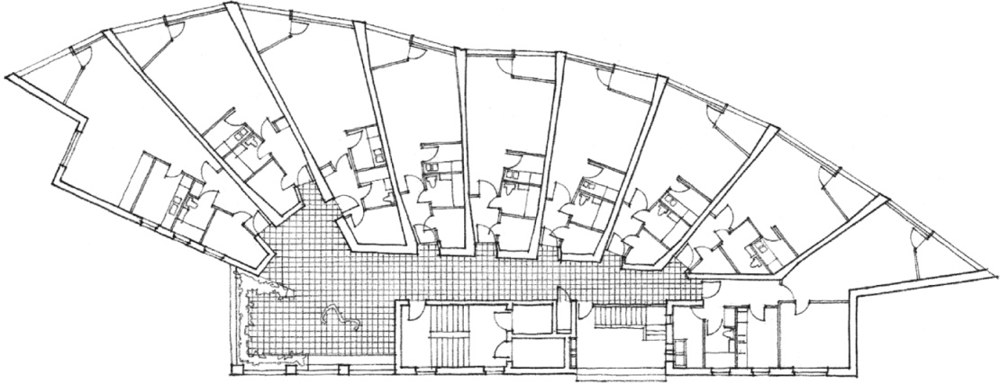
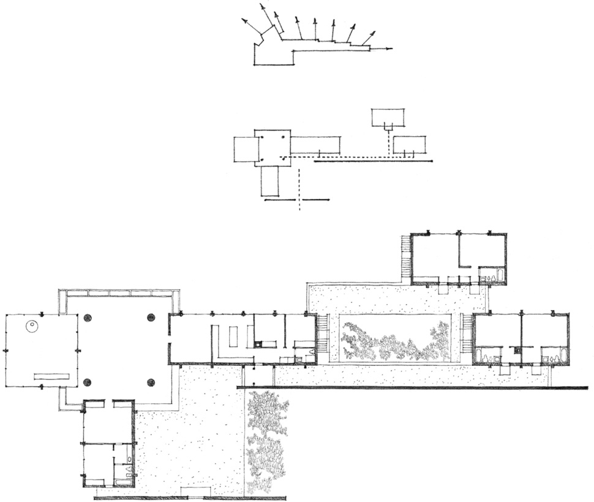

> [BREADCRUMB_CTX: 《Architecture》 > Path–Space Relationships]

## PATH–SPACE RELATIONSHIPS

Paths may be related to the spaces they link in the following ways. They may:

### Pass by Spaces

* The integrity of each space is maintained.
* The configuration of the path is flexible.
* Mediating spaces can be used to link the path with the spaces.

### Pass through Spaces

* The path may pass though a space axially, obliquely, or along its edge.
* In cutting through a space, the path creates patterns of rest and movement within it.

### Terminate in a Space

* The location of the space establishes the path.
* This path-space relationship is used to approach and enter functionally or symbolically important spaces.

**Mortuary Temple of Rameses III**, Medînet-Habu, 1198 B.C.

**Stern House**, Woodbridge, Connecticut, 1970, Charles Moore Associates

Traditional Japanese House

**Farnsworth House**, Plano, Illinois, 1950, Mies van der Rohe

**Palazzo Antonini**, Udine, Italy, 1556, Andrea Palladio

**Neur Vahr Apartment Building**, Bremen, Germany, 1958–1962, Alvar Aalto

**Eric Boissonas House II**, Cap Benat, France, 1964, Philip Johnson