> [BREADCRUMB_CTX: 《Architecture》 > Form of the Circulation Space]

## FORM OF THE CIRCULATION SPACE

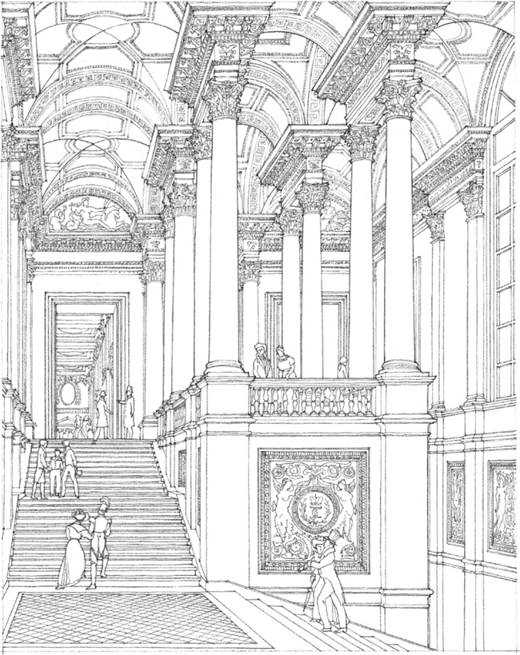

A vaulted staircase, after a drawing by William R. Ware

Spaces for movement form an integral part of any building organization and occupy a significant amount of the volume of a building. If considered merely as functional linking devices, then circulation paths would be endless, corridor-like spaces. The form and scale of a circulation space, however, should accommodate the movement of people as they promenade, pause, rest, or take in a view along a path.

The form of a circulation space varies according to how:

* its boundaries are defined;
* its form relates to the form of the spaces it links;
* its qualities of scale, proportion, light, and view are articulated;
* entrances open onto it; and
* it handles changes in level with stairs and ramps.

A circulation space may be:

### Enclosed

forming a public galleria or private corridor that relates to the spaces it links though entrances in a wall plane;

### Open on One Side

forming a balcony or gallery that provides visual and spatial continuity with the spaces it links;

### Open on Both Sides

forming a colonnaded passageway that becomes a physical extension of the space it passes through.

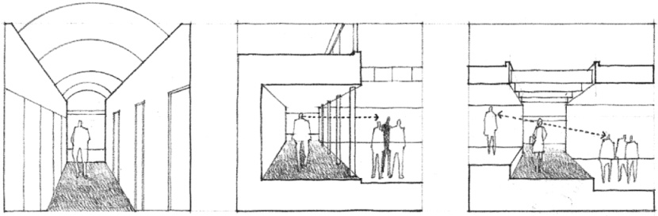

The width and height of a circulation space should be proportionate with the type and amount of movement it must handle. A distinction in scale should be established between a public promenade, a more private hall, and a service corridor.

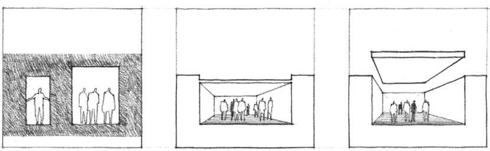

A narrow, enclosed path naturally encourages forward motion. To accommodate more traffic as well as to create spaces for pausing, resting, or viewing, sections of a path can be widened. The path can also be enlarged by merging with the spaces it passes through.

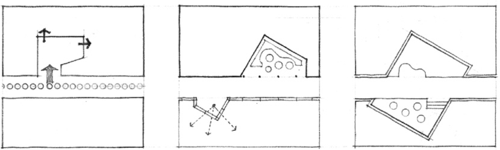

Within a large space, a path can be random, without form or definition, and be determined by the activities and arrangement of furnishings within the space.

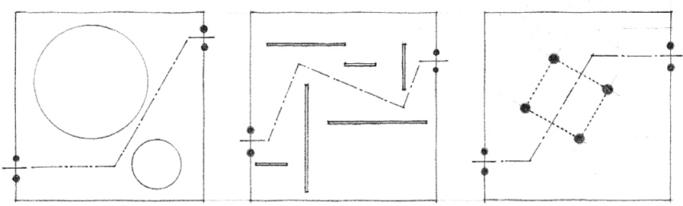
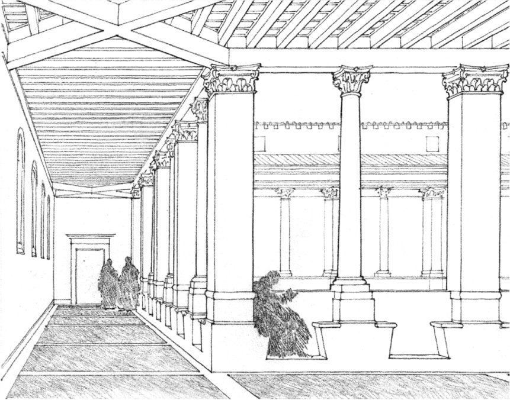

Cloister, **St. Maria della Pace**, Rome, 1500–1504, Donato Bramante

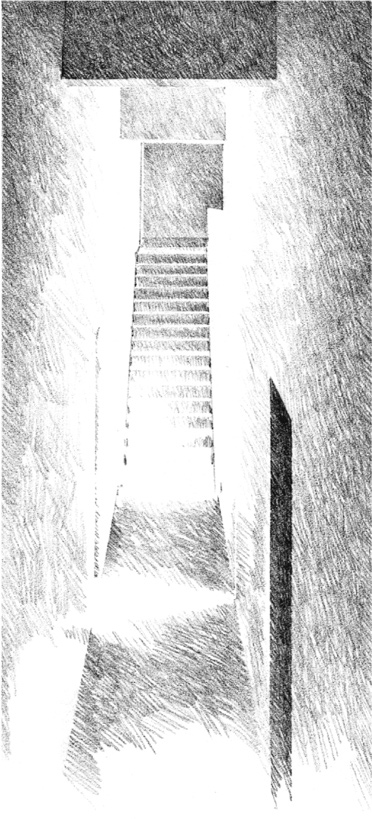

Hallway of **Okusu Residence**, Todoroki, Tokyo, 1976–1978, Tadao Ando

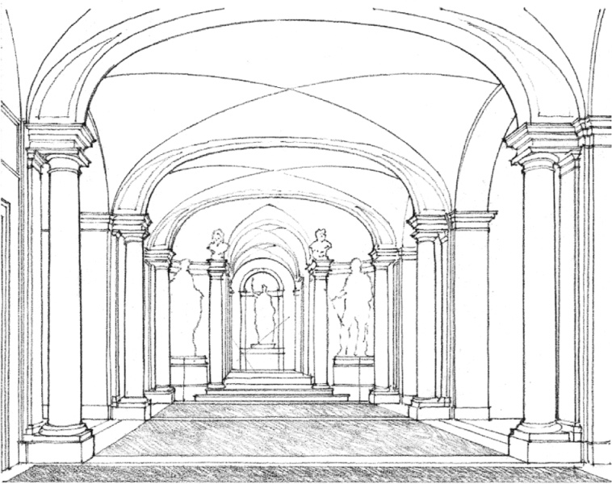

Vestibule of a Renaissance palace

Examples of various forms of spaces used for movement through a building.

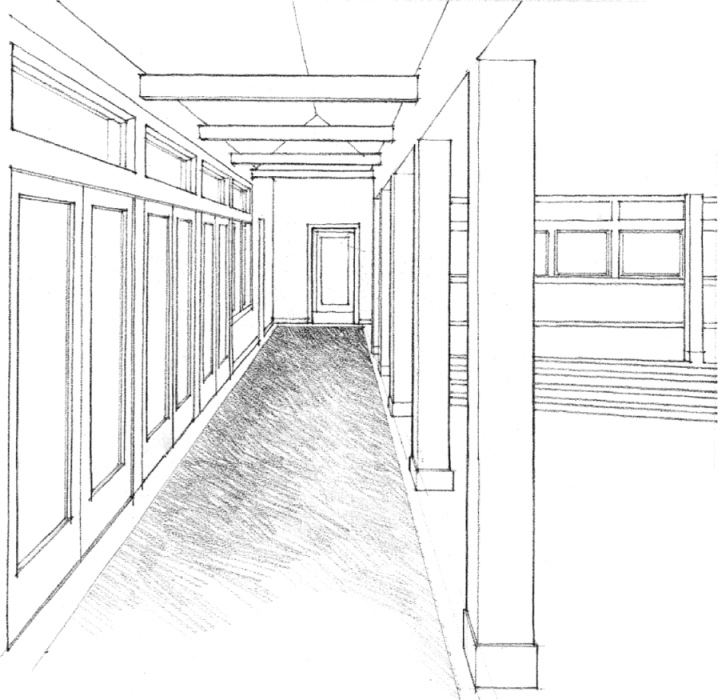

A hall opening through a colonnade onto an interior space and through a series of French doors onto an exterior courtyard

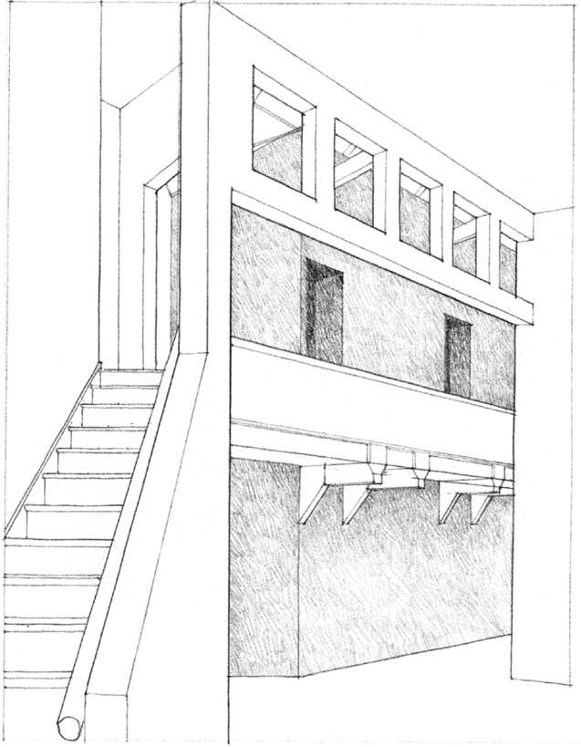

Raised hall, **Residence in Morris County**, New Jersey, 1971, MLTW

Stairs and stairways provide for our vertical movement between the levels of a building or outdoor space. The slope of a stairway, determined by the dimensions of its risers and treads, should be proportioned to fit our body movement and capability. If steep, a stair can make ascent physically tiring as well as psychologically forbidding, and can make descent precarious. If shallow, a stair must have treads deep enough to fit our stride.

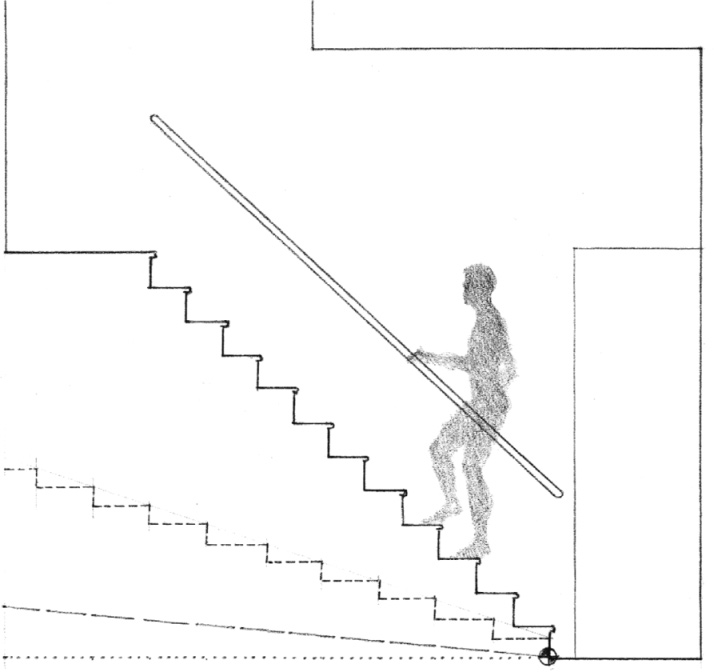

A stairway should be wide enough to comfortably accommodate our passage as well as any furnishings and equipment that must be moved up or down the steps. The width of a stairway also provides a visual clue to the public or private nature of the stairway. Wide, shallow steps can serve as an invitation, while a narrow, steep stairway can lead to more private places.

While the act of traversing up a stairway may convey privacy, aloofness, or detachment, the process of going down can imply moving toward secure, protected, or stable ground.

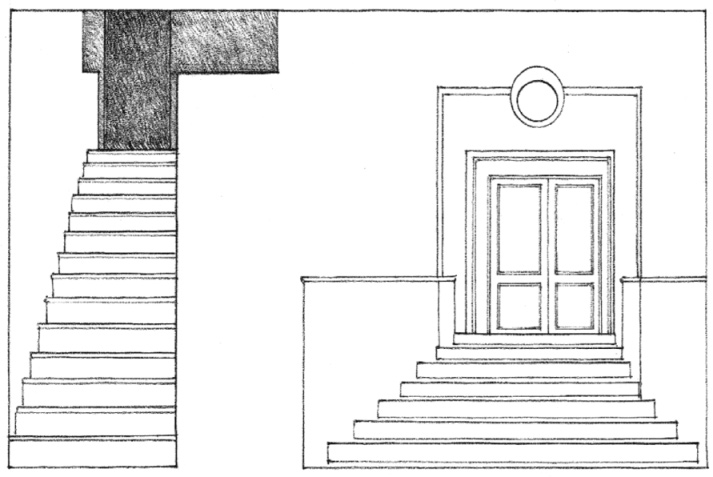

Landings interrupt the run of a stair and enable it to change direction. Landings also provide opportunities for rest and possibilities for access and outlook from the stairway. Together with the pitch of a stair, the locations of landings determine the rhythm and choreography of our movements as we ascend or descend its steps.

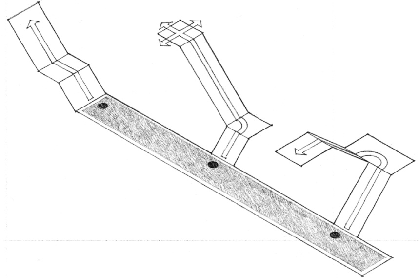

Stairs, in accommodating a change in level, can reinforce the path of movement, interrupt it, accommodate a change in its course, or terminate it prior to entering a major space.

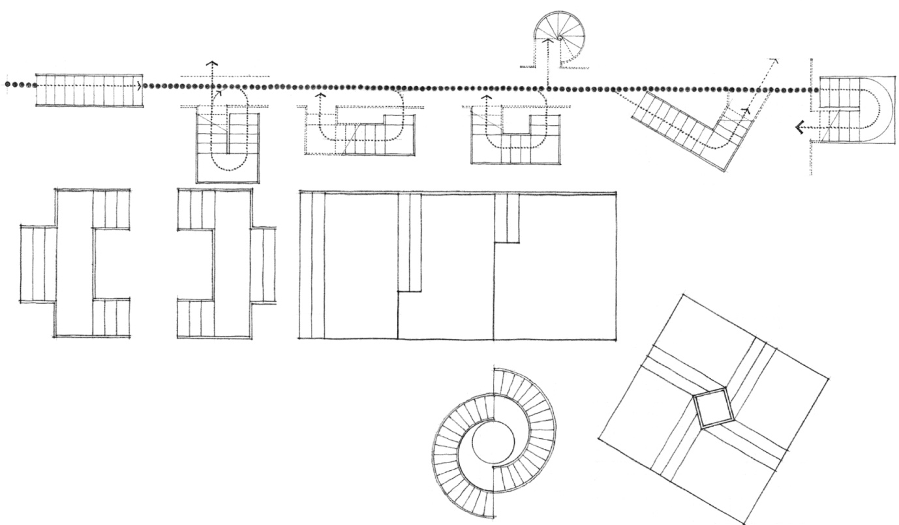

The configuration of a stairway determines the direction of our path as we ascend or descend its steps. There are several basic ways in which to configure the runs of a stairway.

* straight-run stair
* L-shaped stair
* U-shaped stair
* circular stair
* spiral stair

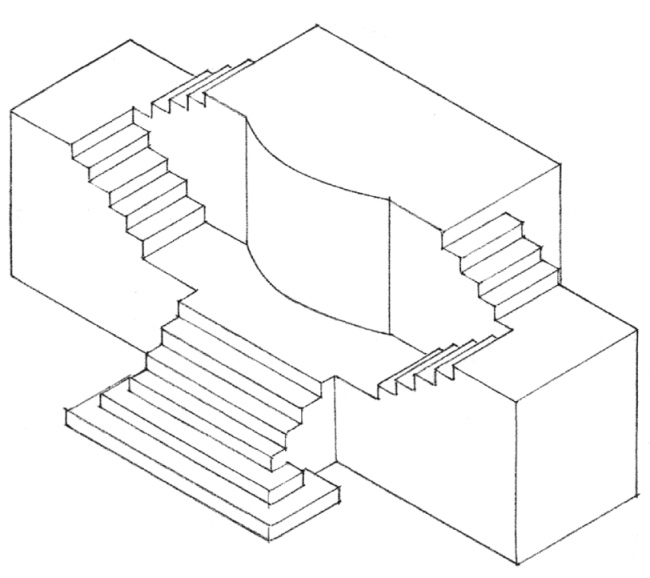

The space a stairway occupies can be great, but its form can be fitted into an interior in several ways. It can be treated as an additive form or as a volumetric solid from which space has been carved out for movement as well as rest.

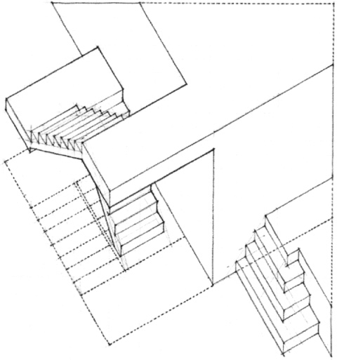
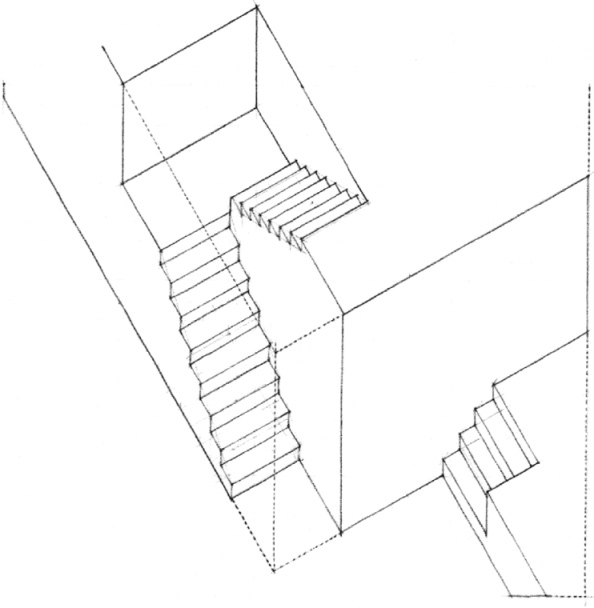

The stairway can run along one of the edges of a room, wrap around the space, or fill its volume. It can be woven into the boundaries of a space or be extended into a series of platforms for seating or terraces for activity.

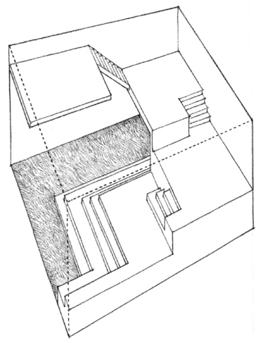

The path of a stair can rise between walls through a narrow shaft of space to offer access to a private place or signify unapproachability.

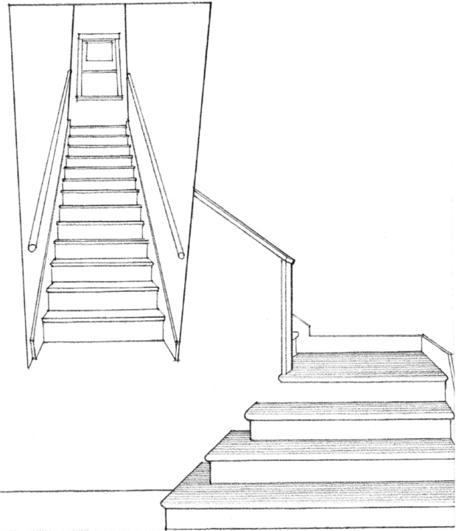

On the other hand, landings that are visible on approach invite ascent, as do treads that spill out at the bottom of a stairway.

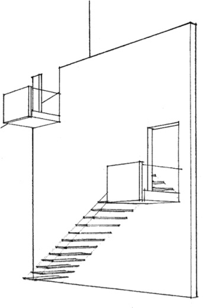

A stairway can skirt an edge or wind around the boundaries of a space.

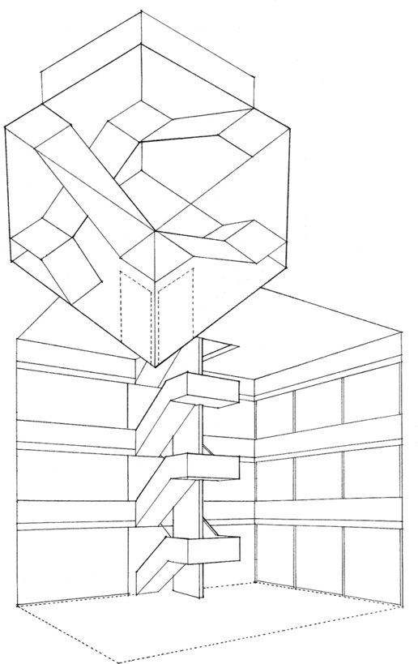

A stairway can be expressed as a sculptural form either attached to an edge or freestanding within a space.

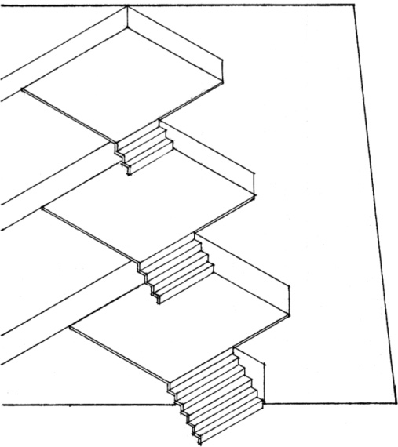

A stairway can be an organizing element and weave together a series of spaces at different levels of a building or with an outdoor space.

Stairs are three-dimensional forms just as moving up or down a stairway is a three-dimensional experience. This three-dimensional quality can be exploited when we treat it as sculpture, freestanding within a space or attached to a wall plane. Further, a space can itself become an oversized elaborated stairway.

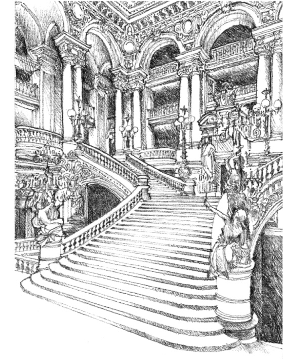

Grand Staircase, **Paris Opera House**, 1861–1874, Charles Garnier

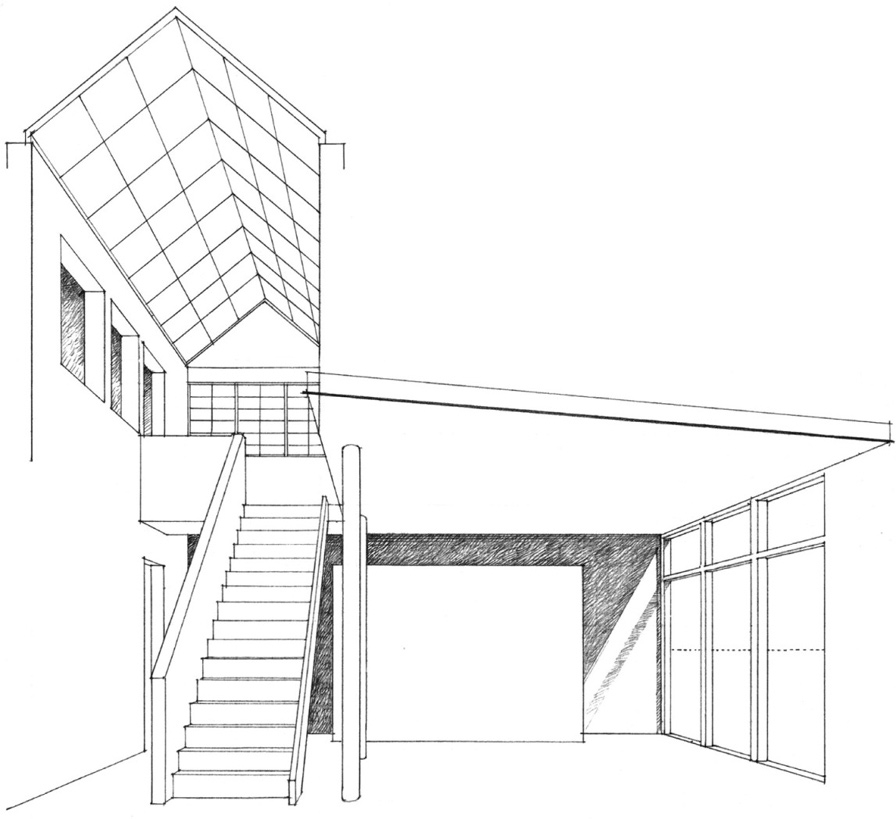
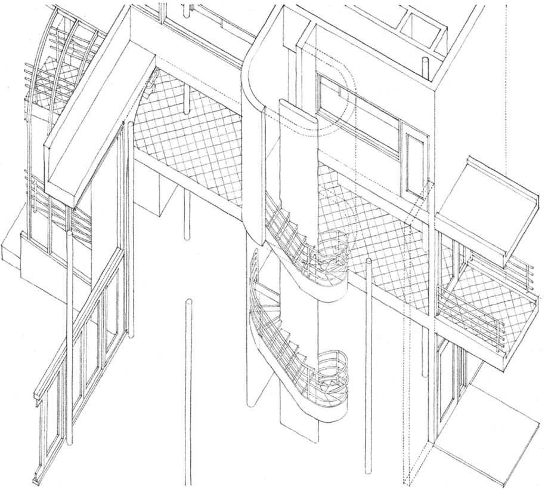

Plan oblique of living room stair, **House in Old Westbury**, New York, 1969–1971, Richard Meier

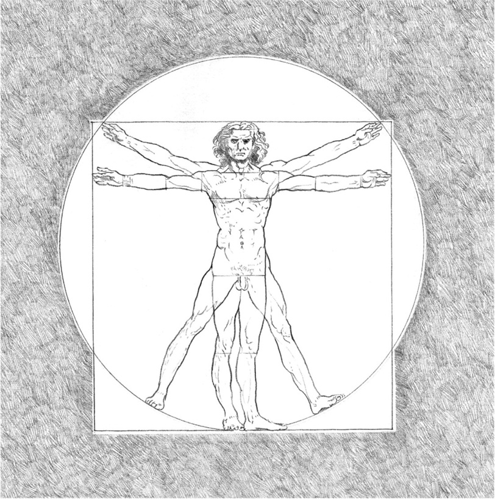

Vitruvian man, Leonardo da Vinci