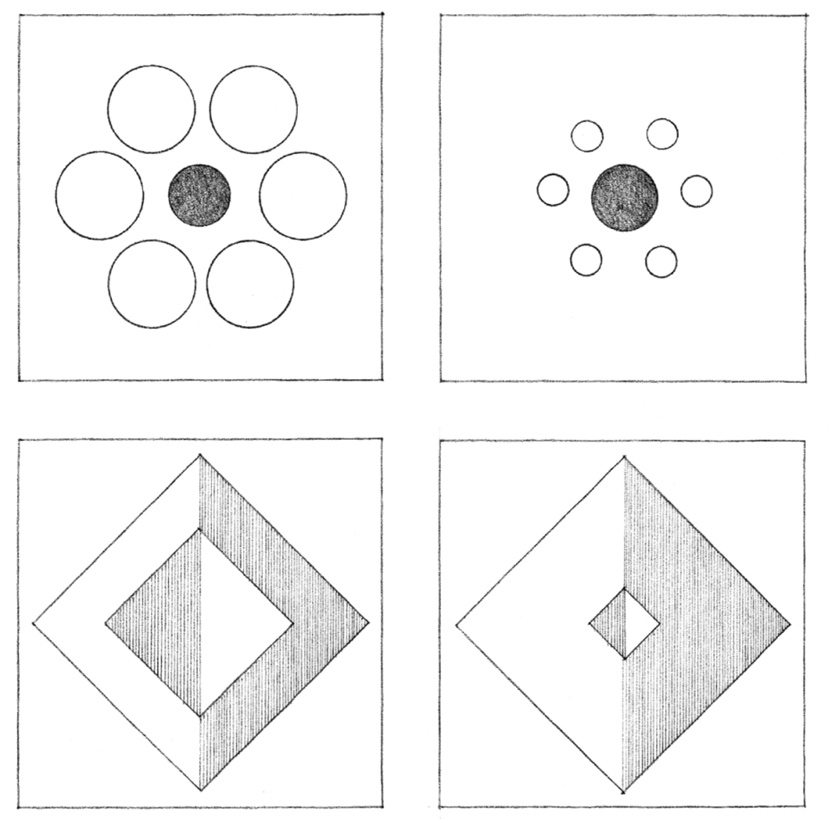

> [BREADCRUMB_CTX: 《Architecture》 > Proportion & Scale]

## PROPORTION & SCALE

This chapter discusses the interrelated issues of proportion and scale. While scale alludes to the size of something compared to a reference standard or to the size of something else, proportion refers to the proper or harmonious relation of one part to another or to the whole. This relationship may not only be one of magnitude, but also of quantity or degree. While the designer usually has a range of choices when determining the proportions of things, some are given to us by the nature of materials, by how building elements respond to forces, and by how things are made.

