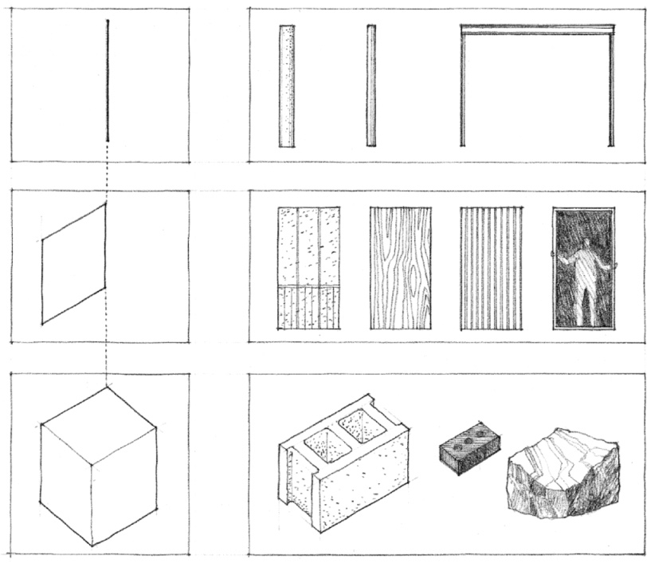
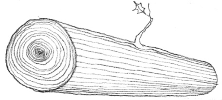

> [BREADCRUMB_CTX: 《Architecture》 > Material Proportions]

## MATERIAL PROPORTIONS

All building materials in architecture have distinct properties of elasticity, hardness, and durability. And they all have an ultimate strength beyond which they cannot extend themselves without fracturing, breaking, or collapsing. Since the stresses in a material resulting from the force of gravity increase with size, all materials also have rational dimensions beyond which they cannot go. For example, a stone slab that is 4 inches thick and 8 feet long can be reasonably expected to support itself as a bridge between two supports. But if its size were to increase fourfold, to 16 inches thick and 32 feet long, it would probably collapse under its own weight. Even a strong material like steel has lengths beyond which it cannot span without exceeding its ultimate strength.

All materials also have rational proportions that are dictated by their inherent strengths and weaknesses. Masonry units like brick, for example, are strong in compression and depend on their mass for strength. Such materials are therefore volumetric in form. Materials like steel are strong in both compression and tension and can therefore be formed into linear columns and beams as well as planar sheet materials. Wood, being a flexible and fairly elastic material, can be used as linear posts and beams, planar boards, and as a volumetric element in log cabin construction.

