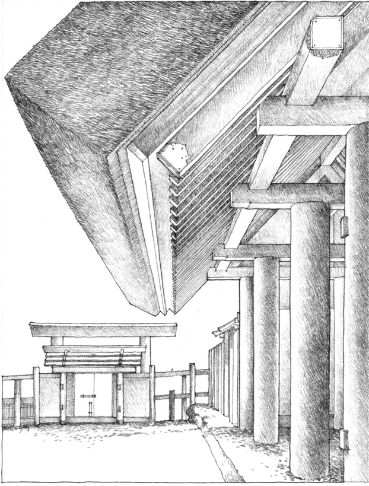
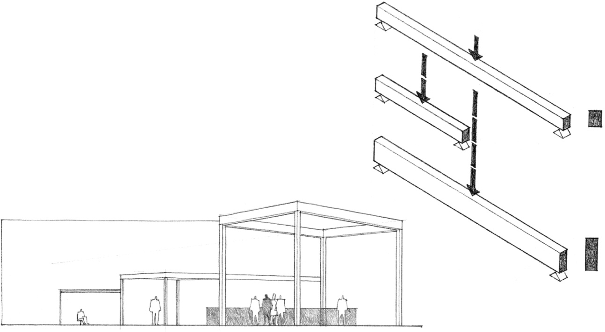
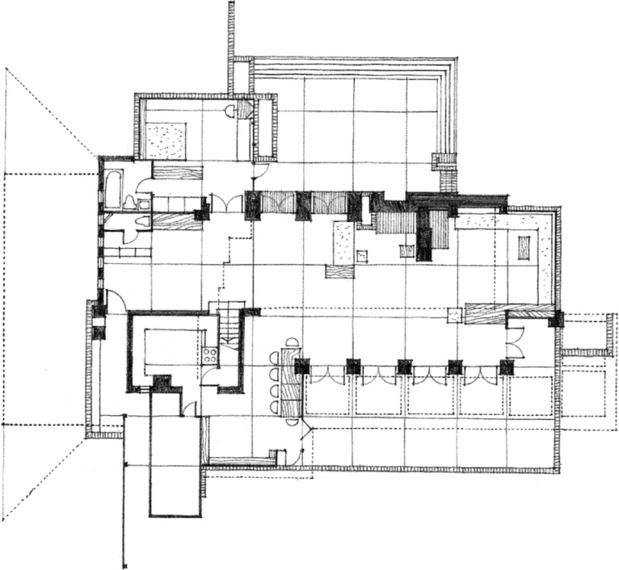
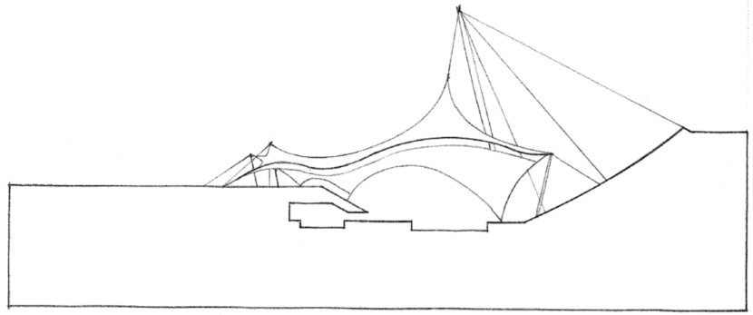
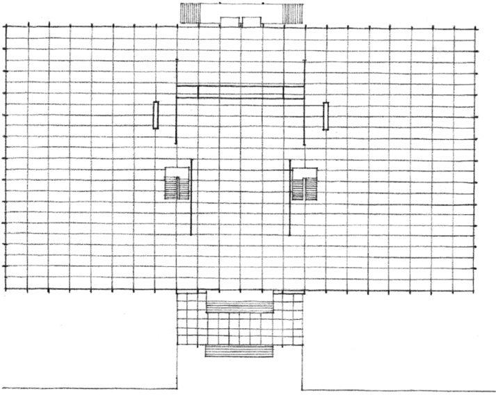

> [BREADCRUMB_CTX: 《Architecture》 > Structural Proportions]

## STRUCTURAL PROPORTIONS

In the construction of architecture, structural elements are called upon to span spaces and transmit their loads through vertical supports to the foundation system of a building. The size and proportion of these elements are directly related to the structural tasks they perform and can therefore be visual indicators of the size and scale of the spaces they help enclose.

Beams, for example, transmit their loads horizontally across space to their vertical supports. If the span or load of a beam were doubled, its bending stresses would likewise double, possibly causing it to collapse. But if its depth were doubled, its strength would increase fourfold. Depth, therefore, is the critical dimension of a beam and its depth-to-span ratio can be a useful indicator of its structural role.

South gateway of the third fence of **Naigu, Ise Inner Shrine**, Mie Prefecture, Japan, A.D. 690

In a similar manner, columns become thicker as their loads and unsupported height increase. Together, beams and columns form a skeletal structural framework that defines modules of space. By their size and proportion, columns and beams articulate space and give it scale and a hierarchical structure. This can be seen in the way joists are supported by beams, which in turn are supported by girders. Each element increases in depth as its load and span increase in size.

The proportions of other structural elements, such as bearing walls, floor and roof slabs, vaults, and domes, also give us visual clues to their role in a structural system as well as the nature of their material. A masonry wall, being strong in compression but relatively weak in bending, will be thicker than a reinforced concrete wall doing the same work. A steel column will be thinner than a wood post supporting the same load. A 4 inch-thick reinforced concrete slab will span farther than 4 inch wood decking.

As a structure depends less on the weight and stiffness of a material and more on its geometry for stability, as in the case of a membrane structure or a space frame, its elements will get thinner and thinner until they lose their ability to give a space scale and dimension.

**Wood and Brick**  
**Schwartz House**, Two Rivers, Wisconsin, 1939, Frank Lloyd Wright

**Membrane**  
Roof of **Olympic Swimming Arena**, Munich, Germany, 1972, Fred Otto

**Steel**  
**Crown Hall**, Illinois Institute of Technology, Chicago, 1956, Mies van der Rohe