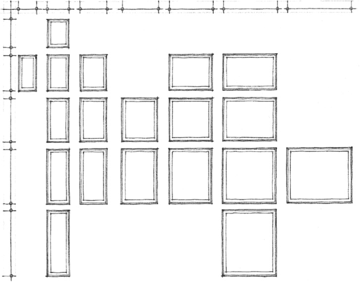
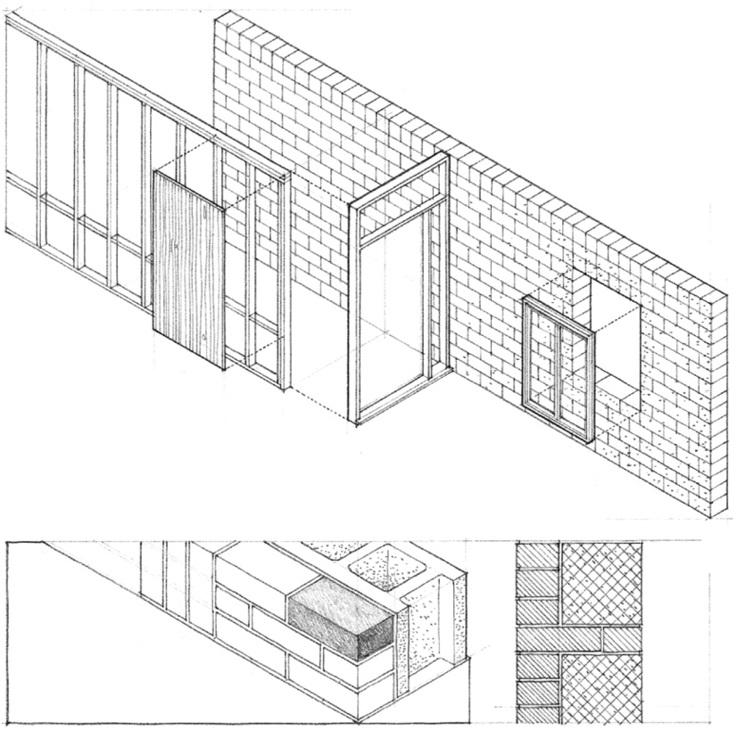

> [BREADCRUMB_CTX: 《Architecture》 > Manufactured Proportions]

## MANUFACTURED PROPORTIONS

Many architectural elements are sized and proportioned not only according to their structural properties and function, but also by the process through which they are manufactured. Because these elements are mass-produced in factories, they have standard sizes and proportions imposed on them by the individual manufacturers or by industry standards.

**Standard Casement Window Units**

Concrete block and common brick, for example, are produced as modular building units. Although they differ from each other in size, both are proportioned on a similar basis. Plywood and other sheathing materials also are manufactured as modular units with fixed proportions. Steel sections have fixed proportions generally agreed upon by the steel manufacturers and the American Institute of Steel Construction. Windows and doors have proportions that are set by the individual manufacturers of the units.

Since these and other materials must ultimately come together and achieve a high degree of fit in the construc-tion of a building, the standard sizes and proportions of factory-produced elements affect the size, proportion, and spacing of other materials as well. Standard door and window units are sized and proportioned to fit into modular masonry openings. Wood or metal studs and joists are spaced to accept modular sheathing materials.

