> [BREADCRUMB_CTX: 《Architecture》 > Proportioning Systems]

## PROPORTIONING SYSTEMS

Even considering the proportional constraints imposed on a form by the nature of its material, its structural function, or by the manufacturing process, the designer still has the ability to control the proportion of the forms and spaces within and around a building. The decision to make a room square or oblong in plan, intimate or lofty in scale, or to endow a building with an imposing, higher-than-usual facade, legitimately falls to the designer. But on what basis are these decisions made?

If a space 400 square feet in area were required, what dimensions—what ratios of width-to-length and length-to-height—should it have? Of course, the functioning of the space and the nature of the activities to be accommodated will influence its form and proportion.

A technical factor, such as its structure, might limit one or more of its dimensions. Its context—the exterior environment or an adjacent interior space—might pressure its form. The decision might be to recall a space from another time and place and to simulate its proportions. Or the decision might be based finally on an aesthetic, visual judgment of the “desirable” relationships among the dimensions of the parts and the whole of a building.

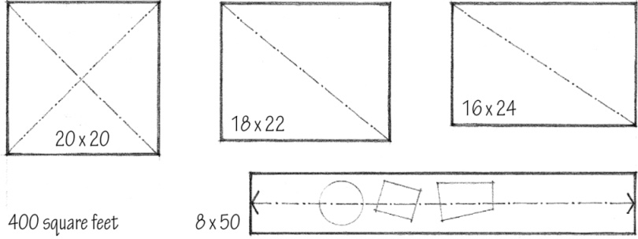

A square space, having four equal faces, is static in nature. If its length expands and dominates its width, it becomes more dynamic. While square and oblong spaces define places for activity, linear spaces encourage movement and are susceptible to subdivision into a number of zones.

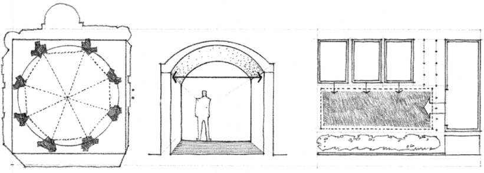
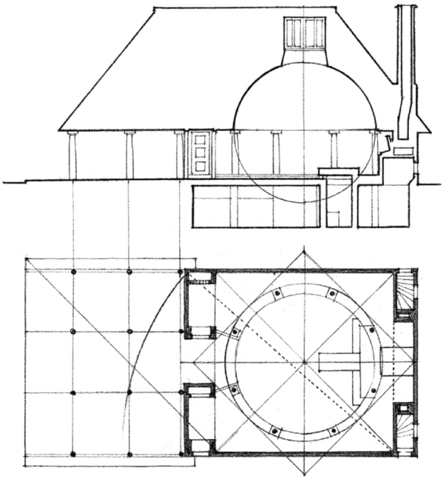

**Woodland Chapel**, Stockholm, Sweden, 1918–1920, Erik Gunnar Asplund

In truth, our perception of the physical dimensions of architecture, of proportion and scale, is imprecise. It is distorted by the foreshortening of perspective and distance, and by cultural biases, and is thus difficult to control and predict in an objective and precise manner.

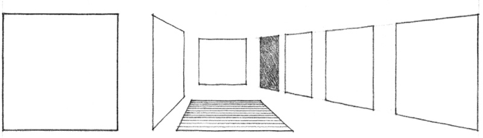

Small or slight differences in the dimensions of a form are especially difficult to discern. While a square, by definition, has four equal sides and four right angles, a rectangle can appear to be exactly square, almost a square, or very much unlike a square. It can appear to be long, short, stubby, or squat, depending on our point of view. We use these terms to give a form or figure a visual quality that is largely a result of how we perceive its proportions. It is not, however, an exact science.

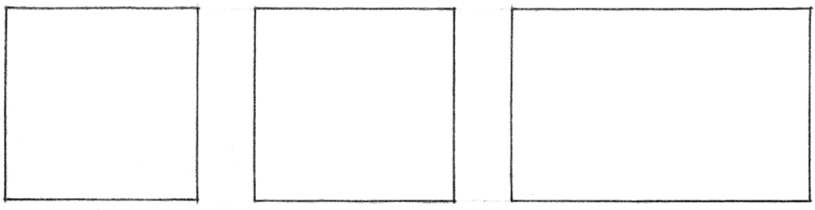

If the precise dimensions and relationships of a design that is regulated by a proportioning system cannot be objectively perceived in a similar manner by everyone, why are proportioning systems useful and of particular significance in architectural design?

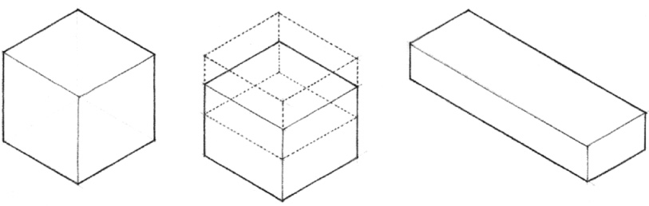

The intent of all theories of proportions is to create a sense of order and harmony among the elements in a visual construction. According to Euclid, a ratio refers to the quantitative comparison of two similar things, while proportion refers to the equality of ratios. Underlying any proportioning system, therefore, is a characteristic ratio, a permanent quality that is transmitted from one ratio to another. Thus, a proportioning system establishes a consistent set of visual relationships between the parts of a building, as well as between the parts and the whole. Although these relationships may not be immediately perceived by the casual observer, the visual order they create can be sensed, accepted, or even recognized through a series of repetitive experiences. Over a period of time, we might begin to see the whole in the part, and the part in the whole.

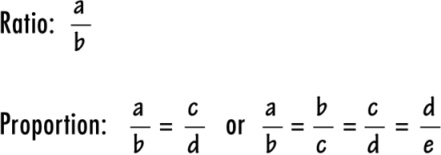

Proportion is the equality between two ratios in which the first of the four terms divided by the second equals the third divided by the fourth.

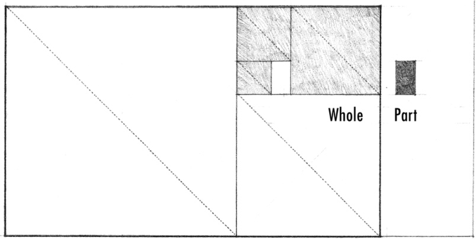

Proportioning systems go beyond the functional and technical determinants of architectural form and space to provide an aesthetic rationale for their dimensions. They can visually unify the multiplicity of elements in an architectural design by having all of its parts belong to the same family of proportions. They can provide a sense of order in, and heighten the continuity of, a sequence of spaces. They can establish relationships between the exterior and interior elements of a building.

A number of theories of “desirable” proportions have been developed in the course of history. The notion of devising a system for design and communicating its means is common to all periods. Although the actual system varies from time to time, the principles involved and their value to the designer remain the same.

### Theories of Proportion:

* **Golden Section**
* **Classical Orders**
* **Renaissance Theories**
* **Modulor**
* **Ken**
* **Anthropometry**
* **Scale**

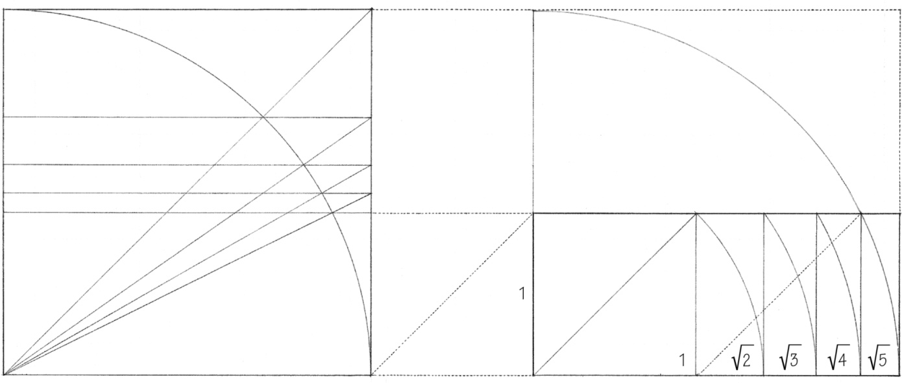

A fixed proportion used in determining measurements and dimensions

### Types of Proportion:

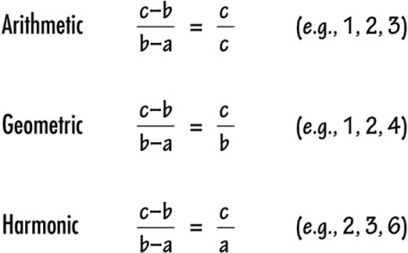
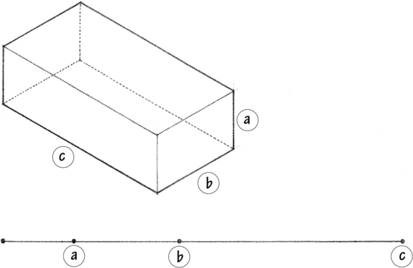