> [BREADCRUMB_CTX: 《Architecture》 > Golden Section]

## GOLDEN SECTION

Mathematical systems of proportion originate from the Pythagorean concept of “all is number” and the belief that certain numerical relationships manifest the harmonic structure of the universe. One of these relationships that has been in use ever since the days of antiquity is the proportion known as the Golden Section. The Greeks recognized the dominating role the Golden Section played in the proportions of the human body. Believing that both humanity and the shrines housing their deities should belong to a higher universal order, they utilized these same proportions in their temple structures. Renaissance architects also explored the Golden Section in their work. In more recent times, Le Corbusier based his Modulor system on the Golden Section. Its use in architecture endures even today.

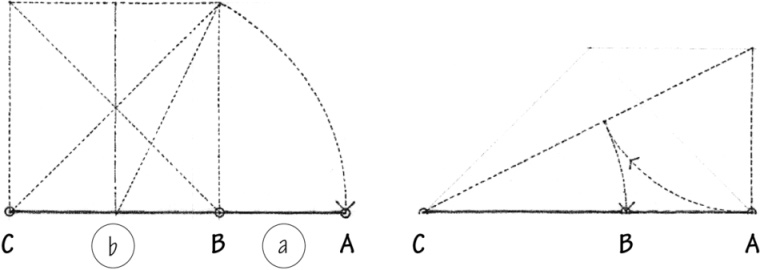

The geometric construction of the Golden Section, first by extension, and then by division.

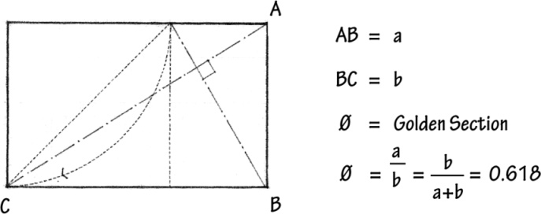

The Golden Section can be defined as the ratio between two sections of a line, or the two dimensions of a plane figure, in which the lesser of the two is to the greater as the greater is to the sum of both. It can be expressed algebraically by the equation of two ratios:

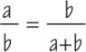

The Golden Section has some remarkable algebraic and geometric properties that account for its existence in architecture as well as in the structures of many living organisms. Any progression based on the Golden Section is at once additive and geometrical.

Another progression that closely approximates the Golden Section in whole numbers is the Fibonacci Series: 1, 1, 2, 3, 5, 8, 13…. Each term again is the sum of the two preceding ones, and the ratio between two consecutive terms tends to approximate the Golden Section as the series progresses to infinity.

In the numerical progression: 1, Ø 1, Ø 2, Ø 3… Ø n, each term is the sum of the two preceding ones.

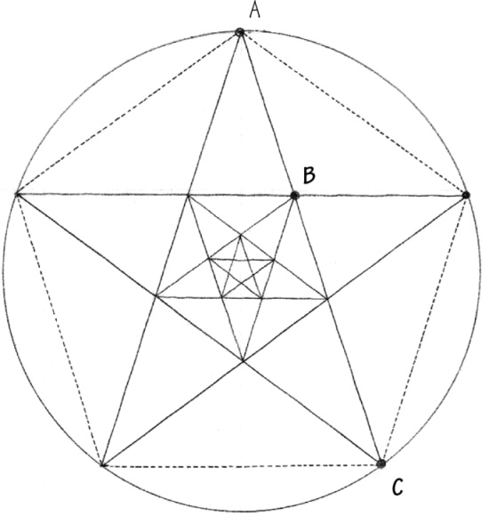

A rectangle whose sides are proportioned according to the Golden Section is known as a Golden Rectangle. If a square is constructed on its smaller side, the remaining portion of the original rectangle would be a smaller but similar Golden Rectangle. This operation can be repeated indefinitely to create a gradation of squares and Golden Rectangles. During this transformation, each part remains similar to all of the other parts, as well as to the whole. The diagrams on this page illustrate this additive and geometrical growth pattern of progressions based on the Golden Section.

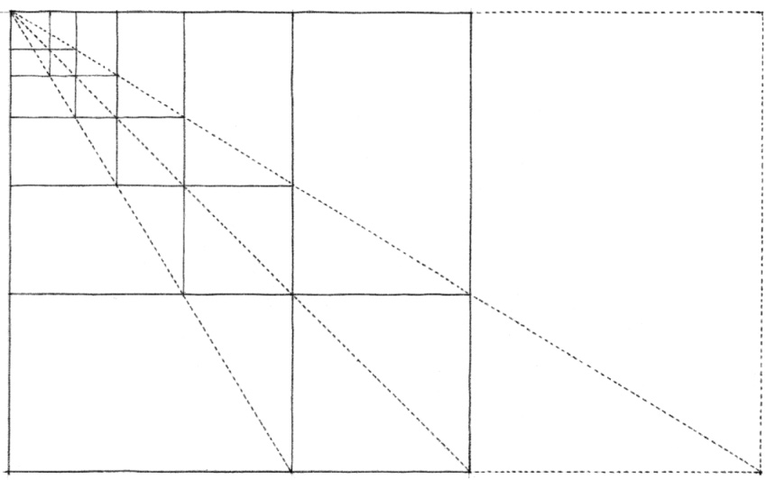
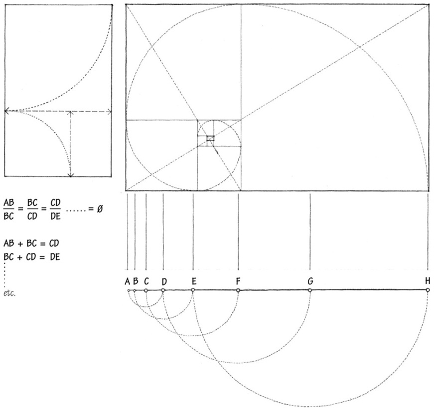
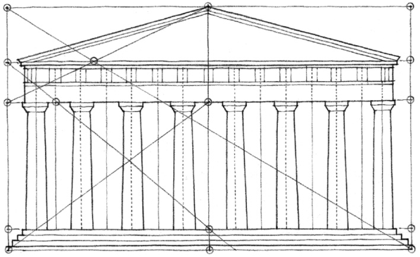

**The Parthenon**, Athens, 447–432 B.C., Ictinus and Callicrates

These two graphic analyses illustrate the use of the Golden Section in the proportioning of the facade of the Parthenon. It is interesting to note that while both analyses begin by fitting the facade into a Golden Rectangle, each analysis then varies from the other in its approach to proving the existence of the Golden Section and its effect on the dimensions and distribution of elements across the facade.

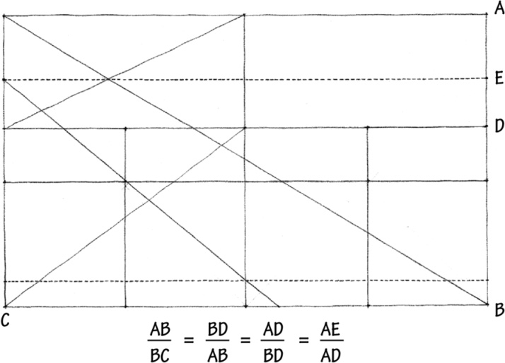
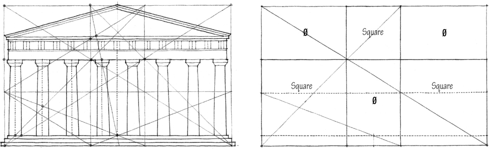
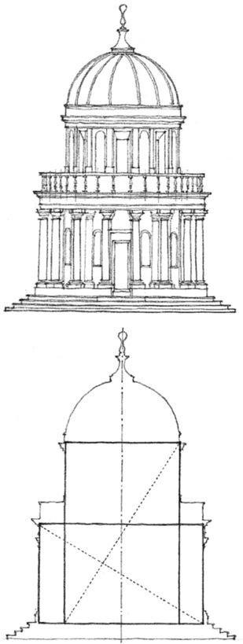

**Tempietto, St. Pietro in Montorio**, Rome, 1502–1510, Donato Bramante

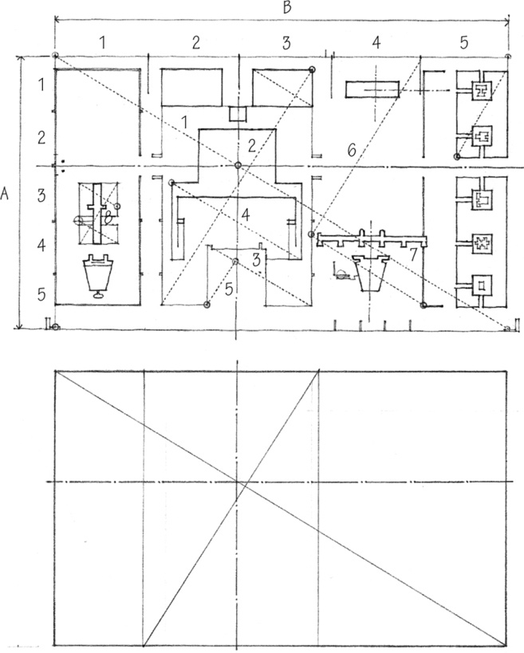

**World Museum** (Project), Geneva, 1929, Le Corbusier

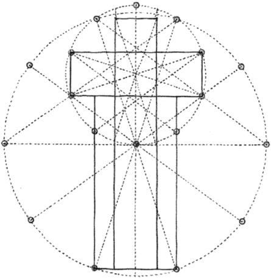

Standard Gothic Plan and Section  
After Moessel

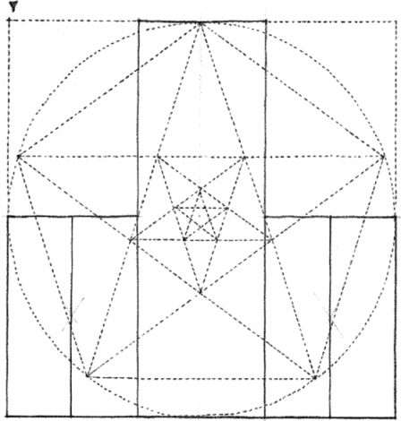

After F.M. Lund