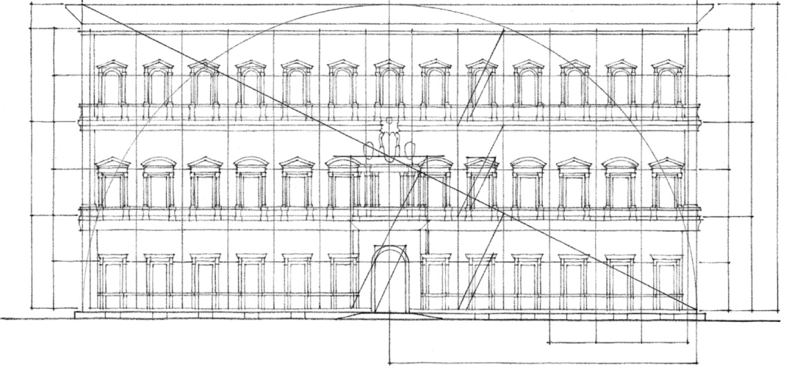
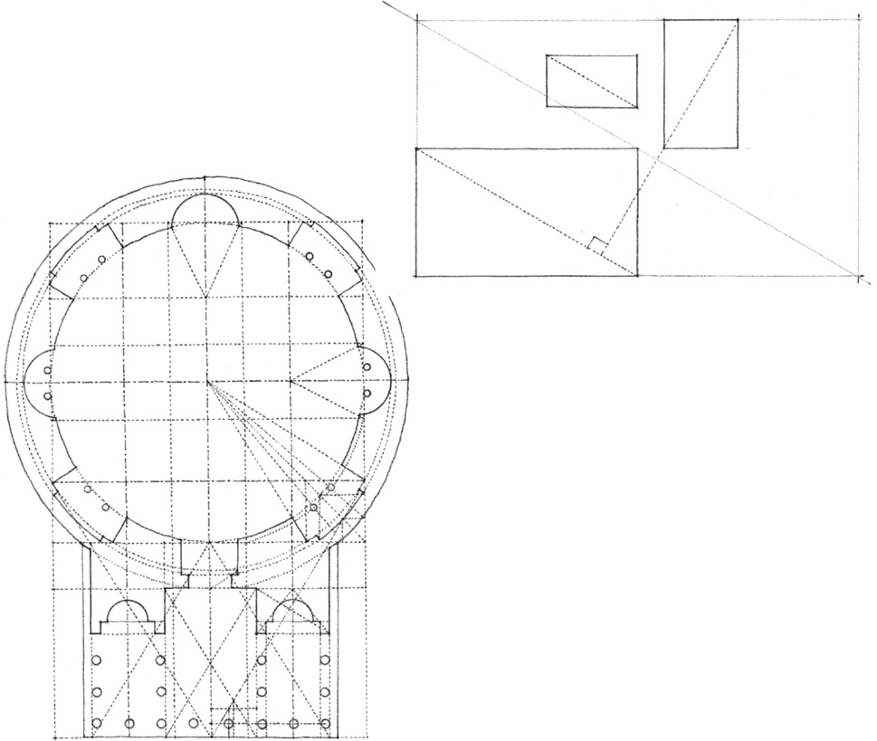
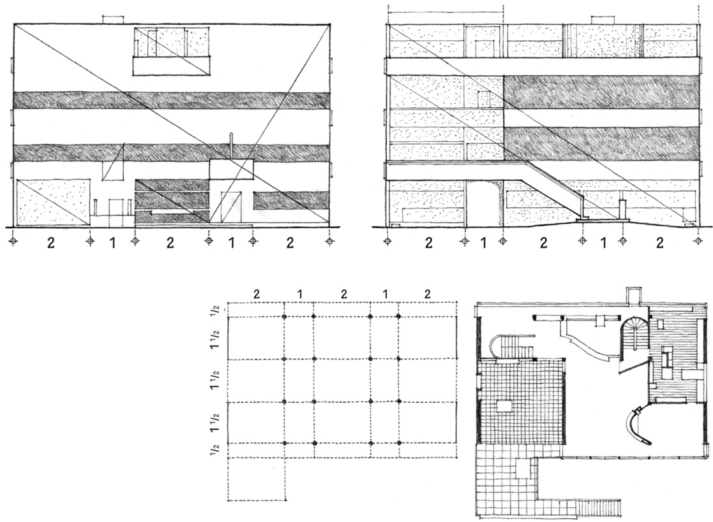
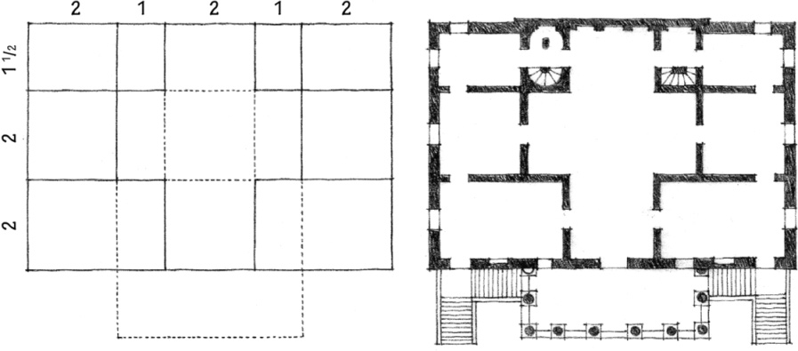

> [BREADCRUMB_CTX: 《Architecture》 > Regulating Lines]

## REGULATING LINES

**Palazzo Farnese**, Rome, 1515, Antonio da Sangallo the Younger

**The Pantheon**, Rome, A.D. 120–124

If the diagonals of two rectangles are either parallel or perpendicular to each other, they indicate that the two rectangles have similar proportions. These diagonals, as well as lines that indicate the common alignment of elements, are called regulating lines. They were seen previously in the discussion of the Golden Section, but they can also be used to control the proportion and placement of elements in other proportioning systems as well. Le Corbusier, in *Towards a New Architecture*, stated the following:

“A regulating line is an assurance against capriciousness; it is a means of verification which can ratify all work created in fervour…. It confers on the work the quality of rhythm. The regulating line brings in this tangible form of mathematics which gives the reassuring perception of order. The choice of a regulating line fixes the fundamental geometry of the work…. It is a means to an end; it is not a recipe.”

**Villa Garches**, Vaucresson, France, 1926–1927, Le Corbusier

In his essay, *The Mathematics of the Ideal Villa*, 1947, Colin Rowe pointed out the similarity between the spatial subdivision of a Palladian villa and the structural grid of a villa by Le Corbusier. While both villas shared a similar proportioning system and a relationship to a higher mathematical order, Palladio’s villa consisted of spaces with fixed shapes and harmonic interrelationships. Le Corbusier’s villa was composed of horizontal layers of free space defined by the floor and roof slabs. The rooms varied in shape and were asymmetrically arranged at each level.

**Villa Foscari**, Malcontenta, Italy, 1558, Andrea Palladio