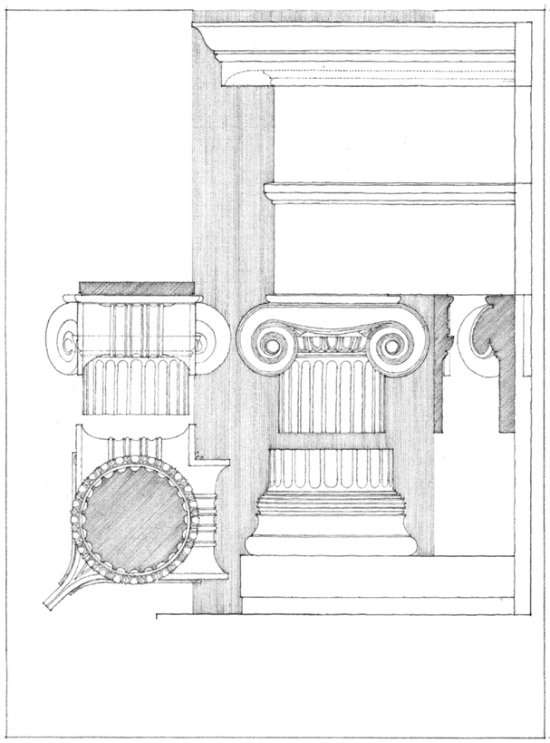
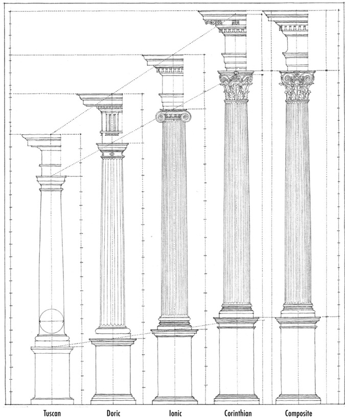
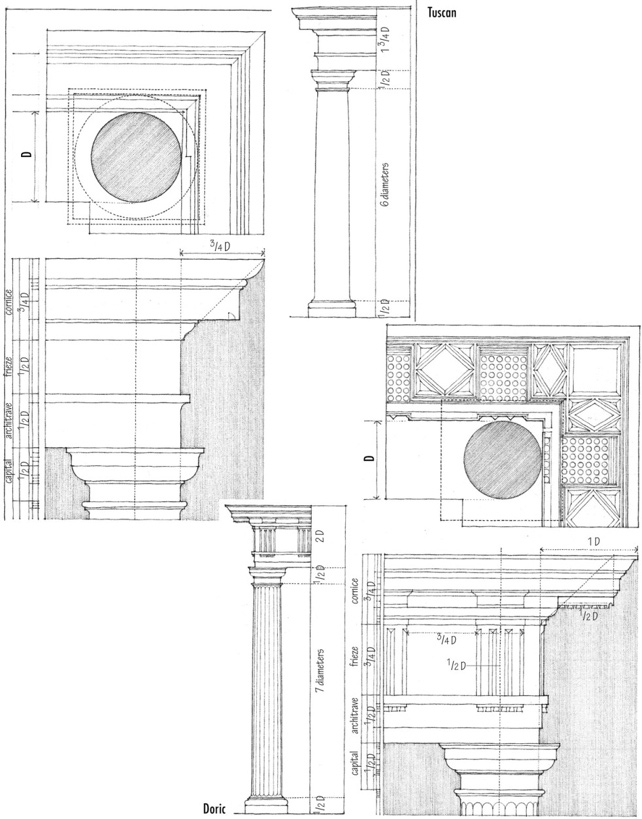
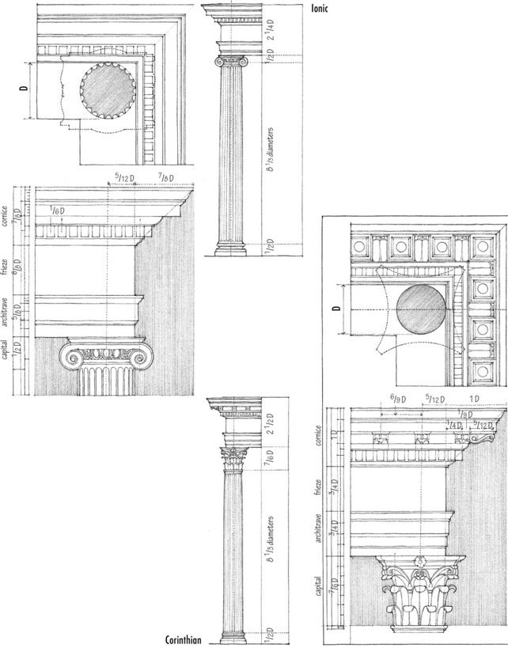
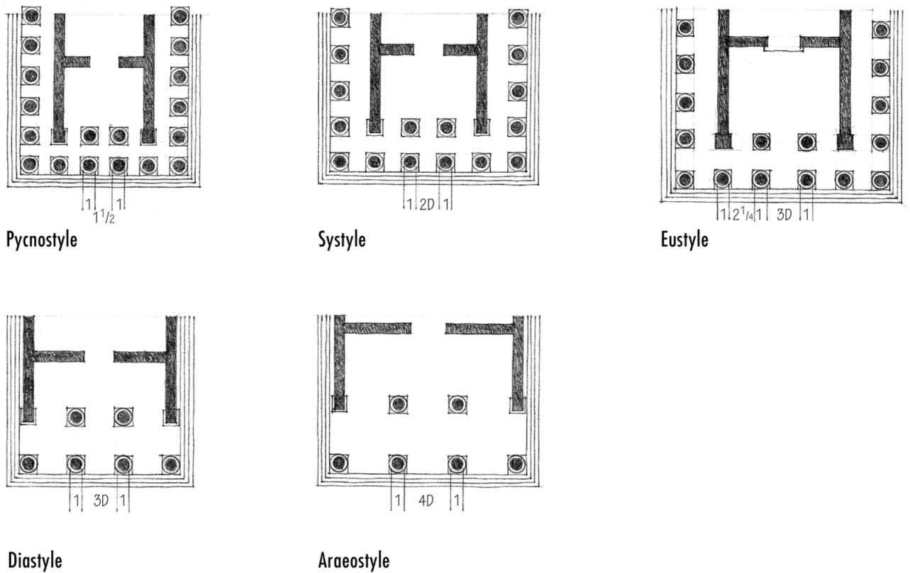
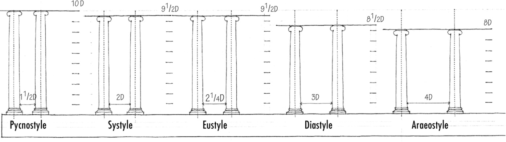
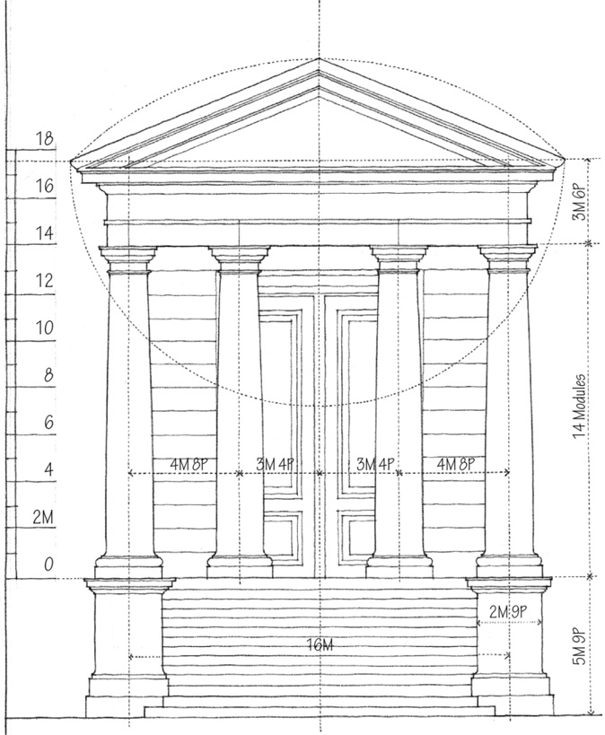
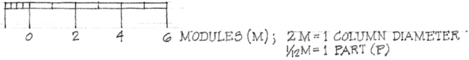
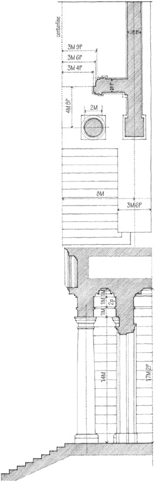

> [BREADCRUMB_CTX: 《Architecture》 > Classical Orders]

## CLASSICAL ORDERS

**Ionic Order**, from the **Temple on the Ilissus**, Athens, 449 B.C., Callicrates. After a drawing by William R. Ware.

To the Greeks and Romans of classical antiquity, the Orders represented in their proportioning of elements the perfect expression of beauty and harmony. The basic unit of dimension was the diameter of the column. From this module were derived the dimensions of the shaft, the capital, as well as the pedestal below and the entablature above, down to the smallest detail. Intercolumniation—the system of spacing between columns—was also based on the diameter of the column.

Because the sizes of columns varied according to the extent of a building, the Orders were not based on a fixed unit of measurement. Rather, the intention was to ensure that all of the parts of any one building were proportionate and in harmony with one another.

Vitruvius, in the time of Augustus, studied actual examples of the Orders and presented his “ideal” proportions for each in his treatise, *The Ten Books on Architecture*. Vignola recodified these rules for the Italian Renaissance and his forms for the Orders are probably the best known today.

**The Classical Orders according to Vignola**

Classification of Temples according to their **Intercolumniation**

Vitruvius’ Rules for the **Diameter, Height, and Spacing of Columns**

Temple Front in the **Tuscan Order**

