> [BREADCRUMB_CTX: 《Architecture》 > Renaissance Theories]

## RENAISSANCE THEORIES

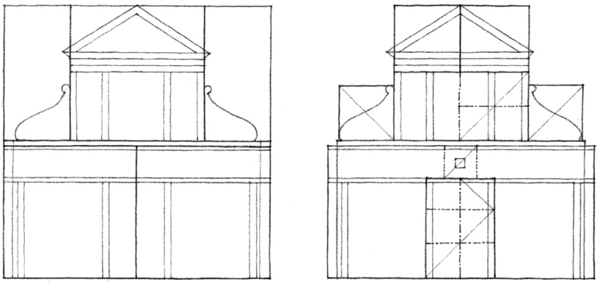

**St. Maria Novella**, Florence, Italy.  
Alberti designed the Renaissance facade (1456–1470) to complete a Gothic church (1278–1350).

Pythagoras discovered that the consonances of the Greek musical system could be expressed by the simple numerical progression—1, 2, 3, 4—and their ratios, 1:2, 1:3, 2:3, 3:4. This relationship led the Greeks to believe they had found the key to the mysterious harmony that pervaded the universe. The Pythagorean creed was “Everything is arranged according to numbers.” Plato later developed Pythagoras’ aesthetics of numbers into an aesthetics of proportion. He squared and cubed the simple numerical progression to produce the double and triple progressions, 1, 2, 4, 8, and 1, 3, 9, 27. For Plato, these numbers and their ratios not only contained the consonances of the Greek musical scale but also expressed the harmonic structure of his universe.

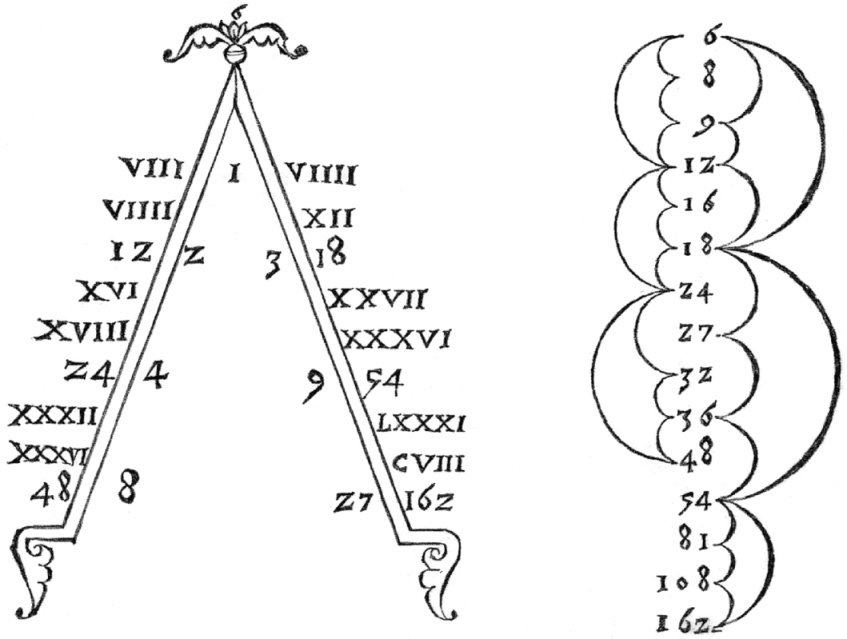

Diagram by Francesco Giorgi, 1525, illustrating the series of interlocking ratios that results from applying Pythagoras’ theory of means to the intervals of the Greek musical scale.

The architects of the Renaissance, believing that their buildings had to belong to a higher order, returned to the Greek mathematical system of proportions. Just as the Greeks conceived music to be geometry translated into sound, Renaissance architects believed that architecture was mathematics translated into spatial units. Applying Pythagoras’ theory of means to the ratios of the intervals of the Greek musical scale, they developed an unbroken progression of ratios that formed the basis for the proportions of their architecture. These series of ratios manifested themselves not only in the dimensions of a room or a facade, but also in the interlocking proportions of a sequence of spaces or an entire plan.

**Seven Ideal Plan Shapes for Rooms.**

Andrea Palladio (1508–1580) was probably the most influential architect of the Italian Renaissance. In *The Four Books on Architecture*, first published in Venice in 1570, he followed in the footsteps of his predecessors, Alberti and Serlio, and proposed these seven “most beautiful and proportionable manners of rooms.”

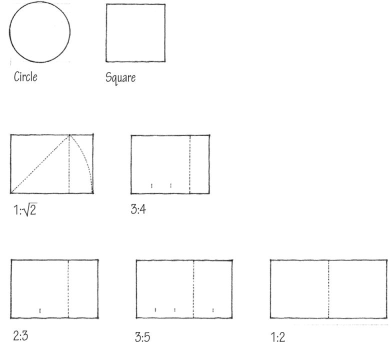

**Determining the Heights of Rooms.**

Palladio also proposed several methods for determining the height of a room so that it would be in proper proportion to the room’s width and length. The height of rooms with flat ceilings would be equal to their width. The height of square rooms with vaulted ceilings would be one-third greater than their width. For other rooms, Palladio used Pythagoras’ theory of means to determine their heights. Accordingly, there were three types of means: arithmetic, geometric, and harmonic.

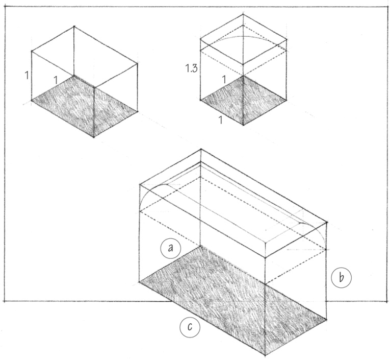

Arithmetic:

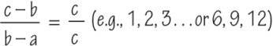

Geometric:

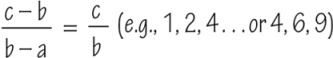

Harmonic:

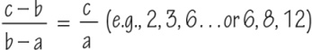

In each case, the height of a room is equal to the mean (b) between the two extremes of the width (a) and length (c) of the room.

“Beauty will result from the form and correspondence of the whole, with respect to the several parts, of the parts with regard to each other, and of these again to the whole; that the structure may appear an entire and complete body, wherein each member agrees with the other, and all necessary to compose what you intend to form.”  
—Andrea Palladio, *The Four Books on Architecture*, Book I, Chapter 1.

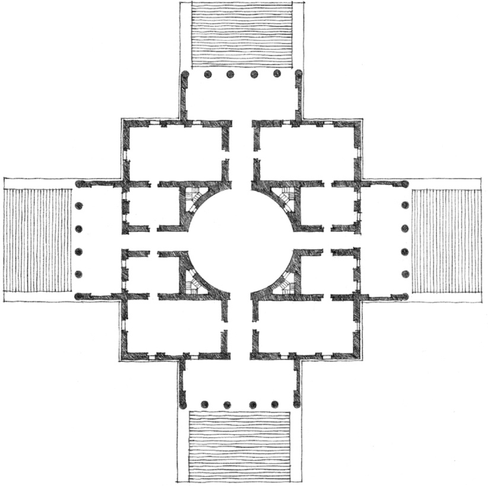

**Villa Capra (The Rotunda)**, Vicenza, Italy, 1552–1567, Andrea Palladio  
12 x 30, 6 x 15, 30 x 30

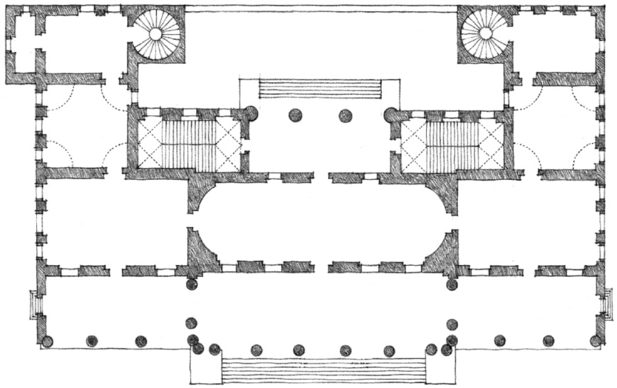

**Palazzo Chiericati**, Vicenza, Italy, 1550, Andrea Palladio  
54 x 16 (18), 18 x 30, 18 x 18, 18 x 12

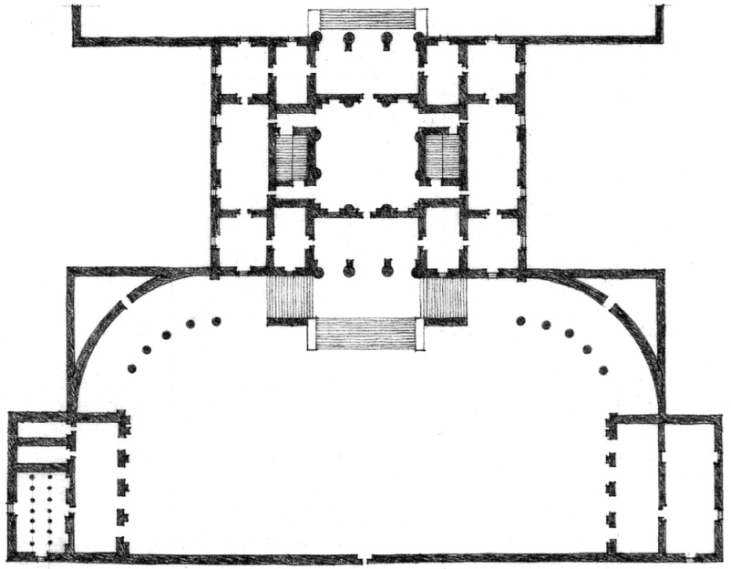

**Villa Thiene**, Cicogna, Italy, 1549, Andrea Palladio  
18 x 36, 36 x 36, 36 x 18, 18 x 18, 18 x 12

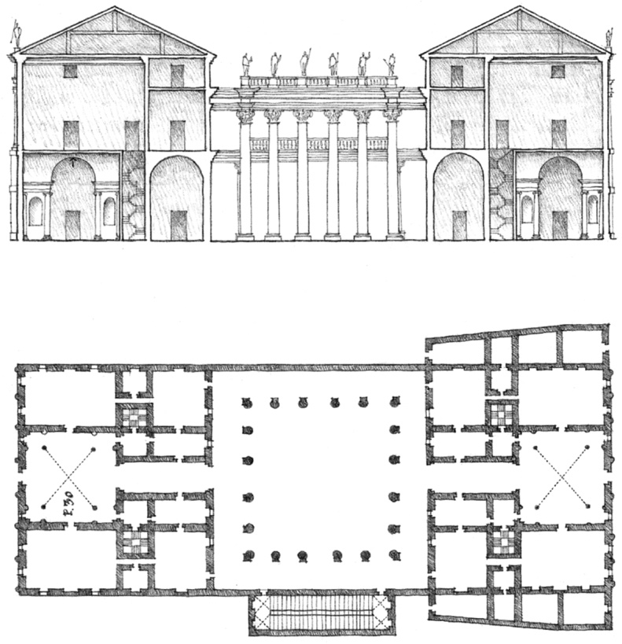

**Palazzo Iseppo Porto**, Vicenza, Italy, 1552, Andrea Palladio  
30 x 30, 20 x 30, 10 x 30, 45 x 45