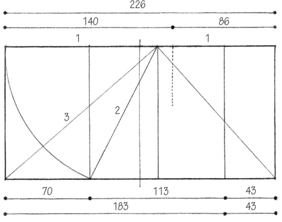
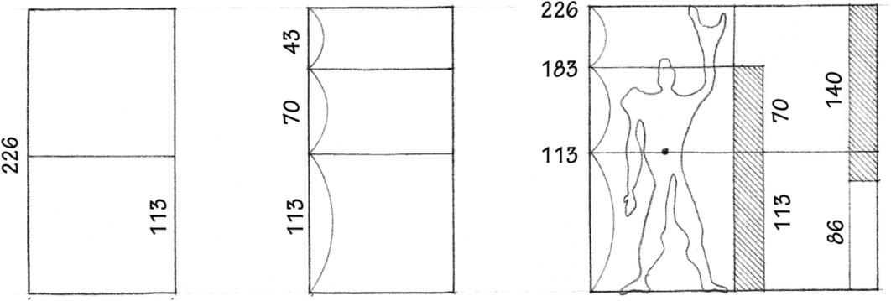
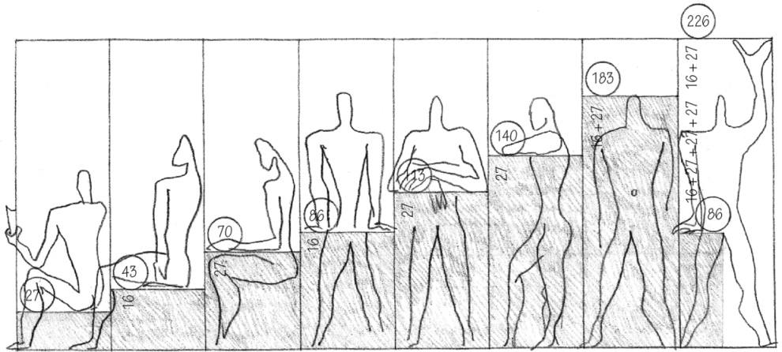
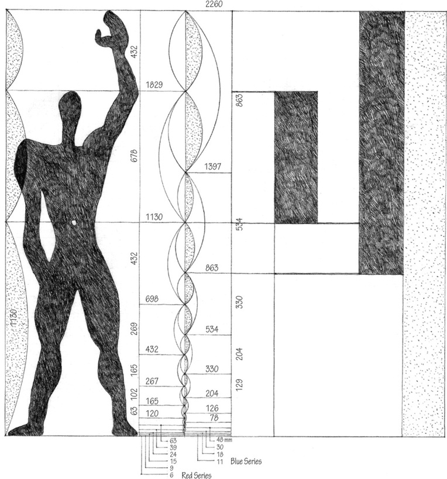
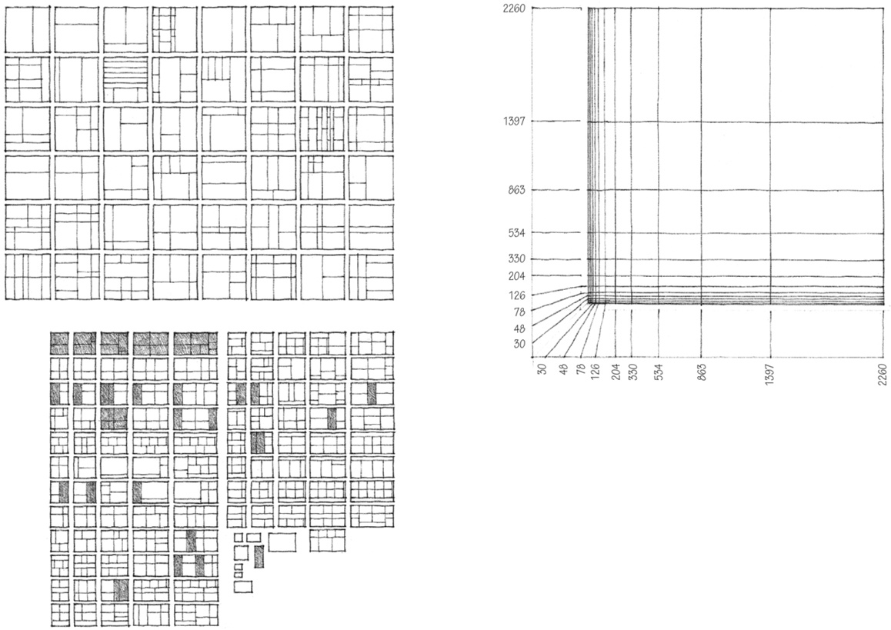
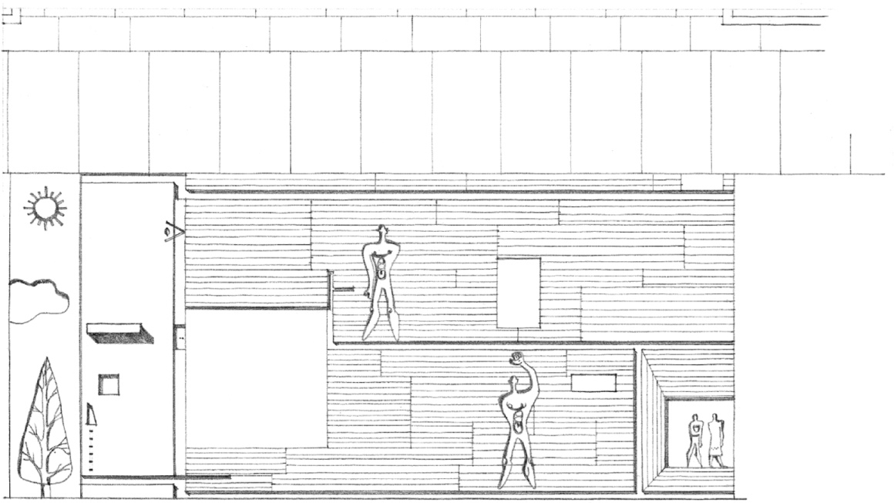
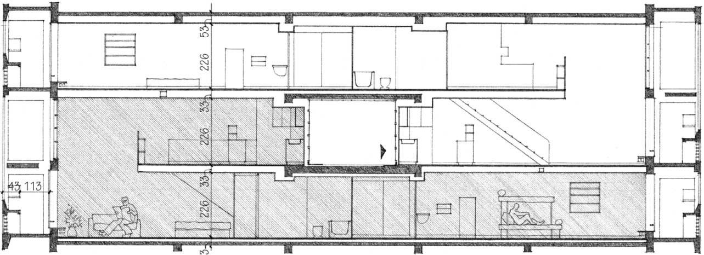
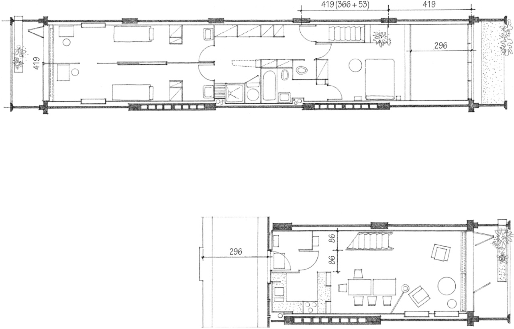

> [BREADCRUMB_CTX: 《Architecture》 > Modulor]

## MODULOR

Le Corbusier developed his proportioning system, the Modulor, to order “the dimensions of that which contains and that which is contained.” He saw the measuring tools of the Greeks, Egyptians, and other high civilizations as being “infinitely rich and subtle because they formed part of the mathematics of the human body, gracious, elegant, and firm, the source of that harmony which moves us, beauty.” He therefore based his measuring tool, the Modulor, on both mathematics (the aesthetic dimensions of the Golden Section and the Fibonacci Series), and the proportions of the human body (functional dimensions).

Le Corbusier began his study in 1942, and published *The Modulor: A Harmonious Measure to the Human Scale Universally Applicable to Architecture and Mechanics* in 1948. A second volume, *Modulor II*, was published in 1954.

The basic grid consists of three measures, 113, 70, and 43 centimeters, proportioned according to the Golden Section.

43 + 70 = 113  
113 + 70 = 183  
113 + 70 + 43 = 226 (2 x 113)

113, 183, and 226 define the space occupied by the human figure. From 113 and 226, Le Corbusier developed the Red and Blue series, diminishing scales of dimensions that were related to the stature of the human figure.

Le Corbusier saw the Modulor not merely as a series of numbers with an inherent harmony, but as a system of measurements that could govern lengths, surfaces, and volumes, and “maintain the human scale everywhere.” It could “lend itself to an infinity of combinations; it ensures unity with diversity … the miracle of numbers.”

The principal work of Le Corbusier that exemplified the use of the Modulor was his Unité d’Habitation at Marseilles. It uses 15 measures of the Modulor to bring human scale to a building that is 140 meters long, 24 meters wide, and 70 meters high.

Le Corbusier used these diagrams to illustrate the diversity of panel sizes and surfaces that could be obtained with the proportions of the Modulor.

Facade Detail, **Unité d’Habitation**, Firminy-Vert, France, 1965–1968, Le Corbusier

Plans and Section of Typical Apartment Unit, **Unité d’Habitation**, Marseilles, 1946–1952, Le Corbusier