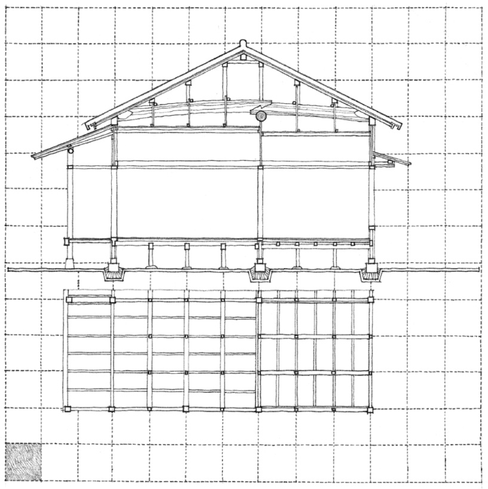
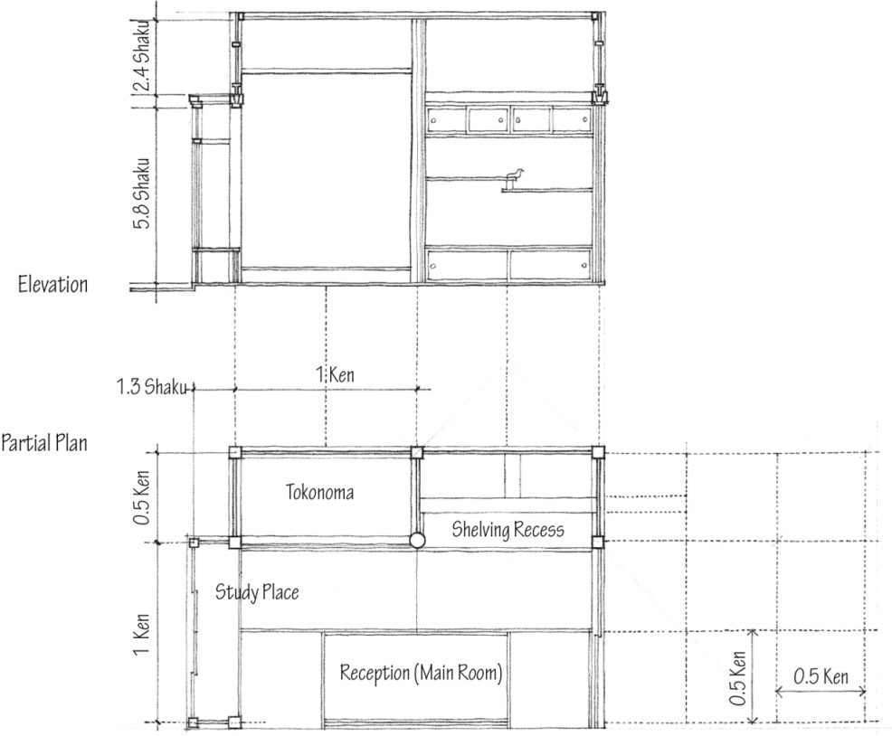
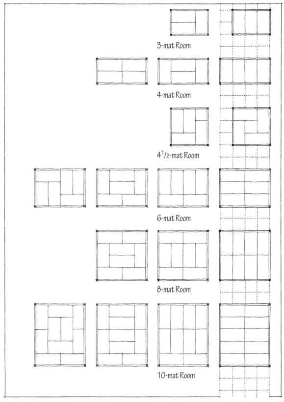
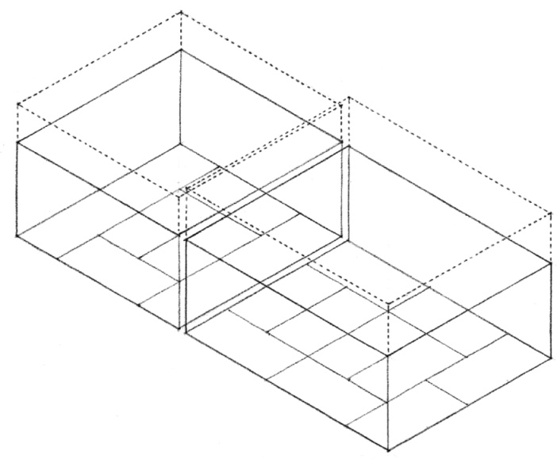
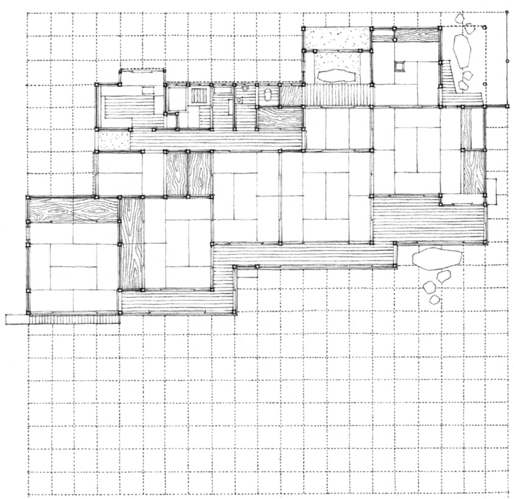
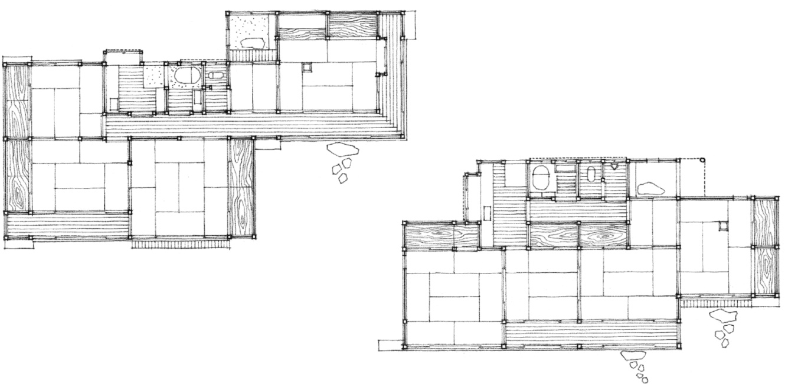
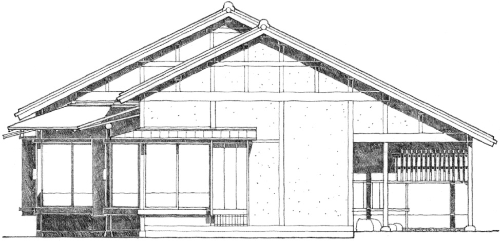
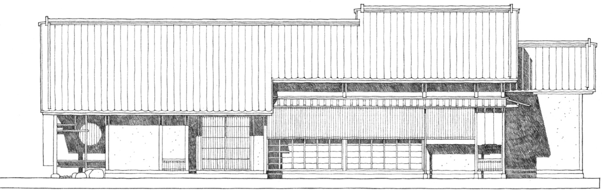

> [BREADCRUMB_CTX: 《Architecture》 > Ken]

## KEN

The traditional Japanese unit of measure, the shaku, was originally imported from China. It is almost equivalent to the English foot and divisible into decimal units. Another unit of measure, the ken, was introduced in the latter half of Japan’s Middle Ages. Although it was originally used simply to designate the interval between two columns and varied in size, the ken was soon standardized for residential architecture. Unlike the module of the Classical Orders, which was based on the diameter of a column and varied with the size of a building, the ken became an absolute measurement.

**Traditional Japanese House**

The ken, however, was not only a measurement for the construction of buildings. It evolved into an aesthetic module that ordered the structure, materials, and space of Japanese architecture.

The **tokonoma** (picture recess) is a shallow, slightly raised alcove for the display of a kakemono or flower arrangement. As the spiritual center of a traditional Japanese house, the tokonoma is located in its most formal room.

Two methods of designing with the ken modular grid developed that affected its dimension. In the Inaka-ma method, the ken grid of 6 shaku determined the center-to-center spacing of columns. Therefore, the standard tatami floor mat (3 x 6 shaku or 0.5 x 1 ken) varied slightly to allow for the thickness of the columns.

In the Kyo-ma method, the floor mat remained constant (3.15 x 6.30 shaku) and the column spacing (ken module) varied according to the size of the room and ranged from 6.4 to 6.7 shaku.

The size of a room is designated by the number of its floor mats. The traditional floor mat was originally proportioned to accommodate two persons sitting or one person sleeping. As the ordering system of the ken grid developed, however, the floor mat lost its dependence on human dimensions and was subjected to the demands of the structural system and its column spacing.

Because of their 1:2 modularity, the floor mats can be arranged in a number of ways for any given room size. And for each room size, a different ceiling height is established according to the following:

height of the ceiling (shaku), measured from the top of the frieze board = number of mats x 0.3.

In a typical Japanese residence, the ken grid orders the structure as well as the additive, space-to-space sequence of rooms. The relatively small size of the module allows the rectangular spaces to be freely arranged in linear, staggered, or clustered patterns.

**Elevations of a Traditional Japanese Residence**

East Elevation

North Elevation