> [BREADCRUMB_CTX: 《Architecture》 > Anthropometry]

## ANTHROPOMETRY

Anthropometry refers to the measurement of the size and proportions of the human body. While the architects of the Renaissance saw the proportions of the human figure as a reaffirmation that certain mathematical ratios reflected the harmony of their universe, anthropometric proportioning methods seek not abstract or symbolic ratios, but functional ones. They are predicated on the theory that forms and spaces in architecture are either containers or extensions of the human body and should therefore be determined by its dimensions.

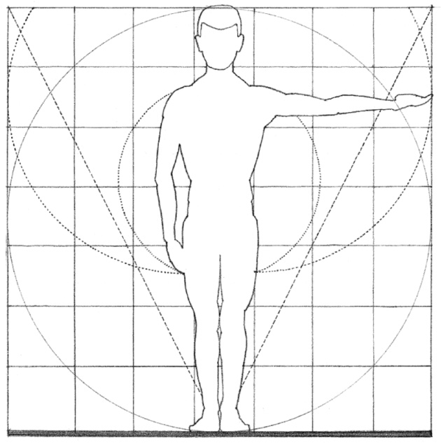

The difficulty with anthropometric proportioning is the nature of the data required for its use. For example, the dimensions given here in millimeters are average measurements and are merely guidelines that should be modified to satisfy specific user needs. Average dimensions must always be treated with caution since variations from the norm will always exist due to the difference between men and women, among various age and racial groups, even from one individual to the next.

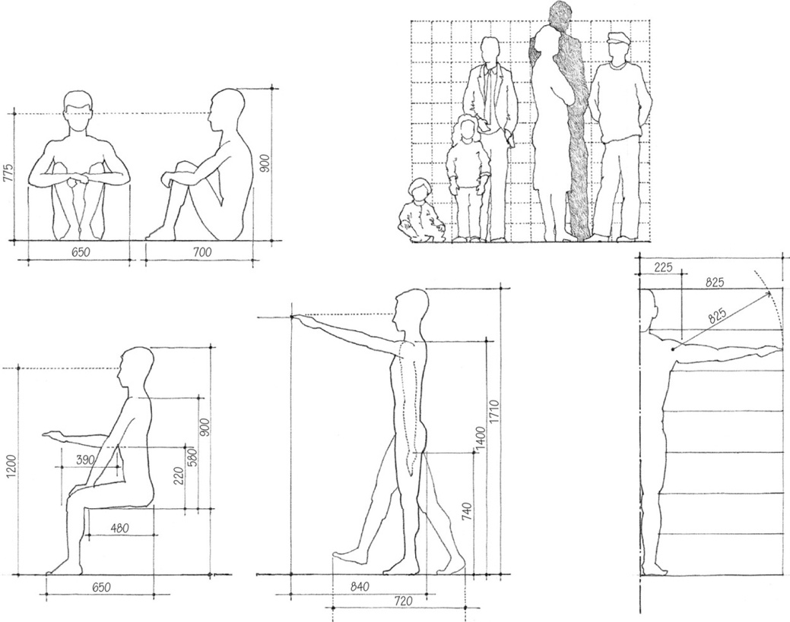

The dimensions and proportions of the human body affect the proportion of things we handle, the height and distance of things we try to reach, and the dimensions of the furnishings we use for sitting, working, eating, and sleeping. There is a difference between our structural dimensions and those dimensional requirements that result from how we reach for something on a shelf, sit down at a table, walk down a set of stairs, or interact with other people. These are functional dimensions and will vary according to the nature of the activity engaged in and the social situation.

A special field that has developed from a concern with human factors is ergonomics—the applied science that coordinates the design of devices, systems, and environments with our physiological and psychological capacities and requirements.

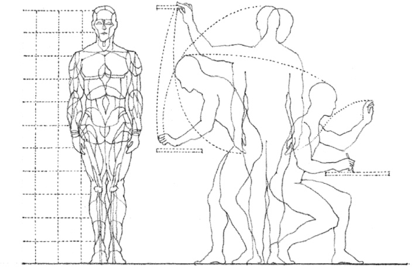
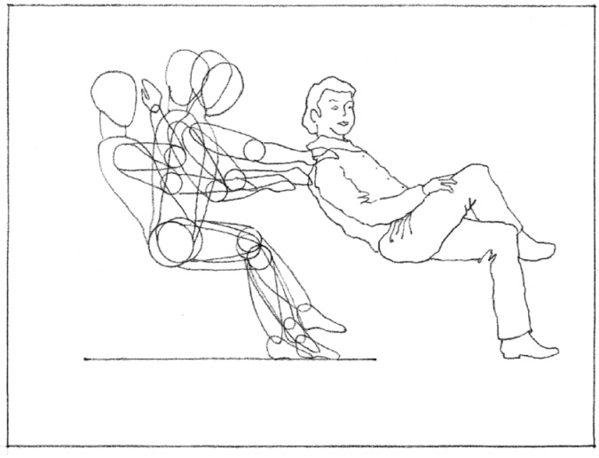
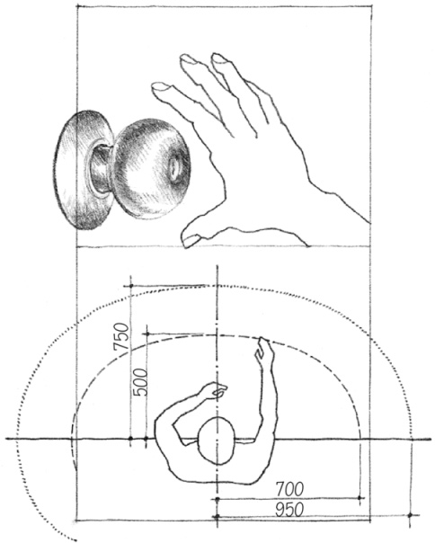
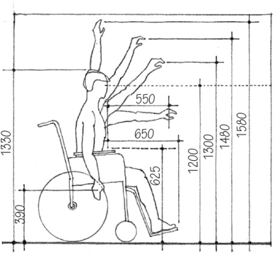
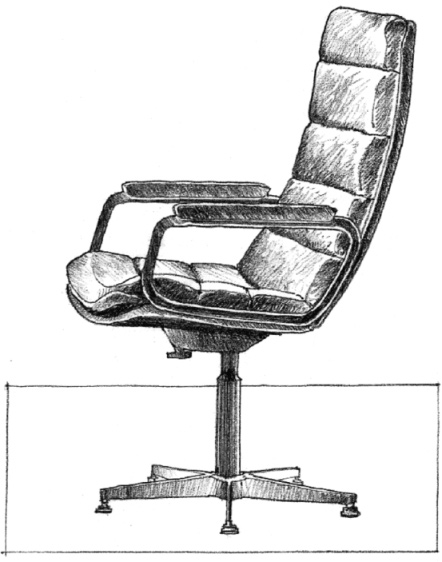

In addition to the elements that we use in a building, the dimensions of the human body also affect the volume of space we require for movement, activity, and rest. The fit between the form and dimensions of a space and our own body dimensions can be a static one as when we sit in a chair, lean against a railing, or nestle within an alcove space. There can also be a dynamic fit as when we enter a building’s foyer, walk up a stairway, or move through the rooms and halls of a building. A third type of fit is how a space accommodates our need to maintain appropriate social distances and to have control over our personal space.

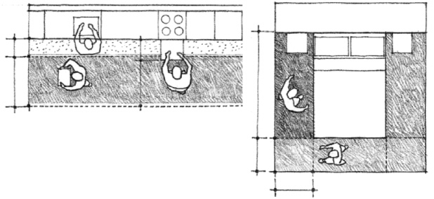
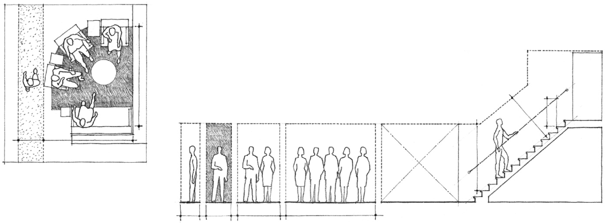
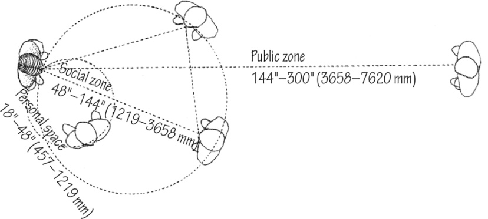
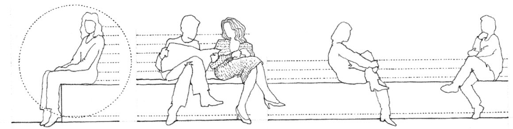