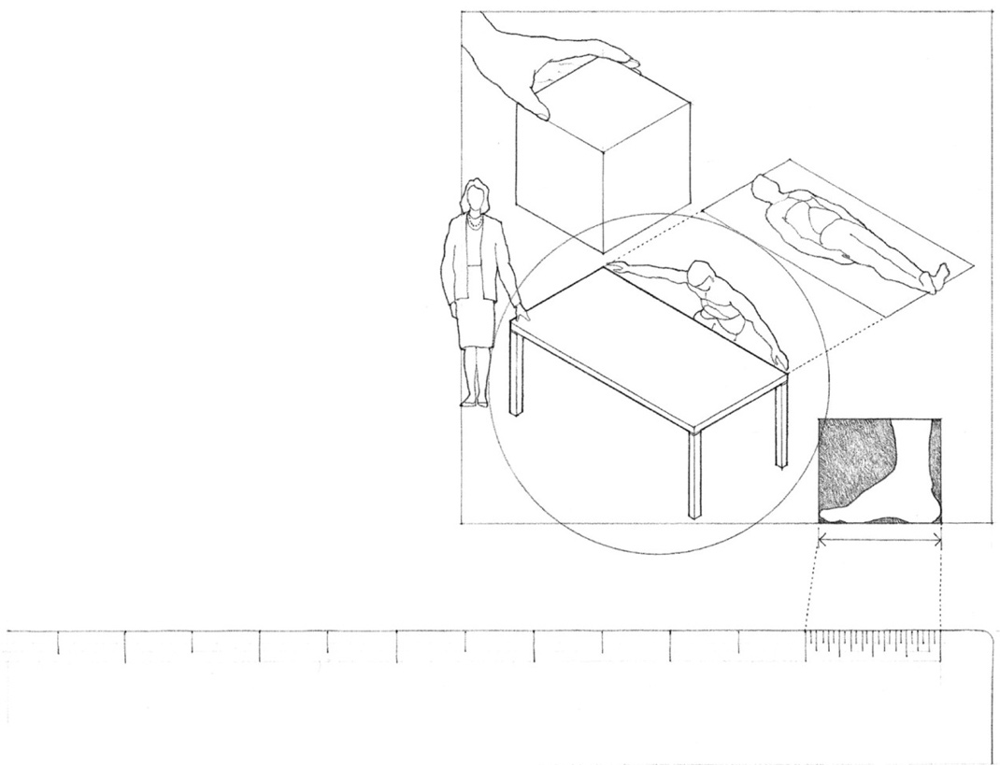
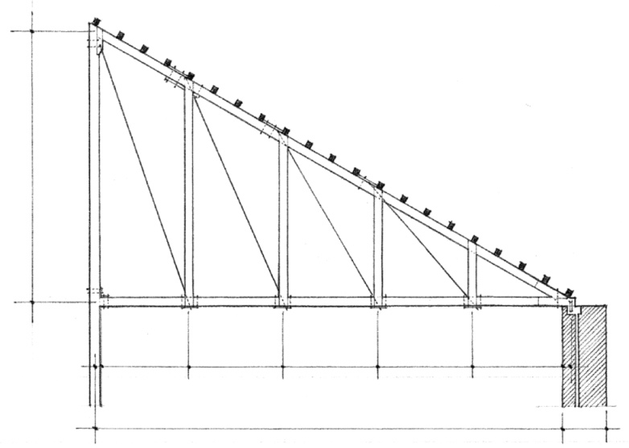

> [BREADCRUMB_CTX: 《Architecture》 > Scale]

## SCALE

While proportion pertains to an ordered set of mathematical relationships among the dimensions of a form or space, scale refers to how we perceive or judge the size of something in relation to something else. In dealing with the issue of scale, therefore, we are always comparing one thing to another.

The entity an object or space is being compared to may be an accepted unit or standard of measurement. For example, we can say that a table is, according to the U.S. Customary System, 3 feet wide, 6 feet long, and 29 inches high. Using the International Metric System, the same table would measure 914 mm wide, 1829 mm long, and 737 mm high. The physical dimensions of the table have not changed, just the system used to calculate its size.

In drawing, we use a scale to specify the ratio that determines the relationship between an illustration to that which it represents. For example, the scale of an architectural drawing notes the size of a depicted building in comparison to the real thing.

