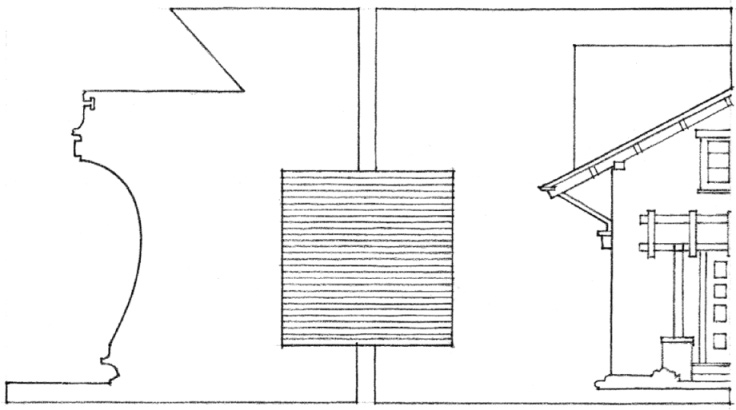
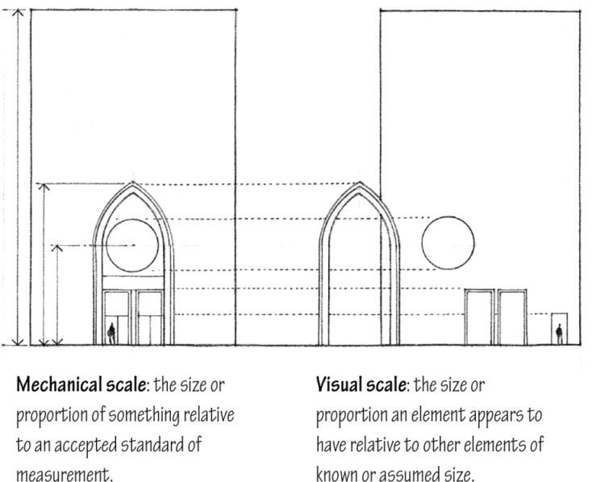
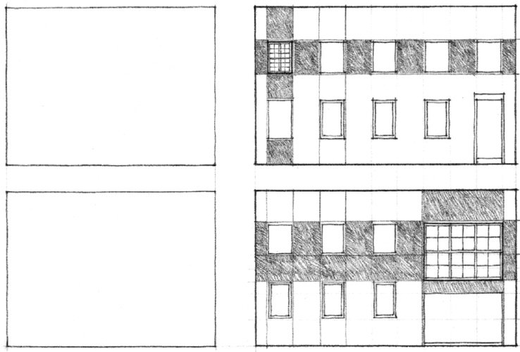
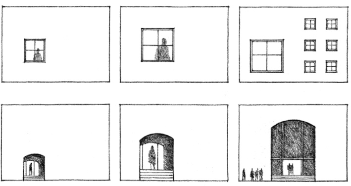
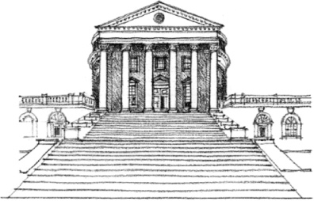
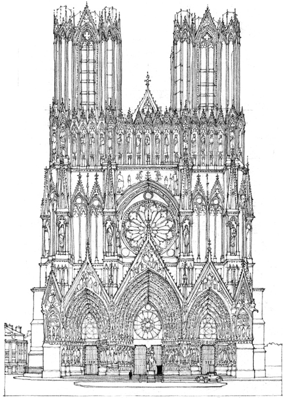

> [BREADCRUMB_CTX: 《Architecture》 > Visual Scale]

## VISUAL SCALE

Of particular interest to designers is the notion of visual scale, which refers not to the actual dimensions of things, but rather to how small or large something appears to be in relation to its normal size or to the size of other things in its context.

When we say something is small-scale or miniature, we usually mean that thing appears to be smaller than its usual size. Likewise, something that is large-scale is perceived as being larger than what is normal or expected.

How large is this square?

We speak of urban scale when we refer to the size of a project in the context of a city, or neighborhood scale when we judge a building appropriate to its locale within a city, or street scale when we note the relative sizes of elements fronting a roadway.

At the scale of a building, all elements, no matter how plain or unimportant they may be, have a certain size. Its dimensions may be predetermined by the manufacturer, or they may be selected by the designer from a range of choices. Nevertheless, we perceive the size of each element in relation to other parts or to the whole of a composition.

For example, the size and proportion of windows in a building facade are visually related to one another as well as to the spaces between them and the overall dimensions of the facade. If the windows are all of the same size and shape, they establish a scale relative to the size of the facade.

If, however, one of the windows is larger than the others, it would create another scale within the composition of the facade. The jump in scale could indicate the size or significance of the space behind the window, or it could alter our perception of the size of the other windows or the overall dimensions of the facade.

Many building elements have sizes and characteristics that are familiar to us and which we use to gauge the sizes of other elements around them. Such elements as residential window units and doorways help give us an idea of how large a building is and how many stories it has. Stairs and certain modular materials, such as brick and concrete block, help us measure the scale of a space. Because of their familiarity, these elements, if oversized, can also be used to deliberately alter our perception of the size of a building form or space.

Some buildings and spaces have two or more scales operating simultaneously. The entrance portico of the library at the University of Virginia, modeled after the Pantheon in Rome, is scaled to the overall building form while the doorway and windows behind it are scaled to the size of the spaces within the building.

**University of Virginia**, Charlottesville, 1817–1826, Thomas Jefferson

The recessed entry portals of Reims Cathedral are scaled to the dimensions of the facade and can be seen and recognized at a distance as the entrances to the interior space of the church. As we get closer, however, we see that the actual entrances are really simple doors within the larger portals and are scaled to our dimensions, to a human scale.

**Reims Cathedral**, 1211–1290