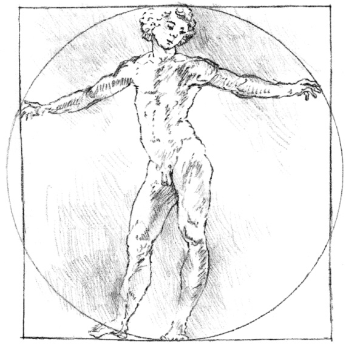
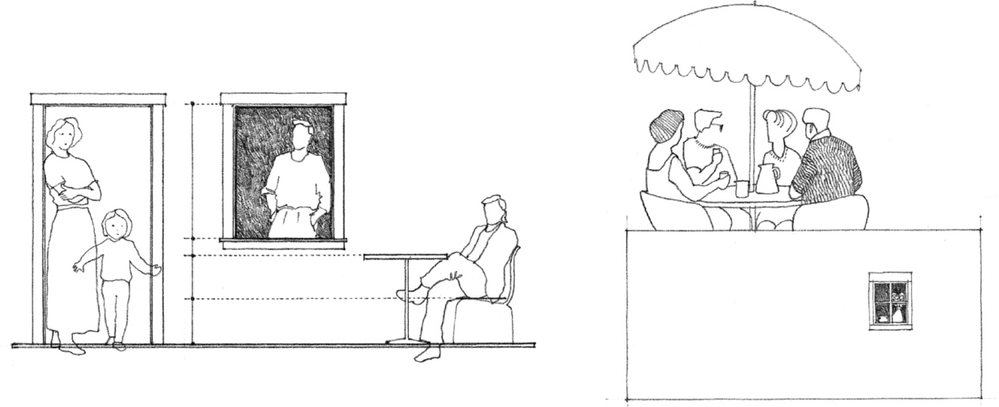
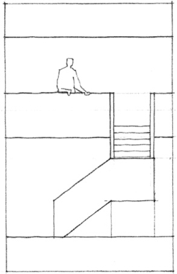
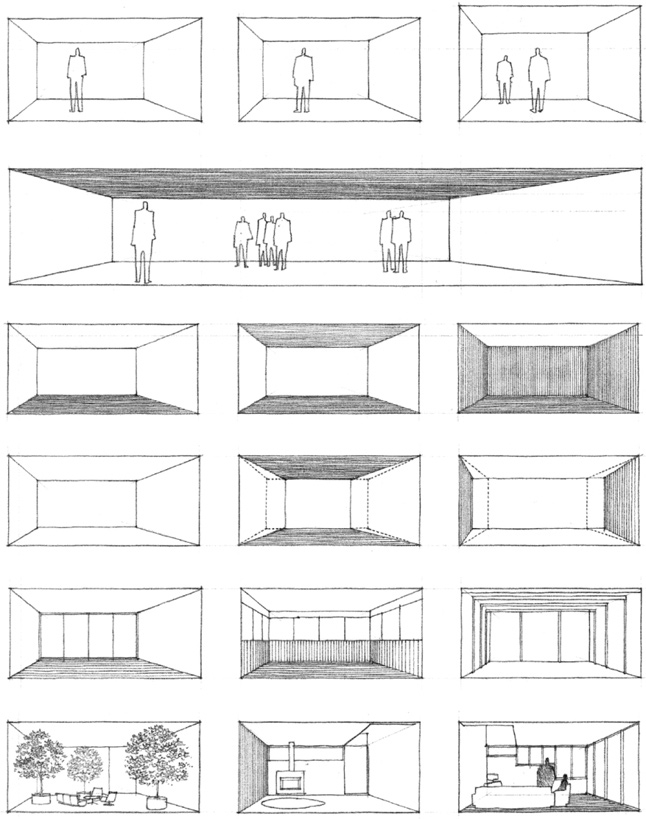
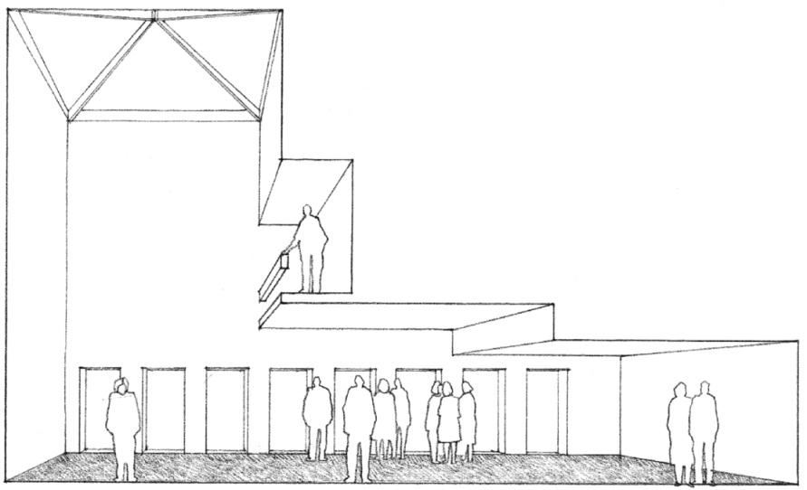

> [BREADCRUMB_CTX: 《Architecture》 > Human Scale]

## HUMAN SCALE

Human scale in architecture is based on the dimensions and proportions of the human body. It has already been mentioned in the section on anthropometric proportioning that our dimensions vary from individual to individual and should not be used as an absolute measuring device. We can, however, gauge a space whose width is such that we can reach out and touch its walls. Similarly, we can judge its height if we can reach up and touch the ceiling plane overhead. Once we can no longer do these things, we must rely on visual rather than tactile clues to give us a sense of the scale of a space.

For these clues, we can use elements that have human meaning and whose dimensions are related to the dimensions of our posture, pace, reach, or grasp. Such elements as a table or chair, the risers and treads of a stairway, the sill of a window, and the lintel over a doorway, not only help us judge the size of a space but also give it a human scale.

While something that is monumental in scale makes us feel small in comparison, a space that is intimate in scale describes an environment in which we feel comfortable, in control, or important. Intimate settings of tables and lounge chairs in a large hotel lobby tell us something about the expansiveness of the space as well as define comfortable, human-scale areas within it. A stairway leading up to a second-story balcony or loft can give us an idea of the vertical dimension of a room as well as suggest a human presence. A window in a blank wall conveys something about the space behind it and also leaves the impression that it is inhabited.

Of a room’s three dimensions, its height has a greater effect on its scale than either its width or length. While the walls of the room provide enclosure, the height of the ceiling plane overhead determines its qualities of shelter and intimacy.

Raising the ceiling height of a 12 × 16-foot room from 8 to 9 feet will be more noticeable and affect its scale more than if its width were increased to 13 feet or its length to 17 feet. While the 12 × 16-foot room with a 9-foot ceiling might feel comfortable to most people, a 50 × 50-foot space with the same ceiling height would begin to feel oppressive.

In addition to the vertical dimension of a space, other factors that affect its scale are:

* the shape, color, and pattern of its bounding surfaces
* the shape and disposition of its openings
* the nature and scale of the elements placed within it

