> [BREADCRUMB_CTX: 《Architecture》 > A Scalar Comparison]

## A SCALAR COMPARISON

On these two pages are architectural structures from various historic periods and places drawn to the same or similar scale. Our perception of how big something or someplace is is always relative to its context and to the size of what we are familar with, such as the length of a Boeing 747 airliner.

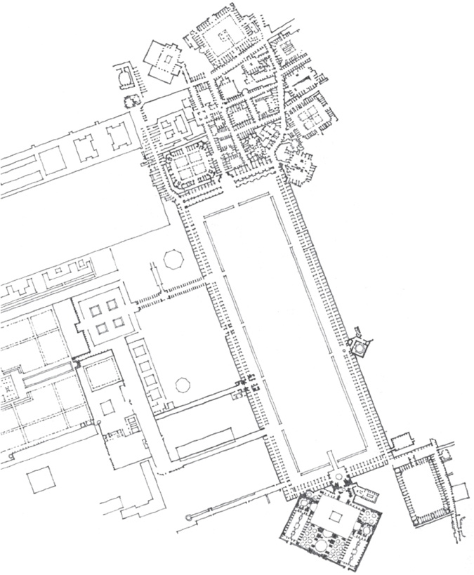

Plan of **Civic Center, Isfahan**, Capital of Persia, 1628

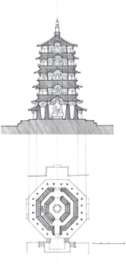

**Yingxian Timber Pagoda**, China, 1056

**Empire State Building**, New York City, 1931,  
Shreve, Lamb, and Harmon

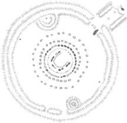

**Stonehenge**, c. 1800 B.C.

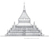

**Shwezigon Pagoda**, Pagan, near Nyangu, Burma, 1058

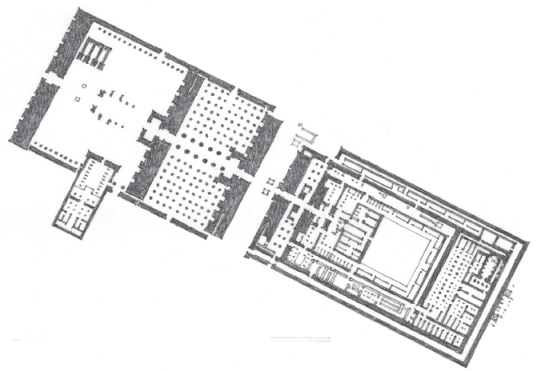

**Temple of Amun at Karnak**, Egypt, c. 1500–323 B.C.

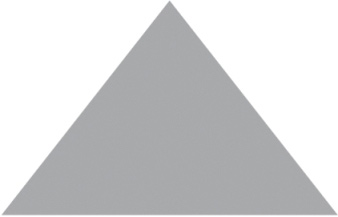

**Great Pyramid of Cheops at Giza**, Egypt, c. 2500 B.C.

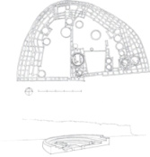

**Pueblo Bonito**, Chaco Canyon, USA, begun c. A.D. 920

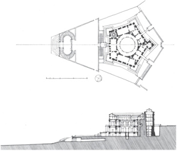

**Villa Farnese**, Caprarola, Italy, 1559–1560, Giacomo Vignola

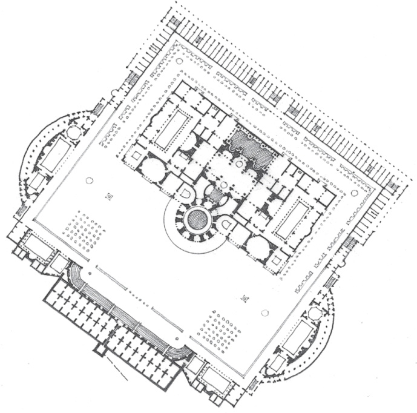

**Baths of Caracalla**, Rome, A.D. 212–216

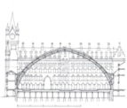

**St. Pancras Station**, London, England, 1863–1876, George Gilbert Scott

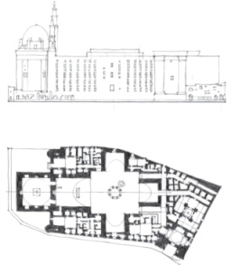

**Mosque of Sultan Hasan**, Cairo, Egypt, 1356–1363

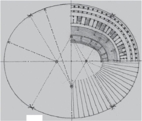

The **Colosseum**, Rome, A.D. 70–82

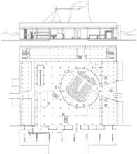

**Legislative Assembly Building**, Chandigarh, India, 1956–1959, Le Corbusier

**Boeing 747-400**

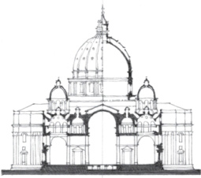

**St. Peter’s Basilica**, 1607, Michelangelo Buonarroti and Carlo Maderno

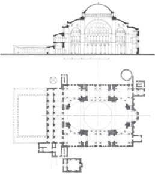

**Hagia Sophia**, Istanbul, Turkey, A.D. 532–537

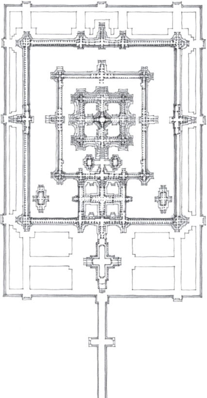

**Angkor Wat**, near Siem Reap, Cambodia, 802–1220

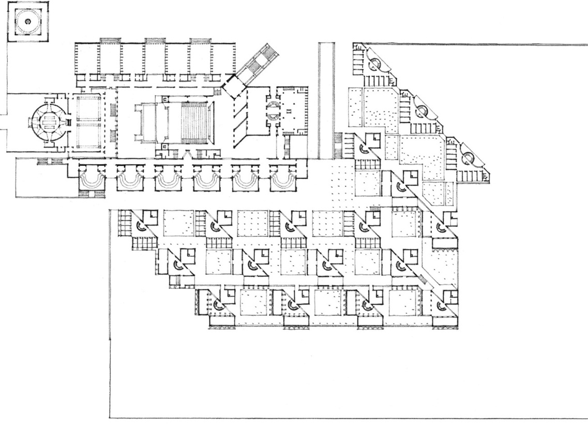

**Indian Institute of Management**, Ahmedabad, India, 1965, Louis Kahn